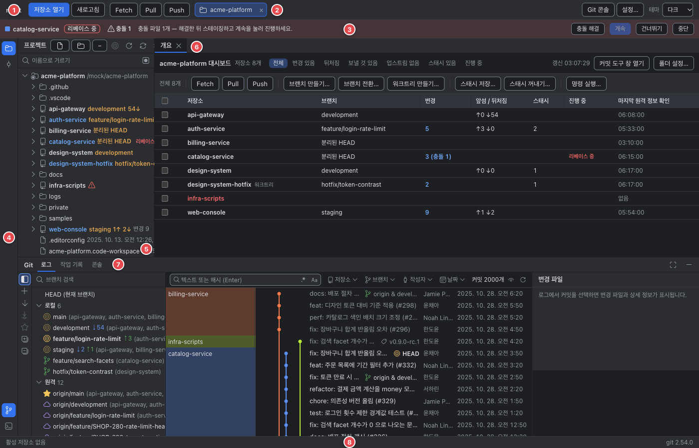

# mGit

IntelliJ IDEA 와 비슷한 화면으로, 여러 Git 저장소가 든 폴더를 한 번에 다루는 macOS 용 Git GUI 입니다.
모든 Git 작업은 Mac 에 설치된 `git` 명령으로 실행합니다.



그림은 합성 데이터로 띄운 화면입니다. 저장소·사람 이름과 경로는 예시입니다.

## 할 수 있는 일

- 여러 저장소를 한 화면에서: 저장소가 모인 폴더의 개요·파일 트리·통합 로그에서 브랜치와 변경 상태, 앞선/뒤처진 커밋 수를 확인합니다. 저장소가 추가되거나 삭제되면 구분 색상을 다시 배정합니다.
- 일괄 Git 작업: 선택한 저장소에 Fetch·Pull·Push, 브랜치 생성·전환, 병합·리베이스, 워크트리 생성을 한 번에 실행합니다. 병합·리베이스는 저장소별 현재 브랜치와 실행 가능 여부를 확인한 뒤 선택해 실행합니다.
- 선택한 변경 커밋: 여러 저장소의 변경 파일을 한 트리에서 스테이징하고 같은 메시지로 커밋합니다. 개별 저장소에서는 변경 구간이나 줄 단위로 스테이징할 수 있습니다.
- 기록 찾기: 메시지·해시·작성자·날짜·브랜치·경로로 커밋을 검색하고, 파일 이력과 줄별 수정 이력을 확인합니다.
- 비교와 편집: 브랜치·커밋·현재 로컬 내용을 비교하고, 파일을 편집하거나 내장 포맷터로 정리합니다.
- 충돌 해결: 3방향 충돌 편집기, 병합 미리보기, 리베이스 예측, 격리 병합, 대화형 리베이스를 제공합니다.
- 워크트리·서브모듈·모듈 관리와 GitHub 풀 리퀘스트·GitLab 병합 요청 조회·생성을 지원합니다.
- 태그 관리: 태그를 만들고 원격별로 푸시·가져오기·삭제를 실행합니다. 원격과 비교한 상태를 확인하고 여러 태그를 한 번에 처리합니다.
- 되돌리기: 실행 취소·다시 실행, 이력 변경 전 자동 백업, 삭제한 변경의 백업, reflog를 제공합니다.
- 한국어·영어 화면: 처음에는 영어로 표시하며, 설정(`⌘,`)에서 한국어 또는 시스템 언어 따르기를 선택합니다. 저장한 언어 선택은 유지합니다. 사용법 문서는 한국어로 제공합니다.

## 어디서부터 읽을까

| 하려는 일                   | 읽을 곳                                                                                                             |
| --------------------------- | ------------------------------------------------------------------------------------------------------------------- |
| 받은 앱을 설치해서 쓰려면   | [사용법](docs/사용법.md)의 "처음 10분" → [1. 설치와 첫 실행](docs/사용법/1-설치와-첫-실행.md)                       |
| 앱이 경고와 함께 안 열리면  | [패키징 5절 "다른 Mac 에서 열기"](docs/패키징.md#5-다른-mac-에서-열기)                                              |
| 소스에서 직접 빌드해 보려면 | 아래 세 줄로 시작하고, 자세한 것은 [빌드·테스트](docs/빌드-테스트.md)                                               |
| `.app`·`.dmg` 를 만들려면   | [패키징](docs/패키징.md)                                                                                            |
| 막혔을 때                   | [사용법 10. 문제 해결](docs/사용법/10-문제-해결.md), [7. 알아 두면 좋은 동작](docs/사용법/7-알아-두면-좋은-동작.md) |

```bash
pnpm install   # 의존성 설치
pnpm dev       # 워크트리별 데이터·포트로 개발 앱을 띄웁니다
pnpm dev:web   # 웹 개발 실행
pnpm dev:test  # 실행별로 격리된 네이티브 목 앱을 띄웁니다
pnpm build     # .app·.dmg 만들기 → target/release/bundle/
```

버전을 고정한 Apple Silicon용 로컬 릴리스는 별도 명령을 사용합니다. 최초에 `pnpm signing:setup`으로 `mGit` 자체 서명 키와 복구용 백업을 준비하고, 공개 인증서 정보와 버전 변경을 검토해 commit합니다.

```bash
pnpm release 0.1.1   # 버전 준비·자동 버전 커밋·태그·검사·패키징을 순서대로 실행
```

버전 준비는 `pnpm release:prepare <버전>`, 키 백업·복원은 `pnpm signing:export` / `pnpm signing:import --bundle <백업 경로>`입니다. 개인키 백업과 암호는 Git에서 제외되는 `signing/`에 보관합니다. 자세한 순서와 실패 조건은 [패키징 가이드](docs/패키징.md)를 봅니다. 이 흐름은 GitHub push·게시·자동 업데이트를 수행하지 않으며, 자체 서명은 Apple 공증과 별개입니다.


## 요구 사항

- macOS 15 이상. Apple Silicon Mac 에서 `pnpm build` 로 만든 앱은 Apple Silicon 전용이고, Intel Mac 에서도 돌게 하려면 universal 로 만듭니다([패키징 3절](docs/패키징.md#3-apple-siliconintel-둘-다-도는-앱-universal)).
- git 2.45 이상. 앱에 들어 있지 않습니다. Finder 로 켠 앱은 보통 Mac 기본 git(`/usr/bin/git`, Xcode Command Line Tools)을 쓰므로 `/usr/bin/git --version` 으로 확인합니다([사용법 1.1](docs/사용법/1-설치와-첫-실행.md#11-요구-사항)).
- 직접 빌드할 때: Xcode Command Line Tools, Rust(stable), Node.js 24, pnpm 11.20.0 — [빌드·테스트 1절](docs/빌드-테스트.md#1-준비물).
- Windows 판은 아직 만들지 않았고 확인하지 않았습니다([패키징 9절](docs/패키징.md#9-windows)).

## 문서

| 문서                               | 내용                                                                                      |
| ---------------------------------- | ----------------------------------------------------------------------------------------- |
| [사용법](docs/사용법.md)           | 앱의 모든 기능을 10장으로: 설치, 열기, 화면, 일상 작업, 가끔 하는 작업, 되돌리기, 설정 등 |
| [빌드·테스트](docs/빌드-테스트.md) | 소스에서 빌드·실행·검사하는 법, 목 모드, 저장소 구조                                      |
| [패키징](docs/패키징.md)           | `.app`·`.dmg` 만들기, 설치, 다른 Mac 에서 열기, 버전 올리기, 릴리스                       |

문서는 브랜치 `feat/intellij-workspace` 를 기준으로 썼습니다. 화면과 글자는 앱 코드와 합성 데이터로 띄운 화면에서 확인했고, 실제 저장소에서의 동작 일부는 아직 실제 Mac 에서 확인하기 전입니다. 각 문서 머리에 기준 커밋이 있습니다.

## 설계·개발 기록

아래는 개발하며 남긴 내부 기록입니다. 앱을 쓰는 데는 필요 없습니다.

- [기능 명세](claudedocs/mgit-기능-명세.md) — 기능 목록과 결정 사항
- [UI 가독성 가이드](agent-docs/UI-가독성-가이드.md) — 화면 작업 전 참고할 제목·그룹·컨트롤 기준, 토큰 사용법과 검증 체크리스트
- [IntelliJ식 화면 개편 결과](agent-docs/intellij-화면-개편-구현-결과.md) — 지금 화면 배치로 바꾼 작업의 결과와 실기기 확인 목록
- [다국어 지원 결과](agent-docs/다국어-지원-구현-결과.md) — 한국어·영어 화면 작업의 결과와 실기기 확인 목록
- `claudedocs/` 의 단계별 결과(`phase*-결과.md`)와 Git GUI 조사

## 라이선스

MIT — [LICENSE](LICENSE). 함께 쓰는 서드파티 구성 요소의 고지는 [THIRD-PARTY-NOTICES.md](THIRD-PARTY-NOTICES.md)에 있습니다.
