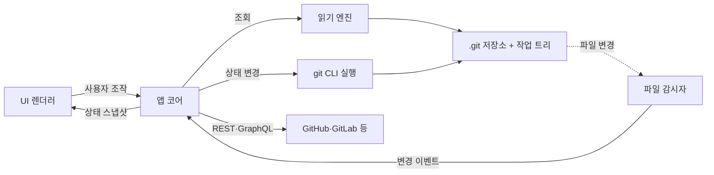
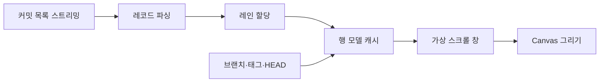
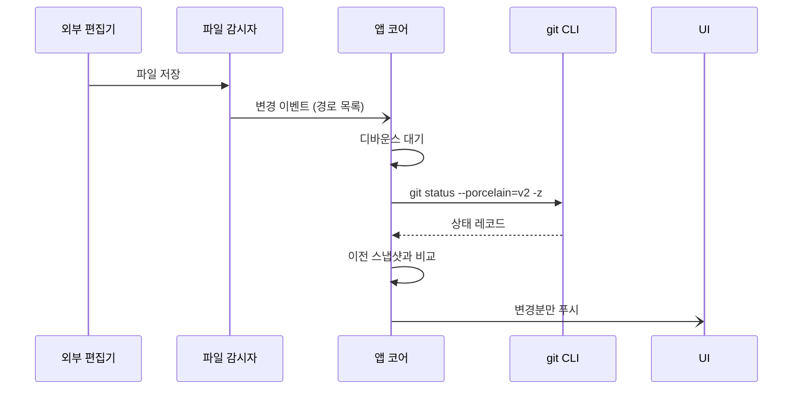

# Git GUI 클라이언트 조사 — GitKraken · GitSquid 중심
크로스 플랫폼 Git GUI 클라이언트 개발에 앞서 기존 제품의 동작 방식과 기능을 조사한 결과.

> ℹ️ 조사일: 2026-10-28 | 주 대상: GitKraken Desktop 12.6.1, GitSquid v2.x | 후속 문서: [mgit-기능-명세.md](mgit-기능-명세.md)

## 1. 핵심 요약

- **Git 엔진은 "git CLI 래핑"으로 수렴했다.** GitKraken은 libgit2(NodeGit)에서 번들 Git 실행 파일로 단계적으로 옮기고 있고(12.3.1에서 번들 Git 2.54.0), GitHub Desktop은 처음부터 번들 Git(dugite)을 쓴다. Sublime Merge는 읽기만 자체 구현하고 쓰기는 실제 git으로 처리한다.
- **UI 셸은 웹 기술 기반이 다수다.** GitKraken·GitHub Desktop은 Electron, GitButler는 Tauri(Rust)를 쓴다.
- **기본 기능은 이미 상향 평준화됐다.** 커밋 그래프, hunk/라인 스테이징, 3-way 병합 편집기, 인터랙티브 리베이스, PR·이슈 연동은 두 제품 모두 갖췄다.
- **2026년 차별화 축은 세 가지다.**
  1. AI 코딩 에이전트 통합: GitKraken 12의 Agent Sessions와 워크트리 연동
  2. 충돌 사전 예측: GitSquid의 Conflict Predictor
  3. 프라이버시와 투명성: GitSquid는 텔레메트리와 계정이 없고 실행한 명령을 로그로 보여 준다

## 2. 조사 대상 개요

| 항목 | GitKraken Desktop | GitSquid |
|---|---|---|
| 개발사 | GitKraken | GT-ITECH (비공개 소스) |
| 플랫폼 | macOS, Windows, Linux (11.8부터 Windows·Linux ARM 지원) | macOS (Apple Silicon·Intel), Windows 10/11, Linux (AppImage) |
| UI 기술 | Electron (12.1.0에서 v41), 내장 터미널 xterm.js v6 | 비공개. 그래프는 Canvas로 렌더링한다고 명시 |
| Git 엔진 | NodeGit(libgit2)에서 번들 Git 실행 파일로 단계적 이전. 시스템 Git 경로 지정 가능 | 비공개. 실행한 모든 Git 명령을 보여 주는 Command Log가 있어 git CLI 호출 방식으로 추정 |
| 과금 | 구독제 (무료 플랜 + 유료 플랜) | 무료 + Pro €49/년 |
| 계정 | 계정 로그인 기반 통합 (12.3.0부터 브라우저 로그인) | 계정 불필요 |
| 네트워크 | 계정·클라우드 기능 사용 | 라이선스 확인과 업데이트 확인만 통신. 텔레메트리 없음 |
| 최신 버전 | 12.6.1 (2026-10-20) | v2.x, 2026년 10월에도 며칠 간격으로 빌드 배포 중 |

### 참고 제품 (아키텍처 비교용)

| 제품 | UI 기술 | Git 엔진 |
|---|---|---|
| GitHub Desktop | Electron + React + TypeScript | dugite: 포터블 Git을 번들하고 CLI로 호출 (`node_modules/dugite/git/bin/git`) |
| Sublime Merge | 자체 C++ UI 프레임워크 | 읽기는 자체 Git 구현, 스테이징·커밋·체크아웃은 실제 git |
| GitButler | Tauri + Svelte + Rust | Rust 백엔드 (git2·gitoxide 사용으로 알려졌으나 각 역할은 1차 출처로 확인하지 못함) |

## 3. 동작 원리

### 3.1 공통 구조

Git GUI는 Git 위에 얹은 얇은 셸이다. 저장소 상태의 원천(source of truth)은 항상 `.git` 디렉터리다. 클라이언트는 이를 읽어 시각화하고, 사용자 조작을 Git 명령으로 번역한다. 터미널이나 IDE가 같은 저장소를 동시에 바꿀 수 있으므로 외부 변경을 감시하는 장치가 반드시 필요하다.



### 3.2 Git 엔진 구현 방식

| 방식 | 사례 | 장점 | 단점 |
|---|---|---|---|
| A. git CLI 래핑 | GitHub Desktop, GitKraken(신규 경로), Sublime Merge(쓰기) | hooks, LFS, credential helper, `~/.ssh/config`, `includeIf` 같은 Git 기능·설정과 완전 호환. 터미널과 동작이 같음 | 명령마다 프로세스 생성 비용, 출력 파싱 필요 |
| B. 라이브러리 바인딩 (libgit2) | GitKraken(기존 NodeGit 경로) | 프로세스 없이 객체에 직접 접근, 구조화된 API | Git 본체보다 기능 개발이 크게 느림, LFS 성능·SSH 설정 문제 |
| C. 자체 구현 | Sublime Merge(읽기), gitoxide(Rust) | 읽기 경로를 극한까지 최적화 가능 | 구현·유지 비용이 큼. 쓰기까지 구현하면 호환성 리스크 |

**GitKraken의 전환 과정**

| 시점 | 내용 |
|---|---|
| 9.4 (2023) | fetch·commit부터 Git Executable 사용을 실험 기능으로 도입 |
| 블로그 공지 | 전환 사유: "order of magnitude difference in development between Git and libgit2", libgit2 개발이 클라이언트보다 호스팅 서비스 요구에 집중, LFS 성능, SSH 설정 지원 |
| 11.5.0 | 이 버전의 성능 개선 대부분은 Git Executable을 켰을 때만 적용 |
| 11.6.0 | shallow 저장소 지원 프리뷰 |
| 12.3.1 (2026-07) | 번들 Git을 2.54.0으로 업데이트 |

> 💡 **시사점**: 수년간 libgit2로 운영하던 GitKraken이 CLI로 옮겨 가는 것이 가장 강력한 근거다. **쓰기는 CLI로 하고, 읽기는 CLI 출력 파싱을 기본으로 하되 병목만 고속 경로로 바꾸는** 하이브리드 구조가 현재 업계가 수렴하는 지점이다.

### 3.3 커밋 그래프 렌더링

그래프는 커밋 목록과 부모 관계만 있으면 그릴 수 있다. 비용이 큰 부분은 레인(열) 할당과 대량의 행을 렌더링하는 일이다.



1. **커밋 수집**: 필드는 `0x1f`, 레코드는 NUL로 구분해 받으면 메시지에 특수문자가 있어도 안전하게 파싱할 수 있다.
   ```bash
   git log --all --topo-order -z --format='%H%x1f%P%x1f%an%x1f%ae%x1f%at%x1f%D%x1f%s'
   ```
2. **레인 할당**: 활성 레인 배열에 "다음에 나타날 커밋 해시"를 담아 둔다. 커밋이 나타나면 그 해시를 기다리던 레인을 차지한다. 첫 번째 부모는 같은 레인을 이어받고, 나머지 부모(머지)는 새 레인을 연다. 더 이어지지 않는 레인은 반환한다.
3. **가상 스크롤**: 보이는 행만 그린다. GitSquid는 그래프를 Canvas로 렌더링한다고 밝혔다. DOM 노드 수가 일정하게 유지되는 것이 핵심이다.
4. **대형 저장소 가속**: `git commit-graph write --reachable` 로 만든 commit-graph 파일이 있으면 `git log`의 토폴로지 정렬이 크게 빨라진다.

### 3.4 작업 트리 상태 갱신



- OS별 감시 API: macOS FSEvents, Windows `ReadDirectoryChangesW`, Linux inotify.
- 작업 트리와 함께 `.git/HEAD`, `.git/refs`, `.git/index`도 감시해야 터미널에서 실행한 commit·checkout을 반영할 수 있다.
- 대형 저장소에서는 Git 내장 FSMonitor(`core.fsmonitor=true`, macOS·Windows)와 `core.untrackedCache=true`로 `git status` 비용을 줄인다.

### 3.5 인증

| 대상 | 일반적인 방식 |
|---|---|
| HTTPS | 시스템 credential helper(Git Credential Manager, osxkeychain, libsecret)를 쓰거나, 앱이 `GIT_ASKPASS` 헬퍼로 토큰을 공급 |
| SSH | 시스템 ssh, ssh-agent, `~/.ssh/config` (CLI 방식이면 자동 호환. libgit2 방식은 SSH 설정 호환이 GitKraken 전환 사유 중 하나) |
| 호스팅 API | GitHub·GitLab·Bitbucket OAuth. GitKraken은 12.3.0부터 브라우저 기반 로그인 후 계정에 연동 정보를 동기화 |

### 3.6 안전장치와 투명성

| 기능 | GitKraken | GitSquid |
|---|---|---|
| 실행 취소 | Undo/Redo 버튼 | Reflog 뷰어 + Undo |
| 명령 가시성 | 해당 기능 확인 못함 | Command Log (`Cmd/Ctrl+Shift+L`): 실행한 모든 Git 명령을 비밀 정보는 가린 채 표시 |
| 충돌 예방 | 병합 전 잠재 충돌 감지 | Conflict Predictor: merge·rebase·cherry-pick 전에 충돌 파일을 보여 주고, 별도 scratch 워크트리에서 미리 해결 (현재 체크아웃은 건드리지 않음) |

> ℹ️ **참고**: 작업 트리를 건드리지 않는 충돌 예측은 Git 2.38+의 `git merge-tree --write-tree <branch1> <branch2>`로 구현할 수 있다. 충돌이 있으면 종료 코드 1과 함께 충돌 파일 목록을 반환한다.

## 4. 기능 비교

범례: ● 지원 · ◐ GitSquid Pro 전용 · — 공식 자료에서 확인 못함

| 영역 | 기능 | GitKraken | GitSquid |
|---|---|---|---|
| 저장소 | 멀티 탭 | ● (12.4.1부터 같은 저장소의 워크트리 탭 자동 그룹) | ● (탭 전환 캐시, 무제한 탭은 ◐) |
| 저장소 | 다중 저장소 워크스페이스 | ● Workspaces | — |
| 저장소 | 모노레포 범위 지정 | — | ● npm/pnpm/Yarn, Cargo, Nx, Turbo, Lerna, Go 워크스페이스 자동 감지 |
| 그래프 | 커밋 그래프 | ● | ● Canvas 렌더링, Gravatar |
| 그래프 | 검색·필터 | ● | ● |
| 그래프 | 브랜치 왼쪽 고정 | ● (11.10) | — |
| 그래프 | 워크트리별 WIP 노드 | ● (12.3.0) | — |
| 그래프 | 저장소 통계 | — | ● |
| 커밋 | 파일·hunk·라인 스테이징 | ● | ● (드래그앤드롭 포함) |
| 커밋 | GPG 서명 | ● | ◐ |
| 커밋 | 커밋 전 비밀 정보 스캔 | — | ● AWS·GitHub·OpenAI 키, JWT, 개인 키 차단 |
| 커밋 | Git hooks 편집기 | — | ● |
| Diff | unified·split 보기 | ● | ● (blame 보기 포함) |
| Diff | 파일 히스토리·blame | ● | ● |
| Diff | 파일 타임라인 재생 | — | ● |
| Diff | 연속 커밋 결합 diff | ● (12.6.0) | — |
| 병합 | 3-way 병합 편집기 | ● | ● Base/Ours/Theirs 블록 단위 해결 |
| 병합 | 인터랙티브 리베이스 | ● | ◐ |
| 병합 | 충돌 사전 예측 | ● | ● |
| 병합 | AI 충돌 해결 | ● (11.2 프리뷰) | — |
| 이력 | 스태시 | ● | — |
| 이력 | Undo·Reflog | ● | ● |
| 고급 | 워크트리 | ● | ◐ |
| 고급 | Git LFS | ● | ◐ |
| 고급 | 서브모듈 | ● | ● |
| 고급 | Git Flow | ● | ◐ |
| 고급 | Sparse checkout | ● (11.10) | — |
| 고급 | 브랜치에 계획 문서 첨부 | — | ● Branch Intent (git notes로 마크다운 저장) |
| 연동 | GitHub·GitLab·Bitbucket | ● | ● (무료는 1개 제공자) |
| 연동 | PR·이슈 관리 | ● Launchpad (PR 리뷰는 12.3.0부터 gitkraken.dev로 이관) | ● |
| 연동 | Stacked PR | ● (12.6.0, GitHub.com) | — |
| 연동 | 클라우드 패치 공유 | ● Cloud Patches | — |
| AI | 커밋 메시지 생성 | ● | ● |
| AI | 커밋·코드 설명 | ● | ● (10개 언어) |
| AI | 브랜치 코드 리뷰 | ● (gitkraken.dev) | ● 원클릭 수정 포함 |
| AI | 커밋 재구성 | ● Commit Composer (프리뷰) | — |
| AI | 자체 API 키 사용 | ● OpenAI·Anthropic·Google | ● Claude Code·Anthropic·OpenAI·Gemini CLI·사용자 지정 |
| AI | 코딩 에이전트 세션 관리 | ● Claude Code, Codex, Copilot CLI, Cursor CLI, OpenCode | — |
| UI | 통합 터미널 | ● 멀티 탭 (12.6.0) | ● |
| UI | 커스텀 테마 | ● | ◐ (기본 6종 무료) |
| UI | 프로필 | ● | ◐ |
| UI | 다국어 | — | ● 10개 언어 |
| UI | Git 명령 로그 | — | ● |

## 5. 2025–2026 동향

| 동향 | 근거 | 의미 |
|---|---|---|
| 코딩 에이전트 관제판화 | GitKraken 12.0 Agent Sessions View, 워크트리별 setup 명령, 에이전트 권한 요청 승인, 12.6.1 워크트리 하나에 여러 에이전트 | Git GUI가 병렬 AI 작업을 워크트리 단위로 관리하는 도구로 확장 중 |
| AI 보조 일반화 | 두 제품 모두 커밋 메시지·설명·리뷰 제공, 자체 API 키(BYOK) 지원 | AI는 차별화 요소가 아니라 기본 기능이 되어 감. 구현할 때는 옵트인과 BYOK가 표준 |
| 충돌 예방 | GitSquid Conflict Predictor, GitKraken 잠재 충돌 감지 | 사후 해결에서 사전 예측으로 이동 |
| 프라이버시·가격 | GitSquid: 텔레메트리 없음, 계정 불필요, "경쟁 제품의 절반 가격" | 구독제와 계정 강제에 대한 반발 수요가 존재 |
| 대형·모노레포 | GitKraken sparse checkout·shallow, GitSquid 모노레포 범위 지정 | 대형 저장소 성능과 범위 지정이 실사용 요구 |
| Stacked PR | GitKraken 12.6.0 | 작은 PR을 연쇄로 올리는 흐름 지원 |

## 6. 우리 제품에 대한 시사점

> ℹ️ **참고**: 이 절은 시장 관점에서 작성했다. 이후 mGit은 수익 모델과 등급이 없는 개인용 도구로 확정됐으므로(2026-10-28), 차별화와 배포 서명 항목은 참고용이다. 현재 기준은 [mgit-기능-명세.md](mgit-기능-명세.md)를 따른다.

**기본으로 갖춰야 할 것 (없으면 비교 대상에도 오르지 못함)**
- 빠른 커밋 그래프, hunk·라인 스테이징, 3-way 충돌 편집기, 인터랙티브 리베이스, 스태시, Undo
- GitHub·GitLab 연동, 3개 OS 동일 동작

**차별화 후보**
- **투명성**: 실행한 모든 git 명령을 보여 주고 복사할 수 있게 해 "GUI를 쓰면서 CLI를 배우는" 경험 제공
- **안전성**: 파괴적 작업 전에 자동 백업 ref를 만들고, Undo 범위를 discard까지 넓힘
- **성능**: 대형 저장소 기준 성능 목표를 공개하고 측정
- **로컬 우선**: 계정 불필요, 텔레메트리 옵트인, 오프라인 완전 동작
- **한국어 사용자 품질**: macOS 한글 파일명 NFD 정규화(`core.precomposeunicode`) 문제를 처리하고, 한국어 UI를 기본 제공

**반면교사**
- GitSquid는 macOS 빌드를 공증(notarization)하지 않아 Gatekeeper가 "손상된 앱" 경고를 띄운다. 사용자가 터미널에서 quarantine 속성을 지워야 한다. **코드 서명과 공증은 첫 배포부터 필수**다.
- GitKraken은 libgit2에서 CLI로 옮기는 데 수년이 걸렸다. **처음부터 CLI 기반으로 설계**한다.

## 출처

- [GitSquid 공식 사이트](https://gitsquid.dev/)
- [GitSquid FAQ](https://gitsquid.dev/faq)
- [GitKraken Desktop 릴리스 노트 (12.x)](https://help.gitkraken.com/release-notes/current/)
- [GitKraken Experimental Features (Git Executable)](https://help.gitkraken.com/gitkraken-client/experimental-features/)
- [GitKraken 블로그: Migrating from libgit2 to Git Executable](https://gitkraken.com/blog/gitkraken-client-migrating-from-libgit2-to-git-executable)
- [GitKraken 블로그: NodeGit과 libgit2](https://gitkraken.com/blog/nodegit-libgit2)
- [GitKraken 11.x 릴리스 이력 (ComponentSource)](https://www.componentsource.com/product/gitkraken/releases)
- [Sublime Merge FAQ](https://www.sublimemerge.com/docs/faq)
- [窓の杜: Sublime Merge 소개 (읽기 전용 자체 구현)](https://forest.watch.impress.co.jp/docs/news/1144/128/amp.index.html)
- [dugite (GitHub Desktop의 Git 래퍼)](https://github.com/desktop/dugite)
- [GitButler 저장소](https://github.com/gitbutlerapp/gitbutler)
