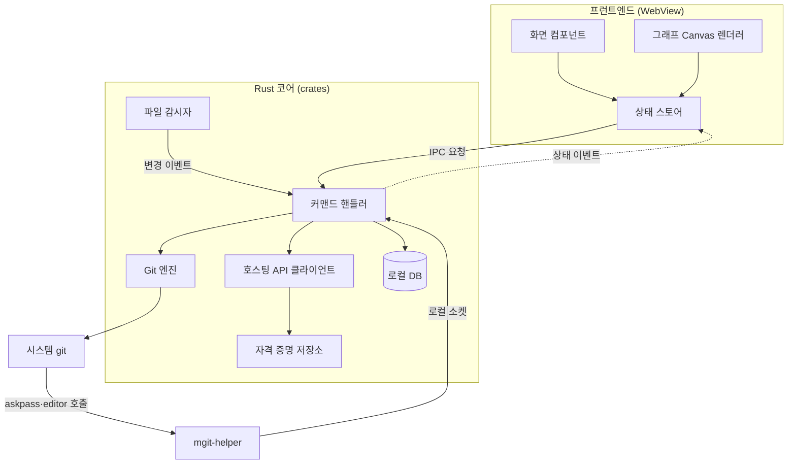
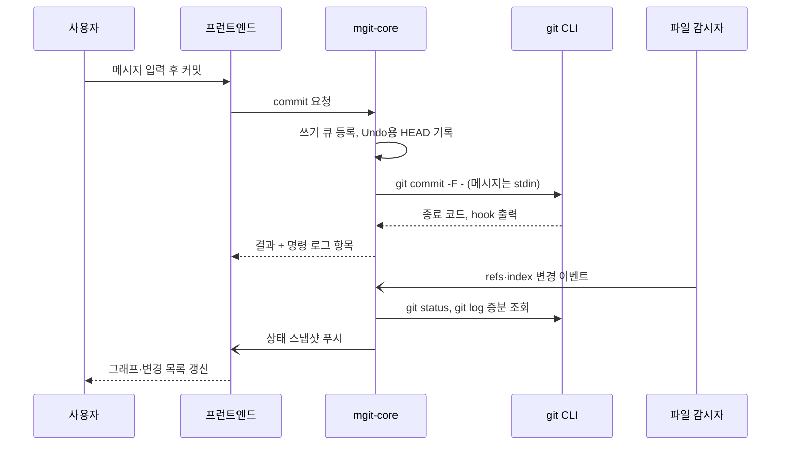
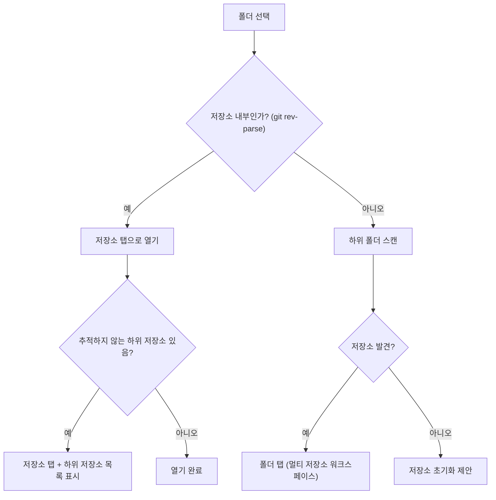
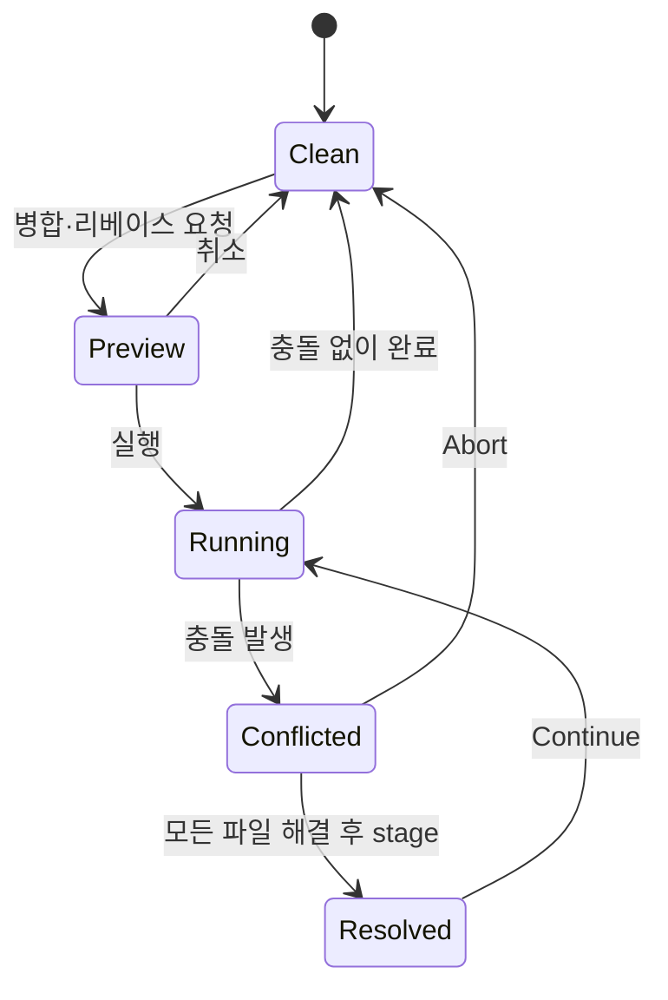
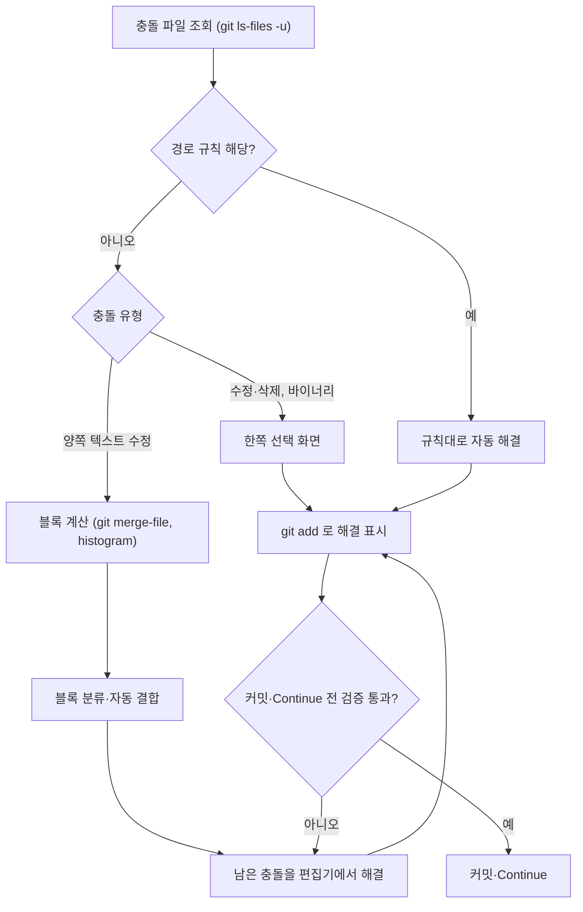

# mGit 기능 명세서
macOS·Windows에서 동작하는 개인용 Git GUI 클라이언트 mGit의 기능 요구사항과 아키텍처 초안.

> ℹ️ 대상 독자: 개발자 본인 | 최종 수정: 2026-11-20 (다국어 반영, UX-06·11절) | 근거 조사: [git-gui-클라이언트-조사.md](git-gui-클라이언트-조사.md)

## 1. 제품 개요

### 1.1 목표

- macOS·Windows에서 같은 기능과 같은 경험 제공
- 커밋 10만 개 이상인 저장소에서도 빠른 그래프
- **Git CLI와 동일한 결과**: GUI로 하던 작업을 터미널에서 그대로 이어 갈 수 있어야 함
- 실수를 쉽게 복구할 수 있는 안전한 UX (Undo, 자동 백업, 명령 로그)
- **개인용 도구**: 계정·라이선스·요금제 등급·텔레메트리 없이 모든 기능을 제공

### 1.2 비목표

- 수익화, 요금제·등급 구분(Free·Standard·Pro 등), 라이선스 관리
- 다른 사용자 대상 배포·지원 (배포 서명, 스토어 등록, 자동 업데이트 서버)
- 클라우드 서비스 운영 (패치 공유, 팀 대시보드 등)
- Git 외 VCS (SVN, Mercurial)
- 코드 편집기 기능 (외부 에디터 연동으로 대체)

### 1.3 사용자와 사용 환경

| 항목 | 내용 |
|---|---|
| 사용자 | 개발자 본인 1명 |
| 사용 방식 | CLI·IDE와 함께 사용, 같은 저장소를 여러 워크트리로 동시에 작업 |
| 저장소 구조 | 부모 폴더 아래 독립 저장소 여러 개, 서브모듈을 쓰는 저장소, Gradle·Maven 멀티 모듈 저장소 |
| 호스팅 | GitHub, GitLab |

### 1.4 지원 플랫폼

| OS | 최소 버전 | 아키텍처 | 빌드 산출물 |
|---|---|---|---|
| macOS | 15 이상 | arm64, x64 (universal) | `.app` / `.dmg` |
| Windows | 10 (1809 이상), 11 | x64, arm64 | `.exe` 설치 파일 |
| Linux | 지원 보류 (D10) | - | - |

직접 빌드하거나 GitHub Actions로 macOS·Windows 산출물을 만든다. 배포 서명은 하지 않는다(4.3 참고).

- Linux는 GUI를 거의 쓰지 않아 지원을 미룬다. 코어 crate는 OS에 의존하지 않게 유지해 나중에 추가할 수 있게 한다. 추가할 때는 Linux WebView(WebKitGTK) 검증을 다시 한다(2.1 전환 조건).

## 2. 아키텍처

### 2.1 기술 스택

**확정: Tauri 2 + Rust 코어 + React(TypeScript) 프런트엔드** (D1·D2)

| 항목 | Tauri 2 (채택) | Electron 45 (대안) |
|---|---|---|
| 렌더링 엔진 | macOS WKWebView(Safari 18 이상 엔진), Windows WebView2(Chromium) | Chromium 고정 |
| 코어 언어 | Rust. git 프로세스 관리·파서·레인 계산을 한 언어로 만들고 테스트한다 | TypeScript. 병목 모듈만 napi-rs로 Rust 작성 |
| 설치 크기·메모리 | 작음 (OS WebView 사용) | 큼 (Chromium 번들) |
| E2E 테스트 | WebdriverIO (`@wdio/tauri-service`) | Playwright |
| 참고 제품 | GitButler | GitKraken, GitHub Desktop |

- **선택 근거**
  - Linux를 지원하지 않으므로(D10) Tauri의 가장 큰 리스크였던 Linux WebKitGTK의 렌더링 문제가 범위 밖이다. 남은 두 엔진은 모두 최신이다.
  - Rust는 AI 보조 개발로 부담이 없다. 코어를 Rust 하나로 만들면 git 실행·파싱·레이아웃을 UI 없이 테스트할 수 있다.
  - 그래프 데이터는 코어가 갖고 화면에 보이는 범위만 프런트로 보낸다(2.3). 그래서 WebView 부담이 커밋 수와 관계없이 일정하다.
- **전환 조건**
  - Phase 0에서 WKWebView나 WebView2의 한글 입력·편집기 품질이 기준(5절 PoC)에 못 미치면 Electron 45 + napi-rs로 전환한다.
  - 전환 비용을 작게 유지하기 위해 코어 crate는 tauri 타입에 의존하지 않는다(2.5 의존 방향).
  - Linux를 지원하게 되면 WebKitGTK PoC를 먼저 한다. 실패하면 Tauri 3의 CEF 런타임(2026-10 기준 알파)이나 Electron을 검토한다.

**구성 요소와 버전**

버전은 2026-10-28에 crates.io·npm에서 조회한 값이다. 착수할 때 최신으로 갱신한다.

| 영역 | 선택 | 버전 | 비고 |
|---|---|---|---|
| 셸 | tauri | 2.12.5 | 플러그인: dialog, opener, single-instance, window-state |
| 코어 언어 | Rust (edition 2024) | 1.97 | tauri 2.12의 MSRV는 1.90 |
| 비동기·프로세스 | tokio, process-wrap | 1.54.1 / 10.0.1 | 프로세스 그룹(Unix)·Job Object(Windows)로 취소 |
| 헬퍼 통신 | interprocess | 2.4.7 | `mgit-helper` 와 로컬 소켓·명명 파이프 통신 |
| 파일 감시 | notify | 8.2.1 | 3.2 MR 구현 참고 |
| diff 계산 | imara-diff, similar | 0.2.0 / 3.2.1 | imara-diff는 histogram 지원(git 블록 경계와 일치), similar는 단어·토큰 단위 |
| 로컬 저장 | rusqlite (SQLite, WAL) | 0.41.0 | 저장소·폴더 목록, 명령 로그, 백업 색인, 해결 규칙, 커밋 초안 |
| 설정 파일 | JSON (serde_json) | 1.0.154 | 직접 편집 가능. 임시 파일에 쓴 뒤 rename |
| 키체인 | keyring | 4.2.0 | AU-03 |
| 로그 | tracing, tracing-appender | 0.1.44 / 0.2.5 | 4.5 진단 |
| 타입 공유 | tauri-specta (버전 고정) | 2.0.0-rc.26 | Rust 타입에서 TS 바인딩 생성. `specta =2.0.0-rc.26`·`specta-typescript =0.0.13` 과 함께 `=` 로 고정한다(최신끼리 섞으면 해석 실패). i64·u64 는 내보내기가 금지라 DTO 필드에 `#[specta(type = Number)]` 를 붙이거나 u32 로 바꾼다. rc가 문제면 ts-rs 12.0.1 |
| 프런트 | React, Vite | 19.3.1 / 8.3.5 | |
| 언어·린트 | TypeScript, Biome | 7.0.2 / 2.6.3 | typescript-eslint 8.72는 TS 6.1 미만만 지원하므로 Biome 사용. Biome의 React 규칙이 부족하면 TS 6.0 + typescript-eslint |
| 상태 | Zustand | 5.0.16 | 저장소 탭마다 store 슬라이스 |
| 목록 가상화 | @tanstack/react-virtual | 3.14.23 | 변경 목록, 브랜치 트리, 그래프 텍스트 열 |
| 그래프 렌더링 | Canvas 2D + DOM 텍스트 | - | WebGL은 쓰지 않는다 (3.3 구현 참고) |
| 편집기 | CodeMirror 6 (`@codemirror/view`, `@codemirror/merge`) | 6.43.15 / 6.12.3 | 3-way는 기본 제공되지 않아 EditorView 4개로 직접 조립한다(3.9). Monaco도 3-way 공개 API가 없다 |
| UI 부품 | react-resizable-panels, cmdk, Radix context menu | 4.15.0 / 1.1.1 / 2.4.1 | 패널 분할, 커맨드 팔레트, 우클릭 메뉴 |
| 터미널 (P1) | @xterm/xterm, portable-pty | 6.0.0 / 0.9.0 | portable-pty는 2025-02 이후 릴리스가 없어 유지 상태 확인 필요 |
| 구문 분석 (P1) | tree-sitter | 0.27.1 | CF-25 |
| 호스팅 (P1) | reqwest, octocrab | 0.13.5 / 0.54.6 | 3.13 |
| 테스트 | insta, proptest, Vitest, WebdriverIO | 1.49.0 / 1.12.0 / 5.0.5 / `@wdio/tauri-service` 1.5.1 | 2.5 테스트 전략 |
| 빌드 | cargo workspace, pnpm, tauri-action | - | 2.5 CI |

- git 읽기 라이브러리 `git2`(libgit2)는 쓰지 않는다. C 라이브러리를 타깃별로 빌드해야 하는데, 쓰기는 어차피 CLI라 얻는 것이 적다.
- `gix`(gitoxide)는 보류한다. 전체 로드는 CLI보다 약 1.5배 빨랐지만 첫 화면은 CLI 스트리밍으로 충분했다. `--topo-order`·mailmap·부분 클론 동작을 git과 맞추는 비용이 더 크다. 측정으로 병목이 드러난 곳에만 검토한다.

### 2.2 구성도



| 컴포넌트 | 책임 |
|---|---|
| 커맨드 핸들러 | IPC 요청 라우팅, 쓰기 큐, 진행률·취소 관리. Tauri 커맨드·채널은 얇은 어댑터로만 둔다 |
| Git 엔진 | git 프로세스 실행·출력 파싱, 그래프 레인 계산, 상태 스냅샷 비교 |
| 파일 감시자 | 작업 트리와 `.git` 의 HEAD·refs·index 감시, 디바운스 (멀티 저장소 규칙은 3.2, 워크트리 규칙은 3.7) |
| 호스팅 API 클라이언트 | GitHub·GitLab REST·GraphQL 호출, 응답 캐시, rate limit 처리 |
| 자격 증명 저장소 | OS 키체인 연동 (macOS Keychain, Windows Credential Manager) |
| 로컬 DB | SQLite. 저장소·폴더 목록, 폴더별 설정, 명령 로그, discard 백업 색인, 경로별 해결 규칙, 커밋 초안 |
| mgit-helper | **본체 실행 파일의 askpass 모드** (Phase 1 구현, 7절). git·ssh 가 `GIT_ASKPASS`·`SSH_ASKPASS` 로 본체를 다시 띄우면 Tauri 를 초기화하지 않고 세션 토큰으로 로컬 소켓에 연결해 앱 대화상자의 답을 stdout 에 쓴다. 별도 바이너리(sidecar)가 아니라 빌드·배포가 단순하다. `GIT_EDITOR`·`GIT_SEQUENCE_EDITOR` 는 MRG-07(P1) 전까지 `true` |

### 2.3 Git 엔진 설계 원칙

| 원칙 | 내용 |
|---|---|
| 쓰기는 git CLI | commit, merge, rebase, push 등 모든 상태 변경은 git 실행 파일로 수행한다. hooks·LFS·서명·credential helper가 자동으로 호환된다 |
| 읽기는 CLI 파싱 우선 | 출력을 `-z`(NUL 구분)로 받아 파싱한다. 용도별 명령은 아래 표. 측정으로 드러난 병목만 gix 같은 고속 경로로 바꾼다 |
| `.git` 직접 쓰기 금지 | 앱 전용 ref(`refs/mgit/*`)도 `git update-ref` 로만 만든다. 읽기도 ref 파일을 직접 열지 않고 `git for-each-ref` 를 쓴다(reftable 백엔드 호환) |
| 시스템 git 사용 | git을 번들하지 않는다. 시작할 때 `git --version` 을 확인해 최소 버전 미만이면 업그레이드를 안내한다. 설정에서 경로를 직접 지정할 수 있다. 찾은 실제 경로는 캐시한다(macOS `/usr/bin/git` 은 xcrun을 거쳐 실행 비용이 약 2배) |
| 최소 Git 버전 | 2.45 이상. 충돌 기능(3.9)에 쓰는 `merge-tree --stdin`·`--merge-base`, `merge-file --object-id`·`--diff-algorithm`, rebase·cherry-pick 중 `log --merge` 가 2.39~2.45에 추가됐다. 버전별 대체 경로는 만들지 않는다 |
| commit-graph 전제 | 그래프 성능 목표는 commit-graph 파일이 있다는 전제로 잡는다. 저장소를 열 때 `objects/info/commit-graph` 나 `commit-graphs/` 가 없고 커밋이 많으면 생성을 제안한다(AD-03) |
| 동시성 | 쓰기 명령은 `git rev-parse --git-common-dir` 단위 직렬 큐로 실행한다. 워크트리들이 refs를 공유하므로 워크트리 경로 단위로는 부족하다. 읽기는 전역 세마포어로 동시 실행 수를 제한한다(기본 8). `index.lock` 이 있으면 짧게 재시도한 뒤 안내한다 |
| 환경 변수 | 아래 실행 환경 표 |
| 출력 고정 | 사용자 git 설정이 출력을 바꾸지 않게 `--no-color`, `--no-ext-diff`, `--no-show-signature` 를 붙이고 작성자는 mailmap이 반영된 `%aN`·`%aE` 로 받는다. 파싱용 읽기 명령에만 `LC_ALL=C` 를 붙인다 |
| 명령 주입 방지 | 셸을 거치지 않고 인자 배열로 실행한다. 사용자 입력(브랜치명 등) 앞에는 `--end-of-options` 또는 `--` 를 둔다 |
| 입출력 | stdout과 stderr를 별도 태스크로 동시에 읽어 파이프 교착을 막는다. stdin은 커밋 메시지(`-F -`)에만 쓰고 나머지는 닫아서 입력 대기를 막는다. Windows는 `CREATE_NO_WINDOW` 로 콘솔 창을 숨긴다 |
| 장시간 명령·취소 | clone·fetch·push는 `--progress` 의 stderr를 `\r`·`\n` 기준으로 나눠 진행률을 표시한다. 취소는 Unix에서 프로세스 그룹에 SIGTERM을 보내고 2~3초 뒤 SIGKILL, Windows는 Job Object로 종료한다. 바로 강제 종료하면 `index.lock` 이 남을 수 있어, 취소 후 잠금 파일을 검사한다 |
| macOS PATH | Finder·Dock에서 실행한 앱은 launchd의 PATH만 받아 Homebrew의 gpg·git-lfs·node(hook)를 찾지 못한다. 시작할 때 `$SHELL -ilc 'env -0'` 을 시간 제한을 두고 한 번 실행해 PATH를 얻는다 |
| 그래프 데이터 전달 | 전체 그래프를 한 번에 보내지 않는다. 코어가 레이아웃을 갖고 프런트는 보이는 범위만 요청한다(`graph_window(session, start, count)`). 큰 데이터는 JSON 대신 바이너리(`tauri::ipc::Response`)로 바꿀 수 있게 한다 |

**실행 환경 변수**

| 변수 | 값 | 적용 대상 | 이유 |
|---|---|---|---|
| `git rev-parse --local-env-vars` 결과(`GIT_DIR`, `GIT_WORK_TREE`, `GIT_INDEX_FILE` 등) | 제거 | 모든 명령 | hook이나 터미널에서 앱을 띄우면 상속돼 엉뚱한 저장소를 건드린다 |
| `GIT_TERMINAL_PROMPT` | `0` | 모든 명령 | 터미널 입력 대기 방지 |
| `GIT_ASKPASS`, `SSH_ASKPASS` | 본체 실행 파일 경로 (askpass 모드) | 네트워크 명령 | 자격 증명 입력을 앱 대화상자로 받는다. `SSH_ASKPASS_REQUIRE=force` 함께 설정 (Windows 내장 OpenSSH 지원은 확인 필요) |
| `GIT_EDITOR`, `GIT_SEQUENCE_EDITOR` | `true` (Phase 1). MRG-07 구현 시 헬퍼 모드로 교체 | 쓰기 명령 | 편집기가 뜨지 않게 한다. `merge --continue`·`rebase --continue` 에 필수 |
| `GIT_PAGER` | `cat` | 모든 명령 | 페이저 실행 방지 |
| `GIT_OPTIONAL_LOCKS` | `0` | 자동 갱신용 읽기 | 백그라운드 `status` 가 `index.lock` 을 잡아 사용자의 터미널 작업과 충돌하는 것을 막는다. 대신 index의 stat 정보가 갱신되지 않으므로 사용자가 직접 새로고침할 때는 붙이지 않는다 |
| `GIT_NO_LAZY_FETCH` | `1` | 백그라운드 읽기 | 부분 클론에서 그래프·상태·충돌 레이더(CF-02)가 원격에서 객체를 하나씩 받아 오는 것을 막는다 |
| `LC_ALL` | `C` | 파싱용 읽기 | 메시지 번역 방지. commit·merge·rebase·push처럼 hook을 실행하는 명령에는 붙이지 않는다(hook의 한글 출력이 깨질 수 있다) |

**읽기 명령**

| 용도 | 명령 |
|---|---|
| 커밋 그래프 | `git log --all --topo-order --no-show-signature --no-color --encoding=UTF-8 -z --format=%H%x00%P%x00%aN%x00%aE%x00%at%x00%ct%x00%s` 를 스트리밍 |
| 모듈 범위 그래프 (MOD-03) | 위 명령에 `--parents -- <경로>` 추가 |
| ref 라벨 | `git for-each-ref --format=...` (필드 구분에 `%00`) |
| 작업 트리 상태 | `git status --porcelain=v2 -z --branch`. fsmonitor·untracked cache·sparse index 처리를 git에 맡긴다 |
| diff 본문 | `git diff --no-color --no-ext-diff [--cached] -- <path>` 의 패치를 파싱한다. 부분 스테이징(CHG-03)이 git의 hunk를 그대로 쓰기 위해서다 |
| 파일 내용 | 저장소마다 상주하는 `git cat-file --batch-command`. 파일마다 프로세스를 띄우는 비용(3~6ms)을 피한다 |
| 충돌·워크트리 | `git ls-files -u -z`, `git merge-file`(3.9), `git worktree list --porcelain -z` |

**사전 측정 (2026-10-28, macOS Apple Silicon, git 2.54)**

| 항목 | 결과 |
|---|---|
| 그래프 첫 출력 (rust-lang/rust, 커밋 34.5만 개) | commit-graph 없음 1,549ms, 있음 23ms |
| 첫 2,000행 (git/git 8.6만 개 / rust 34.5만 개, commit-graph 있음) | 33ms / 38ms |
| 레인 배정 (단순 O(n·w) 구현) | git/git 100ms, rust 750ms. 최대 레인 폭 157 / 185 |
| 그래프 전체를 JSON으로 전달 (git/git) | 67MB, V8 파싱 333ms, 힙 688MB. 메모리 목표 초과 |
| 500행 단위 전달 | 129KB, 파싱 0.12ms |
| 멀티 저장소 `status` 50개 | 직렬 0.88~1.11초, 동시 8개 0.24초 |
| `.git` 변경 이벤트 (notify) | commit 1회 35개, 브랜치 생성 5개. 모두 `*.lock` 생성 후 rename, 10ms 안에 도착 |

- `--author-date-order` 는 commit-graph가 있어도 느렸다(git/git 953ms). 그래프 기본 정렬은 `--topo-order` 로 한다.
- Windows 수치는 Phase 0에서 따로 잰다.

### 2.4 커밋 처리 흐름



### 2.5 프로젝트 구조

```
mgit/
├── Cargo.toml · rust-toolchain.toml · pnpm-workspace.yaml
├── crates/
│   ├── mgit-model/      # 도메인 타입(Oid, Commit, StatusEntry), 포트 트레이트(GitRunner 등). 외부 의존성 없음
│   ├── mgit-l10n/       # 화면 문구 언어(한국어·영어): 프로세스 전역 언어, pick·tr!. 의존성 없음 (11절)
│   ├── mgit-graph/      # 레인 배정, 레인 구간 인코딩, 범위 조회 (순수 로직, IO 없음)
│   ├── mgit-git/        # git 실행(process-wrap), 환경 변수 정책, 출력 파서, merge-tree·blame·history 명령
│   ├── mgit-merge/      # 충돌 블록 모델: 마커 파싱·해결·렌더, 블록 분류·자동 결합·유사도 (imara-diff, 순수)
│   ├── mgit-watch/      # notify 파일 감시 + 폴링 폴백, 폴더 루트 감시 (Watcher 포트 구현)
│   ├── mgit-store/      # SQLite 저장소: 최근 목록·탭·설정(JSON)·명령 로그·스태시 출처 (Store 포트 구현)
│   ├── mgit-core/       # 응용 계층: 저장소·폴더 세션, 쓰기 큐, Undo·백업 ref, 충돌 예방·보조, 모듈, LFS (tauri 비의존)
│   ├── mgit-hosting/    # GitHub(REST·GraphQL)·GitLab(REST) 클라이언트, 디바이스 플로우·PAT (reqwest)
│   ├── mgit-syntax/     # tree-sitter 구문 검사 (js·ts·tsx·rust·python·java·go·json·yaml), core feature `syntax-check`
│   ├── mgit-helper/     # askpass 모드 라이브러리 (본체가 환경 변수·--askpass 로 진입)
│   └── mgit-testkit/    # 테스트 전용: 결정적 git 저장소 생성
├── apps/desktop/
│   ├── src-tauri/       # Tauri 커맨드·채널 어댑터, 의존성 조립, PTY(portable-pty), TS 바인딩 생성
│   └── src/             # React 앱 셸 (레이아웃, 패널, 스토어, 동작 레지스트리)
├── packages/
│   ├── ipc/             # 생성된 TS 바인딩, 클라이언트 래퍼, 그래프 범위 캐시, null 클라이언트
│   ├── graph-view/      # Canvas 2D 그래프 렌더러, 가상 스크롤, WIP 행·라벨 DnD·열 설정
│   ├── diff-view/       # unified/split diff 보기, blame 거터, 줄 선택
│   ├── merge-editor/    # CodeMirror 6 기반 3-way 편집기 (블록 위젯·줄 고르기·자동 결합)
│   ├── terminal/        # xterm.js 통합 터미널 뷰
│   └── ui/              # 공용 컴포넌트, 언어별 문구 사전(i18n/ — 한국어·영어)과 진입점 S, 날짜·숫자 포맷, 단축키 표기
├── tests/               # fixture 생성 스크립트, E2E
├── bench/               # 그래프 로딩·레이아웃 벤치
└── .github/workflows/   # ci.yml (테스트), build.yml (산출물)
```

- **의존 방향**: `src-tauri` → `mgit-core` → `mgit-git` → `mgit-model`, `mgit-core` → `mgit-graph`. `mgit-core` 는 `mgit-git` 의 명령 조립·파서만 쓰고 러너 구현체(`TokioGitRunner`)는 `src-tauri` 에서 조립해 `Arc<dyn GitRunner>` 로 주입한다(2026-10-28 구현 기준, `mgit-watch`·`mgit-store` 도 같은 방식). 코어 crate가 tauri 타입을 모르게 해야 Electron 전환(2.1)이나 CLI 재사용이 쉽다.
- `mgit-graph` 와 `mgit-merge` 는 IO가 없는 순수 로직이라 단위 테스트와 속성 기반 테스트로 검증한다.

**테스트 전략**

| 단계 | 대상 | 방법 |
|---|---|---|
| 단위 | 출력 파서, 레인 레이아웃, 충돌 블록 | NUL·한글 NFD 경로가 섞인 원시 출력 fixture와 insta 스냅샷. 레이아웃 불변식은 proptest |
| git 통합 | 실제 git으로 만든 저장소 | `mgit-testkit` 이 결정적 저장소를 만든다(`GIT_AUTHOR_DATE`·`GIT_COMMITTER_DATE` 고정, `GIT_CONFIG_GLOBAL` 을 임시 파일로, `GIT_CONFIG_NOSYSTEM=1`). 충돌 유형별, rebase 진행 중, 워크트리, 서브모듈, 부분 클론, CRLF 시나리오. 결과는 git CLI 출력과 비교한다. git 2.45와 최신 버전에서 실행 |
| 코어 헤드리스 | `mgit-core` API | UI 없이 시나리오 실행 |
| UI 컴포넌트 | 그래프·편집기 | Vitest + IPC 목(mock) |
| E2E | 핵심 흐름 몇 개 | WebdriverIO로 macOS·Windows에서 clone → commit → 로컬 bare 원격으로 push → 충돌 해결 |

**CI (GitHub Actions)**

| 러너 | 산출물·검증 |
|---|---|
| `macos-15` | `universal-apple-darwin` dmg, 단위·통합·E2E |
| `windows-latest` | x64 설치 파일, 단위·통합·E2E |
| `windows-11-arm` | arm64 설치 파일, 단위 |

- 각 job에서 `git --version` 이 2.45 미만이면 실패시킨다.

## 3. 기능 요구사항

우선순위: **P0** = MVP(0.1), **P1** = 1.0, **P2** = 1.0 이후. 등급 구분 없이 모든 기능을 제공한다.

### 3.1 저장소 관리 (REPO)

| ID | 기능 | 설명 | 우선순위 |
|---|---|---|---|
| REPO-01 | 저장소 열기 | 폴더 선택, 드래그앤드롭, CLI 인자(`mgit <path>`)로 연다. 저장소 안의 폴더를 고르면 그 저장소를 열고, 저장소가 아닌 폴더면 하위 저장소를 찾아 멀티 저장소 대시보드(MR)로 연다 (3.2 판별 흐름) | P0 |
| REPO-02 | 복제 | URL 또는 연동 계정의 저장소 목록에서 고른다. 진행률 표시와 취소를 지원한다. 브랜치 지정, 서브모듈 재귀 옵션 | P0 |
| REPO-03 | 경량 복제 | shallow(`--depth`), partial(`--filter=blob:none`) 복제 | P1 |
| REPO-04 | 초기화 | 기본 브랜치명, `.gitignore` 템플릿 선택 | P0 |
| REPO-05 | 최근 저장소 | 목록·검색·고정, 폴더를 스캔해 저장소 일괄 등록 | P0 |
| REPO-06 | 멀티 탭 | 여러 저장소를 동시에 열고, 탭 전환 시 캐시된 상태를 즉시 표시한다 | P0 |
| REPO-07 | 저장소 설정 | 저장소별 `user.name`·`user.email`, 원격, hooks 목록, `.gitignore` 편집 | P1 |

### 3.2 멀티 저장소·서브모듈·멀티 모듈 (MR·SUB·MOD)

여러 저장소나 여러 모듈이 얽힌 세 가지 구조를 모두 지원한다.

| 구조 | 예시 | 항목 |
|---|---|---|
| 멀티 저장소 폴더 | `~/work/shop/` 아래 `api/`, `web/`, `infra/` 가 각각 독립된 저장소. 부모 폴더는 저장소가 아니거나, 저장소여도 하위 저장소를 추적하지 않음 | A. MR |
| 서브모듈 | 부모 저장소가 `.gitmodules` 로 다른 저장소를 특정 커밋에 고정해 포함 | B. SUB |
| 빌드 멀티 모듈 | 저장소 하나 안에 Gradle·Maven 모듈 여러 개 | C. MOD |

**폴더를 열 때 구조 판별 (REPO-01)**



- 서브모듈 폴더를 고르면 서브모듈 저장소로 열고 부모 저장소와 연결해 둔다 (SUB-03).
- 하위 저장소 판별: `.git` 이 디렉터리면 독립 저장소, 파일이면 워크트리나 서브모듈이다. 워크트리는 원래 저장소 아래에, 서브모듈은 부모 저장소 아래에 묶어 표시한다.

**A. 멀티 저장소 폴더 (MR)**

| ID | 기능 | 설명 | 우선순위 |
|---|---|---|---|
| MR-01 | 저장소 감지 | 하위 폴더를 설정한 깊이(기본 3)까지 스캔한다. `node_modules`, `build`, `target`, `.gradle` 같은 폴더는 건너뛴다 | P0 |
| MR-02 | 저장소 대시보드 | 저장소별 현재 브랜치, 변경 파일 수, ahead·behind, 진행 중 작업(merge·rebase), 마지막 fetch 시각을 한 표로 보여 준다. "변경 있음"·"뒤처짐" 필터와 정렬 | P0 |
| MR-03 | 저장소 열기 | 대시보드에서 고른 저장소를 탭으로 연다. 폴더 탭 아래에 저장소 탭을 묶어 표시 | P0 |
| MR-04 | 최근 항목 | 멀티 저장소 폴더도 최근 목록에 저장해 다시 열 수 있다 | P0 |
| MR-05 | 일괄 fetch·pull·push | 선택한 저장소들에 동시에 실행한다(동시 실행 수 기본 4). 저장소별 성공·실패를 요약하고 실패한 것만 다시 시도한다. 로컬 변경이나 진행 중 작업이 있는 저장소는 pull 대상에서 기본 제외 | P1 |
| MR-06 | 일괄 브랜치 | 선택한 저장소들에 같은 이름의 브랜치를 만들거나 전환·삭제한다. 여러 저장소에 걸친 기능을 개발할 때 쓴다 | P1 |
| MR-07 | 일괄 워크트리 | 선택한 저장소들에 같은 브랜치명으로 워크트리를 만들고, 그 워크트리들을 작업 폴더 하나로 묶어 멀티 저장소 폴더처럼 연다 (3.7 연계) | P1 |
| MR-08 | 통합 변경 보기 | 모든 저장소의 변경 파일을 저장소별로 묶어 한 화면에 보여 주고, 저장소별로 stage·커밋한다. 같은 메시지로 여러 저장소에 한 번에 커밋하는 옵션 | P1 |
| MR-09 | 저장소 간 검색 | 커밋 메시지·작성자·브랜치명으로 모든 저장소에서 찾는다. 2026-11 개편부터 별도 검색 화면 대신 Git 도구 창 로그 필터 바의 텍스트·해시 필터(W16·W17 — 커밋 메시지·해시), 작성자 드롭다운, 브랜치 트리 검색 칸으로 대체했다(10절). 코어 `folder_search` 는 W28 에서 지웠다 | P1 |
| MR-10 | 목록 자동 갱신 | 폴더 최상위를 감시해 새로 clone한 저장소는 추가하고, 사라진 저장소는 제거한다 | P1 |
| MR-11 | 폴더별 설정 | 스캔 깊이, 제외 패턴, 저장소 표시 순서·별칭을 폴더별로 저장 | P1 |
| MR-12 | 통합 타임라인 | 모든 저장소의 커밋을 시간순으로 합쳐 저장소별 색상으로 구분해 표시 | P2 |
| MR-13 | 가상 그룹 | 서로 다른 위치의 저장소를 묶어 멀티 저장소 폴더처럼 다룬다 | P2 |
| MR-14 | 일괄 명령 | 선택한 저장소들에서 임의의 git 명령을 실행하고 결과를 나란히 비교 | P2 |

> ℹ️ **IntelliJ식 개편(2026-11) 뒤 구현 위치** (요구 자체는 위 표 그대로, 상세는 10절)
> - MR-02·03: 저장소 표는 폴더 탭 에디터 공간의 "개요" 탭(폴더를 열면 기본). 저장소 탭으로 열기는 개요 표 줄의 더블클릭·Enter, Project 트리·로그 행 우클릭 "저장소 탭으로 열기".
> - MR-05~07: 진입점은 툴바 Fetch·Pull·Push(Project 트리에서 고른 저장소 행, 없으면 전부 — Push 는 늘 저장소 체크 목록 확인창), Project 트리·브랜치 트리 우클릭, 개요 탭.
> - MR-08: Commit 도구 창의 폴더 모드. 저장소 > 폴더 > 파일 체크 트리에서 체크 = stage, 해제 = unstage(git index 를 그대로 비춘다), 커밋은 stage 된 것만 저장소별로.
> - MR-09: 로그 필터 바로 대체(위 표).
> - MR-11: 폴더 설정은 Project 도구 창 머리의 "폴더 설정" 대화상자.
> - MR-12: Git 도구 창 로그 탭(저장소 띠 + 그래프). 행을 고르면 같은 창 오른쪽에 변경 파일 트리·커밋 상세가 뜬다(저장소 탭으로 이동하지 않는다).
> - SUB-01·03, MOD-02·03 의 "좌측 패널": 저장소 탭 Project 트리의 행 장식, 머리 ⋮ 메뉴, 트리 위 띠(상위 저장소 링크·모듈 범위)로 옮겼다.

> ℹ️ **구현 참고**: 저장소마다 작업 트리 전체를 감시하면 감시 자원과 이벤트 양이 저장소 수에 비례해 늘어난다(Linux를 지원하게 되면 inotify 한도 `fs.inotify.max_user_watches` 도 문제가 된다). 폴더 탭에서는 각 저장소의 `.git` 안(HEAD·refs·index)만 감시하고, 작업 트리 상태는 폴더를 열 때, 창이 포커스를 받을 때, 주기적인 `git status`(기본 60초), 그리고 `.git` 변경 이벤트를 받은 저장소만의 부분 갱신으로 갱신한다. **작업 트리 전체 감시는 탭으로 연 저장소와, 폴더 화면에서 작업 중인 저장소(동시 3개 — 가벼운 세션)에만 건다**(2026-11 개정: 폴더 화면에서 작업 트리 diff·stage·commit·충돌·히스토리·blame 을 처음 요청한 저장소에 가벼운 세션을 열고, 이 세션도 감시를 건다. 10절).

**`.git` 감시 규칙**
- 파일이 아니라 디렉터리를 감시한다. git은 `*.lock` 파일에 쓴 뒤 rename으로 교체하므로, 파일을 직접 감시하면 첫 교체 뒤 감시가 끊긴다.
- 감시 대상: `$GIT_DIR`·`$GIT_COMMON_DIR` 은 비재귀, `refs/` 는 재귀(reftable 백엔드면 `reftable/`).
- `*.lock` 이벤트는 무시하고 경로로 종류(index, HEAD, refs, 진행 중 작업)를 분류한다. 저장소별로 마지막 이벤트 후 100~200ms 기다렸다 한 번만 갱신한다.
- mGit이 직접 실행한 명령이 만든 이벤트는 명령이 끝난 뒤 한 번의 갱신으로 합친다.
- 네트워크 드라이브처럼 이벤트가 불안정한 경로는 stat 폴링으로 대체한다.

**B. 서브모듈 (SUB)**

| ID | 기능 | 설명 | 우선순위 |
|---|---|---|---|
| SUB-01 | 서브모듈 목록 | 좌측 패널에 경로, 부모가 기록한 커밋, 실제 체크아웃된 커밋, 상태(초기화 안 됨, 커밋 불일치, 변경 있음)를 표시한다. `git submodule status --recursive` 와 `git status --porcelain=v2` 의 서브모듈 상태 필드를 파싱한다 | P0 |
| SUB-02 | 초기화·업데이트 | `git submodule update --init --recursive`. 복제할 때 재귀 옵션(REPO-02) | P0 |
| SUB-03 | 서브모듈 열기 | 서브모듈을 별도 탭으로 열고, 부모 저장소 탭으로 돌아가는 링크를 둔다 (`git rev-parse --show-superproject-working-tree`) | P0 |
| SUB-04 | 포인터 변경 표시 | 부모 저장소 변경 목록에서 서브모듈 변경을 "이전 커밋 → 새 커밋 (커밋 N개)"로 보여 주고, 사이 커밋 목록을 펼쳐 볼 수 있다 (`git diff --submodule=log`) | P1 |
| SUB-05 | 추가·제거 | 추가(`git submodule add`), 제거 마법사(`deinit` → `git rm` → `.git/modules/<경로>` 정리) | P1 |
| SUB-06 | 브랜치 추적 | `.gitmodules` 의 `branch` 설정, `git submodule update --remote` 로 원격 최신 커밋 반영 | P1 |
| SUB-07 | URL 동기화 | `.gitmodules` 의 URL을 바꾼 뒤 `git submodule sync --recursive` 실행 | P1 |
| SUB-08 | 일괄 작업 | 모든 서브모듈에 fetch·pull·checkout을 실행하고 서브모듈별 결과를 요약 | P1 |
| SUB-09 | 푸시 전 검사 | 서브모듈에 푸시하지 않은 커밋이 있는데 부모의 포인터 변경을 푸시하려 하면 경고한다 (`push.recurseSubmodules=check` 와 같은 검사) | P1 |
| SUB-10 | 포인터 충돌 | 병합 중 서브모듈 포인터가 충돌하면 Ours·Theirs 커밋 정보를 나란히 보여 주고 하나를 고른다 (3.9 연계) | P1 |
| SUB-11 | 미등록 하위 저장소 경고 | 서브모듈로 등록되지 않은 하위 저장소를 stage하려 하면 서브모듈 등록이나 `.gitignore` 추가를 제안한다 | P1 |

> ⚠️ **주의**: 부모 저장소의 서브모듈 포인터만 푸시하고 서브모듈 커밋을 푸시하지 않으면, 다른 곳에서 clone한 뒤 그 커밋을 찾지 못해 업데이트가 실패한다. SUB-09는 이를 막는 장치다.

**C. 빌드 멀티 모듈 (MOD)**

한 저장소 안의 빌드 모듈을 모듈 단위로 다루는 기능이다.

| ID | 기능 | 설명 | 우선순위 |
|---|---|---|---|
| MOD-01 | 모듈 자동 감지 | 빌드 설정을 읽어 모듈 목록과 경로를 만든다 (아래 감지 규칙 표). 감지가 틀리면 폴더를 수동으로 추가·제외한다 | P1 |
| MOD-02 | 모듈 트리 | 좌측 패널에 모듈 계층 표시, 모듈별 변경 파일 수 배지 | P1 |
| MOD-03 | 모듈 범위 지정 | 선택한 모듈(복수 가능)로 그래프·검색·파일 히스토리 범위를 제한한다 (`git log --parents -- <모듈 경로>`). `--parents` 가 없으면 경로로 걸러진 커밋끼리 부모가 다시 연결되지 않아 그래프 선이 끊긴다. 대형 저장소는 commit-graph의 changed-path Bloom 필터가 있어야 빠르다(AD-03) | P1 |
| MOD-04 | 모듈별 변경 그룹 | 변경 목록을 모듈 단위로 묶어 보여 주고, 모듈 단위로 일괄 stage·discard 한다. 루트 공통 파일(빌드 스크립트 등)은 별도 그룹 | P1 |
| MOD-05 | 범위 기억 | 저장소별로 마지막 모듈 선택을 저장한다 | P1 |
| MOD-06 | 커밋 모듈 배지 | 그래프 행에 그 커밋이 변경한 모듈을 배지로 표시한다 | P2 |
| MOD-07 | 변경 모듈 요약 | 브랜치·커밋 범위 비교 시 영향받은 모듈 목록과 모듈별 변경량 요약 | P2 |
| MOD-08 | 모듈 단위 sparse checkout | 선택한 모듈과 루트 빌드 파일만 체크아웃한다 (AD-04 연계) | P2 |

**모듈 감지 규칙 (MOD-01)**

| 빌드 도구 | 감지 파일 | 모듈 경로 결정 |
|---|---|---|
| Gradle | `settings.gradle`, `settings.gradle.kts` | `include(":a:b")` 를 `a/b` 디렉터리로 매핑 |
| Maven | `pom.xml` | `<modules><module>` 값을 재귀로 따라감 |
| npm·Yarn | `package.json` 의 `workspaces` | glob 패턴 전개 |
| pnpm | `pnpm-workspace.yaml` | `packages` glob 패턴 전개 |
| Cargo | `Cargo.toml` 의 `[workspace] members` | glob 패턴 전개 |
| Go | `go.work` | `use` 디렉터리 |

> ⚠️ **주의**: Gradle 설정은 Groovy·Kotlin 코드라서 정적 파싱으로는 `include` 문만 읽을 수 있다. `project(":x").projectDir = file(...)` 같은 경로 재지정은 감지하지 못하므로 MOD-01의 수동 보정으로 처리한다.

### 3.3 커밋 그래프 (GRAPH)

| ID | 기능 | 설명 | 우선순위 |
|---|---|---|---|
| GRAPH-01 | 그래프 표시 | 전체 ref 기준 토폴로지 순서 그래프. 레인 색상, 머지 곡선, 로컬·원격 브랜치·태그·HEAD 라벨 | P0 |
| GRAPH-02 | 가상 스크롤 | 보이는 행만 렌더링하고 커밋은 청크 단위로 증분 로드한다 | P0 |
| GRAPH-03 | WIP 행 | 작업 트리에 변경이 있으면 HEAD 위에 WIP 행을 표시한다 | P0 |
| GRAPH-04 | 커밋 상세 | 메타데이터, 변경 파일 트리, diff, 부모·자식 커밋 이동 | P0 |
| GRAPH-05 | 컨텍스트 메뉴 | checkout, 브랜치·태그 생성, 워크트리 생성, cherry-pick, revert, reset(soft·mixed·hard), 여기로 rebase, 해시 복사 | P0 |
| GRAPH-06 | 기본 검색 | 메시지·해시·작성자 검색, 결과 하이라이트와 이동 | P0 |
| GRAPH-07 | 고급 검색 | 파일 경로, 코드 내용(`-S`·`-G`), 날짜 범위 검색 | P1 |
| GRAPH-08 | 필터 | 브랜치 숨기기·단독 보기(solo), 원격 브랜치 숨기기 | P1 |
| GRAPH-09 | 드래그앤드롭 | 브랜치 라벨을 다른 브랜치에 끌어다 놓으면 merge·rebase·fast-forward 선택 메뉴 | P1 |
| GRAPH-10 | 다중 선택 | 연속 커밋을 선택하면 범위 결합 diff를 표시한다 | P1 |
| GRAPH-11 | 아바타 | 호스팅·Gravatar 아바타, 오프라인이면 이니셜로 대체, 로컬 캐시 | P1 |
| GRAPH-12 | 열 설정 | 그래프·메시지·작성자·날짜·해시 열 표시 여부와 폭 | P1 |
| GRAPH-13 | 브랜치 고정 | 지정 브랜치를 맨 왼쪽 레인에 고정 | P2 |

**수용 기준 (GRAPH-01·02)**
- 커밋 10만 개 저장소에서 첫 화면이 1초 안에 표시된다
- 스크롤하는 동안 60fps를 유지하고, 렌더링되는 행 수는 화면 높이에 비례해 일정하다
- 외부 터미널에서 커밋하면 2초 안에 그래프에 반영된다

> ℹ️ **구현 참고**
> - **레이아웃**: Rust `mgit-graph` 에서 계산한다. `--topo-order` 로 들어오는 행을 받는 즉시 레인을 배정하므로, 스트리밍 중 첫 청크만으로 첫 화면을 그린다. 커밋→레인 맵과 빈 레인 힙으로 O(n+e)로 만든다.
> - **저장 형식**: 행마다 지나가는 선분을 저장하면 git/git에서 565만 개(22.9MB)가 된다. 레인 구간(레인, 시작 행, 끝 행, 색)으로 저장하면 8.6만 개(약 0.9MB)다. 256행 단위 인덱스로 범위를 조회한다.
> - **렌더링**: 그래프 열은 뷰포트 크기 Canvas 2D 한 장에 보이는 행만 그리고, 텍스트 열은 DOM으로 그린다. 행 높이는 고정한다. 레인 폭이 150을 넘는 저장소가 있으므로 표시 상한을 두고 넘는 레인은 접는다.
> - **외부 변경 반영**: 같은 조회를 다시 스트리밍하고, 첫 범위가 준비되면 커밋 id 기준으로 스크롤 위치를 유지하며 교체한다.
> - **초대형 저장소**: 커밋이 100만 개를 넘으면 스크롤 영역 높이가 브라우저 한계를 넘을 수 있어 스크롤 위치를 비율로 매핑한다. 정확한 한계값은 확인 필요.

### 3.4 변경 사항·스테이징·커밋 (CHG)

| ID | 기능 | 설명 | 우선순위 |
|---|---|---|---|
| CHG-01 | 변경 목록 | Unstaged·Staged 영역 분리, 트리·플랫·모듈별(MOD-04) 보기, 상태 표시(M·A·D·R·C·U·?) | P0 |
| CHG-02 | 파일 스테이징 | 파일 단위 stage·unstage, 다중 선택, 전체 stage | P0 |
| CHG-03 | 부분 스테이징 | hunk·라인 단위 stage·unstage. 선택한 줄로 패치를 다시 만들어 `git apply --cached --recount` 로 적용한다 | P0 |
| CHG-04 | 변경 폐기 | 파일·hunk·라인 discard. 확인 대화상자를 띄우고 폐기 전 내용을 앱 백업 영역에 보관한다 | P0 |
| CHG-05 | 커밋 | 요약·본문 분리 입력, 길이 가이드(50·72자), amend, hook 건너뛰기(`--no-verify`) 옵션 | P0 |
| CHG-06 | Hooks 실행 | pre-commit 등의 출력을 실시간 스트리밍하고, 실패하면 원문을 보여 준다 | P0 |
| CHG-07 | 커밋 템플릿 | `commit.template` 설정 인식과 앱 내 템플릿 | P1 |
| CHG-08 | 커밋 서명 | GPG·SSH 서명(`commit.gpgsign`, `gpg.format=ssh`), 그래프에 서명 검증 결과 표시 | P1 |
| CHG-09 | 비밀 정보 스캔 | 커밋 전에 staged 내용에서 클라우드 키·토큰·개인 키 패턴을 찾아 경고한다 | P1 |
| CHG-10 | ignore 추가 | 파일 우클릭으로 파일·확장자·폴더 단위 ignore 패턴 추가 | P1 |
| CHG-11 | 공동 작성자 | `Co-authored-by` 트레일러 자동완성 | P2 |

> ⚠️ **주의**: discard한 작업 트리 변경은 커밋된 적이 없어 reflog로도 복구할 수 없다. CHG-04의 백업이 유일한 복구 수단이다.

### 3.5 Diff·히스토리 (DIFF)

| ID | 기능 | 설명 | 우선순위 |
|---|---|---|---|
| DIFF-01 | Diff 보기 | unified·split 전환, 구문 강조, 단어 단위 변경 강조 | P0 |
| DIFF-02 | 대용량·바이너리 | 크기 임계값을 넘으면 지연 로드하고, 바이너리는 크기 변화만 표시한다 | P0 |
| DIFF-03 | 보기 옵션 | 공백 무시, 컨텍스트 줄 수, 자동 줄바꿈, 탭 폭 | P1 |
| DIFF-04 | Blame | 줄별 커밋·작성자 표시, 해당 커밋으로 이동, 그 커밋 직전 시점의 blame 보기 | P1 |
| DIFF-05 | 파일 히스토리 | 이름 변경 추적(`--follow`), 커밋별 diff | P1 |
| DIFF-06 | ref 비교 | 임의의 두 브랜치·커밋 비교 (`A..B`, `A...B`) | P1 |
| DIFF-07 | 외부 diff 도구 | `diff.tool` 설정으로 외부 도구 실행 | P1 |
| DIFF-08 | 이미지 diff | 나란히 보기, 스와이프, 겹쳐 보기 | P2 |
| DIFF-09 | 파일 타임라인 | 한 파일의 변화를 커밋 단위로 재생 | P2 |

### 3.6 브랜치·태그 (BR)

| ID | 기능 | 설명 | 우선순위 |
|---|---|---|---|
| BR-01 | 좌측 패널 | 로컬·원격 브랜치, 태그, 스태시, 워크트리, 모듈, 서브모듈 트리. ahead·behind 개수 표시 | P0 |
| BR-02 | 생성·체크아웃 | 임의 커밋에서 생성. 원격 브랜치를 체크아웃하면 추적 브랜치를 자동으로 만든다. 같은 이름의 로컬 브랜치가 그 원격을 추적하면 전환만 하고, 다른 원격을 추적하거나 업스트림이 없으면 새 이름(기본 `<remote>-<name>`)의 추적 브랜치 또는 분리된 HEAD 를 묻는다 | P0 |
| BR-03 | 변경 중 전환 | 로컬 변경이 있으면 stash 후 전환, 변경 가져가기, 취소 중에서 고른다 | P0 |
| BR-04 | 이름 변경·삭제 | 로컬·원격 삭제. 병합되지 않은 브랜치를 지우면 경고한다 | P0 |
| BR-05 | 업스트림 | 업스트림 지정과 해제 | P0 |
| BR-06 | 태그 | lightweight·annotated 생성, 삭제, 푸시 | P0 |
| BR-07 | 빠른 전환 | 브랜치 퍼지 검색으로 바로 체크아웃 | P0 |
| BR-08 | Git Flow | feature·release·hotfix 시작과 완료 | P2 |

### 3.7 워크트리 (WT)

같은 저장소의 여러 브랜치를 폴더별로 동시에 체크아웃해 두고 작업하는 기능이다. 브랜치를 전환하지 않고 병렬로 작업하거나, 코딩 에이전트에게 독립된 작업 공간을 줄 때 쓴다.

| ID | 기능 | 설명 | 우선순위 |
|---|---|---|---|
| WT-01 | 워크트리 목록 | 좌측 패널에 경로, 체크아웃된 브랜치, 변경 여부, 잠금 상태를 표시한다. `git worktree list --porcelain -z` 를 파싱한다 | P0 |
| WT-02 | 생성 | 새 브랜치, 기존 브랜치, 임의 커밋(detached)에서 생성. 기본 경로 규칙을 설정할 수 있다 (예: `../<저장소명>.worktrees/<브랜치명>`) | P0 |
| WT-03 | 열기 | 워크트리를 새 탭으로 연다. 같은 저장소의 워크트리 탭은 하나의 그룹으로 묶어 표시한다 | P0 |
| WT-04 | 삭제 | 미커밋 변경·미푸시 커밋이 있으면 경고한다. "워크트리와 브랜치 함께 삭제" 옵션을 둔다. 지금 열려 있는 워크트리를 지우면 메인 워크트리로 먼저 전환한다 | P0 |
| WT-05 | 체크아웃 충돌 안내 | 다른 워크트리에 체크아웃된 브랜치는 Git이 checkout을 거부한다. 이때 해당 워크트리 탭으로 이동하도록 제안한다 | P0 |
| WT-06 | 그래프 표시 | 브랜치 라벨에 체크아웃된 워크트리 표시, 워크트리마다 WIP 행 표시 | P1 |
| WT-07 | 초기화 명령 | 워크트리를 만든 뒤 실행할 명령을 저장소별로 등록한다 (예: `.env` 복사, `npm install`, `./gradlew build`). 출력은 하단 터미널에 표시 | P1 |
| WT-08 | 정리 | 폴더가 사라진 워크트리를 감지해 `git worktree prune` 을 제안한다. 잠금(`lock`)·해제 지원 | P1 |
| WT-09 | 워크트리 간 이동 | 다른 워크트리의 브랜치·커밋을 현재 워크트리로 cherry-pick, 워크트리별 변경을 한 화면에서 요약 | P2 |
| WT-10 | 이동 | `git worktree move` 로 폴더 위치 변경 | P2 |

> ℹ️ **구현 참고**: 링크된 워크트리는 HEAD와 index를 각자 갖고, refs·stash·config는 메인 저장소와 공유한다. 그래서 파일 감시는 `git rev-parse --git-dir`(워크트리 전용 HEAD·index)와 `git rev-parse --git-common-dir`(공유 refs·packed-refs) 둘 다 대상으로 한다. 한 워크트리에서 만든 커밋·브랜치·스태시는 같은 저장소의 다른 워크트리 탭에도 바로 반영돼야 한다.

### 3.8 병합·이력 수정 (MRG)

| ID | 기능 | 설명 | 우선순위 |
|---|---|---|---|
| MRG-01 | Merge | fast-forward, no-ff, squash 옵션 | P0 |
| MRG-02 | Rebase | 일반 rebase, `--autostash` | P0 |
| MRG-03 | Cherry-pick·Revert | 단일·다중 커밋 | P0 |
| MRG-04 | Reset | soft·mixed·hard. hard는 확인 후 실행 | P0 |
| MRG-05 | 진행 상태 배너 | MERGING·REBASING·CHERRY-PICKING 상태를 감지해 Continue·Skip·Abort 버튼 표시 | P0 |
| MRG-06 | 충돌 해결 | 3-way 병합 편집기로 해결한다. 상세는 3.9 | P0 |
| MRG-07 | 인터랙티브 리베이스 | 드래그로 순서 변경, pick·reword·edit·squash·fixup·drop. `GIT_SEQUENCE_EDITOR` 로 todo 목록을 주입한다 | P1 |
| MRG-08 | 충돌 예측 | 병합 미리보기, 충돌 레이더, 커밋 단위 rebase 예측, 병합 옵션 시뮬레이터. 상세는 3.9 A | P1 |
| MRG-09 | 빠른 이력 수정 | 그래프에서 커밋 메시지 수정, 아래 커밋과 합치기를 바로 실행 | P1 |

**병합·리베이스 상태 전이**



- Preview 단계에서 병합 미리보기(CF-01)와 병합 옵션 시뮬레이터(CF-04) 결과를 보여 준다.
- Conflicted에서 Abort하면 그때까지 해결한 파일을 보관한다(CF-28).
- Rebase는 커밋마다 Running과 Conflicted를 오갈 수 있다.
- 앱을 다시 시작해도 `.git/MERGE_HEAD`, `.git/rebase-merge/` 같은 파일로 진행 중 상태를 복원한다.

### 3.9 충돌 해결 (CF)

충돌을 미리 막고(A), 3-way 편집기에서 쉽게 해결하고(B), 해결 결과를 검증·복구·재사용하는(C) 기능이다. merge, rebase, cherry-pick, revert, stash 적용에서 나는 충돌을 모두 같은 흐름으로 처리한다.

**A. 충돌 전: 예방·예측**

| ID | 기능 | 설명 | 우선순위 |
|---|---|---|---|
| CF-01 | 병합 미리보기 | merge·rebase·cherry-pick 전에 `git merge-tree --write-tree --name-only` 로 충돌 파일을 미리 보여 준다. 작업 트리는 바뀌지 않는다 | P1 |
| CF-02 | 충돌 레이더 | fetch나 커밋 뒤 백그라운드에서 현재 브랜치를 업스트림, 기본 브랜치, 다른 워크트리의 브랜치와 비교해 브랜치 라벨에 배지를 붙인다. 빨강은 충돌 예상, 노랑은 양쪽이 같은 파일을 수정했지만 텍스트 충돌은 없음. 여러 쌍을 `git merge-tree --write-tree --stdin` 으로 한 번에 계산하고, 노랑은 `git diff --name-only -z A...B` 와 `B...A` 의 교집합으로 판별한다. WIP 포함 옵션은 `git stash create` 로 만든 커밋으로 비교한다(ref 변경 없음, untracked 제외) | P1 |
| CF-03 | 커밋 단위 rebase 예측 | rebase가 몇 번째 커밋에서 충돌할지 미리 보여 준다(예: 7개 중 3·5번째). 같은 파일이 여러 커밋에서 충돌하면 먼저 squash하거나 merge로 바꾸자고 제안한다. 커밋마다 `git merge-tree --write-tree --merge-base=<C^> <누적 결과> <C>` 를 실행하고 결과 트리를 `git commit-tree` 로 잇는다(ref 생성 없음). 첫 충돌 이후 결과는 근사치다 | P1 |
| CF-04 | 병합 옵션 시뮬레이터 | `-X ignore-space-change`, `-X renormalize`, `-X diff-algorithm=patience` 마다 `git merge-tree` 로 충돌 수를 비교해 가장 적은 옵션을 제안하고 `git merge -X <옵션>` 으로 실행한다. 그 옵션 때문에 무시되는 변경(공백 등)은 경고한다 | P1 |
| CF-05 | 격리 병합 | 임시 워크트리(`git worktree add --detach`)에서 병합, 충돌 해결, 커밋까지 끝낸 뒤 본 작업 트리에 `git merge --ff-only` 로 반영한다. 해결하는 동안 본 작업 트리를 계속 쓸 수 있고, 포기하면 임시 워크트리만 지운다. rebase 결과는 SF-04 백업 후 `git reset --keep` 으로 반영한다. rerere 기록은 공통 디렉터리에 남아 본 작업 트리에서도 재사용된다 | P1 |

**B. 충돌 중: 이해·해결 (3-way 병합 편집기)**

| ID | 기능 | 설명 | 우선순위 |
|---|---|---|---|
| CF-06 | 충돌 파일 목록 | `git ls-files -u -z` 로 미병합 파일을 찾고 충돌 유형(양쪽 수정, 한쪽 삭제, 양쪽 추가, 이름 변경)을 표시한다 | P0 |
| CF-07 | 3-way 화면 | 위쪽에 Ours·Base·Theirs 3열, 아래쪽에 Result 편집 영역. 열 동기 스크롤, 구문 강조, Ours·Theirs 열에서 Base 대비 바뀐 단어 강조. Base 열 숨기기 옵션 | P0 |
| CF-08 | 블록 단위 선택 | 충돌 블록마다 Ours, Theirs, 둘 다(Ours 먼저·Theirs 먼저), Base 중 하나를 고르고 취소할 수 있다 | P0 |
| CF-09 | 결과 직접 편집 | Result 영역을 자유롭게 편집한다. 편집기 단위 실행 취소·다시 실행 | P0 |
| CF-10 | 충돌 이동 | 다음·이전 충돌 이동, 남은 충돌 수 표시, 다음 충돌 파일로 이동 | P0 |
| CF-11 | 파일 단위 선택 | 파일 전체를 한쪽 버전으로 해결한다 (`git checkout --ours` 또는 `--theirs` 다음에 `-- <path>`) | P0 |
| CF-12 | 특수 충돌 | 수정·삭제 충돌은 유지·삭제 중 선택, 바이너리 충돌은 한쪽 버전 선택. 서브모듈 포인터 충돌은 SUB-10 | P0 |
| CF-13 | 쪽 라벨 | ours·theirs 대신 실제 브랜치·커밋 이름을 표시한다. rebase에서는 ours가 대상 브랜치, theirs가 다시 적용 중인 내 커밋이므로 라벨을 바꿔 보여 준다 | P0 |
| CF-14 | 라인 단위 선택 | 한 블록 안에서 양쪽 줄을 골라 결과에 넣는다 | P1 |
| CF-15 | 블록 분류·자동 결합 | 충돌 블록을 공백만 다름, 인접한 줄을 각각 수정, 토큰 단위로는 겹치지 않음, 양쪽에서 줄 추가(import 등), 진짜 충돌로 분류한다. 진짜 충돌을 뺀 나머지는 결합안을 미리 만들어 한 번에 적용하고 진짜 충돌만 남긴다. 줄 정렬은 git과 같은 histogram 알고리즘(`imara-diff`)으로, 토큰 단위 3-way 재병합은 `similar` 로 계산한다 | P1 |
| CF-16 | 이름 변경 충돌 | 양쪽에서 다르게 이름을 바꾼 경우 최종 경로를 고른다 | P1 |
| CF-17 | 충돌 출처 패널 | 블록을 고르면 양쪽에서 그 줄을 바꾼 커밋, 메시지, 작성자를 보여 준다. rebase·cherry-pick 중이면 적용 중인 커밋의 원래 패치도 보여 준다. 파일 단위는 `git log --merge -- <path>`, 블록 단위는 `git log -L <시작>,<끝>:<path> <base>..<해당 쪽 끝 커밋>`, 원래 패치는 `git rebase --show-current-patch` | P1 |
| CF-18 | 경로별 해결 규칙 | 저장소별 glob 규칙으로 반복 충돌을 자동 처리한다. lockfile은 한쪽 선택 후 재생성(예: `npm install --package-lock-only`), CHANGELOG는 양쪽 합치기(`git merge-file -p --union`), 생성 파일은 재생성. 규칙은 앱 설정에 저장하고 `.git/info/attributes` 는 쓰지 않는다 | P1 |
| CF-19 | 외부 병합 도구 | `merge.tool` 에 설정된 도구로 연다 (`git mergetool`) | P1 |
| CF-20 | 의존 커밋 제안 | cherry-pick 충돌이 앞선 커밋에 의존해서 생겼다면, 충돌한 줄을 원본 브랜치에서 먼저 바꾼 커밋을 `git log -L` 로 찾아 함께 가져오자고 제안한다. 이미 적용된 커밋은 `git cherry` 로 뺀다 | P2 |
| CF-21 | 구조 인식 병합 | Mergiraf(문법 트리 기반 병합 도구)가 설치돼 있으면 그 해결 결과를 미리보기로 보여 준다. 충돌 마커 형식 호환은 확인 필요 | P2 |
| CF-22 | mergetool로 등록 | 터미널의 `git mergetool` 에서 mGit 편집기를 쓸 수 있도록 `mgit merge <LOCAL> <BASE> <REMOTE> <MERGED>` CLI 제공 | P2 |

**C. 충돌 후: 검증·복구·재사용**

| ID | 기능 | 설명 | 우선순위 |
|---|---|---|---|
| CF-23 | 해결 완료 처리 | 편집기에서 저장할 때 충돌 마커(`<<<<<<<`, `=======`, `>>>>>>>`)가 남았는지 검사하고, 없으면 `git add` 로 해결 표시한다 | P0 |
| CF-24 | 해결 검증: 마커 | 커밋·Continue 직전에 외부 도구나 터미널에서 고친 파일까지 포함해 stage된 전체를 `git diff --cached --check` 로 검사하고, 충돌 마커가 있으면 진행을 막는다. 이 명령은 공백 오류에도 실패 코드를 내므로 `LC_ALL=C` 로 실행해 "leftover conflict marker" 항목만 골라 판단한다 | P0 |
| CF-25 | 해결 검증: 구문·명령 | Ours·Theirs 어디에도 없던 구문 오류가 결과에 생겼는지 tree-sitter로 비교하고, 저장소별 검증 명령(컴파일, 테스트 등)을 실행한다. rebase에서는 `git rebase --exec <명령>` 으로 커밋마다 실행 | P1 |
| CF-26 | 해결 취소 | 잘못 `git add` 한 파일을 다시 충돌 상태로 돌린다. 충돌 마커까지 다시 만들기(`git checkout -m -- <path>`)와 stage만 되돌리고 작업 트리 유지하기(`git update-index --unresolve -- <path>`) 중에서 고른다. rerere 기록이 있으면 `git rerere forget <path>` 도 함께 실행 | P0 |
| CF-27 | 해결 내역 리뷰 | git이 자동 병합한 결과(마커 포함) 대비 내가 바꾼 부분만 보여 준다. 커밋 전에는 `git merge-tree --write-tree` 결과 트리와 비교하고, 커밋 후에는 `git show --remerge-diff <merge>` 로 과거 머지 커밋에도 적용한다 | P1 |
| CF-28 | 해결 보관·Abort 보호 | `git merge --abort` 는 이미 해결한 내용까지 버린다. 해결한 파일을 주기적으로 `refs/mgit/conflict/<id>` 에 보관하고(`git hash-object -w` → `git mktree` → `git commit-tree` → `git update-ref`), 같은 병합을 다시 시작하면 세 버전이 같은 파일에 해결본을 다시 적용한다. Abort 확인창에 "해결 N개 보관됨"을 표시한다 | P1 |
| CF-29 | rerere 가시화·학습 | rerere가 자동 적용한 파일에 배지를 달고 적용 내용을 보여 주며, 잘못된 기록은 지운다(`git rerere status`·`diff`·`forget`). 과거 머지 커밋에서 해결 방식을 미리 학습한다(git 저장소 `contrib/rerere-train.sh` 와 같은 절차, 확인 필요) | P1 |

**충돌 처리 흐름**



- 충돌 중인 파일의 세 버전은 index의 stage 번호로 저장돼 있다: 1 = Base, 2 = Ours, 3 = Theirs. 화면에 표시할 때는 `git show :1:<path>` 처럼 읽는다.
- 블록은 `git merge-file -p --zdiff3 --diff-algorithm=histogram --marker-size=32 -L <ours 라벨> -L <base 라벨> -L <theirs 라벨> --object-id :2:<path> :1:<path> :3:<path>` 로 계산한다(git 2.54에서 동작 확인, 종료 코드는 충돌 수).
  - `--diff-algorithm=histogram`: `git merge` 의 기본 전략(ort)은 histogram diff를 쓰지만 `git merge-file` 의 기본값은 myers다. 맞추지 않으면 편집기의 블록 경계가 작업 트리의 충돌 마커와 달라질 수 있다.
  - `--object-id`: index의 blob을 직접 넘기므로 임시 파일이 필요 없다.
  - `--zdiff3`: 사용자의 `merge.conflictStyle` 설정과 관계없이 항상 Base가 포함된 블록을 얻는다.
  - `--marker-size=32`: 파싱용 출력에서 파일 원래 내용에 있는 `<<<<<<<` 줄과 실제 마커를 구분한다. 작업 트리에 쓰는 결과에는 적용하지 않는다.
  - `-L`: 지정하지 않으면 마커에 `:2:<path>` 같은 index 표기가 찍힌다. 브랜치·커밋 이름을 넘겨 쪽 라벨(CF-13)로 쓴다.
- 편집기 정확성 검증: 모든 블록에서 Ours를 고른 결과가 `git merge-file --ours` 출력과 같아야 한다. Theirs는 `--theirs`, 둘 다는 `--union` 과 비교한다.
- 작업 트리 파일을 사용자가 이미 고친 상태라면 "현재 파일에서 이어서 해결"과 "처음부터 다시" 중에서 고르게 한다.

### 3.10 스태시 (ST)

| ID | 기능 | 설명 | 우선순위 |
|---|---|---|---|
| ST-01 | 저장 | 메시지 입력, untracked 포함 옵션 | P0 |
| ST-02 | 부분 저장 | 선택한 파일만(`git stash push -- <paths>`), staged만(`--staged`) 저장 | P1 |
| ST-03 | 적용·꺼내기·삭제 | apply·pop·drop. 충돌이 나면 3-way 병합 편집기(3.9)로 연결한다 | P0 |
| ST-04 | 내용 보기 | 스태시 diff 미리보기, 그래프에 스태시 표시. 스태시는 모든 워크트리가 공유하므로 어느 워크트리에서 만들었는지 함께 표시 | P0 |
| ST-05 | 브랜치로 전환 | `git stash branch` | P2 |

### 3.11 원격·동기화 (RM)

| ID | 기능 | 설명 | 우선순위 |
|---|---|---|---|
| RM-01 | 원격 관리 | 추가·수정·삭제, URL 변경, 포크 원격 추가 | P0 |
| RM-02 | Fetch | 수동과 자동(주기 설정), `--prune` | P0 |
| RM-03 | Pull | merge·rebase·ff-only. 기본값은 `pull.rebase`·`pull.ff` 설정을 따른다 | P0 |
| RM-04 | Push | 업스트림 자동 지정, 태그 포함 옵션. 강제 푸시는 `--force-with-lease` 만 제공한다. 업스트림이 있으면 로컬 이름이 달라도 업스트림 branch 로 push 한다. 툴바 Push ⌄ 와 사이드바 원격 이름 메뉴에서 원격을 골라 push 할 수 있다(같은 이름으로, 업스트림 유지 또는 지정 선택). 원격별 fetch 는 사이드바 원격 이름 메뉴 | P0 |
| RM-05 | 진행률·오류 | 전송 진행률, 취소, 실패 시 git 오류 원문과 해결 방법 표시 | P0 |
| RM-06 | 동기화 배지 | 툴바에 현재 브랜치의 ahead·behind 개수 | P0 |

### 3.12 인증 (AU)

| ID | 기능 | 설명 | 우선순위 |
|---|---|---|---|
| AU-01 | HTTPS | 시스템 credential helper(GCM, osxkeychain)를 우선 쓴다. 없으면 `GIT_ASKPASS` 헬퍼로 입력받아 OS 키체인에 저장한다 | P0 |
| AU-02 | SSH | 시스템 ssh, ssh-agent, `~/.ssh/config` 를 그대로 사용한다 | P0 |
| AU-03 | 비밀 보관 | 토큰과 비밀번호는 OS 키체인에만 저장하고, 평문 파일에는 저장하지 않는다 | P0 |
| AU-04 | SSH 키 관리 | ed25519 키 생성, 공개 키 복사, 호스팅 등록 안내 | P1 |
| AU-05 | 호스팅 OAuth | GitHub·GitLab 브라우저 OAuth(PKCE 또는 디바이스 플로우). GitHub Enterprise, GitLab self-managed 주소 지정 | P1 |
| AU-06 | 프로필 | 회사·개인 프로필별 사용자 정보, 서명 키, 연동 계정 전환. `includeIf` 설정을 존중한다 | P1 |

### 3.13 호스팅 연동 (HO)

지원 순서: GitHub, GitLab (P1) → Bitbucket, Azure DevOps (P2)

| ID | 기능 | 설명 | 우선순위 |
|---|---|---|---|
| HO-01 | 원격 저장소 탐색 | 연동 계정의 저장소 목록에서 복제 | P1 |
| HO-02 | PR·MR 목록 | 저장소별 PR(GitLab은 MR) 상태, 리뷰 상태, CI 체크 결과 | P1 |
| HO-03 | PR·MR 생성 | 현재 브랜치에서 대상 브랜치로 생성, 템플릿 반영 | P1 |
| HO-04 | PR·MR 체크아웃 | 포크에서 온 PR을 포함해 로컬 브랜치나 새 워크트리로 체크아웃 | P1 |
| HO-05 | PR·MR 리뷰 | diff에 코멘트, 승인·변경 요청 | P2 |
| HO-06 | 이슈 | 이슈 목록, 이슈에서 브랜치·워크트리 생성 | P2 |
| HO-07 | Stacked PR | 의존 관계가 있는 브랜치 체인의 PR을 함께 관리 | P2 |

### 3.14 고급 Git (AD)

| ID | 기능 | 설명 | 우선순위 |
|---|---|---|---|
| AD-01 | Git LFS | 추적 패턴 관리, LFS 파일 표시, lock·unlock | P1 |
| AD-02 | Reflog | reflog 뷰어, 항목에서 브랜치 복원 | P1 |
| AD-03 | commit-graph 생성 제안 | commit-graph 파일이 없고 커밋이 많으면 `git commit-graph write --reachable --changed-paths` 실행을 제안한다. 그래프 성능 목표의 전제다(2.3 사전 측정). 부분 클론(`remote.<name>.promisor=true`)이면 `--changed-paths` 를 뺀다. 넣으면 트리를 원격에서 하나씩 받아 온다 | P0 |
| AD-04 | Sparse checkout | cone 모드 디렉터리 선택 (모듈 단위 선택은 MOD-08) | P2 |
| AD-05 | Bisect | good·bad 표시를 시각적으로 진행 | P2 |
| AD-06 | Git notes | 커밋 노트 보기·편집 | P2 |
| AD-07 | 상태 조회 최적화 | 추적 파일이 많은 저장소에 FSMonitor(`core.fsmonitor`)·untrackedCache 활성화를 제안한다 | P1 |

### 3.15 안전장치·투명성 (SF)

| ID | 기능 | 설명 | 우선순위 |
|---|---|---|---|
| SF-01 | 명령 로그 | 실행한 모든 git 명령, 소요 시간, 종료 코드를 표시하고 복사할 수 있다. 토큰·비밀번호는 가린다 | P0 |
| SF-02 | 파괴적 작업 확인 | hard reset, 강제 푸시, discard, 브랜치·워크트리 삭제 전에 영향 범위를 보여 주고 확인을 받는다 | P0 |
| SF-03 | Undo·Redo | 직전 작업(commit, checkout, merge, reset, 브랜치 삭제 등)을 되돌린다. 작업 전 ref 스냅샷을 기록한다 | P1 |
| SF-04 | 자동 백업 ref | rebase·reset 전에 `refs/mgit/backup/*` 를 만들고 보관 기간이 지나면 정리한다 | P1 |
| SF-05 | 오류 안내 | non-fast-forward, `index.lock`, detached HEAD 같은 흔한 오류를 해결 버튼과 함께 설명한다 | P1 |

### 3.16 UI·사용성 (UX)

| ID | 기능 | 설명 | 우선순위 |
|---|---|---|---|
| UX-01 | 도구 창 레이아웃 | IntelliJ IDEA 배치(2026-11 개편, 옛 3단 레이아웃을 대체): 위 = 왼쪽 도구 창 + 에디터 공간, 아래 = Git 도구 창(브랜치 트리 · 로그 · 변경 파일·상세). 폴더 탭과 저장소 탭이 같은 틀이다. 분할 크기·열린 도구 창을 앱 전역 1벌로 저장한다 | P0 |
| UX-02 | 커맨드 팔레트 | `Cmd/Ctrl+Shift+P` 로 모든 동작을 퍼지 검색해 실행 | P0 |
| UX-03 | 단축키 | 기본 단축키 세트 | P0 |
| UX-04 | 단축키 사용자 정의 | 키 재지정, 충돌 감지 | P1 |
| UX-05 | 테마 | 라이트·다크·시스템 연동 | P0 |
| UX-06 | 한국어·영어 UI | UI 문구를 한국어·영어 두 언어로 제공한다. 외부 다국어 프레임워크 없이 타입 검사되는 언어별 사전(프런트)과 두 언어 문구를 함께 적는 `pick`·`tr!`(Rust)로 만들고, Git 용어(commit, rebase 등)는 어느 언어에서나 원어를 유지한다. 처음에는 시스템 언어를 따르고(한국어가 아니거나 감지하지 못하면 영어) 설정 대화상자(`⌘,`)에서 바꾼다. git 출력·hook·원격 서버 메시지는 번역하지 않는다. 계약은 11절 (2026-11-20 "한국어 UI, 다국어 프레임워크 미도입"에서 고침) | P0 |
| UX-07 | 외부 앱 연동 | 에디터(VS Code, IntelliJ 등), 파일 탐색기, 외부 터미널에서 열기 | P0 |
| UX-08 | 통합 터미널 | 저장소·워크트리 경로에서 열리는 터미널, 다중 탭 | P1 |
| UX-09 | 알림 | 백그라운드 fetch 결과, 오래 걸린 작업 완료 알림 | P1 |
| UX-10 | 키보드 조작 | 마우스 없이 모든 기능 사용 (패널 간 포커스 이동, 목록 탐색) | P1 |
| UX-11 | 커스텀 테마 | 색상 테마 파일 편집 | P2 |

**화면 영역** (2026-11 IntelliJ식 개편 뒤. 구현 메모는 10절)

```
+------------------------------------------------------------------------------------------+
| 툴바: 탭 | Undo·Redo | Fetch·Pull·Push | 새로고침 | Git 콘솔 | 테마                    |
+------------------------------------------------------------------------------------------+
| 작업 진행 띠 (진행 중 merge·rebase 등이 있을 때만)                                        |
+----+-----------------------+-------------------------------------------------------------+
| 띠 | 왼쪽 도구 창          | 에디터 공간: [개요] [파일] [diff] [충돌] 탭                 |
| P  | Project / Commit /    |                                                             |
| C  | Pull Requests         |                                                             |
| PR +-----------------------+-------------------------------------------------------------+
|    | 아래 도구 창: Git [로그] [콘솔] (최대화·숨기기) 또는 터미널                        |
| G  | 브랜치 트리 | 로그 (필터 바 + 그래프)               | 변경 파일 · 커밋 상세     |
| T  |                                                                                     |
+----+-------------------------------------------------------------------------------------+
| 상태 바                                                                                  |
+------------------------------------------------------------------------------------------+
```

| 영역 | 위치 | 내용 |
|---|---|---|
| 툴바 | 맨 위 | 저장소 열기·닫기, 폴더·저장소 탭, 새로고침, Git 콘솔(⌘J), 테마. 저장소 탭은 Undo·Redo, Fetch·Pull·Push(현재 branch 의 ahead·behind), 진행 중 명령·취소, 원격 관리. 폴더 탭의 Fetch·Pull·Push 는 Project 트리에서 고른 저장소(없으면 전부)에 일괄로 돌고 툴팁에 대상 수, Push 는 늘 저장소 체크 목록 확인창 |
| 작업 진행 띠 | 툴바 아래 | 진행 중인 merge·rebase·cherry-pick·revert 와 충돌 수, 충돌 해결·Continue·Skip·Abort. 폴더 탭은 진행 중 작업이 있는 저장소마다 한 줄(3줄까지, 창 높이 700px 이하면 2줄, 넘치면 띠 안 스크롤), 저장소 탭은 그 저장소 한 줄 + 격리 병합 줄(반영·버리기). 없으면 그리지 않는다. diff·충돌 탭을 보는 중에도 보인다 |
| 왼쪽 띠 | 왼쪽 끝, 36px | 위 = Project, Commit, Pull Requests(GitLab 이면 Merge Requests — 원격 프로젝트가 있는 저장소 탭에서만), 아래 = Git, 터미널. 누르면 그 도구 창을 열고 닫는다. 탭이 없으면(시작 화면) 그리지 않는다 |
| 왼쪽 도구 창 | 위 왼쪽, 기본 20%·최소 200px | 한 번에 하나: **Project**(파일 트리 — 펼칠 때 그 디렉터리만 읽음, 파일 클릭 = 미리보기 탭, 더블클릭·Enter = 고정 탭, 수정·추가·untracked 색과 충돌 ⚠), **Commit**(변경과 커밋), **Pull Requests**(PR 목록·만들기·checkout) |
| 에디터 공간 | 위 가운데, 최소 320×120 | 탭 막대 + 문서 하나. 문서 = 개요(폴더 탭), 파일 보기(읽기 전용 텍스트), 커밋 파일 diff(읽기 전용), 작업 트리 diff(hunk·줄 stage·되돌리기), 커밋·범위 파일 diff(저장소 탭), 충돌 3-way 편집기(늘 고정 탭). 미리보기 탭 1개(기울임, 단일 클릭이 내용 교체) + 고정 탭. 탭이 없으면 단축키 안내 |
| 아래 도구 창 | 아래, 기본 45%·최소 180px | 앱 수준 슬롯 하나. **Git** 도구 창(탭: 로그, 콘솔) 또는 **터미널**. 머리에 최대화(⌘⇧')·숨기기(⇧Esc). 숨겨도 터미널 프로세스는 살아 있다. 최대화 중 에디터에 문서가 열리면 최대화가 풀린다 |
| Git 로그 탭 | 아래 도구 창 안 | 브랜치 트리(기본 20%·최소 160px, 세로 툴바 포함) \| 로그(최소 360px: 필터 바 + 그래프, 저장소 탭은 찾기 줄도) \| 상세(Git 도구 창의 25%·최소 220px). Git 도구 창 폭이 760px 미만이면 브랜치 트리가 접힌다 |
| Git 콘솔 탭 | 아래 도구 창 안 | 실행한 git 명령 기록(옛 명령 로그 칸). 폴더 탭은 폴더 안 저장소들의 쓰기 명령을 저장소 이름과 함께 보이고 저장소 칩으로 좁힌다. 폴더 탭에서 콘솔을 보지 않는 동안 실패한 명령 수를 탭 옆에 보인다 |
| 상태 바 | 맨 아래 | 저장소 탭 = HEAD(브랜치·detached·unborn), 진행 중 작업, 변경 수(충돌·staged·unstaged·untracked), ahead·behind·stash 수, 그래프 로드 상태. 폴더 탭 = 활성 저장소(이름·브랜치·0 이 아닌 ahead·behind, 세션을 여는 중이면 표시). 공통 = git 버전 |

- **활성 저장소**(폴더 탭): Project 트리에서 고른 행과 활성 에디터 탭이 정한다. 브랜치 트리 클릭·로그 행 선택은 바꾸지 않는다. 선택은 "보여 주기"만 바꾸고, 로그 범위를 좁히는 것은 명시 동작(브랜치 트리 클릭, 필터 바)으로만 한다.
- 분할 크기·열린 도구 창·Git 탭은 앱 전역 1벌로 저장한다(폴더 탭·저장소 탭 공용, 10.2). 최대화 상태·에디터 탭·필터는 재시작 때 복원하지 않는다.

**폴더 탭과 저장소 탭의 차이** (같은 셸, 데이터 컨테이너만 다르다)

| 영역 | 폴더 탭 (여러 저장소) | 저장소 탭 (저장소 하나) |
|---|---|---|
| Project 트리 | 루트 = 폴더. 저장소 행에 이름(굵게)·브랜치(강조색)·`3↑ 54↓`·detached·워크트리·진행 중 배지·요약 실패 ⚠. 다중 선택(⌘·⇧)이 일괄 작업의 "고른 저장소" | 루트 = 작업 트리 1개. 모듈·서브모듈·하위 저장소 행 장식, 머리 ⋮ 메뉴(모듈 범위·직접 추가·다시 감지, 서브모듈 추가·sync·일괄 fetch/pull/push·재귀 update), 트리 위 띠(상위 저장소 링크, 모듈 범위 ×), 루트 행에 서브모듈·워크트리 배지 |
| Commit 도구 창 | 폴더 모드: 저장소 > 폴더 > 파일 체크 트리(체크 = stage, 해제 = unstage, 일부 = 중간), 아래 커밋 메시지(분할선), 커밋될·커밋되지 않을 저장소를 누르기 전에 보인다. amend·템플릿·서명·비밀 스캔은 없다 | 탭 둘: **변경**(옛 변경 목록·커밋 폼 그대로 — amend·템플릿·서명·비밀 스캔·충돌 목록), **Stash**(목록·저장·apply·pop·drop·상세) |
| Pull Requests 도구 창 | 없음 | 원격 프로젝트(GitHub/GitLab)가 있을 때만 띠에 단추. 처음 열 때 목록을 읽는다 |
| 에디터 공간 | 폴더를 열면 "개요" 탭(옛 대시보드 표 — 필터·정렬·체크·일괄 작업)이 기본. 탭이 없으면 단축키 안내 + "개요 열기" | 개요 탭 없음. 탭이 없으면 단축키 안내 |
| 브랜치 트리 | 로컬·원격, 이름 뒤 회색 `(저장소, …)`, `⇣N⇡N`. 클릭 = 로그를 그 branch 로 거름(⌘클릭 다중), 더블클릭 = checkout(대상 저장소 체크 목록 확인) | Local·Remote(원격 그룹)·Tags·Worktrees·Backups, 배지(다른 워크트리 체크아웃·충돌 레이더). 클릭 = 그 커밋으로 이동, 더블클릭·Enter = checkout, 옛 사이드바 메뉴 전 항목 |
| 로그 | 통합 타임라인: 저장소 띠(저장소 색, 이름은 구간 첫 행과 화면 첫 행), 그래프, 제목·ref 라벨, 작성자, 날짜, 해시 8자. 필터 바에 저장소 범위 드롭다운 | 단일 저장소 그래프(스트리밍, WIP 행, 라벨 드래그 merge·rebase, 범위 선택). 필터 바에 경로 칩·보기 옵션 전체(정렬·첫 부모·머지 제외·레이아웃 4종·열 설정)와 찾기 단추, 그 아래 찾기 줄(하이라이트·다음·이전·고급) |
| 상세 | 위 변경 파일 트리(저장소 루트 > 폴더 > 파일, 단일 자식 폴더 압축) / 아래 커밋 상세(분할) | 범위 상세 → 커밋 상세(부모·자식 이동, 서명) → 고른 것이 없으면 작업 트리 요약 + "Commit 도구 창 열기" |
| 저장소 세션 | 로그·상세·커밋 diff·파일 보기는 세션 없이(폴더 세션 + 저장소 경로). 쓰기·히스토리·blame 은 가벼운 세션(폴더당 3개) | 탭이 곧 저장소 세션(Full) |
| 단축키 분기 | ⌘F = 로그 필터 텍스트 칸, ⌘⇧G = 필터 바 첫 드롭다운 | ⌘F = 찾기 줄, ⌘⇧G = 필터 텍스트 칸 |
| 충돌 시 | 띠의 "충돌 해결": 파일 1개면 충돌 탭, 여럿이면 Commit 도구 창에서 그 저장소를 펼친다 | 충돌 수가 0 → 양수가 되면 Commit 도구 창(변경 탭)을 한 번 자동으로 연다. 띠의 충돌 수·"충돌 해결"도 Commit 도구 창으로 |

### 3.17 AI 보조 (AI)

전부 **P2**이며 설정에서 켜야 동작한다. 저장소별로 끌 수 있고, 전송 전에 보낼 내용을 미리 보여 준다. 비밀 정보 스캔(CHG-09)을 통과한 내용만 전송한다.

| ID | 기능 | 설명 |
|---|---|---|
| AI-01 | 커밋 메시지 생성 | staged diff 기반, Conventional Commits 형식 옵션 |
| AI-02 | 변경 설명 | 커밋·hunk·파일 단위 설명 |
| AI-03 | 브랜치 리뷰 | 기준 브랜치 대비 변경 사항 리뷰 |
| AI-04 | 충돌 해결 제안 | 충돌 출처 패널(CF-17)의 커밋 메시지와 줄 이력을 함께 보내 양쪽의 의도 설명과 블록별 해결안을 받는다. 적용 전 미리보기와 해결 검증(CF-24·CF-25)을 거친다 |
| AI-05 | 커밋 재구성 | WIP 변경을 논리적 단위의 여러 커밋으로 나누는 안 제안 |
| AI-06 | 제공자 | 본인 API 키(Anthropic·OpenAI·Google), 로컬 모델, 로컬 CLI 에이전트(Claude Code 등) |
| AI-07 | 에이전트 워크트리 | 코딩 에이전트마다 워크트리(3.7)를 만들어 주고 진행 상태 표시 |

## 4. 비기능 요구사항

### 4.1 성능 목표

Phase 0에서 측정한 뒤 확정한다. 벤치마크 저장소는 `git/git` (약 8.6만 커밋), `rust-lang/rust` (약 34.5만 커밋), `torvalds/linux` (100만 커밋 이상)를 쓴다. 그래프 항목은 commit-graph가 있는 상태 기준이다(2.3 사전 측정).

| 항목 | 조건 | 목표 |
|---|---|---|
| 콜드 스타트 | 최근 저장소 1개 복원 | 2초 이내 첫 화면 |
| 그래프 첫 표시 | 커밋 10만 개 | 1초 이내 (나머지는 백그라운드 로드) |
| 그래프 스크롤 | 커밋 10만 개 | 60fps 유지 |
| 상태 갱신 | 추적 파일 10만 개, FSMonitor 사용 | 외부 변경 후 500ms 이내 반영 |
| 탭 전환 | 이미 열린 저장소·워크트리 | 100ms 이내 |
| 멀티 저장소 스캔 | 하위 저장소 50개, 깊이 3 | 목록 2초, 전체 상태 5초 이내 |
| 모듈 범위 전환 | 모듈 50개 저장소 | 500ms 이내 그래프 재표시 |
| 대용량 diff | 1만 줄 파일 | 첫 화면 500ms 이내 |
| 메모리 | 커밋 10만 개 저장소 1개 | 500MB 이하 |

### 4.2 안정성·데이터 보호

- 앱이 비정상 종료되어도 저장소가 손상되지 않아야 한다. 모든 쓰기는 git CLI에 위임하므로 Git의 원자성을 그대로 따른다.
- 터미널·IDE와 동시에 사용해도 일관성을 유지한다. 파일 감시로 다시 읽고, `index.lock` 이 있으면 기다린다.
- 진행 중 작업(merge·rebase·cherry-pick) 상태는 `.git` 의 상태 파일에서 복원하므로 앱 재시작 후에도 이어 갈 수 있다.

### 4.3 보안·프라이버시

- 자격 증명은 OS 키체인에만 저장한다.
- 명령 로그와 앱 로그에서 토큰·비밀번호·URL 안의 자격 증명을 가린다.
- 텔레메트리와 사용 통계 수집 기능은 만들지 않는다. 네트워크는 git 원격, 호스팅 API, 켜 둔 경우의 AI 제공자에만 쓴다.
- git 실행은 인자 배열로만 하고 셸 문자열 조합을 금지한다(2.3 명령 주입 방지).
- WebView에는 원격 이미지·PR 마크다운을 표시하므로 CSP를 `default-src 'self'` 로 두고 이미지는 아바타 도메인만 허용한다. 외부 링크는 앱 안에서 열지 않고 기본 브라우저로 넘긴다. Tauri capability로 프런트가 호출할 수 있는 커맨드를 제한한다.
- 배포 서명은 하지 않는다. 단, Apple Silicon에서 실행하려면 최소한 ad-hoc 서명은 필요하다(Tauri `bundle.macOS.signingIdentity` 를 `"-"` 로 지정, 확인 필요). 직접 빌드한 앱에는 quarantine 속성이 붙지 않아 macOS Gatekeeper 경고가 뜨지 않는다. GitHub Actions 산출물을 브라우저로 내려받았다면 아래처럼 속성을 지운다.
  ```bash
  xattr -dr com.apple.quarantine /Applications/mGit.app
  ```
  Windows는 SmartScreen 경고에서 "추가 정보 → 실행"을 고른다.

### 4.4 호환성

| 항목 | 처리 |
|---|---|
| Git 버전 | 2.45 이상. 미만이면 시작할 때 업그레이드를 안내한다. macOS는 Homebrew(`brew install git`), Windows는 Git for Windows 설치를 안내한다 |
| 줄바꿈 | `core.autocrlf`, `.gitattributes` 의 `eol` 설정을 존중하고 diff에 CRLF·LF 차이를 표시한다 |
| 한글 파일명 | `-z` 출력을 사용해 경로 이스케이프(`core.quotepath`) 문제를 피한다. macOS NFD 정규화는 `core.precomposeunicode` 를 확인해 처리한다 |
| 대소문자 무시 파일시스템 | macOS·Windows에서 대소문자만 다른 이름 변경을 감지하고 안내한다 |
| Windows 긴 경로 | `core.longpaths` 미설정으로 실패하면 설정을 제안한다. 깊은 워크트리 경로에서 자주 발생한다 |

### 4.5 진단

- 로컬 로그 파일을 회전 방식으로 보관하고, 메뉴에서 로그 폴더를 바로 열 수 있게 한다.

## 5. 개발 로드맵

| 단계 | 목표 | 범위 | 완료 기준 |
|---|---|---|---|
| Phase 0: PoC | 기술 리스크 검증 | 프로젝트 골격(2.5), CI, 아래 PoC 5개 | 모든 PoC가 통과 기준 충족. 미달 항목은 2.1 전환 조건 적용 |
| Phase 1: MVP (0.1) | 일상 Git 작업을 GUI로 처리 | 모든 P0 (워크트리 기본, 3-way 편집기, 해결 취소·마커 검증, 멀티 저장소 대시보드, 서브모듈 기본, commit-graph 제안 포함) | clone → 브랜치 → 커밋 → push → 충돌 merge 해결, 워크트리 생성·삭제, 부모 폴더의 하위 저장소 상태 확인까지 CLI 없이 완료 |
| Phase 2: 1.0 | 주력 도구로 전환 | 모든 P1 (충돌 예방·자동 결합, 멀티 저장소 일괄 작업, 서브모듈 관리, 빌드 멀티 모듈, 인터랙티브 리베이스, 호스팅 연동 등) | 2주 동안 업무 저장소 작업을 mGit으로 처리하면서 데이터 손실 0건 |
| Phase 3: 2.x | 편의 기능 확장 | P2 (AI, 통합 타임라인, 가상 그룹, Stacked PR 등) | 기능별로 정의 |

**Phase 0 PoC**

| # | 검증 대상 | 방법 | 통과 기준 | 실패 시 |
|---|---|---|---|---|
| PoC-1 | 대형 저장소 그래프 | git/git, rust-lang/rust, torvalds/linux에서 CLI 스트리밍 → Rust 레인 배정 → 범위 요청. commit-graph 있음·없음 각각 측정 | commit-graph 있음 기준 커밋 10만 개 첫 화면 1초 이하, 메모리 500MB 이하, 외부 커밋 2초 안 반영 | 레이아웃 저장 형식 개선, gix 읽기 경로 검토 |
| PoC-2 | 그래프 렌더링 | 10만 행 Canvas 그래프 + DOM 텍스트 열 5개. 일정 속도 휠 스크롤 10초, 스크롤바 무작위 점프 10회. macOS Retina, Windows 1080p·4K | 프레임 시간 p95 16.7ms 이하, p99 33ms 이하 | 텍스트까지 Canvas로 그리기 |
| PoC-3 | 3-way 편집기 | CodeMirror 6 EditorView 4개, merge-file 파서, 블록 선택·취소. 5천 줄 파일에 충돌 40개, CRLF·끝 줄바꿈 없음·마커와 비슷한 내용 fixture 포함. 4일 타임박스 | 블록 경계 정렬 오차 0줄, 3.9 정확성 검증 통과, 블록 선택 반응 50ms 이하, 블록 단위 실행 취소 동작 | Monaco로 2일 비교 후 결정 |
| PoC-4 | 한글 입력 | 커밋 메시지 입력란, Result 편집기, 커맨드 팔레트에서 한글·영문·숫자 혼합 200자 입력. 조합 중 Enter, Cmd/Ctrl+Enter, Backspace, 방향키. macOS 두벌식, Windows MS IME | 3회 반복에서 오입력 0건, 조합 중 단축키로 커밋이 실행되는 사고 0건(`isComposing` 처리) | 해당 WebView에서 우회 불가면 Electron 45 전환 검토(2.1) |
| PoC-5 | 프로세스·인증 | HTTPS 토큰, 암호가 걸린 SSH 키, Git Credential Manager, Finder로 실행한 앱에서 node 기반 hook, clone 중간 취소, Windows 콘솔 창 | 모든 시나리오 정상, 취소 후 잠금 파일 0건, 콘솔 창 깜빡임 없음 | 시나리오별로 헬퍼·환경 변수 정책 수정 |

## 6. 결정 사항

### 6.1 확정

| # | 항목 | 결정 | 일자 |
|---|---|---|---|
| D1 | UI 셸 | Tauri 2 + Rust 코어. Linux 제외와 Rust 부담 없음이 근거. 전환 조건은 2.1 | 2026-10-28 |
| D2 | 프런트엔드 | React + TypeScript, 편집기는 CodeMirror 6, 그래프는 Canvas 2D | 2026-10-28 |
| D4 | 수익 모델 | 만들지 않는다. 개인용 도구 | 2026-10-28 |
| D5 | 등급·계정 | Free·Standard·Pro 같은 등급 없이 모든 기능 제공. 계정·라이선스 없음 | 2026-10-28 |
| D8 | 최소 Git 버전 | 2.38에서 2.45로 상향. 충돌 기능용 옵션을 버전별 대체 경로 없이 사용 | 2026-10-28 |
| D9 | macOS 최소 버전 | 12에서 15로 상향 | 2026-10-28 |
| D10 | Linux 지원 | 당장 지원하지 않는다. 코어 crate는 OS 독립으로 유지 | 2026-10-28 |

### 6.2 미결정

| # | 항목 | 선택지 | 권장 | 영향 |
|---|---|---|---|---|
| D3 | git 번들 | 시스템 git만, 번들 포함 | 시스템 git만 | 개인 환경에는 git이 이미 있으므로 번들 빌드 작업을 생략 |
| D6 | AI 도입 시점 | MVP, 1.0, 2.x | 2.x. 단, AI-01(커밋 메시지 생성)은 CHG-09 완료 후 1.0 후반으로 당길 수 있다 | 초기 범위와 일정 |
| D7 | 개발 순서 | macOS·Windows 동시, macOS 먼저 | macOS에서 먼저 개발하고, Windows는 CI 통합 테스트와 마일스톤마다 실기기 확인 | Windows 전용 버그(경로, CRLF, 프로세스 생성) 발견 시점 |

## 7. Phase 1 구현 메모 (2026-10-28)

Phase 1(MVP, 모든 P0) 구현 중 명세와 달라졌거나 명세가 비워 두었던 결정. 상세는 `claudedocs/phase1-mvp-구현-결과.md`.

| 항목 | 결정 | 이유 |
|---|---|---|
| WIP 행 (GRAPH-03) | 작업 트리에 변경이 있으면 그래프 **맨 위(0행)** 에 점선 노드로 둔다. HEAD 레인까지 점선으로 잇는다 | HEAD 위에 "커밋될 것" 을 두는 것이 가장 직관적이고, 행 번호 변환은 `GraphView` 안에서만 처리한다 |
| 그래프 재로드 | 외부 변경 시 새 그래프를 **그림자 로드**한 뒤 `swap` + `generation` 증가. 로드 중에는 옛 그래프를 계속 서빙하고 `GraphReloaded` 1회만 보낸다. 프런트는 보이던 commit id 로 스크롤을 복원한다 | 화면 깜빡임 없이 100ms 안에 갱신 |
| 포트 주입 | `Core::with_deps(runner, watcher, store, cfg)`. `Watcher`·`Store` 는 `mgit-model` 의 trait, 구현은 `mgit-watch`·`mgit-store`, 조립은 셸 | 코어 테스트가 notify·SQLite 없이 돈다 (`NoopWatcher`, `MemoryStore`) |
| 쓰기 큐 | `common_dir` 단위 `tokio::Mutex`. 쓰기 중 감시 억제 → 종료 후 전체 재조회 1회. `index.lock` 은 200ms×5 재시도 | 같은 저장소의 워크트리 세션끼리도 직렬화 |
| 스태시 워크트리 표시 (ST-04) | git 은 어느 워크트리에서 만들었는지 기록하지 않는다. **mGit 이 만든 스태시만** `stash_origin` 테이블에 기록해 보여 주고, 나머지는 `%gs` 의 브랜치명만 보인다 | git 데이터 모델의 한계 |
| askpass | 별도 실행 파일 대신 **본체의 askpass 모드**. 환경에 `MGIT_HELPER_TOKEN` 이 있고 인자가 프롬프트 하나면 `mgit_helper::askpass_main` 으로 진입. 키체인(keyring 4, service `mGit`, user `<종류>:<대상>`) 우선, 없으면 대화상자, "기억" 이면 키체인에만 저장 | `bundle.externalBin` 은 `tauri dev`·`cargo test` 전에 빌드돼 있어야 하고 universal 빌드엔 lipo 가 필요해 복잡 |
| macOS PATH | 시작 시 `$SHELL -ilc '/usr/bin/env -0'` 를 3초 제한으로 1회 실행해 PATH 를 합친다. git·외부 앱 실행에 적용 | Finder 로 실행한 앱의 빈약한 PATH (Homebrew git-lfs, node hook) |
| 자동 fetch (RM-02) | 세션별 5분 간격 `fetch --all --prune`, 실패는 로그만 | 조용한 백그라운드 동기화 |
| 폴더 스캔 (REPO-06, MR-01) | 깊이 3, `node_modules`·`target`·`build`·`dist`·숨김 폴더 제외, 저장소 안으로는 안 들어감. `.git` 파일의 `gitdir:` 로 워크트리·서브모듈 판별 | 스캔 비용 제한 |
| 워크트리 기본 경로 (WT-02) | `../<저장소명>.worktrees/<브랜치명>` (`/`→`-`) | 메인 저장소 옆에 모아 두어 찾기 쉽다 |
| 충돌 편집기 (CF-06~10) | `git merge-file -p --zdiff3 --diff-algorithm=histogram --marker-size=32 --object-id :2: :1: :3:` 결과를 블록으로 파싱. **마커 크기 32** 라 본문의 7자 마커 모양과 구분된다. 결과 편집기는 CodeMirror `StateField` 가 블록 범위를 변경에 매핑하고 블록 위젯을 직접 제공, 블록 선택은 `invertedEffects` 로 **undo 1단계**. 작업 트리 파일이 git 자동 병합 결과와 다르면 "이어서/처음부터" 선택 (CF-07) | PoC-3 기준 충족 |
| rebase 라벨 (CF-13) | ours = "`<onto>` (rebase 대상, 현재 결과)", theirs = "`<branch>` (적용 중인 내 commit — 제목)" | rebase 는 ours/theirs 의 뜻이 뒤집히므로 설명을 붙인다 |
| 줄 끝 보존 | 파서가 첫 줄바꿈으로 LF/CRLF 와 끝 줄바꿈 유무를 기억하고 렌더 시 복원 | Windows 저장소 |
| 커맨드 팔레트·단축키 (UX-02·03) | 동작 레지스트리 하나(`apps/desktop/src/actions.ts`)를 팔레트(cmdk)·단축키·메뉴가 공유. 단축키 표기는 `mod+shift+p` 꼴(`mod` = ⌘/Ctrl) | 중복 정의 방지 |
| 외부 앱 (UX-07) | 탐색기는 opener 플러그인 `reveal_item_in_dir`, 에디터·터미널은 프리셋(VS Code·IntelliJ·Terminal·iTerm·Windows Terminal·직접 입력)을 셸 없이 spawn. 폴백 `code` → `idea` → OS 기본 | 명령 주입 방지 |
| 멀티 저장소 폴더 판별 (REPO-01) | 저장소가 아니면서 하위 저장소가 있으면 `MultiRepoFolder` 오류 → 프런트가 폴더 탭으로 폴백. 저장소 안 비최상위 폴더에 하위 저장소가 있어도 폴더로 본다 | 3.2 흐름 |
| 탭 복원 | 열린 탭 경로를 `open_tabs` 에 저장, 시작 시 순서대로 다시 연다 (폴더 → 하위 저장소) | 콜드 스타트 |

### 7.1 기본 단축키 (UX-03)

| 동작 | macOS | Windows |
|---|---|---|
| 커맨드 팔레트 | ⌘⇧P | Ctrl+Shift+P |
| 저장소 열기 | ⌘O | Ctrl+O |
| 탭 닫기 / 다음 탭 / 이전 탭 | ⌘W / ⌘⇧] / ⌘⇧[ | Ctrl+W / Ctrl+Shift+] / Ctrl+Shift+[ |
| 탭 닫기의 에디터 분기 | ⌘W (에디터 공간에 포커스가 있으면 활성 에디터 탭만 닫는다. 닫을 탭이 없으면 아무것도 하지 않는다) | Ctrl+W |
| 새로고침 | ⌘R | Ctrl+R |
| Fetch / Pull / Push (저장소 탭) | ⌘⇧F / ⌘⇧L / ⌘⇧K | Ctrl+Shift+F / L / K |
| commit 검색: 저장소 탭 = 찾기 줄, 폴더 탭 = 로그 필터 텍스트 칸 | ⌘F | Ctrl+F |
| 포커스: 로그 필터 (저장소 탭 = 텍스트 칸, 폴더 탭 = 첫 드롭다운) | ⌘⇧G | Ctrl+Shift+G |
| branch 전환 / branch 만들기 | ⌘B / ⌘⇧B | Ctrl+B / Ctrl+Shift+B |
| stash 저장 | ⌘⇧S | Ctrl+Shift+S |
| Git 콘솔 열기/닫기 | ⌘J | Ctrl+J |
| 통합 터미널 열기/닫기 | ⌘⇧J | Ctrl+Shift+J |
| Project 도구 창 (열고 포커스) | ⌘1 | Ctrl+1 |
| 포커스: 에디터 | ⌘2 | Ctrl+2 |
| 포커스: Git 로그 상세 | ⌘3 | Ctrl+3 |
| 포커스: Git 로그 | ⌘9 | Ctrl+9 |
| Commit 도구 창 (열고 포커스) | ⌘0 | Ctrl+0 |
| Pull Requests(Merge Requests) 도구 창 | 기본 키 없음 (팔레트·사용자 재지정) | 〃 |
| 아래 도구 창 최대화/복원 / 숨기기 | ⌘⇧' / ⇧Esc | Ctrl+Shift+' / Shift+Esc |
| 그래프 열 설정 | 기본 키 없음 (팔레트 "그래프 열 설정…") | 〃 |
| Undo / Redo (ref) | ⌘Z / ⌘⇧Z | Ctrl+Z / Ctrl+Shift+Z |
| commit (입력란에서) | ⌘↩ | Ctrl+Enter |
| 에디터 / 터미널에서 열기 | ⌘⇧E / ⌘⇧T | Ctrl+Shift+E / T |
| 설정 (언어·외부 앱) | ⌘, | Ctrl+, |
| 충돌 편집기: 다음/이전 충돌, 저장 | F8 / ⇧F8, ⌘S | F8 / Shift+F8, Ctrl+S |
| 닫기 (찾기 줄 → 작업 트리·커밋·범위 diff 탭, 충돌 탭 → 미리보기 탭 순으로 하나) | Esc | Esc |
| 에디터·Git 도구 창 탭 막대에서 그 탭 닫기 | Delete·Backspace | Delete·Backspace |

- 단축키는 동작 id(`apps/desktop/src/actions.ts`)로 저장되므로 사용자가 재지정한 키는 이름·기본 키가 바뀌어도 그대로 적용된다.
- Esc 는 고정 탭과 개요 탭을 닫지 않는다. 충돌 편집기 안의 Esc 는 편집기 몫이고, 초안이 있는 충돌 탭은 닫기 전에 확인한다.
- **IntelliJ식 개편(2026-11)에서 바뀜**: ⌘2 = 가운데(그래프) 포커스 → **에디터 공간 포커스**, 그래프(로그) 포커스는 **⌘9** 로 옮겼다. ⌘1 = 사이드바 → Project 도구 창, ⌘3 = 상세 → Git 로그 상세(아래 도구 창의 오른쪽 칸). ⌘W 에 에디터 분기를 더했다(전에는 늘 폴더·저장소 탭을 닫았다). ⌘J = 아래 명령 로그 칸 → Git 도구 창의 콘솔 탭(툴바 단추 이름도 "Git 콘솔"). ⌘⇧G = 그래프 필터 바 열기/닫기 → 로그 필터 바로 포커스(필터 바는 늘 보인다). ⌘F 는 폴더 탭에서 로그 필터 텍스트 칸으로 간다. 새 키 ⌘0(Commit 도구 창), ⌘⇧'(아래 도구 창 최대화), ⇧Esc(아래 도구 창 숨기기 — 숨긴 도구 창 안에 포커스가 있었으면 에디터로), 탭 막대의 Delete·Backspace. 새 동작 "Pull Requests 도구 창"(기본 키 없음). Esc 는 옛 동작(검색 → diff·충돌 화면)을 유지하고 그 뒤에 미리보기 탭이 더해졌다. ⌘⇧'·⇧Esc 는 IntelliJ 키를 확인하지 못한 추정값이다.
- **다국어(2026-11-20)에서 바뀜**: ⌘, 가 여는 대화상자가 "외부 앱 설정" → **설정**(맨 위 언어, 그 아래 외부 앱)으로 넓어졌고, 팔레트 이름도 "외부 앱 설정…" → "설정…"(영어 "Settings…")이다. 동작 id `app.settings` 와 키는 그대로다(11절).

## 8. Phase 2 구현 메모 (2026-10-29)

Phase 2(1.0, 모든 P1) 구현 중 명세·계획과 달라졌거나 비워 두었던 결정. 상세는 `claudedocs/phase2-1.0-구현-결과.md`.

| 항목 | 결정 | 이유 |
|---|---|---|
| Undo/Redo (SF-03) | 쓰기 명령 직전 `for-each-ref`+HEAD 스냅샷을 세션 스택(20개)에 쌓고, `update-ref --stdin` 트랜잭션으로 **ref 만** 되돌린다. 작업 트리·인덱스는 건드리지 않고 안내 | 데이터 손실 없이 되돌릴 수 있는 범위만 자동화 |
| 백업 ref (SF-04) | rebase·reset·amend·branch -D·worktree remove 전에 `refs/mgit/backup/<branch>/<unix-ts>`. 그래프 rev 인자는 `--exclude='refs/mgit/*' --all` | `refs/mgit/*` 네임스페이스는 그래프·사이드바에서 숨긴다 |
| 인터랙티브 rebase (MRG-07·09) | 헬퍼 editor 모드 대신 **todo 주입**: `GIT_SEQUENCE_EDITOR="cp '<todo>'"`, reword 는 `pick` 뒤 `exec git commit --amend -q --no-edit -F <msg>`, 검증 명령은 commit 을 만드는 단계 뒤 `exec <cmd>` | 편집기 왕복 없음, `--fixup=reword:` 의 `-m/-F` 비호환 회피 |
| 호스팅 (AU-05, HO-01~04) | octocrab 대신 **reqwest 직접 구현**(`mgit-hosting`). GitHub 는 PR 목록을 GraphQL 1회, 디바이스 플로우는 OAuth App client_id 가 설정돼 있을 때만, 없으면 PAT. GitLab 은 PAT(`api`) 기본. 토큰은 키체인 `hosting:<id>` | 필요한 호출이 적고 TLS·버전 의존을 줄인다 |
| 아바타 (GRAPH-11) | 코어가 받아 `<app data>/avatars/<sha256>` 캐시 → data URI. GitHub noreply 는 id 로, 그 외 Gravatar(sha256) | CSP `img-src 'self' data:` 유지 |
| 멀티 저장소 일괄 (MR-05~07) | 저장소별 임시 세션(동시 4)에서 기존 fetch/pull/push/branch/worktree 호출, pull 은 더티·진행 중이면 제외. 공용 러너 `batch_run` 은 서브모듈 일괄(SUB-08)도 쓴다 | 세션 로직 재사용 |
| 미등록 하위 저장소 (SUB-11) | stage 대상 untracked 폴더에 `.git` 이 있으면 `CoreError::NestedRepos` 로 차단 → 서브모듈 등록 / ignore 제안 | 내용 없는 gitlink 커밋 방지 |
| 모듈 감지 (MOD-01) | git 호출 없는 파일 파서: Gradle `include`(여러 줄·`:` 경로), Maven `<module>`, npm `workspaces`·`pnpm-workspace.yaml`(`*`/`**` 는 `package.json` 있는 폴더로 펼침), Cargo `[workspace] members`(`Cargo.toml` 마커), `go.work use`. 수동 보정 `modules:<repo>`, 범위 `module-scope:<repo>` | 감지는 빠르고 결정적이어야 한다 |
| 병합 미리보기 (CF-01) | `merge-tree --write-tree --name-only -z` 결과 tree 에서 `show <tree>:<path>` 로 마커 포함 내용. WIP 포함은 임시 `GIT_INDEX_FILE` 에 `add -A` 한 commit(untracked 포함) | 작업 트리·인덱스를 건드리지 않는다 |
| 충돌 레이더 (CF-02) | 업스트림 → 기본 branch(`origin/HEAD`, main/master/develop) → 워크트리 branch → 로컬 branch 순 12개를 단건 `merge-tree`, `refsChanged` 1.5초 디바운스. 사이드바 배지(⚠ N / ●) | `--stdin` 은 `--merge-base` 와 비호환 |
| rebase 예측 (CF-03) | commit 마다 `--merge-base=<부모>` 로 얹고 결과 tree 로 `commit-tree` 해 다음 base 로. 첫 충돌 뒤는 `approximate` | ref 를 만들지 않는 시뮬레이션 |
| 격리 병합 (CF-05) | branch `mgit/isolated-<ts>` + `../<repo>.worktrees/_merge-<ts>` 에서 merge → 새 탭 배너에서 메인에 `--ff-only` 반영 또는 버리기(워크트리·branch 삭제) | 메인 작업 트리 보존 |
| 블록 분류 (CF-15) | imara-diff histogram 으로 base↔ours·base↔theirs hunk 비교: 동일 / ours 만 / theirs 만 / 공백만 / 겹치지 않음(양쪽 hunk 를 base 에 순서대로 적용) / 진짜 충돌. 같은 자리 삽입은 충돌 | git 과 같은 diff 알고리즘 |
| 이름 변경 충돌 (CF-16) | base 만·ours 만·theirs 만 있는 unmerged 경로를 줄 유사도 ≥0.5 로 묶고, 고른 경로에 `update-index --index-info` 로 3스테이지를 모은 뒤 `checkout -m` | 이후는 보통의 양쪽 수정 충돌 |
| 출처 (CF-17) | `log --left-right --max-count 100 HEAD...<MERGE_HEAD\|CHERRY_PICK_HEAD\|REVERT_HEAD\|REBASE_HEAD> -- <path>` + 적용 중 commit | 작업 종류와 무관하게 한 명령 |
| 경로별 규칙 (CF-18) | 설정 `conflict-rules:<repo>` = `[{glob, action: ours\|theirs\|union\|command{cmd}}]`. union 은 `merge-file -p --union --object-id`, 명령은 `sh -c`(`$MGIT_PATH`) 성공 시 stage | 잠금 파일 재생성 같은 반복 해결 자동화 |
| 해결 보관 (CF-28) | 해결 직후 스테이지 blob 3개 + 결과 blob 을 `mktree` → `commit-tree`(메시지에 JSON 메타) → `refs/mgit/conflict/<상대 commit oid\|none>/<sha256(path)[..16]>`. 같은 상대 commit·같은 스테이지면 재적용 제안, Abort 확인창에 보관 수 안내 | gc 안전, 메타가 ref 하나에 담김 |
| 해결 리뷰 (CF-27) | 보관 스테이지로 `merge-file --object-id` 자동 병합을 다시 만들어 `git diff <auto blob> <resolved blob>`. 머지 commit 은 `show --remerge-diff` | 저장본이 자동 병합과 어디가 다른지 |
| rerere (CF-29) | `rerere.enabled`/`autoupdate` 읽기·쓰기, 자동 해결 경로 = unmerged − `rerere remaining`, `rerere forget`. 학습(rerere-train)은 미구현 | 범위 제한 |
| 구문 검사 (CF-25) | `mgit-syntax`(tree-sitter 0.27) 가 ERROR·MISSING 노드를 세고, 결과 오류 수가 ours/theirs 중 나은 쪽보다 많으면 저장 전 확인. core feature `syntax-check` 로 뺄 수 있음 | 컴파일 시간·바이너리 크기 제어 |
| 검증·초기화 명령 (CF-25, WT-07) | 설정 `verify-command:<common dir>`, `worktree-init:<common dir>` (워크트리끼리 공유). `sh -c`, 10분 제한, 출력 끝 8000자. 초기화는 `$MGIT_WORKTREE`·`$MGIT_MAIN` | 저장소 단위 설정 |
| 통합 터미널 (UX-08) | `portable-pty` 로 `$SHELL -l`(TERM=xterm-256color, 로그인 PATH), 출력은 UTF-8 경계에서 잘라 Channel 로, 프런트 `@mgit/terminal`(xterm 6 + fit). 탭은 앱 스토어, 단축키 ⌘⇧J | PTY 수명은 뷰 마운트와 같다 |
| LFS (AD-01) | `git lfs version/track/ls-files/locks --json` 파싱, `install --local`·track·untrack·lock·unlock 은 쓰기 큐(undo 제외) | hook·filter 설치는 저장소 로컬 |
| 설정 키 정리 | 8.1 참고 | — |

### 8.1 앱 설정 키 (`Store.setting`, 값은 JSON)

| 키 | 내용 |
|---|---|
| `secrets.ignore` | 비밀 스캔 무시 규칙 |
| `hosting.accounts`, `hosting.oauth` | 호스팅 계정 목록, OAuth client_id (토큰은 키체인 `hosting:<id>`) |
| `profiles` | 작성자 프로필 |
| `folder:<path>` | 폴더 세션 설정(일괄 동시 수·제외 등) |
| `modules:<repo>`, `module-scope:<repo>` | 모듈 수동 보정, 마지막 모듈 범위 |
| `conflict-rules:<repo>` | 경로별 해결 규칙 |
| `verify-command:<common dir>`, `worktree-init:<common dir>` | 검증 명령, 워크트리 초기화 명령 |
| (프런트 localStorage) `mgit.diffOptions`, `mgit.shortcuts`, 그래프 열 설정 | 보기·단축키 선호 |

### 8.2 `refs/mgit/*` 네임스페이스

| ref | 용도 |
|---|---|
| `refs/mgit/backup/<branch>/<unix-ts>` | 파괴적 명령 전 백업 (30일 뒤 세션 열 때 정리) |
| `refs/mgit/conflict/<상대 commit oid\|none>/<path hash>` | 충돌 해결 보관 (blob 4개 + JSON 메타 commit) |
| 임시 branch `mgit/isolated-<ts>` | 격리 병합 (반영·버리기 시 삭제) |

그래프·사이드바는 `refs/mgit/*` 를 제외하고 읽는다.

## 9. Phase 3 G1·G2 구현 메모 (2026-10-29)

첫 실기기 피드백(그래프 복잡도·원격 숨기기·브랜치 색·필터 발견성·IntelliJ 통합 로그)에서 출발한 슬라이스. 상세는 `claudedocs/phase3-g1-g2-구현-결과.md`.

| 항목 | 결정 | 이유 |
|---|---|---|
| 브랜치별 색 | ref 팁에서 레인 색 전환(구간 분할 + 같은 레인 이음선 엣지), 새 레인은 기다릴 커밋의 ref 색을 미리 적용. 색은 브랜치 이름 FNV-1a 해시 % 10, `origin/x` 는 `x` 와 같은 키 | 커밋해도·저장소가 달라도 같은 이름은 같은 색 |
| 레인 0 고정 (GRAPH-13) | 레인 0 을 HEAD 팁을 기다리는 가상 레인으로 심고(steal 규칙 포함), HEAD 브랜치가 질의에 확실히 들어갈 때만 | 기존 합류 경로를 재사용, 빈 레인 0 예방 |
| 긴 엣지 접기 | N=40행 선행 버퍼(lookahead)로 먼 부모는 레인 대신 ↓/↑ 스텁. `len()`=배정된 행 수이고 코어 행 수도 이것 | 스트리밍·결정성·배치 분할 동일성 유지 |
| 원격 숨기기 | 커밋 집합(`--exclude`)뿐 아니라 행 배지에서도 원격 추적 브랜치 제외 | solo 모드에서도 효과가 보이게 |
| 현재 브랜치 밖 흐리게 | 스트리밍 중 HEAD 도달성(`in_head`)을 테이블에 기록, 프런트 보기 설정(재로드 없음) | IntelliJ "Highlight: Current Branch" |
| 정렬·첫 부모·머지 제외 | `GraphQuery{sort, first_parent, no_merges}`. 머지 제외는 레이아웃을 목록 모드(부모 없음)로 | 끊긴 DAG 의 dangling 긴 선 회피 |
| 레이아웃 설정 | `GraphLayoutPrefs` 는 세션 단위, 변경 시 테이블은 두고 레이아웃만 재배치(`relayout_graph`) | git 재실행 없이 즉시 |
| 그래프 머리글 | 검색·필터 토글·조건 요약·옵션 드롭다운(정렬/옵션/보기)·열 설정을 항상 노출 | 필터 발견성 |
| 통합 타임라인 (MR-12) | 폴더 세션이 저장소별 `log --date-order --max-count=10000` 을 `run` 으로 받아 commit_time k-way 병합, 레이아웃 키 `(저장소, Oid)`, 레인 색 = 저장소 번호, `FolderChanged{refs}` 로 재로드. 이벤트는 폴더 세션 id 로 `graph*` 재사용 | 스트림 permit(8) 교착 회피, 공유 커밋 충돌 방지 |
| 브랜치 목록 저장소 표기 | `TimelineInfo.branches[{name, remote, repos, currentIn}]` 로 왼쪽 패널에 `(저장소, …)` | IntelliJ 브랜치 목록 |

### 9.1 추가 설정 키

| 키 | 내용 |
|---|---|
| (프런트 localStorage) `mgit.graphLayout` | 레이아웃 설정 `{pinHead, refColors, collapseLongEdges}` (기본 모두 켬) |
| (프런트 localStorage) `mgit.graphView` | 보기 설정 `{dimOffHead}` |
| `CoreConfig.graph_long_edge_rows` (40), `CoreConfig.timeline_max_per_repo` (10000) | 코어 상수 |

## 10. IntelliJ식 화면 개편 구현 메모 (2026-11-18~20)

화면을 IntelliJ IDEA 배치로 바꾼 개편(브랜치 `feat/intellij-workspace`, 슬라이스 W0~W30)에서 명세와 달라졌거나 비워 두었던 결정. 화면 영역은 3.16, 단축키는 7.1, 감시 원칙은 3.2. 판단·받아들인 동작·실기기 확인 목록은 `agent-docs/intellij-화면-개편-구현-결과.md`, 계획은 `~/.claude/plans/ui-ux-glowing-walrus.md`.

앞 절과 달라진 것: 9절의 "그래프 머리글"은 로그 필터 바(W26)로, "브랜치 목록 저장소 표기"(`TimelineInfo.branches`)는 `folder_branches`(W6)로 대체됐다. 8절 "멀티 저장소 일괄"의 "저장소별 임시 세션"은 코드와 다르다 — 일괄 작업은 경로 기반 실행이고 undo 를 타지 않는다(W13 부터 쓰기 잠금은 잡는다).

| 항목 | 결정 | 이유 |
|---|---|---|
| 화면 구조 | 위 = 왼쪽 띠 + 왼쪽 도구 창(Project·Commit·Pull Requests) + 에디터 공간, 아래 = 앱 수준 아래 도구 창(Git: 로그·콘솔 / 터미널). 셸·영역 뷰(`WorkspaceShell`·`BranchTree`·`FilterBar`·`CommitDetailView`·`ChangedFilesTree`·`DiffPaneView`·`ProjectTree`)는 props 전용 공용이고 데이터 컨테이너만 `FolderWorkspace` / `RepoWorkspace` 2벌. `MainLayout`·`Sidebar`·`GraphHeader`·`GraphFilterBar`·`OpBanner` 는 W28 에서 지웠다 | 저장소 탭을 "루트 1개 폴더"로 합치는 안은 기각 — 단일 저장소 그래프의 스트리밍·WIP 행·라벨 드래그·HEAD 고정·ref 색이 통합 타임라인에 없다 |
| 아래 도구 창 슬롯 | `layout/BottomDock.tsx` 가 앱 수준에서 늘 렌더하고 접기만 한다. 숨김·최대화는 `groupRef.setLayout()` 한 번. 터미널 뷰는 늘 마운트하고 `display:none` | 터미널 프로세스 수명이 뷰 마운트와 같다 |
| 에디터 문서 | 워크스페이스 스토어(탭 id 별)의 `DocTarget`: 개요·`file`·`commitDiff`(폴더)·`worktreeDiff`·`historyDiff`(저장소 탭의 커밋·범위 파일)·`conflict`. 세션에 묶인 문서(작업 트리 diff·충돌)는 저장하지 않고 세션 슬롯에서 파생. 옛 `session-store.centerView` 는 W20 에서 지웠다. 문서가 사라지면 직전 문서로 | 탭 막대 하나로 모든 문서를 다룬다 |
| 세션 — 읽기 | 폴더 탭의 로그 → 상세 → 커밋 diff, 파일 트리·파일 보기는 **폴더 세션 id + 저장소 경로**로 부른다. 저장소 세션을 만들지 않는다 | 로그를 훑어도 세션 수가 늘지 않는다 |
| 세션 — 쓰기 | 작업 트리 diff·stage·commit·충돌·히스토리·blame 을 처음 요청할 때 **가벼운 세션**(`SessionProfile::Light`)을 연다: 그래프 로드·자동 fetch 없음, status 는 `core.fsmonitor=false`, 감시·쓰기 큐·상태 이벤트는 같다. 폴더당 3개(`LIGHT_SESSIONS_PER_FOLDER`), 넘으면 작업·초안이 없고 보이지 않는 가장 오래된 세션을 놓는다. 같은 저장소를 탭으로 열면 같은 세션을 Full 로 승격(작업 트리당 세션 하나), 내리는 승격은 없다 | 폴더에서 쓰기를 하되 저장소 수만큼 세션을 띄우지 않는다 |
| 폴더 탭의 세션 기능(허용 목록) | 폴더 탭에서 켜는 세션 기능은 파일 히스토리·Blame, 오류 줄, 작업 트리 diff 탭(hunk·줄 stage·되돌리기), 충돌 편집기 탭, 작업 진행 띠의 Continue·Skip·Abort, 일부 힌트(indexLock 등). 툴바 저장소 버튼·undo/redo·쓰기 단축키·나머지 세션 대화상자는 저장소 탭 전용 | 숨은 세션에 대고 엉뚱한 저장소에 쓰지 않게 |
| 일괄 작업 잠금 | 폴더 일괄 작업·일괄 커밋·폴더 stage 가 저장소마다 `write_lock_for(common_dir)`(세션 쓰기 큐와 같은 잠금)를 잡는다 | 세션 쓰기와 경합하지 않게 |
| 저장소 식별·색 | 저장소 식별자는 경로. 색 = 코어가 폴더를 열 때·재스캔 때 `common_dir` 로 묶어 준 순번 % 10(`RepoSummary.color` 등이 같은 값을 싣는다). 워크트리는 원 저장소 색 | 띠·레인·트리·변경 트리의 색이 같은 출처 |
| Commit 도구 창(폴더) | 체크 = stage, 해제 = unstage(git index 를 그대로 비춘다), 커밋은 stage 된 것만(`folder_commit(…, stage_all=false)`). 충돌 파일은 체크할 수 없다 | 저장소 탭의 index 기준 모델과 하나로, 앱을 껐다 켜도·CLI 에서도 같은 상태 |
| 로그 필터 | `GraphQuery.filter = CommitFilter{text{pattern, regex, matchCase}, authors(이메일), since, until}`. git 인자는 `mgit_git::cmd::filter_args` 한 곳(`-E`·`-i`·`--use-mailmap`·`--author`·`--grep`·`--since-as-filter`·`--until`). 텍스트·작성자 필터는 그래프 선 없는 목록 모드. 텍스트가 hex 7자 이상이면 해시 접두로도 찾는다. 날짜는 커밋 시각. 폴더의 저장소 범위는 질의 밖 상태(`folder_timeline_scope_set`) | 단일 저장소와 타임라인이 같은 계약 |
| 포함 브랜치(CD-03) | `for-each-ref --contains`, 지연 호출, 시간 상한 10초(`CONTAINING_TIMEOUT`, 넘으면 결과의 `timedOut`), 세션마다 마지막 요청만 살리고 앞 요청의 git 을 취소 | 깊은 저장소에서 커밋을 빠르게 옮길 때 git 이 쌓이지 않게 |
| 충돌 저장 경로 | `resolve_file` 이 작업 트리 밖·`..`·절대 경로·`.git` 안 경로를 거부한다(`a6ad02a`). 더 엄격한 이름 규칙은 두지 않았다 | 기존 결함 수정. 이름 변경 충돌 같은 정상 흐름을 깨지 않는 범위 |
| 폴더 콘솔 | 쓰기 명령(`record.is_write`)만 그 cwd 를 품는 폴더에 `FolderCommandLogged` 로 보낸다. 자격 증명 가림은 기존 기록과 같다. 기록은 프런트 메모리(500개) | IntelliJ 의 Git 콘솔 |
| 단축키 | 동작 id 를 바꾸지 않고 뜻·기본 키만 바꿨다(7.1) | 사용자 재지정이 id 로 저장된다 |

### 10.1 IPC 계약 변경 (Tauri 명령 이름, 프런트 `client.ts` 는 camelCase)

| 슬라이스 | 더한 것 |
|---|---|
| W6 | 명령 `folder_summaries`·`folder_changes`·`folder_branches`(선택 인자 `repos`), 이벤트 `folderChanged.repo`, `GraphRevs` 의 `{"kind":"head"}`, `BatchOp::CreateBranch.start_point`·`BatchOp::CheckoutRemote`, DTO `RepoSummary.color`·`TimelineRepoDto.error`·`FolderBranchesDto` |
| W7 | `folder_commit_detail`·`folder_commit_file_diff`. 세션용 `commit_file_diff` 에 `old_path` 인자 |
| W9 | `commit_containing_refs`·`folder_commit_containing_refs` → `ContainingRefs{timedOut, head, branches}` |
| W10 | `fs_list_dir`·`fs_read_file` → `FsDirListing`·`FsEntry`·`FsEntryKind`·`FsFile` |
| W13 | `folder_open_repo_session`·`folder_release_repo_session`, `RepoOpened.profile`·`promoted`, 오류 kind `graphUnavailable`·`lightSessionLimit` |
| W14 | `folder_stage`·`folder_unstage` → `IndexTarget`·`IndexWriteResult`·`SkipReason` |
| W16 | `GraphQuery.filter`(`CommitFilter`), `folder_timeline_scope_set`·`folder_timeline_authors`·`graph_authors` → `AuthorList`, `TimelineInfo.repos[].inScope`·`TimelineInfo.scoped`, 오류 kind `invalidFilter`, 공용 도우미 `packages/ipc/src/commit-filter.ts` |
| W19 ② | 이벤트 `folderCommandLogged{session, repo, record}`(폴더 채널) |
| W28 (삭제) | `folder_search`(+ DTO·목), `TimelineInfo.branches`, graph-view 의 `RefBadge`·`HeadBadge` export |

- 거부·없는 커밋 같은 오류 중 위 kind 가 아닌 것은 `CoreError::Invalid` → wire `internal` 이다(전용 kind 없음).
- 가벼운 세션에서 그래프 API(`graph_window` 등)는 `graphUnavailable`, `commit_detail` 은 그래프 필드(`row`·`children`) 없이 동작한다.

### 10.2 새 설정·저장 키 (프런트 localStorage, 모두 앱 전역 1벌)

| 키 | 내용 |
|---|---|
| `mgit.leftTool` | 왼쪽 도구 창 `{tool: 'project'\|'commit'\|'pullRequests'}`(닫혀 있으면 null). PR 을 보일 수 없는 탭에서는 Project 가 보인다 |
| `mgit.bottomDock` | 아래 도구 창 `{tool: 'git'\|'terminal'\|null, gitTab}`. 최대화는 저장하지 않는다 |
| `mgit.gitLogBranches` | 로그 탭 왼쪽 칸(브랜치 트리)을 펼쳐 둘지 `{open}` |
| `mgit.branchFavorites` | 브랜치 즐겨찾기 `{[루트 경로]: {on: string[], off: string[]}}`(전체 ref 이름 — 루트 = 폴더 경로 또는 저장소 경로). 기본 즐겨찾기 `main`·`master` 와 원격 짝 |
| `mgit.diffOptions` | 기존 키. 커밋 diff 탭(워크스페이스 스토어)과 세션 diff 가 함께 쓴다 |
| `react-resizable-panels:<id>` | 분할 크기(패널 id → 퍼센트). id = `bottom-dock`(`shell-body`·`shell-dock`), `workspace`(`ws-left`·`ws-editor`), `git-log`(`gitlog-branches`·`gitlog-commits`), `git-log-detail`(`gitlog-graph`·`gitlog-detail`), `git-detail`(폴더 상세 세로: `gitdetail-files`·`gitdetail-info`), `commit-tool`(폴더 Commit 도구 창: `commit-changes`·`commit-message`). 옛 `main` 은 W28 에서 지웠다 |

- 저장하지 않는 것: 아래 도구 창 최대화, Commit 도구 창의 변경/Stash 탭(켜면 변경 탭), 에디터 탭, 브랜치 트리의 펼침·검색어, 로그 필터.
- `react-resizable-panels` 4.15 는 숫자 크기를 픽셀로 해석한다 — 패널 크기는 `"20%"` 같은 문자열로 쓴다.
- 코어 상수: `LIGHT_SESSIONS_PER_FOLDER`(3), `CONTAINING_TIMEOUT`(10초), `FS_LIST_DEFAULT_LIMIT`(2,000)·`FS_LIST_MAX_LIMIT`(50,000), `FS_READ_MAX_BYTES`(1 MiB), `UNATTENDED_STATUS_CONFIG`(`core.fsmonitor=false`, 가벼운 세션·폴더 요약의 status).

### 10.3 파일 API 보안 경계 (FS-01~14)

Project 트리·파일 보기용 `fs_list_dir`·`fs_read_file`(`crates/mgit-core/src/fs_tree.rs`). Tauri fs 플러그인은 넣지 않았다. 경로는 어휘 검증(`RelPath::parse`) → 구성요소 확인(`symlink_metadata`, 중간 링크 거부) → 정규화 재검사(루트 하위·`.git` 없음·깊이 일치) → 열기(unix `O_NOFOLLOW|O_NONBLOCK|O_NOCTTY` + 장치·inode 대조) 4단계로 다룬다. 거부는 `CoreError::Invalid`(wire `internal`).

| ID | 규칙 |
|---|---|
| FS-01 | 루트는 세션에서만 정한다(폴더 세션 = 폴더 경로, 저장소 세션 = 작업 트리). API 는 절대 루트를 받지 않는다 |
| FS-02 | NUL, 절대 경로, `..`·`.` 구성요소, 길이 초과(구성요소 255바이트)를 거부한다 |
| FS-03 | 구성요소가 `.git`(ASCII 대소문자 무시)이면 나열·읽기를 거부한다. 나열 결과에 `.git` 이 없다 |
| FS-04 | 심볼릭 링크는 종류만 보이고 따라가지 않는다. 경로 중간·끝이 링크면 거부 |
| FS-05 | 정규화한 경로가 정규화한 루트의 하위가 아니면 거부 |
| FS-06 | 정규 파일만 읽는다. 열기 전 메타와 연 핸들의 메타(장치·inode)가 같아야 한다 |
| FS-07 | 1 MiB + 1 바이트까지만 읽고 넘으면 본문 없이 `tooLarge` |
| FS-08 | 앞 8,000바이트에 NUL 이면 `binary`, UTF-8 이 아니면 `notUtf8`(손실 변환본을 보내지 않는다) |
| FS-09 | 디렉터리 항목이 상한(기본 2,000, 최대 50,000)을 넘으면 `truncated`·`total` |
| FS-10 | 나열·읽기는 git 을 실행하지 않고 파일을 만들거나 고치지 않는다 |
| FS-11 | 폴더 API 의 저장소 경로는 그 폴더의 저장소 목록과 일치할 때만(워크트리 경로는 원 저장소로) |
| FS-12 | 가벼운 세션 생성만으로 저장소 설정의 명령(fsmonitor·`post-index-change` 훅)이 실행되지 않는다 |
| FS-13 | Tauri capability·CSP 불변 |
| FS-14 | 파일 내용은 텍스트로만 그린다(HTML·SVG·이미지 미리보기 없음) |

결과는 오류가 아니라 상태다: 나열 = `listed`·`missing`·`denied`, 읽기 = `text`·`binary`·`notUtf8`·`tooLarge`·`unsupported`·`missing`·`denied`. 남는 한계(확인 뒤 바꿔치기 경합 등)는 결과 문서 7절.

### 10.4 목 모드 (브라우저 확인)

```bash
VITE_MGIT_MOCK=2000 VITE_MGIT_MOCK_SCENE=folder pnpm -F @mgit/desktop dev:web   # → http://localhost:1420
```

- 장면 `VITE_MGIT_MOCK_SCENE` = `folder`(저장소 8개 안팎의 폴더 — behind 54, detached, rebase 충돌, 워크트리, 요약 실패 등) · `repo`(저장소 하나) · `conflict`(충돌 중인 저장소). `VITE_MGIT_MOCK=<행 수>` 는 합성 그래프의 행 수이고 장면 없이 쓰던 기존 동작은 그대로다.
- 개발 서버는 1420 포트 고정이라 `pnpm dev`(Tauri)와 동시에 띄울 수 없다. 끝낼 때 `lsof -ti tcp:1420 -sTCP:LISTEN | xargs kill`.
- IPC 메서드를 더하면 같은 커밋에서 목 데이터도 넣는다(`packages/ipc/src/mock/mock-workspace.ts` → `mock-client.ts` 의 `sceneMethods`). 목 조절값(`localStorage['mgit.mock.*']`)은 결과 문서 9절.

## 11. 다국어 구현 메모 (2026-11-20)

한국어·영어 UI(브랜치 `feat/i18n`, 슬라이스 L1~L5)에서 명세를 고쳤거나 비워 두었던 결정. UX-06 을 "한국어 UI, 다국어 프레임워크 미도입"에서 "한국어·영어 UI, 외부 프레임워크 없는 언어별 사전"으로 고쳤다(프레임워크를 들이지 않는 것은 그대로). 결과·실기기 확인 목록은 `agent-docs/다국어-지원-구현-결과.md`, 계획은 `~/.claude/plans/serene-munching-comet.md`. 사용자 매뉴얼(`docs/`)은 한국어만 두고 언어 설정 설명만 더했다.

| 항목 | 결정 | 이유 |
|---|---|---|
| 방식 | 외부 i18n 라이브러리 없이 언어별 사전 객체. 화면은 지금처럼 `S.x.y(…)` 로 읽고, 언어를 바꾸면 `S` 가 가리키는 사전만 바뀐다. 호출부(약 2,900곳)는 고치지 않았다 | 키 누락·함수 인자 불일치를 컴파일 시점에 잡는다. 런타임 키 조회·문자열 키가 없다 |
| 기준 언어 | 한국어 사전 `ko` 가 모든 사전의 모양(`Strings = Widen<typeof ko>`). `S`·`Lang` 의 기본값도 한국어라 테스트는 한국어로 돈다(언어 자동 결정은 `main.tsx` 에서만) | 테스트 수백 곳이 한글 리터럴과 비교한다 |
| 언어 수 | 프런트 `Locale = 'ko' \| 'en'`, Rust `Lang::{Ko, En}`. 세 번째 언어는 사전 파일과 `Lang` 변형을 하나씩 더하면 된다 | 사용자가 정한 범위 |
| 전환 | 루트를 `<App key={uiLocale}>` 로 다시 마운트한다. 스토어(세션·commit 메시지·충돌 초안 등)는 React 밖이라 남고, 컴포넌트 지역 상태만 처음으로 돌아간다 | 모든 문구를 빠짐없이 새 사전으로 그리는 가장 단순한 길 |
| Rust 문구 | 프로세스 전역 언어 하나(`mgit-l10n`). 문구를 만드는 시점의 언어를 쓴다. DTO·이벤트 모양과 IPC 계약은 그대로(명령 2개만 더함, 11.3) | 오류·일괄 작업 라벨 등 약 260곳을 계약 변경 없이 옮긴다 |
| git 출력 | 지금처럼 `LANGUAGE=en` 고정(`mgit-model/src/env.rs`). hook·원격 서버 메시지도 받은 그대로 보인다 | 힌트 분류가 영어 메시지 패턴이다 |
| 설정 대화상자 | `⌘,` 의 "외부 앱 설정"을 **설정**으로 넓혔다: 맨 위 언어, 그 아래 외부 앱(UX-07). 동작 id `app.settings` 와 키는 그대로. 툴바·팔레트 전용 언어 전환은 두지 않는다 | 사용자가 정함. 설정을 한곳에 모을 자리 |

### 11.1 i18n 계약 — 프런트 사전과 새 문구 규칙

| 파일 (`packages/ui/src/`) | 내용 |
|---|---|
| `i18n/ko.ts` | 한국어 사전 `ko`. 모든 사전의 모양 기준 |
| `i18n/en/{workspace,repository,tools}.ts` | 영어 사전을 최상위 섹션 묶음 셋으로 나눈 것. 파일마다 `Pick<Strings, …섹션>` 타입 |
| `i18n/en/index.ts` | 세 묶음을 `joinSections` 로 합친 `en: Strings`. 섹션이 두 묶음에 겹치면 타입 오류, 빠지면 `Strings` 주석에서 타입 오류 |
| `i18n/language-names.ts` | 언어 이름(`한국어`·`English`). 화면 언어와 상관없이 원어로 쓰고 두 사전이 같은 값을 가리킨다 |
| `strings.ts` | 진입점: `Strings`(= `Widen<typeof ko>`: 문자열 → `string`, 함수 → 같은 인자, 객체 → 재귀), 라이브 바인딩 `export let S`, `setStringsLocale(l)`(포맷 언어와 `S` 를 함께 바꿈). ESM 재수출도 라이브 바인딩이라 `import { S } from '@mgit/ui'` 그대로 새 사전을 본다 |
| `locale.ts` | 지금 언어 `getLocale`·`setLocale`·`intlLocale`(→ `ko-KR`·`en-US`). 아무것도 import 하지 않는다 |
| `format.ts` | 언어별 Intl 포맷터(언어마다 처음 쓸 때 만들어 캐시), `formatNumber`, `plural`. `strings.ts`·`i18n/` 을 import 하지 않는다(사전이 이 파일을 import 하므로 순환 방지 — 날짜 문구는 `S.date` 를 인자로 받는다) |

새 문구를 더하는 규칙:

1. **ko·en 두 사전에 같은 키로 함께 넣는다.** 새 최상위 섹션이면 영어 묶음 파일 하나의 `Pick` 키 목록에도 넣는다. 한쪽에만 넣으면 `tsc` 와 사전 완전성 테스트가 실패한다.
2. 화면 코드(`apps/desktop/src`, `packages/*/src`)에는 한글을 쓰지 않는다. 화면 문구는 사전에만 두고, 개발자용 문구(throw·console)는 영어로 쓴다. 주석은 한국어 그대로.
3. 값이 들어가는 문구는 함수로 쓰고, 두 사전의 인자 수를 같게 한다.
4. **모듈 최상위에서 `S` 를 미리 읽지 않는다.** `const LABEL = S.x.y` 나 최상위 배열·맵에 넣은 라벨은 언어를 바꿔도 옛 값이 남는다. 렌더나 함수 안, 쓰는 시점에 읽는다.
5. 수량은 `formatNumber(n)`(언어별 천 단위 구분)으로 쓰고, 영어의 단수·복수는 `plural(n, one, other)` 로 고른다. `toLocaleString('ko-KR')` 처럼 로캘을 박아 두지 않는다. 날짜는 `format.ts` 의 함수(`formatCommitDate` 등)에 맡긴다.
6. Git 용어(commit, branch, rebase, stash, worktree …)는 어느 언어에서나 원어. 영어 단추·메뉴는 sentence case, `…` 와 단축키 표기는 그대로. 영어 용어는 L2 용어집을 따른다(repository, folder tab, changes, discard, conflict, batch, remote, stash, worktree. undo 와 revert 는 문맥으로 가른다).
7. 언어 이름은 `LANGUAGE_NAMES` 를 쓴다(사전마다 번역하지 않는다).
8. 화면 문구는 되도록 프런트 사전에서 만든다: 코어는 코드(오류 kind, `GitHint`)를 보내고 프런트가 `S` 로 문구를 고른다(`apps/desktop/src/store/errors.ts describeError`). Rust 가 만든 문구를 그대로 보이는 경로는 `internal`·`invalidFilter` 오류 kind 와 DTO·이벤트에 든 문구(일괄 작업 결과 등)뿐이고, 이 문구는 11.2 규칙을 따른다.

### 11.2 Rust 문구 (`crates/mgit-l10n`)

- `Lang::{Ko, En}`, 프로세스 전역 `AtomicU8`(기본 Ko), `set`·`current`. `Lang::from_code` 는 언어 부분(`-`·`_`·`.`·`@` 앞)이 대소문자 무시 `ko` 면 Ko, 그 밖(빈 값·모르는 코드)은 En.
- 인자 없는 고정 문구는 `pick("한국어", "English")`(할당 없음), 값이 들어가면 `tr!("한국어 {x}", "English {x}")`(`format!` 문법, 결과 `String`. 인자는 두 포맷에서 모두 써야 컴파일된다).
- thiserror 오류는 `#[error("{}", messages::f(.field))]` 꼴. 메시지 함수는 크레이트별 `messages.rs`(mgit-model·mgit-core·mgit-hosting·셸)에 모으고, 한 곳에서만 쓰는 문구는 그 자리에서 `tr!`·`pick` 으로 만든다.
- 적용한 곳: mgit-model·mgit-git·mgit-core·mgit-hosting·mgit-merge·mgit-watch·셸(`error.rs`·`pty.rs`·`commands_*.rs`). 대상은 화면에 나가는 문구 — 오류 문구, 생성 지점 안내(`CoreError::Invalid` 등), 화면에 그대로 쓰는 데이터(일괄 작업 라벨·건너뜀 사유·요약, 취소됨·시간 초과, 충돌 편집기 열 제목(SideLabels), `.gitignore` 템플릿 이름, stash 메시지), PTY 안내.
- **옮기지 않는 것**(한국어 그대로): tracing 로그, `expect`·`panic`·`debug_assert`, 테스트·testkit, `mgit-graph/src/check.rs`, 생성 파일 머리. 새 Rust 문구도 화면에 나가면 `pick`·`tr!`, 로그·테스트에만 쓰면 한국어로 쓴다.
- 언어는 문구를 만드는 시점에 정해진다. 이미 만든 문구(떠 있는 오류, 받은 일괄 작업 결과)는 언어를 바꿔도 그대로다.
- 기존 Rust 테스트는 기본 Ko 로 돈다. 영어는 별도 통합 테스트 바이너리(`crates/mgit-core/tests/l10n_en.rs`)에서 확인한다 — 통합 테스트는 파일마다 프로세스가 달라 전역 언어가 다른 테스트와 겹치지 않는다. 같은 바이너리 안에서 언어를 바꾸는 단위 테스트는 끝날 때(패닉 포함) Ko 로 되돌리는 가드를 쓴다(`mgit-l10n` 은 잠금으로 직렬화까지).

### 11.3 언어 결정과 전환

| 항목 | 내용 |
|---|---|
| 선호 | `'system' \| 'ko' \| 'en'`, localStorage `mgit.language`(앱 전역 1벌). 기본·읽지 못함·모르는 값은 `system`. 상태와 적용은 `apps/desktop/src/store/language.ts`, app-store 의 `language`·`uiLocale`·`initLanguage`·`setLanguage` |
| system 판정 | 셸 명령 `system_locale`(`sys-locale` — macOS 는 사용자 선호 언어 목록 `CFLocaleCopyPreferredLanguages` 의 첫 항목, Windows 는 사용자 UI 언어, 그 밖의 유닉스는 `LANGUAGE`·`LC_ALL`·`LC_MESSAGES`·`LANG`)의 언어 부분이 `ko` 면 한국어, 그 밖은 영어. **1초(`SYSTEM_LOCALE_TIMEOUT_MS`) 안에 읽지 못하거나 실패하면 영어**. 읽은 값은 다시 묻지 않는다(읽지 못했으면 다음에 system 을 고를 때 다시). WKWebView 의 `navigator.language` 는 번들 지역화가 없으면 시스템 언어와 다를 수 있어 쓰지 않는다 |
| 시작 순서 | `main.tsx`: 선호 → (system 이면 OS 로캘) → 적용(사전·포맷·`<html lang>`) → 셸 명령 `set_language` 로 Rust 에 알림 → app-store bootstrap → 첫 렌더. Rust 에 먼저 알려야 첫 응답의 문구(`.gitignore` 템플릿 이름 등)가 그 언어로 온다. 첫 렌더는 OS 로캘 읽기만큼(최대 1초) 늦을 수 있다 |
| 전환 | 설정 대화상자 **저장**: 외부 앱 저장 → 대화상자 닫기 → 언어가 바뀌었으면 `setLanguage`(선호 저장 → 적용 → Rust 알림 → `uiLocale` 갱신 = 루트 다시 마운트 → `.gitignore` 템플릿 이름 다시 받기). 닫은 뒤 바꿔야 다시 마운트된 화면에 대화상자가 또 뜨지 않는다 |
| 다시 마운트로 사라지는 것 | 컴포넌트 지역 상태(입력 중이던 값 등)와 터미널 셸 — PTY 수명이 뷰 마운트와 같아 열린 터미널이 새 셸로 다시 시작한다. 터미널이 있으면 대화상자가 미리 알린다(`S.settings.languageRestartsTerminals`). 검증 명령으로 연 터미널은 초기 입력을 한 번만 보낸다(`onInitialInputSent`) |
| 이전 언어로 남는 것 | 이미 뜬 알림·오류, 이미 받은 일괄 작업 결과 등 전에 만든 문구. Rust 알림이 실패하면 화면 언어만 바뀌고 Rust 문구는 이전 언어로 남는다(경고 로그) |
| 목 모드 | `systemLocale` 은 `navigator.language`, `setLanguage` 는 아무것도 하지 않는다. 매뉴얼 그림(`bench/docs-shots.js`)은 `mgit.language='ko'` 를 넣고 찍는다(브라우저 기본이 en-US 라서) |

| 셸 명령 (프런트 `client.ts`) | 내용 |
|---|---|
| `system_locale` (`systemLocale`) | OS 화면 언어 BCP 47 태그(예: `ko-KR`), 읽지 못하면 null |
| `set_language` (`setLanguage`) | Rust 문구 언어를 바꾼다(`Lang::from_code`, 모르는 코드는 영어). 이후에 만드는 문구부터 따른다 |

### 11.4 테스트 안전망

| 테스트 | 막는 것 |
|---|---|
| `packages/ui/src/__tests__/i18n.test.ts` | ko·en 의 키 경로·값 종류·함수 인자 수(`length`)가 같은지, en 의 모든 값과 함수 결과에 한글이 없는지(언어 이름 제외), 전환하면 재수출된 `S` 와 날짜·숫자 포맷이 바뀌는지 |
| `apps/desktop/src/__tests__/i18n-guard.test.ts` | 비테스트 TS/TSX 소스(`apps/desktop/src`, `packages/*/src`)의 주석 밖 한글(문자열·JSX 글자). 예외: `i18n/ko.ts`, `i18n/language-names.ts`, 생성 파일 `bindings.ts`, `contrast.ts`, 목(`packages/ipc/src/mock/`), 테스트 파일 |
| `apps/desktop/src/__tests__/language.test.ts`, `settings-dialog.test.tsx` | 판정 규칙(ko-KR → ko, en-US·fr → en, 실패·시간 초과 → en), 선호 저장, `setLanguage` 부수 효과(사전·`<html lang>`·Rust 알림·템플릿 다시 받기), 저장 순서(외부 앱 → 닫기 → 언어), 영어 화면 그리기, 터미널 안내, 루트 다시 마운트 |
| `crates/mgit-l10n` 단위 테스트 | `from_code`, `pick`·`tr!` 이 전역 언어를 따르는지 |
| `crates/mgit-core/tests/l10n_en.rs` | 영어일 때 일괄 fetch·pull 라벨·요약·건너뜀 사유, 오류 문구, SideLabels, stash 메시지, `.gitignore` 템플릿 이름 |
| 셸 `commands_app.rs` 테스트 | `set_language` 가 Rust 문구 언어를 바꾸는지, macOS 에서 `system_locale` 이 값을 읽는지 |

- 타입 검사(`pnpm typecheck`)가 첫 안전망이다: 영어 사전의 키 누락·여분 키·함수 시그니처 차이는 컴파일 오류다.
- 검사하지 않는 것: 영어 문구가 화면에서 넘치거나 잘리는지(목 모드 스크린샷·실기기로 본다), 번역 품질, Rust 쪽 한글 잔여(가드 테스트 없음 — `rg -n '"[^"]*[가-힣]' crates apps/desktop/src-tauri/src` 결과가 테스트·로그·expect·`check.rs` 뿐인지 눈으로 본다).
