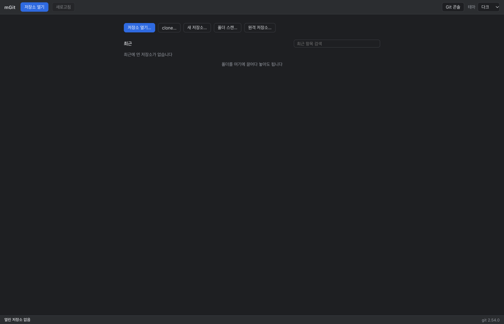

# 1. 설치와 첫 실행

mGit 을 설치하고 처음 켰을 때 보이는 시작 화면을 설명합니다. 시작 화면에서 저장소를 열거나 만들고, 최근에 연 저장소를 다시 엽니다.

기준: 브랜치 `feat/intellij-workspace` · 커밋 `528b84b` · 2026-11-20

## 1.1 요구 사항

mGit 을 쓰려면 아래가 필요합니다.

| 항목    | 필요한 것                                                  | 확인하는 법                  |
| ------- | ---------------------------------------------------------- | ---------------------------- |
| macOS   | 15 이상                                                    | Apple 메뉴 → 이 Mac에 관하여 |
| git     | 2.45 이상. 앱에 들어 있지 않고 Mac 에 설치된 git 을 씁니다 | `/usr/bin/git --version`     |
| git-lfs | 선택. Git LFS 를 쓰는 저장소에서만 필요합니다              | `git lfs version`            |

Finder·Dock 으로 켠 mGit 은 보통 Mac 기본 git(`/usr/bin/git`, Xcode Command Line Tools 에 든 것)을 씁니다. 그래서 확인도 이 git 으로 합니다. 없거나 2.45 보다 낮으면 Command Line Tools 를 설치하거나 올립니다.

```bash
xcode-select --install   # Command Line Tools 설치(없을 때)
/usr/bin/git --version   # 설치·업데이트 뒤 다시 확인
```

이미 설치돼 있는데 버전이 낮으면 시스템 설정 → 일반 → 소프트웨어 업데이트에서 Command Line Tools 를 올립니다. Git LFS 가 필요하면 [Homebrew](https://brew.sh) 로 `brew install git-lfs` 합니다.

> [!NOTE]
> mGit 은 앱이 켜질 때 받은 PATH 에서 git 을 찾습니다. Finder·Dock 으로 켜면 그 PATH 에 Homebrew 폴더가 없어 `/usr/bin/git` 을 쓰므로, Homebrew 로 설치한 git 은 쓰이지 않을 수 있습니다(실제 Mac 에서 확인 전). 앱이 쓰는 버전은 상태 바 오른쪽 끝에 보입니다. 찾는 순서와 확인하는 법은 [10.1](10-문제-해결.md#101-git-이-없거나-버전이-낮을-때)에 있습니다. git 경로를 앱에서 따로 정하는 설정은 없습니다.

소스에서 직접 빌드하려면 [빌드·테스트](../빌드-테스트.md)를 보세요.

## 1.2 앱 설치하기

`.dmg` 파일로 설치하려면 다음과 같이 합니다. `.dmg` 를 직접 만드는 법은 [패키징](../패키징.md)에 있습니다.

1. `.dmg` 파일을 더블클릭해 엽니다.
2. 열린 창에서 mGit 아이콘을 응용 프로그램(Applications) 폴더로 끌어 놓습니다.
3. 응용 프로그램 폴더에서 mGit 을 엽니다.

> [!NOTE]
> 이 앱은 Apple 정식 서명이 아닌 임시 서명으로 만들어집니다. 처음 열 때 "확인되지 않은 개발자" 경고가 뜨거나 열리지 않으면 [패키징 5절 "다른 Mac 에서 열기"](../패키징.md#5-다른-mac-에서-열기)를 따라 하세요.

## 1.3 시작 화면

탭이 하나도 열려 있지 않으면 가운데에 시작 화면이 보입니다. 앱을 처음 켰을 때, 그리고 마지막 탭을 닫았을 때입니다.



그림은 처음 실행한 상태라 최근 목록이 비어 있습니다.

### 시작 화면의 단추

| 단추             | 하는 일                                                                                               | 자세히                                                                                                           |
| ---------------- | ----------------------------------------------------------------------------------------------------- | ---------------------------------------------------------------------------------------------------------------- |
| **저장소 열기…** | 폴더 선택 창에서 폴더를 골라 엽니다. 저장소면 저장소 탭, 여러 저장소가 든 폴더면 폴더 탭으로 열립니다 | [2.1](2-저장소와-폴더-열기.md#21-여러-저장소가-든-폴더-열기), [2.2](2-저장소와-폴더-열기.md#22-저장소-하나-열기) |
| **clone…**       | 원격 저장소를 내려받아 저장소 탭으로 엽니다                                                           | [2.4](2-저장소와-폴더-열기.md#24-clone-하기)                                                                     |
| **새 저장소…**   | 빈 저장소를 만들어 저장소 탭으로 엽니다                                                               | [2.5](2-저장소와-폴더-열기.md#25-새-저장소-만들기)                                                               |
| **폴더 스캔…**   | 고른 폴더 아래의 저장소를 찾아 최근 목록에 넣습니다. 탭은 열지 않습니다                               | [2.3](2-저장소와-폴더-열기.md#23-폴더-스캔으로-최근-목록-채우기)                                                 |
| **원격 저장소…** | 연결한 호스팅 계정(GitHub·GitLab)의 저장소 목록에서 골라 clone 합니다                                 | [2.6](2-저장소와-폴더-열기.md#26-호스팅-계정의-저장소에서-clone-하기)                                            |

### 끌어다 놓아 열기

Finder 에서 폴더를 앱 창으로 끌어다 놓아도 열립니다. 시작 화면에는 **폴더를 여기에 끌어다 놓아도 됩니다** 라고 쓰여 있지만, 실제로는 탭이 열려 있을 때도 창 어디에 놓아도 됩니다. 폴더 여러 개를 한꺼번에 놓으면 하나씩 차례로 엽니다.

### 함께 보이는 것

- 맨 위 툴바에는 **저장소 열기**, **새로고침**(탭이 없으면 꺼져 있음), **Git 콘솔**, **테마** 선택이 있습니다. 툴바는 [3.2 툴바와 작업 진행 띠](3-화면-둘러보기.md#32-툴바와-작업-진행-띠)에서 설명합니다.
- 맨 아래 상태 바에는 **열린 저장소 없음** 과 git 버전(`git 2.54.0` 꼴)이 보입니다.
- 탭이 없으므로 왼쪽 도구 창 띠는 없습니다. **Git 콘솔** 을 누르면 아래에 콘솔만 열립니다.

## 1.4 최근 목록

최근에 연 저장소와 폴더를 다시 열려면 시작 화면의 **최근** 목록을 씁니다.

- 줄 하나에 이름, 경로, 마지막으로 연 시각이 보입니다. 폴더 탭으로 열었던 항목에는 **폴더** 꼬리표가 붙습니다.
- 줄을 누르면 엽니다. **폴더** 꼬리표가 있으면 폴더 탭, 없으면 저장소 탭으로 열립니다.
- 오른쪽 위 **최근 항목 검색** 칸에 이름이나 경로의 일부를 적으면 목록이 좁혀집니다.
- 목록이 비어 있으면 **최근에 연 저장소가 없습니다** 가 보입니다.

### 고정하기와 빼기

1. 고정하려면 줄 끝의 ★ 단추(툴팁 **고정**)를 누릅니다. 이름 앞에 ★ 가 붙고 목록 맨 위로 올라갑니다.
2. 고정을 풀려면 같은 자리의 ☆ 단추(툴팁 **고정 해제**)를 누릅니다.
3. 목록에서 빼려면 × 단추(툴팁 **목록에서 제거**)를 누릅니다. 목록에서만 빠지고 디스크의 폴더는 그대로입니다.

목록 순서는 고정한 항목이 먼저, 그다음 최근에 연 순서입니다. 개수 제한은 없습니다.

목록에 들어가는 것은 다음과 같습니다.

- 탭으로 연 저장소와 폴더
- clone 하거나 새로 만든 저장소
- **폴더 스캔…** 으로 찾은 저장소

## 1.5 git 이 없거나 버전이 낮을 때

앱을 켰을 때 git 을 찾지 못하거나 버전이 2.45 보다 낮으면 다음과 같이 됩니다.

- 상태 바 오른쪽에 git 버전 대신 **git 없음** 이 보입니다. 마우스를 올리면 이유가 나옵니다(**git을 찾을 수 없습니다** 또는 `git 2.39.5는 최소 버전 2.45.0 미만입니다` 꼴).
- 지난번에 열려 있던 탭을 다시 열지 않습니다.

git 을 설치하거나 올린 뒤 앱을 다시 켜세요. 자세한 대처는 [10.1 git 이 없거나 버전이 낮을 때](10-문제-해결.md#101-git-이-없거나-버전이-낮을-때)에 있습니다.

---

[목차](../사용법.md) · [2. 저장소와 폴더 열기 →](2-저장소와-폴더-열기.md)
