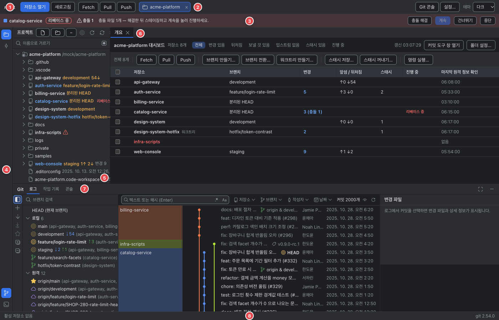
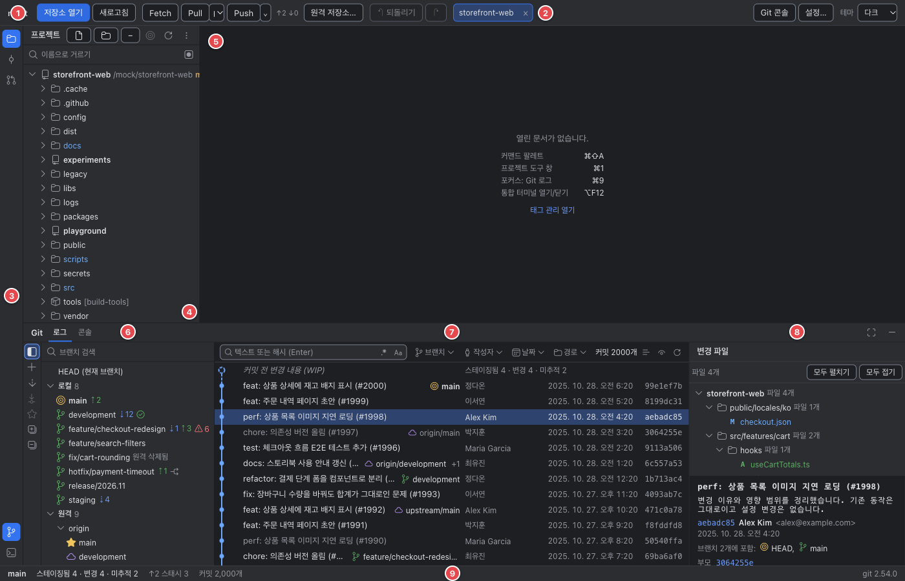
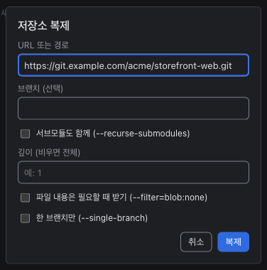
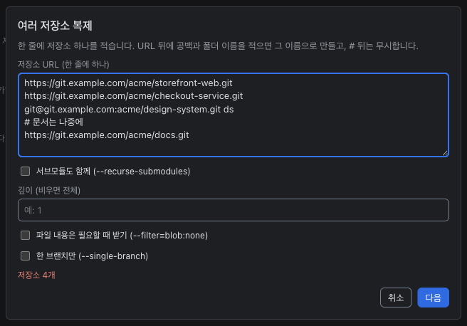
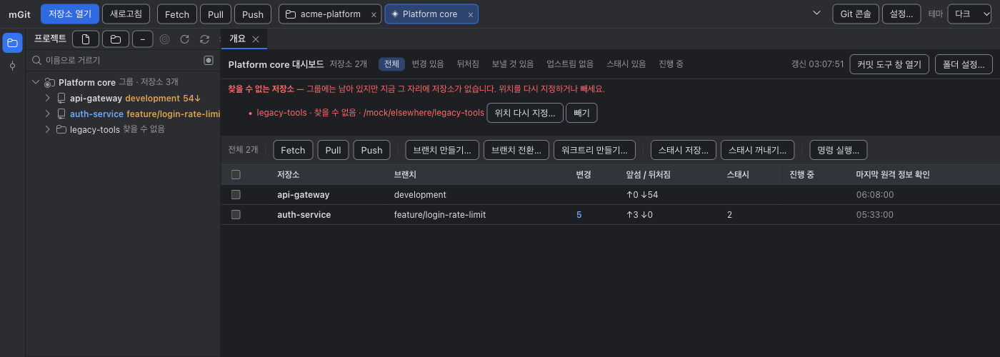
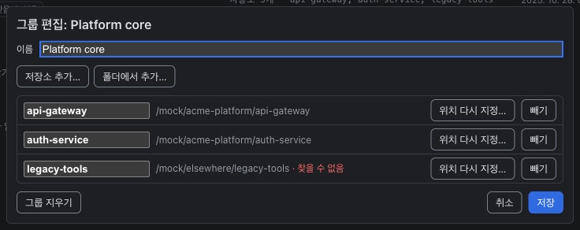

# 2. 저장소와 폴더 열기

저장소를 여는 방법과 열린 탭을 다루는 방법입니다. 저장소 하나는 저장소 탭으로, 여러 저장소가 든 폴더는 폴더 탭으로 열립니다.

기준: 브랜치 `feat/multirepo-editor-batch1` · 커밋 `14bacde` · 2026-11-27

## 2.1 여러 저장소가 든 폴더 열기

여러 저장소를 한 화면에서 보려면 그 저장소들이 든 상위 폴더를 엽니다.

1. 시작 화면의 **디렉토리 선택…** 을 누릅니다. 탭이 열려 있으면 툴바의 **저장소 열기** 로 시작 화면을 먼저 엽니다. `⌘O`(커맨드 팔레트의 **저장소 열기…**)는 시작 화면 없이 바로 폴더 선택 창을 엽니다.
2. 폴더 선택 창에서 저장소들이 든 상위 폴더(예: `~/work/acme-platform`)를 고릅니다.
3. 폴더 탭이 열립니다. 툴바의 탭 이름 앞에 폴더 아이콘이 붙고, 가운데에 개요 탭이 열립니다.

Finder 에서 폴더를 창으로 끌어다 놓아도 같습니다.

그림의 번호는 [3.1 화면 영역](3-화면-둘러보기.md#31-화면-영역)에서 설명합니다.

### 폴더 탭이 되는 조건

같은 **저장소 열기** 라도 고른 폴더에 따라 열리는 탭이 다릅니다.

| 고른 폴더                                                                 | 열리는 탭                                                   |
| ------------------------------------------------------------------------- | ----------------------------------------------------------- |
| 저장소의 맨 위 폴더(`.git` 이 바로 안에 있음)                             | 저장소 탭. 안에 다른 저장소가 들어 있어도 저장소 탭입니다   |
| 저장소가 아닌 폴더이고, 바로 아래 자식 폴더 하나 이상에 `.git` 이 있음    | 폴더 탭                                                     |
| 저장소 안의 하위 폴더이고, 바로 아래 자식 폴더 하나 이상에 `.git` 이 있음 | 폴더 탭                                                     |
| 저장소 안의 하위 폴더이고, 바로 아래에 저장소가 없음                      | 그 폴더를 품은 저장소의 저장소 탭                           |
| 저장소도 아니고 바로 아래에 저장소도 없음                                 | 열리지 않고 툴바에 **Git 저장소가 아닙니다**: `<경로>` 오류 |

`.git` 이 폴더가 아니라 파일인 것(워크트리·서브모듈)도 저장소로 봅니다.

> [!NOTE]
> 폴더 탭이 되려면 저장소가 고른 폴더의 바로 아래에 있어야 합니다. `~/work/team-a/repo-x` 처럼 한 단계 더 깊이에만 저장소가 있는 `~/work` 를 고르면 **Git 저장소가 아닙니다** 가 뜹니다. 그럴 때는 `~/work/team-a` 를 고르세요.

### 폴더 안에서 저장소를 찾는 규칙

폴더 탭이 열리면 그 폴더 아래의 저장소를 찾아 목록을 만듭니다.

- 폴더 바로 아래를 1단계로 쳐서 3단계 깊이까지 찾습니다.
- 저장소를 찾으면 그 안으로는 더 들어가지 않습니다. 저장소 안에 든 저장소는 폴더 탭 목록에 나오지 않습니다.
- 이름이 `.` 으로 시작하는 숨김 폴더와 심볼릭 링크는 건너뜁니다.
- 빌드 산출물·의존성 폴더도 건너뜁니다: `node_modules`, `target`, `build`, `dist`, `out`, `.gradle`, `.idea`, `.vscode`, `.cache`, `.venv`, `venv`, `__pycache__`, `vendor`, `Pods`, `DerivedData`.
- 워크트리와 서브모듈도 찾습니다. 개요 표와 Project 트리에서 **워크트리**·**서브모듈** 꼬리표가 붙습니다.

### 저장소 목록 다시 찾기

폴더 바로 아래에 저장소가 새로 생기거나 사라지면 목록을 저절로 다시 찾습니다. 더 깊은 곳(2~3단계)에 저장소를 clone 했거나 지웠으면 직접 다시 찾게 합니다.

1. 왼쪽 Project 도구 창 머리의 **다시 스캔** 단추를 누릅니다.
2. 또는 Project 트리 맨 위의 폴더(루트) 행을 우클릭하고 **다시 스캔** 을 고릅니다.

툴바의 **새로고침**(`⌘R`)은 저장소 목록은 그대로 두고, 각 저장소의 상태와 펼쳐 둔 파일 트리만 다시 읽습니다.

## 2.2 저장소 하나 열기

저장소 하나만 열려면 저장소의 맨 위 폴더를 고릅니다.

1. 시작 화면의 **디렉토리 선택…** 을 누르거나 `⌘O` 를 누릅니다([2.1](#21-여러-저장소가-든-폴더-열기)과 같습니다).
2. 폴더 선택 창에서 저장소 폴더(예: `~/work/acme-platform/storefront-web`)를 고릅니다.
3. 저장소 탭이 열립니다. 탭 이름은 폴더 이름입니다.

이미 열려 있는 저장소를 다시 열면 새 탭을 만들지 않고 그 탭으로 갑니다.

### 폴더 탭에서 저장소 탭으로 열기

폴더 탭 안의 저장소 하나를 저장소 탭으로 따로 열 수 있습니다. stash 목록·apply·drop, Undo, tag 처럼 저장소 탭에서만 되는 기능을 쓸 때 필요합니다([3.10 폴더 탭과 저장소 탭의 차이](3-화면-둘러보기.md#310-폴더-탭과-저장소-탭의-차이)).

- 개요 탭의 표에서 저장소 줄을 더블클릭하거나, 줄을 고르고 Enter 를 누릅니다.
- Project 트리에서 저장소 행을 우클릭하고 **저장소 탭으로 열기** 를 고릅니다.
- Git 도구 창의 로그에서 커밋 행을 우클릭하고 **저장소 탭으로 열기** 를 고릅니다.

이렇게 연 탭은 이름 앞에 `└` 가 붙는 하위 탭입니다. 부모 폴더 탭을 닫으면 함께 닫힙니다.

> [!NOTE]
> Project 트리에서 저장소 행을 더블클릭하면 펼쳐지기만 하고 탭은 열리지 않습니다. 우클릭 메뉴를 쓰세요.

## 2.3 폴더 스캔으로 최근 목록 채우기

폴더 아래의 저장소를 탭으로 열지 않고 최근 목록에만 한꺼번에 넣으려면 폴더 스캔을 씁니다.

1. 시작 화면의 **폴더 스캔…** 을 누릅니다.
2. 폴더 선택 창에서 저장소들이 든 상위 폴더를 고릅니다.
3. 찾은 저장소가 최근 목록에 들어갑니다. 탭은 열리지 않습니다.

- 찾는 깊이와 건너뛰는 폴더는 [2.1 폴더 안에서 저장소를 찾는 규칙](#폴더-안에서-저장소를-찾는-규칙)과 같습니다.
- 찾은 항목은 모두 저장소 항목(**폴더** 꼬리표 없음)으로 들어갑니다.
- 이 단추는 시작 화면에만 있습니다. 탭이 열려 있으면 탭을 모두 닫아야 시작 화면이 보입니다.

## 2.4 clone 하기

원격 저장소를 내려받으려면 clone 합니다. 세 단계로 진행합니다.

1. 시작 화면의 **복제…** 를 누릅니다. 탭이 열려 있으면 커맨드 팔레트(`⌘⇧A`)에서 **저장소 복제…** 를 고릅니다.
2. **저장소 복제** 대화상자에서 **URL 또는 경로** 를 적고, 필요한 옵션을 고른 뒤 **복제** 를 누릅니다.

   

3. 폴더 선택 창 **복제할 상위 폴더 선택** 에서 clone 할 위치(상위 폴더)를 고릅니다.
4. 다시 뜬 **저장소 복제** 대화상자에서 **폴더 이름** 을 확인하고 **복제** 를 누릅니다. 기본값은 주소 끝 이름에서 `.git` 을 뺀 것입니다(예: `storefront-web`).
5. clone 이 시작됩니다. 끝나면 저장소 탭으로 열리고 최근 목록에 들어갑니다.

첫 대화상자의 칸은 다음과 같습니다.

| 칸                                                  | 뜻                                                                                             |
| --------------------------------------------------- | ---------------------------------------------------------------------------------------------- |
| **URL 또는 경로**                                   | 필수. `https://`·`git@` 주소나 내 Mac 의 저장소 경로                                           |
| **브랜치 (선택)**                                   | clone 뒤 checkout 할 branch. 비우면 원격의 기본 branch                                         |
| **서브모듈도 함께 (--recurse-submodules)**          | 서브모듈까지 함께 받습니다                                                                     |
| **깊이 (비우면 전체)**                              | 숫자를 적으면 최근 commit 그만큼만 받습니다(얕은 복제). 이때 한 branch 만 받기도 함께 켜집니다 |
| **파일 내용은 필요할 때 받기 (--filter=blob:none)** | 이력은 다 받고 파일 내용은 필요할 때 받습니다. 큰 저장소를 빨리 받을 때                        |
| **한 브랜치만 (--single-branch)**                   | 고른 branch(또는 기본 branch) 하나만 받습니다                                                  |

### 진행 보기와 취소

- 시작 화면에는 `clone <폴더 이름> 중…` 과 진행 막대, 단계, **취소** 단추가 보입니다.
- 툴바에는 `clone <폴더 이름> 실행 중…` 과 진행 막대, × 단추(툴팁 **취소**)가 보입니다. 탭이 열려 있을 때도 여기서 진행을 볼 수 있습니다.
- 취소하거나 실패하면 저장소 탭이 열리지 않습니다. 실패 이유는 툴바 오른쪽 빨간 칸에 나옵니다. 빨간 칸을 누르면 사라집니다.
- 고른 위치에 같은 이름의 폴더가 이미 있으면 clone 을 시작하지 않고 `이미 존재하는 경로입니다: <경로>` 오류가 뜹니다.
- 사용자 이름이나 비밀번호(토큰)를 물으면 입력 대화상자가 뜹니다. → [10.6 인증을 묻거나 실패할 때](10-문제-해결.md#106-인증을-묻거나-실패할-때)

### 여러 저장소 한꺼번에 clone 하기

여러 저장소를 한 상위 폴더 아래에 한꺼번에 내려받으려면 다음과 같이 합니다.

1. 시작 화면의 **여러 저장소 복제…** 를 누릅니다. 탭이 열려 있으면 커맨드 팔레트에서 **여러 저장소 복제…** 를 고릅니다.
2. **여러 저장소 복제** 대화상자의 **저장소 URL (한 줄에 하나)** 칸에 주소를 한 줄에 하나씩 적습니다. 아래에 `저장소 N개` 가 보입니다.
   - 폴더 이름은 주소 끝 이름에서 `.git` 을 뺀 것입니다. 다른 이름을 쓰려면 주소 뒤에 공백과 이름을 적습니다(`git@github.com:team/api.git api-server`).
   - 빈 줄과 `#` 로 시작하는 줄은 건너뛰고, 줄 안의 ` #` 뒤도 무시합니다. 같은 주소가 두 번 있으면 한 번만 넣고 `(겹친 줄 N개는 뺍니다)` 가 붙습니다.
   - 아래 옵션(**서브모듈도 함께 (--recurse-submodules)**·**깊이 (비우면 전체)**·**파일 내용은 필요할 때 받기 (--filter=blob:none)**·**한 브랜치만 (--single-branch)**)은 모든 저장소에 같게 겁니다. branch 는 고르지 않습니다.

   

3. **다음** 을 누릅니다.
4. 폴더 선택 창 **저장소들을 복제할 상위 폴더 선택** 에서 상위 폴더를 고릅니다. 폴더 탭에서 열었다면 그 폴더에서 열립니다. 그룹 탭([2.9](#29-여러-곳의-저장소를-그룹으로-묶기))에서 열었다면 처음 위치를 정하지 않습니다.
5. `저장소 N개 복제` 창에서 대상(`<폴더 이름> ← <주소>`)을 확인합니다. 처음엔 모두 체크돼 있고, 빼려면 체크를 풉니다.
6. **복제** 를 누릅니다. 한 번에 2개씩 clone 합니다.
7. 끝나면 결과 알림이 뜨고 상위 폴더가 폴더 탭으로 열립니다. 그 폴더 탭이 이미 열려 있었으면 저장소 목록을 다시 찾습니다.

- 줄을 해석하지 못하면 **다음** 이 꺼지고 사유가 보입니다. 주소가 `-` 로 시작하는 줄, 폴더 이름에 `/` 가 든 줄, 값이 셋 이상인 줄은 `N번째 줄: …` 로 알립니다. 두 줄이 같은 폴더 이름을 쓰면(대소문자 구별 없이) `같은 폴더 이름이 겹칩니다: <이름>. …` 이 보입니다.
- 상위 폴더에 같은 이름의 폴더가 이미 있으면 그 저장소는 `이미 있는 폴더입니다` 로 건너뛰고, 그 폴더는 건드리지 않습니다.
- clone 에 실패한 저장소는 사유가 알림에 보이고, 만들던 폴더는 지웁니다.
- 진행은 [진행 보기와 취소](#진행-보기와-취소)와 같은 곳에 `일괄 복제 (N개) 중…` 으로 보이고, 단계에는 방금 끝난 저장소 이름이 보입니다. 취소하면 실행 중이던 clone 을 멈추고 만들던 폴더를 지운 뒤 `실행 중에 취소했습니다 (만들던 폴더는 지웠습니다)` 로 남깁니다. 시작하지 않은 저장소는 **취소됨** 입니다.
- 인증을 물으면 입력 대화상자가 하나씩 차례로 뜹니다.
- 결과는 열린 폴더 탭의 **작업 기록** 탭에도 남습니다. 실패하거나 취소된 저장소가 있으면 `실패한 저장소만 다시 실행 (N개)` 가 그 주소만 채운 **여러 저장소 복제** 대화상자를 같은 상위 폴더·옵션으로 다시 엽니다([4.3 작업 기록](4-일상-작업.md#작업-기록)).

## 2.5 새 저장소 만들기

빈 저장소를 새로 만들려면 다음과 같이 합니다.

1. 시작 화면의 **새 저장소…** 를 누릅니다. 탭이 열려 있으면 커맨드 팔레트에서 **새 저장소…** 를 고릅니다.
2. 폴더 선택 창 **새 저장소를 만들 상위 폴더 선택** 에서 새 저장소를 만들 위치(상위 폴더)를 고릅니다.
3. **새 저장소** 대화상자가 뜹니다. 맨 위에 고른 상위 폴더가 보입니다.

   

4. **폴더 이름** 을 적습니다. 상위 폴더 아래에 이 이름의 폴더가 생깁니다.
5. **기본 브랜치** 를 확인합니다. 기본값은 `main` 입니다.
6. 필요하면 **.gitignore 템플릿** 을 고릅니다.
7. **만들기** 를 누릅니다. 저장소가 만들어지고 저장소 탭으로 열립니다.

**.gitignore 템플릿** 에서 고를 수 있는 것은 **없음**, **Node**, **Rust**, **Java / Gradle**, **Python**, **macOS / Windows**, **빈 파일** 입니다.

- 템플릿을 고르면 `.gitignore` 파일만 만들어 둡니다. stage 나 commit 은 하지 않습니다.
- 새 저장소에는 commit 이 하나도 없습니다. 그래서 상태 바에 `main (commit 없음)` 처럼 보입니다.
- 이미 있는 폴더 이름을 적으면 그 폴더 안에 저장소를 만듭니다. 그 폴더가 이미 저장소면 `이미 저장소입니다: <경로>` 오류가 뜹니다.

## 2.6 호스팅 계정의 저장소에서 clone 하기

GitHub·GitLab 계정의 저장소 목록에서 골라 clone 할 수 있습니다. 먼저 호스팅 계정을 연결해야 합니다([8.4 호스팅 계정](8-설정.md#84-호스팅-계정)).

1. 시작 화면의 **원격 저장소…** 를 누릅니다. 탭이 열려 있으면 커맨드 팔레트에서 **원격 저장소 탐색…** 을 고릅니다.
2. **원격 저장소** 대화상자가 열리고 계정의 저장소 목록을 읽습니다.
3. 계정이 여럿이면 맨 위 선택 상자에서 계정(`사용자 · 호스트`)을 고릅니다.
4. 이름으로 찾으려면 **이름 검색 (Enter)** 칸에 적고 Enter 나 **검색** 을 누릅니다.
5. **프로토콜** 에서 `https` 나 `ssh` 를 고릅니다. clone 할 때 쓸 주소의 종류입니다.
6. 원하는 저장소 줄의 **복제** 를 누릅니다.
7. [2.4](#24-clone-하기)의 첫 대화상자가 주소가 채워진 채로 열립니다. 그다음은 2.4 와 같습니다.

- 각 줄에는 저장소 이름과 설명, 마지막 갱신 날짜가 보입니다. 비공개 저장소에는 **비공개**, 포크한 저장소에는 **포크** 꼬리표가 붙습니다.
- 목록이 길면 맨 아래 **다음 페이지** 를 눌러 이어서 봅니다.
- 여러 저장소를 한꺼번에 받으려면 줄 앞의 체크 상자로 고른 뒤 머리줄의 `고른 저장소 N개 복제…` 를 누릅니다. 고른 저장소의 주소(**프로토콜** 에 맞춘 것)가 채워진 **여러 저장소 복제** 대화상자가 열리고, 그다음은 [여러 저장소 한꺼번에 clone 하기](#여러-저장소-한꺼번에-clone-하기)와 같습니다.
- 계정을 연결하지 않았으면 목록 대신 **먼저 호스팅 계정을 연결하세요 (팔레트: 호스팅 계정…)** 이 보입니다.
- `ssh` 로 clone 하려면 SSH 키가 호스팅에 등록돼 있어야 합니다. → [8.6 SSH 키](8-설정.md#86-ssh-키)

## 2.7 탭 오가기와 닫기

열린 폴더·저장소는 툴바에 탭으로 보입니다. 탭에 마우스를 올리면 전체 경로가 보입니다.

| 탭 모양              | 뜻                                                   |
| -------------------- | ---------------------------------------------------- |
| 폴더 아이콘 + `이름` | 폴더 탭                                              |
| `◈ 이름`             | 그룹 탭([2.9](#29-여러-곳의-저장소를-그룹으로-묶기)) |
| `└ 이름`             | 폴더 탭에서 연 하위 저장소 탭                        |
| `이름`               | 저장소 탭                                            |

### 탭 오가기

- 탭을 누르면 그 탭으로 바뀝니다.
- **다음 탭** 은 `⌘⇧]`, **이전 탭** 은 `⌘⇧[` 입니다. 끝에서 누르면 처음으로 돌아갑니다.
- 탭을 끌어 순서를 바꾸거나 탭을 우클릭하는 메뉴는 없습니다.

### 탭 닫기

1. 탭의 × 단추(툴팁 **저장소 닫기**)를 누릅니다. 또는 **탭 닫기**(`⌘W`)를 누릅니다.
2. 확인창이 뜨면 함께 사라지는 것을 읽고 **닫기** 를 누릅니다.

`⌘W` 는 키보드 포커스가 어디 있느냐에 따라 뜻이 다릅니다.

| 포커스                              | `⌘W` 가 닫는 것                                                 |
| ----------------------------------- | --------------------------------------------------------------- |
| 편집기 영역(파일·diff·개요 탭)      | 편집기 탭 하나. 닫을 편집기 탭이 없으면 아무 일도 하지 않습니다 |
| 그 밖(Project 트리·로그·도구 창 등) | 지금 폴더·저장소 탭 전체                                        |

확인창은 잃을 것이 있을 때만 뜹니다.

- 폴더 탭: 그 폴더 탭에서 연 `└` 하위 탭이 하나라도 있거나, 저장하지 않은 충돌 편집이 있거나, 진행 중인 작업이 있으면 **<이름> 폴더 탭을 닫을까요?** 가 뜹니다. 함께 사라지는 하위 탭과 편집 목록이 보입니다.
- 저장소 탭: 저장하지 않은 충돌 편집이 있으면 **<이름> 탭을 닫을까요?** 가 뜹니다. 닫으면 그 편집은 사라집니다.

폴더 탭을 닫으면 거기서 연 `└` 하위 탭도 함께 닫힙니다. 마지막 탭을 닫으면 시작 화면이 보입니다.

> [!NOTE]
> 앱을 끝낼 때(`⌘Q`)는 확인창이 없습니다. 저장하지 않은 충돌 편집이나 진행 중인 작업이 있으면 먼저 마치세요. → [7. 알아 두면 좋은 동작](7-알아-두면-좋은-동작.md)

## 2.8 다시 켰을 때 돌아오는 것

앱을 다시 켜면 지난번에 열려 있던 탭을 같은 순서로 다시 엽니다. 맨 마지막 탭이 앞에 보입니다.

| 다시 켜면 돌아오는 것                                                                      | 돌아오지 않는 것                                                  |
| ------------------------------------------------------------------------------------------ | ----------------------------------------------------------------- |
| 열려 있던 폴더 탭·저장소 탭(순서대로)                                                      | 미리보기 탭, 파일이 아닌 편집기 탭(diff·충돌·커밋 diff·비교·태그) |
| 그 탭마다 고정한 파일 탭(순서와 보던 탭, [3.5](3-화면-둘러보기.md#다시-켰을-때의-파일-탭)) | 저장하지 않은 편집. 폴더 탭의 개요 탭은 다시 기본으로 열림        |
| 편집기를 나눈 모양(오른쪽 그룹의 고정 파일 탭과 두 그룹 사이 폭)                           |                                                                   |
| 최근 파일(`⌘P`·`⌘E`)                                                                       |                                                                   |
| 테마                                                                                       | 아래 도구 창의 최대화                                             |
| 왼쪽 도구 창(Project·Commit·Pull Requests 중 열려 있던 것)                                 | 로그 필터                                                         |
| 아래 도구 창(Git·터미널·숨김)과 Git 도구 창의 탭(로그·작업 기록·콘솔)                      | `└` 표시 — 하위 탭은 일반 저장소 탭으로 돌아옵니다                |
| 칸 크기, 브랜치 칸을 펼쳤는지                                                              | Commit 도구 창의 탭 선택(늘 변경 탭으로 시작)                     |
| branch 즐겨찾기, diff 보기 옵션, 그래프 열·보기 설정                                       | 저장소 탭 툴바의 pull 방식 선택                                   |
| 단축키 설정, 최근 목록                                                                     | Undo 기록, 터미널 셸(터미널이 열려 있었으면 새 셸이 하나 뜸)      |

git 을 찾지 못하면 탭을 다시 열지 않습니다([1.5](1-설치와-첫-실행.md#15-git-이-없거나-버전이-낮을-때)).

열려 있던 그룹 탭([2.9](#29-여러-곳의-저장소를-그룹으로-묶기))도 다시 열리고, 그 탭의 고정 파일 탭과 최근 파일도 돌아옵니다. 그 사이 그룹을 지웠으면 그 탭은 열리지 않습니다.

## 2.9 여러 곳의 저장소를 그룹으로 묶기

서로 다른 폴더에 흩어진 저장소를 한 탭에서 다루려면 그룹을 만듭니다. 그룹 탭은 폴더 탭과 같은 화면(개요 탭, 일괄 작업, 통합 로그, Commit 도구 창)을 쓰고, Project 트리 맨 위에는 저장소마다 별칭 행이 하나씩 놓입니다. 폴더 탭과 다른 점은 [3.10](3-화면-둘러보기.md#그룹-탭이-폴더-탭과-다른-점)에 있습니다.

### 그룹 만들기

다음 중 하나로 **새 그룹** 대화상자를 엽니다.

- 시작 화면의 **새 그룹…**
- 커맨드 팔레트의 **새 그룹…**
- 폴더 탭에서 커맨드 팔레트의 **이 폴더로 그룹 만들기…**: 그 폴더의 저장소들과 폴더 이름이 미리 채워집니다

대화상자에서:

1. **이름** 을 적습니다. 1~80자이고, 다른 그룹과 같은 이름(대소문자 무시)은 쓸 수 없습니다.
2. 저장소를 더합니다.
   - **저장소 추가…**: 저장소 하나를 고릅니다. 저장소 안의 폴더를 고르면 그 저장소의 맨 위로 고쳐집니다.
   - **폴더에서 추가…**: 고른 폴더 아래의 저장소를 모두 더합니다(폴더 탭과 같은 깊이까지, [2.1](#폴더-안에서-저장소를-찾는-규칙)).
3. 넣지 않을 저장소는 그 줄의 **빼기** 를 누릅니다.
4. **만들기** 를 누르면 그룹이 만들어지고 그룹 탭이 열립니다.

넣지 못한 경로는 목록 아래에 이유와 함께 보입니다: **경로가 없습니다** · **저장소가 아닙니다** · **이미 그룹에 있습니다** · **다른 저장소 안에 있거나 다른 저장소를 품습니다**. 같은 저장소를 두 번 넣을 수는 없지만, 한 저장소와 그 워크트리는 함께 넣을 수 있습니다. 한 저장소를 여러 그룹에 넣어도 됩니다.

### 별칭

별칭은 Project 트리 맨 위 행의 이름입니다. 저장소 폴더 이름을 쓰고, 이미 같은 이름이 있으면 `이름-<상위 폴더 이름>`, 그것도 있으면 그 뒤에 `-2`, `-3` … 을 붙입니다(대소문자 무시).

그룹 탭의 파일 탭·최근 파일은 별칭으로 시작하는 경로(예: `api/src/main.rs`)로 기억합니다. 저장소 위치를 다시 지정해도 별칭이 그대로라 이 기록이 이어집니다. 파일 빠른 열기(`⌘P`)·내용 검색(`⌘⌥F`)과 내용 검색 창의 **바꾸기…** 도 그룹의 저장소들을 모두 찾고 결과를 이 경로로 보입니다([9.3](9-단축키.md#빠른-열기와-내용-검색)).

별칭은 그룹 편집에서 바꿀 수 있습니다. 저장소 줄 맨 앞의 별칭 칸을 고칩니다.

- 파일 경로의 한 칸으로 쓸 수 있는 이름이어야 합니다. 비어 있거나, `/`·`\` 가 들었거나, `.`·`..`·`.git` 이거나, 255바이트를 넘으면 쓸 수 없습니다.
- 다른 저장소의 별칭과 겹치면(대소문자 무시) 쓸 수 없습니다.
- 쓸 수 없는 별칭이 있으면 칸이 빨갛게 되고 목록 아래에 이유가 보이며, **저장** 이 꺼집니다.

별칭을 바꾸면 그 저장소의 열린 파일 탭(저장하지 않은 편집 포함), Project 트리의 선택과 펼침, 탭 복원 기록, 최근 파일이 새 별칭 경로로 옮겨집니다. 파일 빠른 열기(`⌘P`)의 목록도 새 경로로 다시 읽습니다.

### 그룹 열기

- 시작 화면의 **그룹** 묶음에서 그룹을 누릅니다. 즐겨찾기(★)한 그룹이 먼저, 그다음 최근에 연 순입니다. **항목 종류** 상자에서 **그룹** 을 고르면 그룹만 보입니다.
- 커맨드 팔레트의 **그룹 열기: <이름>**

그룹 탭에는 ◈ 와 그룹 이름이 보이고, 탭에 마우스를 올리면 **그룹: <이름>** 이 보입니다. 이미 열린 그룹을 다시 열면 그 탭으로 갑니다.

Project 트리 맨 위 행은 그룹 이름과 `그룹 · 저장소 N개` 이고, 그 아래에 저장소마다 별칭 행이 있습니다. 그림의 legacy-tools 는 폴더를 지웠거나 옮긴 저장소입니다([찾을 수 없는 저장소](#찾을-수-없는-저장소)).

### 그룹 편집

시작 화면의 그룹 줄에서 ✎ 를 누르거나, 그룹 탭에서 커맨드 팔레트의 **그룹 편집…** 을 고릅니다.

- 이름과 별칭([별칭](#별칭))을 바꾸고 저장소를 더하거나 뺍니다(**저장소 추가…** · **폴더에서 추가…** · **빼기**).
- **위치 다시 지정…**: 저장소 폴더를 옮겼을 때 새 위치를 고릅니다. 별칭은 그대로입니다.
- **저장** 을 누르면 고칩니다. 그룹 탭이 열려 있으면 탭을 연 채로 바로 반영합니다. 남은 저장소의 파일 탭(고정한 탭 포함)은 그대로 남습니다.
  - 뺀 저장소와 위치를 다시 지정한 저장소의 파일 탭은 닫힙니다. 그 탭에 저장하지 않은 편집이 있으면 먼저 확인이 뜨고, 취소하면 아무것도 고치지 않습니다.
  - 대화상자 아래에 **열린 그룹은 탭을 연 채로 바뀝니다. 뺀 저장소의 파일 탭은 닫힙니다.** 가 보입니다.
- **그룹 지우기**: 그룹만 지웁니다. 저장소는 그대로 남습니다. 그룹 탭이 열려 있으면 그 탭을 먼저 닫습니다. 탭 닫기 확인을 취소하면 지우지 않습니다.
  - 그 그룹의 폴더 설정([8.8](8-설정.md#88-폴더-설정)), 탭 복원 기록, 최근 파일, 통합 로그의 저장소 열 너비, 브랜치 즐겨찾기, 개요 탭 **명령 실행…** 의 최근 명령도 함께 지웁니다.

### 찾을 수 없는 저장소

그룹에 넣은 저장소 폴더를 지우거나 옮기면, 그 저장소는 그룹에 남지만 일괄 작업·로그·Commit 도구 창에서는 빠집니다.

- 개요 탭 머리줄 아래에 **찾을 수 없는 저장소** 줄이 생기고, 저장소마다 **위치 다시 지정…** · **빼기** 가 있습니다. 누르면 그룹 편집과 같이 탭을 연 채로 반영합니다.
- Project 트리의 별칭 행 옆에 **찾을 수 없음** 또는 **저장소 아님** 이 붙습니다. **저장소 아님** 행은 펼쳐지지 않습니다.
- 시작 화면의 그룹 줄에도 **찾을 수 없음** 이 붙습니다.

그룹은 저장소 폴더의 상위 폴더를 지켜보지 않습니다. 저장소가 사라지거나 다시 생긴 것은 Project 도구 창의 **다시 스캔** 을 누르거나 그룹 탭을 다시 열 때 반영됩니다.

---

[← 1. 설치와 첫 실행](1-설치와-첫-실행.md) · [목차](../사용법.md) · [3. 화면 둘러보기 →](3-화면-둘러보기.md)
