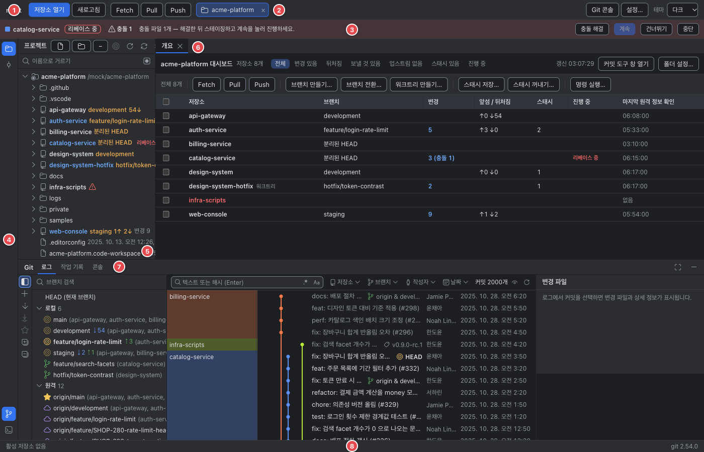
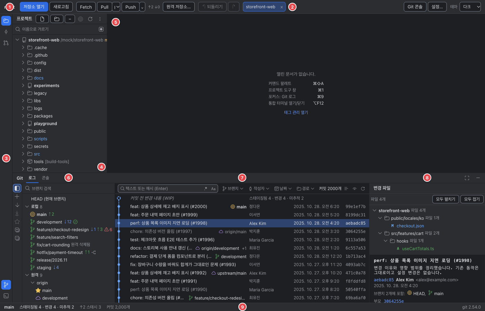
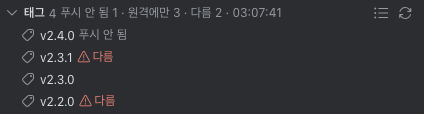
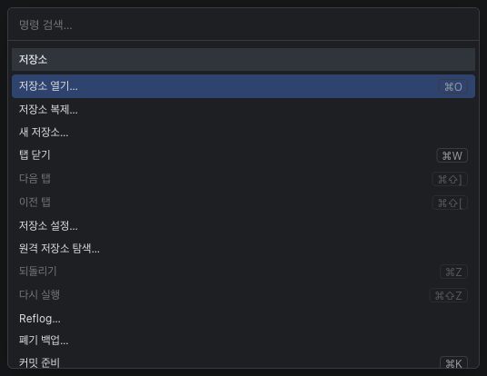

# 3. 화면 둘러보기

mGit 화면의 각 영역이 무엇이고 어떻게 여닫는지 설명합니다. 폴더 탭과 저장소 탭은 같은 틀을 쓰므로 한 번 익히면 두 탭에서 똑같이 쓸 수 있습니다. 두 탭이 다른 점은 [3.10](#310-폴더-탭과-저장소-탭의-차이)에 모았습니다.

기준: 브랜치 `feat/branch-file-menu` · 커밋 `048a5fc` · 2026-11-23

## 3.1 화면 영역

화면은 위에서부터 툴바, (필요할 때) 작업 진행 띠, 가운데 영역, 아래 도구 창, 상태 바입니다. 가운데 영역은 왼쪽 도구 창과 편집기 영역으로 나뉩니다. 맨 왼쪽 세로 띠에는 도구 창 단추가 있습니다.

### 폴더 탭

| 번호 | 이름                 | 하는 일                                                                       | 여는 법                    |
| ---- | -------------------- | ----------------------------------------------------------------------------- | -------------------------- |
| ①    | 툴바                 | 열기·새로고침, 폴더 안 저장소에 한꺼번에 하는 Fetch·Pull·Push, Git 콘솔, 테마 | 늘 보임                    |
| ②    | 탭 막대              | 열린 폴더·저장소 탭. `▣` 는 폴더 탭                                           | 늘 보임(툴바 안)           |
| ③    | 작업 진행 띠         | 진행 중인 merge·rebase 등과 충돌 수, **Continue**·**Abort** 같은 단추         | 진행 중인 작업이 있을 때만 |
| ④    | 왼쪽 띠              | 도구 창 단추. 위는 Project·Commit, 아래는 Git·터미널                          | 탭이 있으면 늘 보임        |
| ⑤    | Project 도구 창      | 폴더 전체의 파일 트리. 저장소 행에 branch·ahead/behind·변경 수                | `⌘1`, 띠의 Project 단추    |
| ⑥    | 편집기 영역(개요 탭) | 개요 표, 파일 보기, diff, 충돌 편집기가 탭으로 열림                           | 파일·diff 를 열면          |
| ⑦    | 아래 Git 도구 창     | 로그 탭(브랜치 칸·여러 저장소의 통합 로그·상세), 작업 기록 탭, 콘솔 탭        | 띠의 Git 단추, `⌘9`, `⌘J`  |
| ⑧    | 상태 바              | 활성 저장소의 이름·branch·ahead/behind, git 버전                              | 늘 보임                    |

### 저장소 탭

| 번호 | 이름            | 하는 일                                                                                                    | 여는 법                      |
| ---- | --------------- | ---------------------------------------------------------------------------------------------------------- | ---------------------------- |
| ①    | 툴바            | 열기·새로고침, 이 저장소의 Fetch·Pull·Push, ahead/behind 배지, **원격…**, ↶ **되돌리기**·↷, Git 콘솔, 테마 | 늘 보임                      |
| ②    | 탭 막대         | 열린 폴더·저장소 탭                                                                                        | 늘 보임(툴바 안)             |
| ③    | 왼쪽 띠         | 위는 Project·Commit·Pull Requests, 아래는 Git·터미널                                                       | 늘 보임                      |
| ④    | Project 도구 창 | 작업 트리의 파일 트리. 맨 위 행에 branch·ahead/behind·변경 수                                              | `⌘1`, 띠의 Project 단추      |
| ⑤    | 편집기 영역     | 파일 보기·diff·충돌 편집기. 그림은 열린 탭이 없는 상태                                                     | 파일·diff 를 열면            |
| ⑥    | 브랜치 칸       | 로컬·원격 branch, 태그, 워크트리, 백업                                                                     | Git 도구 창 로그 탭의 왼쪽   |
| ⑦    | 로그            | 필터 바와 commit 그래프. 맨 위는 **변경 사항 (WIP)** 행                                                    | `⌘9`                         |
| ⑧    | 상세 칸         | 고른 commit 의 메시지·작성자·부모·포함 branch·변경 파일                                                    | `⌘3`, 로그에서 commit 고르기 |
| ⑨    | 상태 바         | branch, 진행 중 작업, 변경 수, ahead·stash, commit 수, git 버전                                            | 늘 보임                      |

폴더 탭의 ⑦(아래 Git 도구 창) 안도 저장소 탭의 ⑥·⑦·⑧ 처럼 브랜치 칸·로그·상세로 나뉩니다.

## 3.2 툴바와 작업 진행 띠

### 툴바

툴바는 창 맨 위 한 줄입니다. 탭 종류에 따라 가운데 단추가 바뀝니다.

| 자리                        | 탭이 없을 때   | 폴더 탭                                                                                        | 저장소 탭                                                                                       |
| --------------------------- | -------------- | ---------------------------------------------------------------------------------------------- | ----------------------------------------------------------------------------------------------- |
| **저장소 열기**             | ○              | ○                                                                                              | ○                                                                                               |
| **새로고침**(`⌘R`)          | 꺼짐           | 각 저장소의 상태와 펼친 파일 트리를 다시 읽음                                                  | 저장소 상태와 펼친 파일 트리를 다시 읽음                                                        |
| **Fetch**·**Pull**·**Push** | ×              | 고른 저장소(없으면 전체)에 한꺼번에. 툴팁에 `Fetch (선택 2개)`·`Fetch (전체 8개)` 처럼 대상 수 | 이 저장소에. **Pull** 옆 선택 상자로 방식, **Push** 옆 ⌄(**push 대상 선택**)로 보낼 원격을 고름 |
| 배지                        | ×              | ×                                                                                              | `↑2 ↓0`(보낼 것·받을 것), **업스트림 없음**, **원격 삭제됨**                                    |
| **원격…**                   | ×              | ×                                                                                              | 원격 추가·이름 변경·URL 변경·제거                                                               |
| ↶ **되돌리기**·↷            | ×              | ×                                                                                              | 직전 Git 작업 되돌리기(Undo)·다시 실행(Redo)                                                    |
| 탭 막대                     | 비어 있음      | 열린 탭들                                                                                      | 열린 탭들                                                                                       |
| 진행 표시                   | clone 진행     | clone·일괄 작업 진행                                                                           | clone·실행 중인 명령(`<작업> 실행 중…` + % + ×)                                                 |
| 빨간 오류 칸                | 오류가 있을 때 | 〃                                                                                             | 〃                                                                                              |
| **Git 콘솔**(`⌘J`)          | ○              | ○                                                                                              | ○                                                                                               |
| **테마**                    | ○              | ○                                                                                              | ○                                                                                               |
- 빨간 오류 칸에는 저장소 열기·clone 같은 앱 수준의 마지막 오류가 한 줄로 보입니다. 누르면 사라집니다. 길면 마우스를 올려 전체를 봅니다.
- 저장소에서 실행한 Git 작업(commit·push·merge 등)의 오류는 툴바 아래(작업 진행 띠가 있으면 그 아래)에 빨간 오류 줄로 따로 보입니다. 누르면 사라집니다. → [10장 머리](10-문제-해결.md)
- **테마** 는 **시스템**·**라이트**·**다크** 중에서 고릅니다. **시스템** 은 macOS 의 밝은·어두운 모드를 따릅니다. → [8.1 테마](8-설정.md#81-테마)
- **Git 콘솔** 단추는 콘솔 탭이 보일 때 눌린 모양입니다.
- Fetch·Pull·Push 의 자세한 동작은 [4.3 Fetch·Pull·Push 하기](4-일상-작업.md#43-fetchpullpush-하기), 원격 관리는 [5.5 원격 관리하기](5-가끔-하는-작업.md#55-원격-관리하기), Undo 는 [6.1 Undo·Redo 로 되돌리기](6-실수했을-때.md#61-undoredo-로-되돌리기)에 있습니다.

> [!NOTE]
> 툴팁에 적힌 `⌘R`·`⌘J` 는 고정 글자입니다. 단축키를 바꿔도 툴팁 글자는 그대로입니다.

### 작업 진행 띠

merge·rebase·cherry-pick·revert 같은 작업이 충돌 등으로 멈춰 있으면 툴바 바로 아래에 띠가 생깁니다. 진행 중인 작업이 없으면 띠도 없습니다.

- 한 줄에 저장소 이름(폴더 탭), 작업 라벨(**MERGING**, `REBASING 2/5`, **CHERRY-PICKING**, **REVERTING** 등), `⚠ 충돌 N`, 안내 글, 단추가 보입니다.
- 단추는 **충돌 해결**·**Continue**·**Skip**·**Abort** 입니다. **Skip** 은 rebase·cherry-pick·revert 에만 있습니다.
- 폴더 탭은 진행 중인 저장소마다 한 줄입니다. 세 줄까지 보이고, 더 있으면 띠 안에서 스크롤합니다.

충돌을 푸는 방법은 [5.6 충돌 해결하기](5-가끔-하는-작업.md#56-충돌-해결하기)에 있습니다.

## 3.3 왼쪽 띠와 도구 창

창 맨 왼쪽의 세로 띠(**도구 창**)에는 아이콘 단추가 있습니다. 마우스를 올리면 이름이 보입니다. 탭이 하나도 없으면 띠도 없습니다.

| 자리 | 단추              | 여는 것                                                                              | 키    |
| ---- | ----------------- | ------------------------------------------------------------------------------------ | ----- |
| 위   | **Project**       | 파일 트리([3.4](#34-project-도구-창))                                                | `⌘1`  |
| 위   | **Commit**        | 변경 목록과 commit 입력([4.2](4-일상-작업.md#42-stage-하고-commit-하기))             | `⌘0`  |
| 위   | **Pull Requests** | PR 목록([5.9](5-가끔-하는-작업.md#59-pull-requests)). GitLab 이면 **Merge Requests** | 없음  |
| 아래 | **Git**           | 아래 Git 도구 창(로그·콘솔, [3.7](#37-아래-도구-창))                                 | —     |
| 아래 | **터미널**        | 아래 터미널 도구 창([3.9](#39-콘솔과-터미널))                                        | `⌘⇧J` |

위쪽 세 도구 창은 같은 자리(왼쪽 도구 창)를 번갈아 씁니다. 아래쪽 둘도 같은 자리(아래 도구 창)를 번갈아 씁니다.

### 여닫기

- 띠의 단추를 누르면 그 도구 창이 열리고, 열려 있는 단추를 다시 누르면 닫힙니다.
- `⌘1`(**Project 도구 창**)과 `⌘0`(**Commit 도구 창**)은 닫지 않습니다. 열고 그 안에 키보드 포커스를 줍니다. 아래 도구 창이 최대화돼 있으면 최대화도 풉니다.
- **Pull Requests** 단추는 원격이 GitHub·GitLab 으로 인식된 저장소 탭에만 생깁니다. 폴더 탭에는 없습니다.

### 크기

- 왼쪽 도구 창과 편집기 사이의 분할선(**왼쪽 도구 창 폭 조절**)을 끌어 폭을 바꿉니다. 처음에는 창 폭의 20%, 가장 좁게는 200px 입니다.
- 분할선을 왼쪽 끝까지 끌면 도구 창이 닫힙니다.
- 폭은 저장돼 다음에 켜도 그대로입니다.

> [!NOTE]
> 도구 창의 열림·닫힘과 크기는 앱 전체가 하나를 함께 씁니다. 한 탭에서 Commit 도구 창을 열면 다른 탭으로 옮겨도 Commit 도구 창이 열려 있습니다. Pull Requests 를 열어 둔 채 Pull Requests 가 없는 탭으로 가면 그 탭에서는 Project 가 대신 보입니다.

## 3.4 Project 도구 창

Project 도구 창은 파일 트리입니다. 폴더 탭에서는 폴더 전체가, 저장소 탭에서는 그 저장소의 작업 트리가 맨 위(루트) 행입니다.

### 머리줄

머리에는 **Project** 제목과 단추가 있습니다.

| 단추                            | 하는 일                                                                                 | 있는 탭                        |
| ------------------------------- | --------------------------------------------------------------------------------------- | ------------------------------ |
| ◎ **열린 파일을 트리에서 찾기** | 편집기에서 보고 있는 파일의 행을 골라 보이게 스크롤                                     | 두 탭 모두                     |
| **새로고침**                    | 상태와 펼친 트리를 다시 읽음                                                            | 두 탭 모두                     |
| **다시 스캔**                   | 폴더 안의 저장소 목록을 다시 찾음([2.1](2-저장소와-폴더-열기.md#저장소-목록-다시-찾기)) | 폴더 탭                        |
| ⚙ **폴더 설정…**                | 폴더 설정 대화상자([8.8](8-설정.md#88-폴더-설정))                                       | 폴더 탭                        |
| ⋮ **모듈·서브모듈·하위 저장소** | 모듈 범위, 서브모듈 작업([5.8](5-가끔-하는-작업.md#58-서브모듈모듈하위-저장소))         | 저장소 탭(그런 것이 있을 때만) |

Project 트리에는 검색이나 필터 칸이 없습니다.

### 행에 붙는 것

- 루트 행: 굵은 이름과 회색 경로.
- 저장소 행: 저장소 아이콘, 굵은 이름, branch(강조색), `3↑`·`54↓`(보낼 것·받을 것), `변경 N`, 꼬리표(**워크트리**·**서브모듈**, **MERGING**·**REBASING** 같은 진행 중 작업). 상태를 읽지 못한 저장소에는 ⚠ 가 붙고, 마우스를 올리면 이유가 보입니다. 폴더 탭에서는 각 저장소 폴더 행에, 저장소 탭에서는 루트 행에 붙습니다.
- 파일 행: 이름 뒤에 회색으로 `날짜, 크기`. 24시간 안에 바뀐 파일은 `3분 전`·`오늘 오전 10:21` 처럼 보입니다.
- 저장소 탭에서는 모듈(상자 아이콘, `변경 N`)과 하위 저장소(저장소 아이콘, 굵은 이름)도 아이콘으로 구분됩니다.

### 파일 상태

바뀐 파일은 이름에 색이 들고 행 끝에 상태 문자가 붙습니다. 상태 문자에 마우스를 올리면 뜻이 보입니다.

| 문자 | 뜻(툴팁)                              |
| ---- | ------------------------------------- |
| M    | **수정됨**                            |
| A    | **추가됨 (stage 된 새 파일)**         |
| C    | **복사됨 (stage 됨)**                 |
| R    | **이름 바뀜** (원래 경로가 함께 보임) |
| T    | **종류 바뀜**                         |
| ?    | **untracked (git 이 추적하지 않음)**  |
| ⚠ U  | **충돌: 해결해야 합니다**             |
- 안에 바뀐 파일이 든 폴더는 이름에만 색이 들고 툴팁에 **안에 변경된 파일이 있습니다** 가 보입니다.
- 지운 파일은 디스크에 없어서 트리에 나오지 않습니다. Commit 도구 창에서 보세요([4.1](4-일상-작업.md#41-변경-확인하기)).
- `.gitignore` 로 무시된 파일에는 색이 들지 않습니다.

### 조작

| 입력                    | 동작                                                                |
| ----------------------- | ------------------------------------------------------------------- |
| 파일 클릭, Space        | 미리보기 탭으로 열기([3.5](#35-편집기-영역))                        |
| 파일 더블클릭, Enter    | 고정 탭으로 열기                                                    |
| 폴더·저장소 행 클릭     | 고르고 펼치거나 접기. 저장소 행을 더블클릭해도 탭은 열리지 않습니다 |
| `⌘` 클릭                | 하나씩 더 고르거나 빼기                                             |
| `⇧` 클릭, `⇧↑`·`⇧↓`     | 범위로 고르기                                                       |
| ↑ ↓ · Home · End        | 행 옮기기                                                           |
| ← →                     | 접기·펼치기, 부모·자식 행으로 옮기기                                |
| `⇧F10`, 메뉴 키, 우클릭 | 우클릭 메뉴                                                         |

폴더 탭에서 고른 저장소 행은 툴바의 Fetch·Pull·Push 와 개요 탭 일괄 줄의 대상이 됩니다. 저장소 행을 하나도 고르지 않았거나 파일만 골랐으면 전체 저장소가 대상입니다. 개요 표의 체크와 같은 선택입니다([4.3](4-일상-작업.md#43-fetchpullpush-하기)).

### 안내 줄

폴더를 펼쳤을 때 내용 대신 안내 줄이 보일 수 있습니다.

| 안내                                                | 뜻                                                                       |
| --------------------------------------------------- | ------------------------------------------------------------------------ |
| **읽는 중…**                                        | 폴더 내용을 읽고 있음                                                    |
| **비어 있음**                                       | 빈 폴더                                                                  |
| **폴더가 없습니다 (지워졌거나 옮겨졌습니다)**       | 펼친 뒤 폴더가 사라짐                                                    |
| **권한이 없어 읽지 못했습니다**                     | 읽기 권한이 없음([10.5](10-문제-해결.md#105-권한이-없다는-안내가-뜰-때)) |
| `읽지 못했습니다: <이유>` + **다시 시도**           | 그 밖의 오류. **다시 시도** 나 Enter 로 다시 읽음                        |
| `… N개 더 보기`                                     | 항목이 많아 일부만 보임. 누르거나 Enter 로 더 읽음                       |
| `한 폴더에서 N개까지만 볼 수 있습니다 (전체 N개)`   | 한 폴더에서 볼 수 있는 상한에 닿음                                       |
| `이름을 읽을 수 없는 항목 N개 (UTF-8 이 아닌 이름)` | 이름이 UTF-8 이 아닌 파일은 트리에 나오지 않음                           |
| **하위 저장소가 없습니다**                          | 폴더 탭인데 찾은 저장소가 없음                                           |

### 열 수 없는 항목

흐리게 보이는 행은 펼치거나 열 수 없습니다. 마우스를 올리면 이유가 보입니다.

- **심볼릭 링크: 대상을 따라가지 않아 펼치거나 열 수 없습니다**
- **특수 파일(FIFO·소켓·장치): 열 수 없습니다**
- **이름이 너무 길어 열 수 없습니다**

### 우클릭 메뉴

여러 행을 고른 채 우클릭하면 고른 행 전체가 대상입니다. 고르지 않은 행을 우클릭하면 그 행만 고릅니다.

| 우클릭한 행 | 폴더 탭                                                                                                                                                                                                                                       | 저장소 탭                                                                                                                                           |
| ----------- | --------------------------------------------------------------------------------------------------------------------------------------------------------------------------------------------------------------------------------------------- | --------------------------------------------------------------------------------------------------------------------------------------------------- |
| 루트(맨 위) | **새로고침** · **다시 스캔** · **폴더 설정…** · `전체 Fetch (N개)` · **Finder 에서 보기** · **터미널에서 열기** · **경로 복사**                                                                                                               | (서브모듈로 열었을 때) `↑ 상위 저장소 <이름>` · **새로고침** · **Finder 에서 보기** · **터미널에서 열기** · **경로 복사**                           |
| 저장소 행   | **저장소 탭으로 열기** · `Fetch (<이름>)` · `Pull (<이름>)` · `Push… (<이름>)` · `새 branch… (<이름>)` · `checkout… (<이름>)` · `워크트리 만들기… (<이름>)` · **변경 되돌리기…** · **Finder 에서 보기** · **터미널에서 열기** · **경로 복사** | 하위 저장소: **저장소 탭으로 열기**. 서브모듈: 서브모듈 메뉴. 모듈: **이 모듈만 보기**(또는 **범위 해제**) · **목록에서 숨기기**. 그 뒤에 폴더 메뉴 |
| 일반 폴더   | **변경 되돌리기…** · **ignore 에 추가 ▸** · **Finder 에서 보기** · **터미널에서 열기** · **경로 복사** · **상대 경로 복사**                                                                                                                   | 같음                                                                                                                                                |
| 파일        | **열기** · **새 탭으로 열기** · **파일 히스토리…** · **blame…** · **변경 되돌리기…** · **ignore 에 추가 ▸** · **Finder 에서 보기** · **터미널에서 열기** · **경로 복사** · **상대 경로 복사**                                                 | 같음                                                                                                                                                |
- 저장소 행을 여럿 고르면 괄호 안이 `(저장소 3개)` 처럼 바뀌고, **저장소 탭으로 열기** 는 빠집니다.
- 파일을 여럿 고르면 `새 탭으로 열기 (3개)`·`경로 복사 (3개)` 처럼 바뀌고, **파일 히스토리…**·**blame…** 은 빠집니다. 이 둘은 저장소 안의 파일 하나일 때만 있습니다.
- **변경 되돌리기…** 는 고른 파일·폴더나 그 아래에 바뀐 파일([파일 상태](#파일-상태)의 색이 든 행)이 있을 때만 있습니다. 파일이 둘 이상이면 `변경 되돌리기… (3개)` 처럼 수가 붙습니다. 저장소 행에서는 그 저장소의 변경 전부가 대상입니다. → [4.2 변경 되돌리기](4-일상-작업.md#변경-되돌리기)
- **ignore 에 추가 ▸** 는 행 하나를 골랐고 그 행이 untracked 파일이거나 untracked 파일을 품은 폴더일 때만 있습니다. → [4.2 ignore 에 추가하기](4-일상-작업.md#ignore-에-추가하기)
- **Finder 에서 보기** 는 Finder 를 열고 그 항목을 골라 줍니다. `.DS_Store` 처럼 Finder 에서 숨겨진 파일도 그 폴더가 열립니다. macOS 가 아니면 이름이 **파일 탐색기에서 보기** 입니다. **터미널에서 열기** 는 폴더면 그 폴더, 파일이면 그 파일이 든 폴더에서 터미널을 엽니다.
- 저장소 행 메뉴의 일괄 작업은 [4.3](4-일상-작업.md#43-fetchpullpush-하기)·[4.4](4-일상-작업.md#44-branch-만들고-바꾸기)·[5.7 워크트리](5-가끔-하는-작업.md#57-워크트리), 파일 히스토리·Blame 은 [4.6](4-일상-작업.md#46-파일히스토리blame-보기), 서브모듈·모듈 메뉴와 ⋮ 메뉴는 [5.8](5-가끔-하는-작업.md#58-서브모듈모듈하위-저장소)에 있습니다.

## 3.5 편집기 영역

가운데 편집기 영역에는 파일·diff·개요가 탭으로 열립니다. 편집기 탭은 툴바의 폴더·저장소 탭과 따로입니다. 폴더·저장소 탭마다 자기 편집기 탭을 가집니다.

### 탭 종류

| 탭             | 제목                                            | 여는 법                                                                   | 특징                                                                                                                                      |
| -------------- | ----------------------------------------------- | ------------------------------------------------------------------------- | ----------------------------------------------------------------------------------------------------------------------------------------- |
| 개요           | **개요**                                        | 폴더 탭을 열면 기본으로 열려 있음                                         | 폴더 탭에만 있습니다. 늘 고정 탭입니다([3.6](#36-개요-탭))                                                                                |
| 파일 보기      | 파일 이름 + 흐린 저장소 이름                    | Project 트리에서 파일을 클릭(미리보기)·더블클릭(고정)                     | 읽기 전용입니다. 위 줄에 경로·크기, 저장소 안 파일이면 **히스토리**·**Blame** 단추([4.6](4-일상-작업.md#46-파일히스토리blame-보기))       |
| 커밋 파일 diff | `파일 이름 @해시8` + 흐린 저장소 이름           | 로그 상세 칸의 변경 파일                                                  | 폴더 탭: 파일마다 탭이 생기고 클릭은 미리보기, 더블클릭은 고정. 저장소 탭: 저장소마다 탭 하나라서 다른 파일을 열면 내용이 바뀌고, 늘 고정 |
| 작업 트리 diff | 파일 이름 + 흐린 저장소 이름                    | Commit 도구 창에서 파일 열기(폴더 탭은 클릭, 저장소 탭은 더블클릭·Enter)  | 저장소마다 탭 하나, 늘 고정([4.1](4-일상-작업.md#41-변경-확인하기))                                                                       |
| 충돌 편집기    | 파일 이름(저장하지 않은 편집이 있으면 끝에 `*`) | 충돌 파일 클릭, 작업 진행 띠의 **충돌 해결**                              | 저장소마다 탭 하나, 늘 고정([5.6](5-가끔-하는-작업.md#56-충돌-해결하기))                                                                  |
| 태그 문서      | **태그** + 흐린 저장소 이름                     | **태그** 묶음의 **tag 관리 열기**(행 끝 단추·우클릭), 팔레트 **tag 관리** | 저장소 탭에만, 저장소마다 탭 하나, 늘 고정([5.4](5-가끔-하는-작업.md#태그-문서))                                                          |

탭에 마우스를 올리면 경로가 보입니다. 같은 이름의 파일을 여러 저장소에서 열어도 흐린 저장소 이름으로 구분됩니다.

태그 문서는 원격과 견준 tag 목록에서 여러 tag 를 한꺼번에 push·가져오기·지웁니다. 브랜치 칸 **태그** 묶음 행 끝의 단추(툴팁 **tag 관리 열기**)나 묶음 우클릭 메뉴로 엽니다.

### 미리보기 탭과 고정 탭

- 파일을 한 번 클릭하면 미리보기 탭으로 열립니다. 제목이 기울임꼴입니다. 다른 파일을 한 번 클릭하면 새 탭을 만들지 않고 같은 자리가 그 파일로 바뀝니다.
- 미리보기 탭을 남겨 두려면 탭 제목을 더블클릭합니다. 툴팁 끝에도 **더블클릭하면 탭을 고정합니다** 라고 보입니다.
- 파일을 더블클릭하거나 Enter 로 열면 처음부터 고정 탭입니다. 제목이 보통 글씨이고, 닫을 때까지 남습니다.

### 탭 닫기와 키

- 탭의 × 단추(툴팁 `<제목> 닫기`)를 누릅니다.
- 탭 막대에 포커스가 있을 때 ← → · Home · End 는 옆 탭을 열고, Delete·Backspace 는 그 탭을 닫습니다.
- Esc 는 한 번에 하나를 닫습니다. 닫는 것은 미리보기 탭, 작업 트리 diff 탭, 저장소 탭의 커밋 diff 탭, 충돌 편집기 탭입니다. 고정 탭과 개요 탭은 닫지 않습니다. 순서와 예외는 [9.1 기본 단축키](9-단축키.md#91-기본-단축키)에 있습니다.
- 편집기에 포커스가 있을 때 `⌘W` 는 지금 편집기 탭을 닫습니다([2.7](2-저장소와-폴더-열기.md#27-탭-오가기와-닫기)).
- 편집기 탭을 우클릭하는 메뉴는 없습니다.

### 파일 보기 위 줄

파일 보기 탭 위 줄에는 경로와 함께 아래가 보일 수 있습니다.

- **UTF-8 BOM**: 파일 앞에 BOM 이 있음
- **큰 파일이라 구문 강조를 하지 않습니다**
- 파일 크기
- **히스토리**·**Blame**: 저장소 안의 파일일 때. 대화상자로 열립니다([4.6](4-일상-작업.md#46-파일히스토리blame-보기))

### 열 수 없는 파일

파일 내용 대신 안내가 보이면 그 파일은 파일 보기로 열 수 없습니다.

- **바이너리 파일이라 내용을 보이지 않습니다** (크기)
- **UTF-8 이 아닌 텍스트라 보이지 않습니다** (크기)
- **파일이 너무 커서 보이지 않습니다**: 크기 (상한 1.0 MB)
- **심볼릭 링크는 열지 않습니다 (대상을 따라가지 않습니다)**
- **FIFO·소켓·장치 같은 특수 파일은 열 수 없습니다**
- **파일이 없습니다 (지워졌거나 옮겨졌습니다)**
- **권한이 없어 파일을 읽지 못했습니다**
- **빈 파일입니다**
- `파일을 읽지 못했습니다: <이유>` + **다시 시도**

이런 파일은 외부 에디터로 여세요(저장소 탭의 **에디터에서 열기**, [5.10](5-가끔-하는-작업.md#510-터미널과-외부-앱)).

### 탭이 없을 때

열린 편집기 탭이 없으면 **열린 문서가 없습니다** 와 단축키 안내 네 줄이 보입니다.

| 안내                      | 키    |
| ------------------------- | ----- |
| **커맨드 팔레트**         | `⌘⇧P` |
| **Project 도구 창**       | `⌘1`  |
| **포커스: Git 로그**      | `⌘9`  |
| **통합 터미널 열기/닫기** | `⌘⇧J` |

폴더 탭에서는 그 아래에 **개요 열기** 링크도 있습니다. 닫은 개요 탭을 다시 엽니다. 단축키를 바꾸면 안내의 키도 바뀐 키로 보입니다.

## 3.6 개요 탭

개요 탭은 폴더 탭에만 있는 표입니다. 폴더 안 저장소들의 상태를 한눈에 보고, 고른 저장소에 한꺼번에 작업합니다.

### 머리줄

- `<폴더 이름> 대시보드`, `저장소 N개`.
- 필터 **전체**·**변경 있음**·**뒤처짐**·**진행 중**: 표에 보일 저장소를 거릅니다. **뒤처짐** 은 받을 commit 이 있는 저장소, **진행 중** 은 merge·rebase 등이 멈춰 있는 저장소입니다.
- `갱신 <시각>`: 상태를 마지막으로 읽은 시각.
- **Commit 도구 창 열기**: 왼쪽에 Commit 도구 창을 엽니다.
- **폴더 설정…**: [8.8 폴더 설정](8-설정.md#88-폴더-설정).

### 일괄 줄

표 위의 줄은 고른 저장소에 한꺼번에 하는 작업입니다.

- 왼쪽 글자가 대상입니다. 고른 저장소가 없으면 `전체 8개`, 있으면 `선택 2개` 꼴이고 **선택 해제** 단추가 생깁니다.
- **fetch**·**pull**·**push**: [4.3 Fetch·Pull·Push 하기](4-일상-작업.md#43-fetchpullpush-하기)
- **branch 만들기…**·**checkout…**: [4.4 branch 만들고 바꾸기](4-일상-작업.md#44-branch-만들고-바꾸기)
- **워크트리 만들기…**: [5.7 워크트리](5-가끔-하는-작업.md#57-워크트리)

### 표

| 열               | 내용                                                                            |
| ---------------- | ------------------------------------------------------------------------------- |
| 체크             | 고르기. 머리의 체크(**보이는 저장소 모두 고르기**)는 지금 보이는 줄만 고르고 풂 |
| **저장소**       | 이름. 워크트리·서브모듈이면 꼬리표. 상태를 읽지 못한 저장소는 빨간 글자         |
| **branch**       | 현재 branch, 분리된 HEAD 면 **HEAD (detached)**                                 |
| **변경**         | 바뀐 파일 수. 충돌이 있으면 `3 (충돌 1)`                                        |
| **ahead/behind** | `↑보낼 것 ↓받을 것`                                                             |
| **진행 중**      | **MERGING**·**REBASING** 등                                                     |
| **마지막 fetch** | 마지막으로 fetch 한 시각. 한 적이 없으면 **없음**                               |
- **저장소**·**변경**·**ahead/behind** 머리를 누르면 그 열로 정렬합니다. 저장소는 이름순, 변경은 많은 순, ahead/behind 는 받을 commit 이 많은 순입니다.
- 줄을 더블클릭하거나 줄을 고르고 Enter 를 누르면 그 저장소를 `└` 저장소 탭으로 엽니다.
- 줄에서 Space 는 체크를 켜고 끕니다. ↑ ↓ · PageUp · PageDown · Home · End 로 줄을 옮깁니다.
- 체크는 Project 트리의 저장소 행 선택과 같은 상태입니다. 한쪽에서 고르면 다른 쪽도 골라집니다.

## 3.7 아래 도구 창

창 아래쪽은 아래 도구 창 자리입니다. **Git** 도구 창과 **터미널** 도구 창 중 하나가 보입니다.

### 머리줄

- 왼쪽: 제목(**Git** 또는 **터미널**)과 탭. Git 도구 창의 탭은 폴더 탭에서 **로그**·**작업 기록**·**콘솔**, 저장소 탭에서 **로그**·**콘솔** 입니다. 터미널은 열린 셸마다 탭이 하나입니다.
- 오른쪽: 최대화 단추(툴팁 **도구 창 최대화**, 최대화 중에는 **도구 창 크기 복원**)와 숨기기 단추(툴팁 **도구 창 숨기기**).
- Git 도구 창의 탭 막대에 포커스가 있으면 ← → · Home · End 로 탭을 고릅니다. 터미널 탭은 Tab 으로 하나씩 옮겨 Enter 로 고릅니다.

### 열고 닫는 법

| 조작                                  | 결과                                                                                             |
| ------------------------------------- | ------------------------------------------------------------------------------------------------ |
| 왼쪽 띠 아래의 **Git** 단추           | Git 도구 창을 마지막에 보던 탭(로그·작업 기록·콘솔)으로 열거나 닫습니다                          |
| 툴바 **Git 콘솔**, `⌘J`               | 콘솔 탭을 엽니다. 콘솔 탭이 보이고 있으면 닫습니다. 다른 탭이 보이고 있으면 콘솔 탭으로 바꿉니다 |
| `⌘9`·`⌘3`                             | 로그 탭을 열고 로그·상세에 포커스를 줍니다. 닫지는 않습니다                                      |
| 왼쪽 띠 아래의 **터미널** 단추, `⌘⇧J` | 터미널 도구 창을 열거나 닫습니다                                                                 |
| `⌘⇧'`(**아래 도구 창 최대화/복원**)   | 최대화하거나 원래 크기로                                                                         |
| `⇧Esc`(**아래 도구 창 숨기기**)       | 숨깁니다. 포커스가 도구 창 안에 있었으면 편집기로 옮깁니다                                       |

### 크기와 최대화

- 위쪽과의 분할선(**도구 창 높이 조절**)을 끌어 높이를 바꿉니다. 처음에는 창 높이의 45%, 가장 낮게는 180px 입니다.
- 분할선을 아래 끝까지 끌면 숨겨지고, 위 끝까지 끌면 최대화됩니다.
- 최대화하면 위쪽(Project·편집기)을 덮습니다. 최대화는 저장되지 않아 다시 켜면 풀려 있습니다. 편집기에 문서를 열거나 `⌘1`·`⌘0`·`⌘2` 를 눌러도 풀립니다.
- 높이는 저장돼 다음에 켜도 그대로입니다. 열림 상태와 Git 도구 창의 탭도 앱 전체가 함께 쓰고 다시 켜면 돌아옵니다.
- 탭이 하나도 없을 때(시작 화면)는 Git 도구 창에 콘솔 탭만 있습니다.
- 폴더 탭에서 작업 기록 탭을 보다 저장소 탭으로 가면 도구 창은 그대로 두고 로그 탭을 보입니다. 폴더 탭으로 돌아오면 다시 작업 기록 탭입니다.

## 3.8 로그 탭의 틀

Git 도구 창의 **로그** 탭은 세 칸입니다. 폴더 탭과 저장소 탭이 같은 틀을 씁니다.

| 칸        | 폴더 탭                                                                                                                                | 저장소 탭                                                                                                 | 자세히                                        |
| --------- | -------------------------------------------------------------------------------------------------------------------------------------- | --------------------------------------------------------------------------------------------------------- | --------------------------------------------- |
| 브랜치 칸 | 모든 저장소의 branch 를 한 목록으로. 누르면 로그를 그 branch 로 거름, 더블클릭하면 기본 branch 와 함께 그 branch 가 있는 저장소만 거름 | 로컬·원격·태그·워크트리·백업. 누르면 그 commit 으로 이동, branch 를 더블클릭하면 기본 branch 와 함께 거름 | [4.4](4-일상-작업.md#44-branch-만들고-바꾸기) |
| 로그      | 여러 저장소의 commit 을 시간순으로 합친 통합 로그. 맨 앞에 저장소 색 띠                                                                | 이 저장소의 commit 그래프. 맨 위에 **변경 사항 (WIP)** 행                                                 | [4.5](4-일상-작업.md#45-기록-찾기)            |
| 상세      | 고른 commit 의 변경 파일 트리와 상세                                                                                                   | 고른 commit 의 상세와 변경 파일 목록                                                                      | [4.5](4-일상-작업.md#45-기록-찾기)            |
- 로그 칸 맨 위에는 필터 바가 있습니다. 텍스트·해시, branch, 작성자, 날짜(폴더 탭은 저장소도)로 거릅니다. → [4.5 기록 찾기](4-일상-작업.md#45-기록-찾기)
- 브랜치 칸 왼쪽의 세로 툴바(**브랜치 도구**)에는 **브랜치 목록 보기/숨기기**·**새 branch…**·**fetch**·**선택한 branch 업데이트**·**선택한 branch 즐겨찾기 추가/해제**·**모두 펼치기**·**모두 접기** 단추가 있습니다.
  - **fetch** 는 원격 추적 branch(`origin/*`)만 받습니다. 로컬 branch 의 `⇣N` 은 그대로이거나 오히려 늘어납니다.
  - **선택한 branch 업데이트** 는 브랜치 칸에서 고른 로컬 branch 하나를 업스트림으로 fast-forward 합니다(checkout 하지 않은 branch 도). 로컬 branch 를 고르지 않았으면 꺼져 있습니다. → [4.3 branch 업데이트](4-일상-작업.md#branch-업데이트)
- 브랜치 칸에서 branch 를 더블클릭하거나 Enter 를 누르면 checkout 하지 않고 로그를 그 branch 와 기본 branch(`master`·`origin/master`, 없으면 `main`·`origin/main`)로 거릅니다. 폴더 탭은 저장소 범위도 그 branch 가 있는 저장소로 좁히고, 다른 branch 로 바꾸거나 branch 필터를 풀면 원래 저장소 범위로 돌아갑니다. checkout 은 우클릭 메뉴로 합니다. → [4.4 브랜치 칸](4-일상-작업.md#더블클릭으로-기본-branch-와-견주어-보기)

- 저장소 탭 브랜치 칸의 **태그** 묶음에는 원격 tag 와 견준 상태가 붙습니다. 처음에는 아무것도 붙지 않고, **원격 tag 확인** 을 한 뒤부터 보입니다. → [5.4 원격 tag 상태 확인](5-가끔-하는-작업.md#원격-tag-상태-확인)
- **태그** 묶음 행 끝 단추 둘: 툴팁 **tag 관리 열기**(태그 문서를 엶)와 **원격 tag 확인**(모든 원격을 확인). 같은 항목이 묶음 우클릭 메뉴에도 있습니다. 행 끝 단추에는 Tab 이 서지 않으니 키보드로는 묶음 행에서 `⇧F10` 으로 메뉴를 엽니다.
- **태그** 묶음의 tag 행: 확인한 모든 원격에 없으면 이름 뒤에 **push 안 됨**, 확인한 원격 하나라도 tag 가 다르면 ⚠ 와 **다름** 이 붙습니다. 마우스를 올리면 원격마다 `origin: 같음` 처럼 한 줄씩 보입니다(확인하지 않은 원격은 **확인 안 함**).
- **태그** 묶음 행: `push 안 됨 2 · 원격에만 3 · 다름 1 · 14:02:31 · 오래됨` 처럼 요약이 붙습니다. 0 인 것은 빠지고, 모두 0 이면 **원격과 같음** 입니다. 시각은 마지막으로 확인한 때이고, 확인 중이면 앞에 **확인 중…**, 확인이 실패했으면 뒤에 **인증 실패**·**연결 실패**·**확인 실패** 가 붙습니다.
- 원격에만 있는 tag 는 브랜치 칸에 넣지 않습니다. 태그 문서에서 봅니다.
- 칸 사이의 분할선을 끌어 폭을 바꿉니다. 처음에는 브랜치 칸이 20%, 상세가 25% 입니다. 가장 좁게는 브랜치 칸 160px, 로그 360px, 상세 220px 입니다. 폭은 앱 전체가 함께 쓰고 저장됩니다.
- Git 도구 창 폭이 760px 보다 좁으면 브랜치 칸이 저절로 접히고 안내 글(**도구 창이 좁아 브랜치 목록을 접었습니다**, 저장소 탭은 **도구 창이 좁아 브랜치·태그 목록을 접었습니다**)이 보입니다. 넓어지면 다시 펼쳐집니다.
- 저장소 탭에서 고른 commit 이 없으면 상세 칸에 **로그에서 commit 을 고르면 상세가 보입니다** 와 **작업 트리 변경** 요약, **Commit 도구 창 열기** 단추가 보입니다. 폴더 탭은 **로그에서 commit 을 고르면 변경 파일과 상세가 보입니다** 가 보입니다.

## 3.9 콘솔과 터미널

### 콘솔

Git 도구 창의 **콘솔** 탭에는 앱이 실행한 git 명령이 쌓입니다(`⌘J`).

- 한 줄에 시각, (폴더 탭은 저장소 이름), **쓰기**·**읽기**, 명령, 걸린 시간과 종료 코드, **복사** 단추가 보입니다. 명령을 누르면 오류 출력이 펼쳐집니다.
- 폴더 탭의 콘솔에는 쓰기·네트워크 명령(fetch·pull·push·commit·stage 등)만 쌓입니다. 저장소 이름을 누르면 그 저장소의 기록만 보이고, **전체 보기** 로 돌아갑니다.
- 폴더 탭에서 콘솔을 보지 않는 동안 실패한 명령이 있으면 **콘솔** 탭 옆에 숫자 배지가 붙습니다. 콘솔을 열면 사라집니다.
- 아무 명령도 없으면 저장소 탭은 **아직 실행한 git 명령이 없습니다** 가 보입니다.

자세한 쓰임은 [6.5 실행된 명령 보기](6-실수했을-때.md#65-실행된-명령-보기)에 있습니다.

### 작업 기록

폴더 탭의 Git 도구 창에는 **작업 기록** 탭이 있습니다. 끝난 일괄 작업·일괄 commit·자동 fetch 의 결과가 끝난 시각과 함께 최신 순으로 쌓입니다.

- 한 줄에 시각, 작업 이름, `성공 s · 건너뜀 k · 실패 f` 같은 요약이 보입니다. 줄을 누르면 저장소별 결과가 펼쳐집니다.
- 머리줄의 **기록 지우기** 로 비웁니다. 폴더 탭을 닫으면 사라집니다.

자세한 쓰임은 [4.3 작업 기록](4-일상-작업.md#작업-기록)에 있습니다.

### 터미널

**터미널** 도구 창은 앱 안의 셸입니다(`⌘⇧J`).

- 새 셸은 지금 탭의 폴더에서 시작합니다. 탭 이름은 그 폴더 이름입니다.
- 머리의 **+**(툴팁 **새 터미널**)로 셸을 더 엽니다. 각 탭의 ×로 닫습니다. 끝난 셸의 탭에는 `종료됨 (코드)` 가 붙습니다.
- 도구 창을 숨겨도 셸은 살아 있습니다. 마지막 터미널 탭을 닫으면 도구 창도 숨겨집니다.
- 열린 셸이 없으면 **열린 터미널이 없습니다** 와 **새 터미널** 단추가 보입니다.

외부 터미널 앱으로 여는 법은 [5.10 터미널과 외부 앱](5-가끔-하는-작업.md#510-터미널과-외부-앱)에 있습니다.

## 3.10 폴더 탭과 저장소 탭의 차이

두 탭은 틀이 같지만 쓸 수 있는 기능이 다릅니다. ○ 는 있음, × 는 없음입니다.

| 기능                                                                              | 폴더 탭                                                                                                 | 저장소 탭                                                    |
| --------------------------------------------------------------------------------- | ------------------------------------------------------------------------------------------------------- | ------------------------------------------------------------ |
| 개요 탭                                                                           | ○                                                                                                       | ×                                                            |
| Project 트리의 루트                                                               | 고른 폴더 전체                                                                                          | 저장소 작업 트리                                             |
| Project 머리 단추                                                                 | **다시 스캔**·**폴더 설정…**                                                                            | ⋮ **모듈·서브모듈·하위 저장소**                              |
| Commit 도구 창                                                                    | 여러 저장소의 변경을 한 트리로. 체크하면 바로 stage                                                     | **변경**·**Stash** 탭. amend·서명·hook 건너뛰기·템플릿       |
| Pull Requests 도구 창                                                             | ×                                                                                                       | 원격이 GitHub·GitLab 이면 ○                                  |
| 툴바 Fetch·Pull·Push                                                              | 고른 저장소(없으면 전체)에 한꺼번에                                                                     | 이 저장소에                                                  |
| pull 방식                                                                         | 폴더 설정(처음 값 ff-only)                                                                              | 툴바 **Pull** 옆 선택 상자                                   |
| ↶ **되돌리기**(Undo)·↷(Redo)                                                      | ×                                                                                                       | ○                                                            |
| **원격…**(원격 관리)                                                              | ×                                                                                                       | ○                                                            |
| stash, Reflog, 폐기 백업, 저장소 설정                                             | ×                                                                                                       | ○                                                            |
| tag(만들기·push·지우기·원격 tag 확인·태그 문서)                                   | ×                                                                                                       | ○([5.4](5-가끔-하는-작업.md#54-tag))                         |
| 로그                                                                              | 여러 저장소의 통합 로그                                                                                 | 이 저장소의 그래프와 **변경 사항 (WIP)** 행                  |
| 브랜치 칸 클릭                                                                    | 로그를 그 branch 로 거름                                                                                | 그 commit 으로 이동                                          |
| 브랜치 칸 branch 더블클릭·Enter                                                   | 로그를 그 branch 와 기본 branch 로, 그 branch 가 있는 저장소만 거름(저장소마다 그 저장소의 기본 branch) | 같음. 태그는 분리된 HEAD checkout, 워크트리는 그 워크트리 탭 |
| 로그 행 우클릭                                                                    | 복사·**저장소 탭으로 열기**·범위 좁히기만                                                               | merge·rebase·cherry-pick·reset 등 이력 작업                  |
| `⌘F`                                                                              | 필터 바의 텍스트 칸으로                                                                                 | 로그의 찾기 줄                                               |
| `⌘⇧G`                                                                             | 필터 바의 첫 드롭다운으로                                                                               | 필터 바의 텍스트 칸으로                                      |
| 동기화·branch·외부 앱 단축키(`⌘⇧F`·`⌘⇧L`·`⌘⇧K`·`⌘B`·`⌘⇧B`·`⌘⇧S`·`⌘⇧E`·`⌘⇧T`·`⌘Z`) | 꺼짐                                                                                                    | ○                                                            |
| 충돌이 생기면                                                                     | 작업 진행 띠에 줄이 생김                                                                                | Commit 도구 창의 변경 탭이 저절로 열림                       |
| 콘솔                                                                              | 쓰기·네트워크 명령만, 저장소별로 좁히기                                                                 | 이 저장소의 명령                                             |
| 상태 바                                                                           | 활성 저장소의 이름·branch·ahead/behind                                                                  | branch·진행 중 작업·변경 수·stash·commit 수                  |

저장소 탭에만 있는 기능을 폴더 안 저장소에 쓰려면 그 저장소를 저장소 탭으로 여세요([2.2](2-저장소와-폴더-열기.md#폴더-탭에서-저장소-탭으로-열기)).

## 3.11 커맨드 팔레트

앱의 명령을 이름으로 찾아 실행하려면 커맨드 팔레트를 엽니다.

1. `⌘⇧P` 를 누릅니다.
2. **명령 검색…** 칸에 명령 이름의 일부를 적습니다. 글자가 띄엄띄엄 맞아도 찾습니다.
3. ↑ ↓ 로 고르고 Enter 를 누릅니다. Esc 는 닫기입니다.

- 명령은 묶음별로 보입니다. 오른쪽에 기본 단축키가 보입니다.
- 지금 쓸 수 없는 명령은 숨기지 않고 흐리게 보입니다. 골라도 실행되지 않습니다.
- 맞는 명령이 없으면 **일치하는 명령이 없습니다** 가 보입니다.
- `⌘⇧P` 는 바꿀 수 없고, 팔레트를 여는 명령은 목록에 없습니다.

| 묶음    | 명령                                             | 기본 키 | 쓸 수 있을 때                                                                    |
| ------- | ------------------------------------------------ | ------- | -------------------------------------------------------------------------------- |
| 저장소  | **저장소 열기…**                                 | `⌘O`    | 늘                                                                               |
| 저장소  | **저장소 clone…**                                |         | 늘                                                                               |
| 저장소  | **새 저장소…**                                   |         | 늘                                                                               |
| 저장소  | **탭 닫기**                                      | `⌘W`    | 탭이 있을 때                                                                     |
| 저장소  | **다음 탭**                                      | `⌘⇧]`   | 탭이 둘 이상일 때                                                                |
| 저장소  | **이전 탭**                                      | `⌘⇧[`   | 탭이 둘 이상일 때                                                                |
| 저장소  | **저장소 설정…**                                 |         | 저장소 탭                                                                        |
| 저장소  | **원격 저장소 탐색…**                            |         | 늘                                                                               |
| 저장소  | **되돌리기**                                     | `⌘Z`    | 저장소 탭, 되돌릴 작업이 있을 때(`되돌리기: <작업>` 으로 보임)                   |
| 저장소  | **다시 실행**                                    | `⌘⇧Z`   | 저장소 탭, 다시 할 작업이 있을 때                                                |
| 저장소  | **Reflog…**                                      |         | 저장소 탭                                                                        |
| 저장소  | **폐기 백업…**                                   |         | 저장소 탭                                                                        |
| 보기    | **새로고침**                                     | `⌘R`    | 탭이 있을 때                                                                     |
| 보기    | **commit 검색**                                  | `⌘F`    | 폴더·저장소 탭                                                                   |
| 보기    | **통합 터미널 열기/닫기**                        | `⌘⇧J`   | 늘                                                                               |
| 보기    | **포커스: 로그 필터**                            | `⌘⇧G`   | 폴더·저장소 탭                                                                   |
| 보기    | **그래프 열 설정…**                              |         | 저장소 탭                                                                        |
| 보기    | **두 ref 비교…**                                 |         | 저장소 탭                                                                        |
| 보기    | **Project 도구 창**                              | `⌘1`    | 폴더·저장소 탭                                                                   |
| 보기    | **포커스: Git 로그**                             | `⌘9`    | 폴더·저장소 탭                                                                   |
| 보기    | **포커스: Git 로그 상세**                        | `⌘3`    | 폴더·저장소 탭                                                                   |
| 보기    | **Git 콘솔 열기/닫기**                           | `⌘J`    | 늘                                                                               |
| 보기    | **아래 도구 창 최대화/복원**                     | `⌘⇧'`   | 아래 도구 창이 보일 때                                                           |
| 보기    | **아래 도구 창 숨기기**                          | `⇧Esc`  | 아래 도구 창이 보일 때                                                           |
| 보기    | **포커스: 에디터**                               | `⌘2`    | 폴더·저장소 탭                                                                   |
| 보기    | **Commit 도구 창**                               | `⌘0`    | 폴더·저장소 탭                                                                   |
| 보기    | **Pull Requests 도구 창**                        |         | 원격이 GitHub·GitLab 인 저장소 탭(GitLab 이면 이름이 **Merge Requests** 로 바뀜) |
| 보기    | **tag 관리**                                     |         | 저장소 탭. 태그 문서를 엽니다                                                    |
| 동기화  | **Fetch (모든 원격)**                            | `⌘⇧F`   | 저장소 탭, 원격이 있을 때                                                        |
| 동기화  | **Pull**                                         | `⌘⇧L`   | 저장소 탭, 업스트림이 있을 때                                                    |
| 동기화  | **Push**                                         | `⌘⇧K`   | 저장소 탭, 원격이 있고 branch 위에 있을 때                                       |
| 동기화  | **원격 tag 확인**                                |         | 저장소 탭, 원격이 있을 때. 모든 원격을 확인합니다                                |
| 동기화  | **모든 tag push…**                               |         | 저장소 탭, 원격이 있을 때. 기본 원격으로 준비합니다                              |
| 앱      | **호스팅 계정…**                                 |         | 늘                                                                               |
| 앱      | **작성자 프로필…**                               |         | 늘                                                                               |
| 앱      | **SSH 키…**                                      |         | 늘                                                                               |
| 앱      | **단축키 설정…**                                 |         | 늘                                                                               |
| 앱      | **설정…**                                        | `⌘,`    | 늘                                                                               |
| 앱      | **테마: 라이트**·**테마: 다크**·**테마: 시스템** |         | 지금 쓰는 테마가 아닌 것                                                         |
| branch  | **branch 전환…**                                 | `⌘B`    | 저장소 탭                                                                        |
| branch  | **branch 만들기…**                               | `⌘⇧B`   | 저장소 탭                                                                        |
| branch  | **stash 저장**                                   | `⌘⇧S`   | 저장소 탭, 변경이 있을 때                                                        |
| 외부 앱 | **에디터에서 열기**                              | `⌘⇧E`   | 저장소 탭                                                                        |
| 외부 앱 | **터미널에서 열기**                              | `⌘⇧T`   | 저장소 탭                                                                        |
| 외부 앱 | **파일 탐색기에서 보기**                         |         | 저장소 탭                                                                        |
- Fetch·Pull·Push, branch 전환·만들기, stash 저장, 되돌리기·다시 실행, 저장소 설정, 두 ref 비교는 다른 Git 작업이 실행 중이면 잠시 꺼집니다. Fetch·Pull·Push 와 stash 저장은 merge·rebase 등이 멈춰 있는 동안에도 꺼집니다.
- 팔레트에는 `⇧Esc` 가 `⇧Escape` 로 보입니다.
- 단축키를 바꾸는 법은 [9.2 단축키 바꾸기](9-단축키.md#92-단축키-바꾸기)에 있습니다.

> [!WARNING]
> **stash 저장**(`⌘⇧S`)은 대화상자 없이 바로 실행됩니다. untracked 파일까지 메시지 없이 stash 에 넣습니다. 메시지를 적거나 옵션을 고르려면 Commit 도구 창의 Stash 탭을 쓰세요. → [4.7 stash 하기](4-일상-작업.md#47-stash-하기)

## 3.12 상태 바

창 맨 아래 한 줄이 상태 바입니다. 글자만 보이고 눌러서 하는 동작은 없습니다.

| 탭           | 왼쪽부터 보이는 것                                                                                                                                                                                                                                                                                        |
| ------------ | --------------------------------------------------------------------------------------------------------------------------------------------------------------------------------------------------------------------------------------------------------------------------------------------------------- |
| 탭이 없을 때 | **열린 저장소 없음**                                                                                                                                                                                                                                                                                      |
| 폴더 탭      | 활성 저장소 이름(툴팁에 경로) · branch · `3↑ 54↓`. 활성 저장소가 없으면 **활성 저장소 없음**. 저장소 세션을 여는 동안 `<저장소> 세션 여는 중…`                                                                                                                                                            |
| 저장소 탭    | branch(분리된 HEAD 면 **HEAD (detached)**, commit 이 없으면 `main (commit 없음)`) · 진행 중 작업(**MERGING**, `REBASING 2/5` 등) · `충돌 N · staged N · 변경 N · untracked N` 또는 **변경 없음** · `↑N ↓N stash N` · `commit N개` (읽는 동안 `commit N개 (로드 중…)`, 다시 읽는 동안 **그래프 갱신 중…**) |
| 오른쪽 끝    | git 버전(`git 2.54.0` 꼴) 또는 **git 없음**                                                                                                                                                                                                                                                               |
- 폴더 탭의 활성 저장소는 Project 트리에서 고른 행과 지금 편집기 탭이 정합니다. 그 저장소 안의 파일을 고르거나 열면 그 저장소가 활성입니다.
- ahead/behind 표기는 자리마다 조금 다릅니다. 저장소 탭 상태 바는 `↑3 ↓5`, Project 트리와 폴더 탭 상태 바는 `3↑ 5↓`, 브랜치 칸은 `⇡3 ⇣5` 입니다. 모두 ↑(⇡)가 보낼 commit, ↓(⇣)가 받을 commit 입니다.

## 3.13 키보드로 영역 옮기기

마우스 없이 영역 사이를 옮기려면 다음 키를 씁니다.

| 키   | 명령                      | 가는 곳                                                   |
| ---- | ------------------------- | --------------------------------------------------------- |
| `⌘1` | **Project 도구 창**       | Project 트리(닫혀 있으면 열고)                            |
| `⌘0` | **Commit 도구 창**        | Commit 도구 창(닫혀 있으면 열고)                          |
| `⌘2` | **포커스: 에디터**        | 편집기 영역의 지금 탭                                     |
| `⌘9` | **포커스: Git 로그**      | 로그(Git 도구 창이 숨겨져 있거나 콘솔이면 로그 탭을 열고) |
| `⌘3` | **포커스: Git 로그 상세** | 상세 칸(같은 방식으로 로그 탭을 열고)                     |
- 이 키들은 여닫기 토글이 아닙니다. 이미 열려 있으면 포커스만 옮깁니다.
- `⌘1`·`⌘0`·`⌘2` 는 아래 도구 창의 최대화를 풉니다.
- 브랜치 칸으로 가는 전용 키는 없습니다. Tab 으로 옮겨 갑니다.
- 영역 안에서는 Tab 이 묶음(트리·탭 막대·표 등) 사이를 옮기고, 묶음 안에서는 화살표·Home·End 로 옮깁니다. 자세한 규칙은 [9.3 키보드로 옮겨 다니기](9-단축키.md#93-키보드로-옮겨-다니기)에 있습니다.

---

[← 2. 저장소와 폴더 열기](2-저장소와-폴더-열기.md) · [목차](../사용법.md) · [4. 일상 작업 →](4-일상-작업.md)
