# 4. 일상 작업

매일 하는 Git 작업입니다. 변경을 확인하고 commit 하고, 원격과 주고받고, branch 를 바꾸고, 기록을 찾습니다. 폴더 탭과 저장소 탭에서 방법이 다른 곳은 절 안에서 나눠 적었습니다.

기준: 브랜치 `feat/multirepo-editor-batch1` · 커밋 `14bacde` · 2026-11-27

## 4.1 변경 확인하기

무엇이 바뀌었는지 보려면 Project 트리의 색을 보거나 Commit 도구 창을 엽니다.

### Project 트리에서 보기

바뀐 파일은 Project 트리에서 이름에 색이 들고 행 끝에 상태 문자(M·A·R·? 등)가 붙습니다. 문자의 뜻은 [3.4 파일 상태](3-화면-둘러보기.md#파일-상태)의 표에 있습니다.

지운 파일은 디스크에 없어서 Project 트리에 나오지 않습니다. 지운 파일까지 보려면 Commit 도구 창을 엽니다.

### Commit 도구 창 열기

다음 중 하나로 왼쪽에 Commit 도구 창을 엽니다.

- 왼쪽 띠의 **커밋** 단추
- `⌘0`(**커밋 도구 창**)
- 폴더 탭: 개요 탭 머리의 **커밋 도구 창 열기**
- 저장소 탭: 로그 맨 위의 **커밋 전 변경 내용 (WIP)** 행을 누르거나, 상세 칸의 **커밋 도구 창 열기**

### 폴더 탭에서는

폴더 탭의 Commit 도구 창은 변경이 있는 저장소를 모두 한 트리로 보입니다. 그림은 [4.2](#42-stage-하고-commit-하기)에 있습니다.

- 맨 위 행이 저장소입니다. 저장소 색, 이름, 현재 branch, 진행 중 작업(**리베이스 중** 등), `파일 N개`(충돌이 있으면 `· 충돌 N`)가 보입니다.
- 저장소 아래는 폴더, 그 아래가 파일입니다. 하위 폴더가 하나뿐인 폴더는 `java/com/acme/auth/login` 처럼 한 줄로 묶입니다.
- 파일 행에는 상태 문자와 이름이 보입니다. 지운 파일은 `D`(**삭제됨**), 이름이 바뀐 파일은 뒤에 `← <원래 경로>` 가 붙습니다.
- 행 앞의 체크 상자는 stage 상태입니다. 자세한 뜻은 [4.2](#폴더-탭에서-stage-하고-commit-하기)에 있습니다.
- 머리의 **모두 펼치기**·**모두 접기**·**새로고침** 단추로 트리를 다룹니다. 접어 둔 줄과 스크롤 위치는 Project 도구 창으로 바꿨다 와도 남아 있습니다.
- 바뀐 것이 없으면 **변경 없음** 이 보입니다.

| 조작                   | 동작                                                            |
| ---------------------- | --------------------------------------------------------------- |
| 파일 클릭, Enter       | 작업 트리 diff 탭으로 열기. 충돌 파일은 충돌 편집기 탭으로 열기 |
| 저장소·폴더 행 클릭    | 펼치기·접기                                                     |
| 체크 상자 클릭, Space  | stage·unstage([4.2](#42-stage-하고-commit-하기))                |
| ↑ ↓ · Home · End · ← → | 행 옮기기, 접기·펼치기                                          |
| `⇧F10`, 우클릭         | 우클릭 메뉴([4.2](#파일-우클릭-메뉴))                           |

### 저장소 탭에서는

저장소 탭의 Commit 도구 창 머리에는 탭이 둘 있습니다. **변경** 탭이 변경 목록이고, **스태시** 탭은 [4.7](#47-stash-하기)에서 다룹니다. 그림은 [4.2](#저장소-탭에서-stage-하고-commit-하기)에 있습니다.

- 머리줄에 **변경 내용** 제목, **폐기 백업…** 단추([6.3](6-실수했을-때.md#63-버린-파일-되살리기)), 보기 전환 **트리**·**목록**·**모듈** 이 있습니다.
- 목록은 영역 셋으로 나뉩니다.

  | 영역           | 담긴 것                                                                             |
  | -------------- | ----------------------------------------------------------------------------------- |
  | `충돌 N`       | 충돌한 파일. 충돌이 있을 때만 보입니다([5.6](5-가끔-하는-작업.md#56-충돌-해결하기)) |
  | `스테이징됨 N` | stage 된 변경(다음 commit 에 들어갈 것)                                             |
  | `변경 N`       | stage 하지 않은 변경과 untracked 파일                                               |

- 일부만 stage 된 파일은 `스테이징됨` 과 `변경` 두 영역에 한 번씩 나옵니다. 상태 문자는 영역 기준입니다. `스테이징됨` 의 문자는 stage 된 쪽, `변경` 의 문자는 작업 트리 쪽 상태입니다.
- **트리** 는 폴더별로 묶어 보이고, 폴더 줄의 ▾ 를 누르면 접힙니다. **목록** 은 파일 이름 뒤에 폴더 경로를 회색으로 붙입니다. **모듈** 은 모듈별로 묶습니다(모듈은 [5.8](5-가끔-하는-작업.md#58-서브모듈모듈하위-저장소)).
- 파일을 클릭하면 고르기만 합니다. `⌘` 클릭은 하나씩 더하고, `⇧` 클릭은 범위로 고릅니다. 목록에 포커스가 있을 때 Space 도 고르기입니다.
- 파일을 더블클릭하거나 Enter 를 누르면 diff 탭이 열립니다. `스테이징됨` 의 파일은 stage 된 쪽 diff, `변경` 의 파일은 작업 트리 쪽 diff 입니다. 충돌 파일은 충돌 편집기로 열립니다.

> [!NOTE]
> 저장소 탭의 변경 목록은 한 번 클릭으로 열리지 않습니다. 폴더 탭과 달리 더블클릭이나 Enter 로 엽니다.

### 작업 트리 diff 탭

Commit 도구 창에서 파일을 열면 편집기 영역에 작업 트리 diff 탭이 열립니다.

- 탭 제목은 파일 이름과 흐린 저장소 이름입니다. 마우스를 올리면 `<저장소>: <경로> (작업 트리)` 처럼 어느 쪽 diff 인지 보입니다.
- 저장소마다 탭 하나입니다. 같은 저장소의 다른 파일을 열면 같은 탭의 내용이 바뀝니다. Esc 로 닫습니다.
- 위 줄에 경로, 지금 보는 쪽(**작업 트리** 또는 **스테이징됨**), 보기 옵션이 있습니다.

  | 옵션               | 뜻                                                                                  |
  | ------------------ | ----------------------------------------------------------------------------------- |
  | **공백 무시**      | 공백만 다른 줄을 같은 줄로 봅니다                                                   |
  | **문맥**           | 바뀐 줄 앞뒤로 보일 줄 수(0~99, 처음 3)                                             |
  | **줄바꿈**         | 긴 줄을 접어 보입니다                                                               |
  | **탭**             | 탭 문자 폭(2·4·8)                                                                   |
  | **외부 비교 도구** | git 의 `diff.tool` 로 설정한 외부 diff 도구로 엽니다([4.6](#외부-diff-도구로-열기)) |

- 그 아래 줄에 변경 종류(**수정됨**·**추가됨**·**삭제됨**·`이름 변경 (90%)` 등)와 **통합**·**좌우** 전환이 있습니다.
- hunk 머리줄의 **구간 전체 스테이징**·**구간 전체 되돌리기**·**구간 전체 선택** 과 줄 앞의 체크 상자로 hunk·줄 단위 작업을 합니다. → [hunk·줄 단위로 stage 하기](#hunk줄-단위로-stage-하기)
- 폴더 탭에서 일부만 stage 된 파일을 열면 맨 위에 **작업 트리**·**스테이징됨** 전환 단추가 생깁니다. 같은 파일의 다른 쪽 diff 로 바꿉니다.
- 큰 파일은 `큰 파일: 전체 N줄 중 앞부분만 표시` 와 **전체 보기** 가 보입니다. 바이너리 파일은 `바이너리 파일 (크기 → 크기)` 만 보입니다.

보기 옵션(**공백 무시**·**문맥**·**줄바꿈**·**탭**)은 저장돼 다음에도 그대로입니다. **통합**·**좌우** 는 저장되지 않아 다시 켜면 **통합** 입니다.

## 4.2 stage 하고 commit 하기

변경을 commit 하려면 Commit 도구 창에서 올릴 것을 stage 하고 메시지를 적어 commit 합니다. 폴더 탭은 여러 저장소를 공통 메시지 하나로(필요하면 저장소마다 다른 메시지로) 한꺼번에 commit 하고, 저장소 탭은 저장소 하나를 세밀하게 commit 합니다.

### 폴더 탭에서 stage 하고 commit 하기

1. Commit 도구 창을 엽니다(`⌘0`).
2. 올릴 파일·폴더·저장소의 체크 상자를 누릅니다. 누르는 즉시 stage 됩니다.
3. 아래 메시지 칸(`커밋 메시지 (⌘Enter로 커밋)`)에 commit 메시지를 적습니다.
4. 메시지 칸 아래의 대상 `저장소 N개 · 파일 M개` 를 확인합니다.
5. **커밋** 을 누릅니다. 메시지 칸에서 `⌘Enter` 를 눌러도 됩니다.
6. 결과가 알림(토스트)으로 뜹니다.

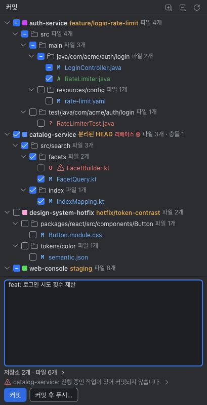

commit 하고 바로 push 하려면 5 단계에서 **커밋 후 푸시…** 를 누릅니다. commit 이 끝나면 commit 된 저장소만 담은 push 체크 목록이 뜹니다([4.3](#폴더-탭에서는-일괄-실행)). 업스트림이 없는 새 branch 도 이 목록에서 업스트림을 지정해 보냅니다.

#### 체크 상자의 뜻

체크 상자는 git index(stage 영역)를 그대로 보여 줍니다. 마우스를 올리면 지금 상태가 보입니다.

| 모양      | 툴팁                                                       | 누르면               |
| --------- | ---------------------------------------------------------- | -------------------- |
| 체크      | **스테이징됨 — 클릭하면 스테이징을 해제합니다**            | 그 아래 전부 unstage |
| 빈 칸     | **스테이징 안 됨 — 클릭하면 스테이징합니다**               | 그 아래 전부 stage   |
| 가로줄(−) | **일부 스테이징됨 — 클릭하면 전체를 스테이징합니다**       | 그 아래 전부 stage   |
| 꺼진 칸   | **충돌 파일은 체크할 수 없습니다. 충돌을 먼저 해결하세요** | 아무 일도 없음       |
- 저장소 행은 그 저장소 전체, 폴더 행은 그 폴더 아래 전체가 대상입니다.
- 폴더·저장소 행을 누를 때 안의 충돌 파일은 건너뜁니다. 건너뛰면 `<저장소>: 충돌 파일 N개는 건너뛰었습니다` 알림이 뜹니다. 충돌 파일만 든 행은 **충돌 파일만 있어 체크할 수 없습니다** 입니다.
- stage·unstage 가 도는 동안 누른 줄에 **처리 중…** 이 붙고, 그 저장소의 다른 체크는 잠깐 막힙니다(**이 저장소의 스테이징·스테이징 해제가 끝나기를 기다리는 중입니다.**). commit 이나 일괄 작업이 도는 동안에는 모든 체크가 막힙니다(**일괄 작업(커밋 등)이 끝난 뒤에 체크할 수 있습니다.**).
- 실패하면 `<저장소>: stage·unstage 하지 못했습니다` 알림이 뜨고 체크는 그대로입니다.

> [!WARNING]
> 체크 상자는 누르는 즉시 git index 를 바꿉니다. 확인창도 Undo 도 없습니다. 특히 가로줄(일부만 stage 됨)인 파일·폴더를 누르면 파일 전체가 stage 됩니다. 저장소 탭이나 터미널에서 hunk·줄 단위로 골라 둔 stage 가 사라지니, 그런 파일은 폴더 탭에서 누르지 마세요.

#### 커밋될 저장소와 막히는 경우

**커밋** 은 stage 된 것이 있는 저장소만 commit 합니다. stage 된 것이 있어도 다음 저장소는 commit 하지 않고, 메시지 칸 아래에 `<저장소>: <사유>` 로 미리 알려 줍니다. 여럿이면 `커밋되지 않을 저장소 N개` 한 줄로 접히고, 누르면 펼쳐집니다.

| 사유                                        | 뜻                           |
| ------------------------------------------- | ---------------------------- |
| **진행 중인 작업이 있어 커밋되지 않습니다** | merge·rebase 등이 멈춰 있음  |
| **충돌이 있어 커밋되지 않습니다**           | 충돌 파일이 남아 있음        |
| **상태를 읽지 못해 커밋되지 않습니다**      | 저장소 상태를 읽다 오류가 남 |
| **상태를 아직 몰라 커밋되지 않습니다**      | 상태를 아직 읽는 중          |

**커밋** 단추가 꺼져 있으면 마우스를 올려 사유를 봅니다.

- **스테이징된 변경이 없습니다**: 커밋될 저장소가 없음
- **커밋 메시지를 입력하세요**: 메시지가 비었음
- **스테이징·스테이징 해제가 끝난 뒤에 커밋할 수 있습니다.**
- **실행 중인 일괄 작업이 끝난 뒤에 커밋할 수 있습니다**

#### 저장소마다 다른 메시지로 commit 하기

서로 상관없는 변경을 한꺼번에 commit 할 때는 저장소마다 메시지를 따로 쓸 수 있습니다. 커밋될 저장소가 둘 이상이면 메시지 칸 아래의 대상 줄(`저장소 N개 · 파일 M개`)을 누를 수 있습니다.

1. 대상 줄을 누르면 그 위에 저장소별 커밋 메시지 창이 뜹니다. 맨 위에 **비워 두면 공통 메시지로 커밋합니다.** 가 보이고, 커밋될 저장소마다 이름, 파일 수, **이 저장소만 커밋** 단추와 메시지 칸이 있습니다.
2. 메시지를 따로 쓸 저장소의 칸에 적습니다. 칸을 비워 두면 공통 메시지(위의 메시지 칸)로 commit 합니다. 빈 칸에는 `공통 메시지: <첫 줄>` 이 흐리게 보입니다.

   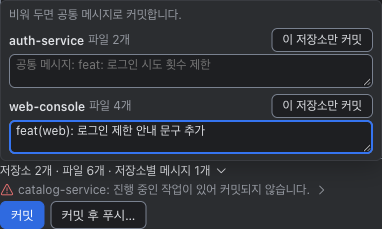

3. Esc 나 창 밖을 눌러 닫습니다. 적은 메시지는 그대로 남습니다.
4. 대상 줄이 `저장소 N개 · 파일 M개 · 저장소별 메시지 K개` 로 바뀝니다. 마우스를 올리면 따로 쓴 저장소와 그 첫 줄(`<저장소>: <첫 줄>`)이 보입니다.
5. **커밋** 이나 **커밋 후 푸시…** 를 누릅니다.

- 대상마다 따로 쓴 메시지가 있으면 공통 메시지 칸은 비어 있어도 됩니다. 따로 쓴 메시지가 없는 대상이 하나라도 있는데 공통 메시지가 비면 **커밋** 이 꺼집니다(**커밋 메시지를 입력하세요.**).
- commit 된 저장소의 메시지는 지워집니다. 실패한 저장소의 메시지는 남습니다.
- 커밋될 저장소가 하나뿐이면 대상 줄은 누를 수 없는 글자입니다. 위의 메시지 칸에 쓰면 됩니다.

#### 한 저장소만 commit 하기

stage 해 둔 저장소 가운데 하나만 먼저 commit 하려면 다음 중 하나를 씁니다.

- 변경 트리의 저장소 행을 우클릭하고 **이 저장소만 커밋** 을 누릅니다. **이 저장소만 커밋 후 푸시…** 는 commit 한 뒤 그 저장소만 담은 push 체크 목록을 엽니다.
- 저장소별 커밋 메시지 창에서 그 저장소 줄의 **이 저장소만 커밋** 을 누릅니다.

그 저장소에 따로 쓴 메시지가 있으면 그 메시지로, 없으면 공통 메시지로 commit 합니다. 다른 대상이 아직 남아 있으면 공통 메시지는 지워지지 않습니다. 커밋되지 않을 저장소(진행 중인 작업·충돌 등)나 stage 된 것이 없는 저장소에서는 항목이 꺼져 있고, 마우스를 올리면 사유가 보입니다.

#### 결과

- 결과 알림의 제목은 `일괄 commit` 이고, 본문에 `성공 s · 건너뜀 k · 실패 f` 와 건너뛰거나 실패한 저장소의 사유(다섯 줄까지)가 보입니다. 하나라도 실패하면 빨간 알림입니다.
- 저장소별 결과는 Git 도구 창의 **작업 기록** 탭에도 끝난 시각과 함께 남습니다([작업 기록](#작업-기록)).
- 대상이 모두 commit 됐을 때만 메시지 칸이 비워집니다. 실패가 있으면 메시지가 남아 고친 뒤 다시 누를 수 있습니다.
- stage 된 파일에 충돌 마커(`<<<<<<<` 등)가 남아 있으면 그 저장소는 `충돌 마커가 남아 있습니다: <파일>` 로 실패합니다.
- git hook 은 그대로 실행됩니다. hook 이 거부하면 그 저장소가 실패하고 hook 의 출력이 사유로 보입니다.

> [!NOTE]
> 폴더 탭의 commit 은 stage 된 것을 전부 commit 합니다. 터미널 등 앱 밖에서 미리 stage 해 둔 변경도 같은 메시지로 함께 들어갑니다. 파일 수가 생각과 다르면 `저장소 N개 · 파일 M개` 를 확인하세요.

폴더 탭에는 amend, 서명(`-S`), hook 건너뛰기, 메시지 템플릿, 비밀 정보 검사, 파일 버리기가 없습니다. 이런 기능이 필요하면 그 저장소를 저장소 탭으로 엽니다(Commit 도구 창의 저장소 행 우클릭 → **저장소 탭으로 열기**).

### 저장소 탭에서 stage 하고 commit 하기

1. Commit 도구 창의 **변경** 탭을 엽니다.
2. `변경` 영역에서 파일을 고르고 **스테이징** 을 누릅니다. 전부 올리려면 **모두 스테이징** 을 누릅니다.
3. 잘못 올린 파일은 `스테이징됨` 영역에서 고르고 **스테이징 해제** 를 누릅니다. 전부 내리려면 **모두 스테이징 해제** 입니다.
4. 아래 **요약** 칸에 commit 제목을 적습니다. 필요하면 **본문 (선택)** 칸에 본문을 적습니다.
5. **커밋** 을 누릅니다. **요약**·**본문 (선택)** 칸에서 `⌘Enter` 를 눌러도 됩니다.
6. 끝나면 폼 아래에 `커밋 <해시> 완료` 가 보이고, 메시지 칸이 비워지며 **마지막 커밋에 합치기 (amend)** 가 꺼집니다.

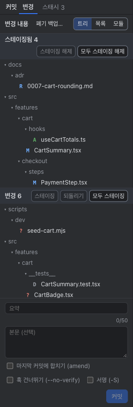

commit 은 툴바의 ↶ **되돌리기**(`⌘Z`)로 되돌릴 수 있습니다. 이때 commit 만 풀리고 파일 내용은 그대로 남습니다. → [6.1 Undo·Redo 로 되돌리기](6-실수했을-때.md#61-undoredo-로-되돌리기)

#### commit 폼

| 칸·옵션                          | 뜻                                                                                                                  |
| -------------------------------- | ------------------------------------------------------------------------------------------------------------------- |
| **템플릿 선택…**                 | 메시지 템플릿을 고르면 메시지 칸에 채웁니다. git 의 `commit.template` 이나 앱 템플릿이 있을 때만 보입니다           |
| **요약**                         | commit 제목(첫 줄). 아래에 `N/50` 글자 수가 보이고, 50자를 넘으면 강조됩니다                                        |
| **본문 (선택)**                  | 둘째 문단부터. 72자를 넘는 줄이 있으면 **72자를 넘는 본문 줄이 있습니다** 가 보입니다                               |
| **마지막 커밋에 합치기 (amend)** | 새 commit 대신 직전 commit 을 고칩니다. 켤 때 메시지가 비어 있으면 직전 commit 의 메시지를 채웁니다                 |
| **훅 건너뛰기 (--no-verify)**    | pre-commit·commit-msg hook 을 실행하지 않습니다                                                                     |
| **서명 (-S)**                    | commit 에 서명합니다. 처음 값은 git 의 `commit.gpgSign` 이고, 마우스를 올리면 `설정: 켜짐`·`설정: 꺼짐` 이 보입니다 |
- 글자 수 안내는 경고일 뿐이고, 넘어도 commit 할 수 있습니다.
- commit 폼에는 작성자를 바꾸는 칸이 없습니다. 저장소별 이름·이메일·서명 키는 [8.5 작성자 프로필](8-설정.md#85-작성자-프로필)이나 [8.7 저장소 설정](8-설정.md#87-저장소-설정)에서 바꿉니다.

> [!WARNING]
> **마지막 커밋에 합치기 (amend)** 는 직전 commit 을 새 commit 으로 바꿔 씁니다. 이미 push 한 commit 을 amend 하면 원격과 갈라져 다음 push 가 거부됩니다. amend 전 commit 은 백업으로 남습니다. → [6.2 백업에서 되살리기](6-실수했을-때.md#62-백업에서-되살리기)

#### commit 할 수 없을 때

**커밋** 단추는 다음일 때 꺼져 있습니다.

- **요약** 이 비었을 때
- 충돌 파일이 남아 있을 때
- stage 된 것이 없을 때(**마지막 커밋에 합치기 (amend)** 는 예외). 폼 아래에 **스테이징된 변경이 없습니다** 가 보입니다.
- commit 이 도는 동안(단추 글자가 **커밋 중…**)

#### commit·stage 할 때 뜨는 경고

| 상황                                | 보이는 것                                                                                | 할 일                                                                              |
| ----------------------------------- | ---------------------------------------------------------------------------------------- | ---------------------------------------------------------------------------------- |
| stage 된 내용에 토큰·키로 보이는 줄 | 폼 안에 `비밀 정보로 보이는 줄 N개가 staged 에 있습니다` 와 줄 목록(경로:줄, 규칙, 내용) | 줄마다 **이 규칙 무시**, 확인했으면 **그래도 커밋**, 멈추려면 **취소**             |
| stage 된 파일에 충돌 마커           | 대화상자 **충돌 마커가 남아 있습니다** 와 파일 목록                                      | 마커가 내용이면 **그래도 커밋**, 아니면 취소하고 고칩니다                          |
| hook 이 거부                        | 폼 아래 빨간 오류 줄과 hook 의 출력                                                      | 출력을 보고 고칩니다. 건너뛰려면 **훅 건너뛰기 (--no-verify)** 를 켜고 다시 commit |
| stage 된 것이 없음                  | 폼 아래 **스테이징된 변경이 없습니다**, **커밋** 꺼짐                                    | 먼저 stage 합니다                                                                  |
| `.git` 이 든 폴더를 stage           | 대화상자 **미등록 하위 저장소**: 그대로 stage 하면 내용 없는 포인터만 들어간다는 안내    | **서브모듈로 등록** 또는 **Git 추적에서 제외**                                     |

> [!NOTE]
> commit 폼이 아닌 작업(merge·rebase·계속하기 등)이 hook 에 거부되면 **훅이 거부했습니다.** 대화상자가 뜹니다. **확인**·**취소** 는 닫기만 하고 다시 실행하지 않습니다. hook 의 출력은 Git 콘솔에서 봅니다([6.5](6-실수했을-때.md#65-실행된-명령-보기)). hook 건너뛰기(--no-verify)는 commit 폼에만 있습니다. 폴더 탭에서는 제목 앞에 `<저장소>:` 가 붙습니다.

### hunk·줄 단위로 stage 하기

파일의 일부만 commit 하려면 diff 탭에서 hunk(바뀐 덩어리)나 줄을 골라 stage 합니다. 폴더 탭과 저장소 탭에서 같습니다.

1. Commit 도구 창에서 파일을 열어 작업 트리 diff 탭을 띄웁니다(폴더 탭은 클릭, 저장소 탭은 더블클릭).
2. hunk 하나를 통째로 올리려면 hunk 머리줄의 **구간 전체 스테이징** 을 누릅니다.
3. 일부만 고르려면 바뀐 줄 앞의 체크 상자를 누릅니다. 위 줄의 **선택 단위** 가 처음 값 **변경 블록** 이면 이어진 바뀐 줄 묶음이 한꺼번에 골라지고, **행** 으로 바꾸면 줄 하나씩 고릅니다. 줄을 눌러도 됩니다. `⇧` 를 누른 채 누르면 같은 hunk 안에서 범위로 고릅니다. **구간 전체 선택** 은 그 hunk 의 바뀐 줄을 모두 고릅니다.
4. 위 줄의 **선택 변경 스테이징** 을 누릅니다. 옆에 고른 수가 `변경 N개 선택` 으로 보입니다. 고른 것을 풀려면 **선택 해제** 를 누릅니다.

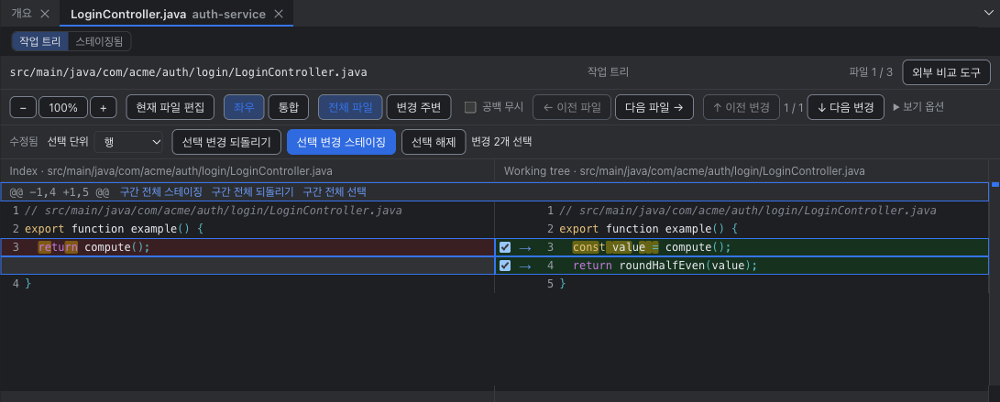

- stage 된 쪽 diff(저장소 탭의 `스테이징됨` 영역 파일, 폴더 탭의 **스테이징됨** 전환)에는 **선택 단위** 가 없고 줄 하나씩 고릅니다. 단추가 **구간 전체 스테이징 해제**·`선택 N줄 스테이징 해제` 로 바뀌어 내립니다.
- 작업 트리 쪽 diff 에는 **구간 전체 되돌리기**·**선택 변경 되돌리기** 도 있습니다. 누르면 `<저장소>: <경로> 의 변경을 되돌릴까요?` 확인창에 버릴 줄이 보이고, **되돌리기** 를 누르면 그 변경을 버립니다. 버리기 전에 파일 전체를 폐기 백업에 복사합니다([6.3](6-실수했을-때.md#63-버린-파일-되살리기)).
- 파일에 UTF-8 이 아닌 줄이 있으면 **UTF-8이 아닌 줄이 있어 줄·변경 구간 단위로 작업할 수 없습니다.** 가 보이고 단추가 없습니다.
- commit diff·범위 diff 는 읽기 전용이라 이 단추들이 없습니다.

### 변경 버리기

저장소 탭에서 파일의 변경을 버리려면 다음과 같이 합니다.

1. `변경` 영역에서 버릴 파일을 고릅니다.
2. **되돌리기** 를 누릅니다.
3. 확인창 **변경 내용을 버릴까요?** 에 `N개 파일의 작업 트리 변경을 버립니다. …` 와 파일 목록이 보입니다.
4. **버리기** 를 누릅니다. 끝나면 **폐기 백업에서 복구할 수 있습니다** 알림이 뜹니다.

- 추적 중인 파일은 작업 트리의 변경만 버립니다. stage 해 둔 부분은 남습니다. stage 해 둔 변경까지 없애려면 [변경 되돌리기](#변경-되돌리기)를 씁니다.
- untracked 파일은 지웁니다.
- untracked 폴더(예: 안에 `.git` 이 든 폴더)는 백업할 수 없어 버리지 않습니다. `폴더는 백업할 수 없어 버리지 않습니다: <경로>. 필요하면 직접 지우세요` 오류가 뜨고, 함께 고른 파일도 그대로 둡니다.
- 폴더 탭에는 이 **되돌리기** 단추가 없습니다. 폴더 탭에서는 Project 트리나 Commit 도구 창의 우클릭 메뉴 **변경 되돌리기…**([아래](#변경-되돌리기))를 씁니다. diff 탭의 **구간 전체 되돌리기** 는 폴더 탭에서도 됩니다.

> [!WARNING]
> 버린 변경은 commit 된 적이 없어 git 으로도, ↶ **되돌리기**(Undo)로도 되찾을 수 없습니다. 버리기 직전 사본이 앱의 폐기 백업에만 남습니다. → [6.3 버린 파일 되살리기](6-실수했을-때.md#63-버린-파일-되살리기)
>
> 이 **되돌리기** 단추는 "변경 버리기" 입니다. 툴바의 ↶ **되돌리기**(Undo)와 이름이 같으니 헷갈리지 마세요.

### 변경 되돌리기

파일을 마지막 commit(HEAD) 상태로 되돌리려면 다음과 같이 합니다. stage 해 둔 변경까지 되돌립니다. 폴더 탭과 저장소 탭에서 모두 됩니다.

1. Project 트리나 폴더 탭 Commit 도구 창에서 파일·폴더를 우클릭합니다. 여러 개 골라도 됩니다.
2. **변경 되돌리기…** 를 누릅니다. 바뀐 파일이 둘 이상이면 `변경 되돌리기… (3개)` 처럼 보입니다.
3. 확인창 **변경 사항을 되돌릴까요?** 에 `N개 파일을 마지막 커밋(HEAD) 상태로 되돌립니다. …` 와 파일 목록이 보입니다. 저장소가 여럿이면 `<저장소>/<경로>` 로 보입니다.
4. **되돌리기** 를 누릅니다. 끝나면 **폐기 백업에서 복구할 수 있습니다** 알림이 뜨고 Project 트리를 다시 읽습니다.

| 파일 상태                    | 변경 버리기 (저장소 탭 **되돌리기** 단추)        | 변경 되돌리기… (우클릭 메뉴)                |
| ---------------------------- | ------------------------------------------------ | ------------------------------------------- |
| 고친 파일(M)                 | 작업 트리의 변경만 버림. stage 해 둔 부분은 남음 | stage 해 둔 부분까지 마지막 commit 내용으로 |
| 새로 추가해 stage 한 파일(A) | 그대로 둠                                        | index 에서 빼고 파일을 지움                 |
| untracked 파일(?)            | 지움                                             | 지움                                        |
| 이름을 바꾼 파일(R)          | 작업 트리 쪽 변경만 버림                         | 새 이름 파일을 지우고 원래 이름으로 되살림  |
| 지운 파일(D)                 | 작업 트리에서만 지웠으면 되살림                  | stage 한 삭제까지 되살림                    |
- 폴더를 고르면 그 아래의 바뀐 파일이 모두 대상입니다. 폴더 자체는 지우지 않으므로 빈 폴더가 남을 수 있습니다.
- 폴더 탭의 저장소 행에서 고르면 그 저장소의 변경 전부가 대상입니다. 안에 든 다른 저장소의 파일은 빠집니다.
- 충돌 파일은 대상에서 빠집니다. merge·rebase 등이 멈춰 있는 동안에는 stage 된 파일을 되돌리지 않습니다. `merge·rebase 같은 작업이 진행 중이라 stage 된 변경은 되돌리지 않습니다 (해결 결과 보호): <경로>` 오류가 뜨고 아무것도 바꾸지 않습니다.
- 안에 `.git` 이 든 폴더(하위 저장소)는 백업할 수 없어 대상이 아닙니다.

예를 들어 Finder 에서 보이지 않는 `.DS_Store` 가 Project 트리에 `A` 로 보이면, 트리에서 그 파일을 우클릭해 **변경 되돌리기…** 를 고릅니다. 파일이 지워지고 index 에서도 빠집니다. 다시 생겨도 잡히지 않게 하려면 이어서 **Git 추적에서 제외** ▸ 를 씁니다(파일이 untracked 로 다시 생겼을 때 메뉴에 보입니다).

> [!WARNING]
> 되돌린 변경도 commit 된 적이 없어 git 이나 ↶ **되돌리기**(Undo)로 되찾을 수 없습니다. 되돌리기 직전의 작업 트리 파일만 폐기 백업에 남습니다. stage 해 둔 내용이 작업 트리와 달랐다면 그 stage 쪽 내용은 남지 않습니다. → [6.3 버린 파일 되살리기](6-실수했을-때.md#63-버린-파일-되살리기)

### ignore 에 추가하기

저장소 탭에서 파일을 `.gitignore` 에 넣으려면 다음과 같이 합니다. Project 트리(두 탭)와 폴더 탭 Commit 도구 창의 우클릭 메뉴에도 같은 **Git 추적에서 제외** ▸ 가 있습니다. 그곳에서는 untracked 파일, 또는 untracked 파일을 품은 폴더 하나를 골랐을 때 보입니다. 폴더를 골랐으면 `이 폴더 (<폴더>/)` 하나만 있습니다.

1. `변경` 영역의 파일을 우클릭합니다.
2. **Git 추적에서 제외** ▸ 에서 패턴을 고릅니다.
   - `이 파일 (<경로>)`: 그 파일 하나
   - `확장자 (*.<확장자>)`: 같은 확장자 전부(확장자가 있을 때)
   - `이 폴더 (<폴더>/)`: 그 파일이 든 폴더 전체(맨 위 폴더의 파일이 아닐 때)
3. 저장소 맨 위의 `.gitignore` 끝에 그 줄이 붙습니다. 이미 있는 줄이면 건너뜁니다.

이미 commit 된 파일은 ignore 에 넣어도 계속 추적됩니다. untracked 파일을 숨길 때 씁니다.

> [!WARNING]
> **Git 추적에서 제외** 는 확인창 없이 바로 `.gitignore` 파일을 고칩니다. ↶ **되돌리기**(Undo) 대상도 아닙니다. 잘못 넣었으면 `.gitignore` 를 열어 그 줄을 지우세요. `.gitignore` 자체도 변경으로 잡히니 함께 commit 할지 정하세요.

### 파일 우클릭 메뉴

Commit 도구 창에서 행을 우클릭하면 다음 메뉴가 뜹니다.

| 탭        | 우클릭한 행                                       | 메뉴                                                                                                                                         |
| --------- | ------------------------------------------------- | -------------------------------------------------------------------------------------------------------------------------------------------- |
| 폴더 탭   | 파일                                              | **열기** · **저장소 탭으로 열기** · **변경 되돌리기…** · **Git 추적에서 제외** ▸(untracked 파일) · **Finder에서 보기** · **터미널에서 열기** |
| 폴더 탭   | 충돌 파일                                         | **충돌 해결** · **저장소 탭으로 열기** · **Finder에서 보기** · **터미널에서 열기**                                                           |
| 폴더 탭   | stage 된 파일(그 저장소에 진행 중 작업이 있을 때) | 위에 더해 **충돌 상태로 되돌리기 (자동 병합 다시)** · **충돌 상태로 되돌리기 (작업 트리 유지)**                                              |
| 폴더 탭   | 저장소 행                                         | **저장소 탭으로 열기** · **Finder에서 보기** · **터미널에서 열기**                                                                           |
| 저장소 탭 | 모든 파일                                         | **편집기에서 열기** · **Finder에서 보기**                                                                                                    |
| 저장소 탭 | `스테이징됨`·`변경` 영역 파일                     | 위에 더해 **줄별 수정 이력…** · **파일 이력…** · **외부 비교 도구로 열기**([4.6](#46-파일히스토리blame-보기))                                |
| 저장소 탭 | `변경` 영역 파일                                  | 위에 더해 **Git 추적에서 제외** ▸                                                                                                            |
| 저장소 탭 | `스테이징됨` 영역 파일(진행 중 작업이 있을 때)    | 위에 더해 **충돌 상태로 되돌리기 (자동 병합 다시)** · **충돌 상태로 되돌리기 (작업 트리 유지)** · **해결 내역 리뷰…**                        |
- 폴더 탭에서 지운 파일의 **Finder에서 보기**·**터미널에서 열기** 는 그 파일이 있던 폴더를 엽니다.
- macOS 가 아니면 **Finder에서 보기** 대신 **파일 탐색기에서 보기** 입니다.

충돌 상태로 되돌리기와 해결 내역 리뷰는 [5.6 충돌 해결하기](5-가끔-하는-작업.md#56-충돌-해결하기)에서 설명합니다.

## 4.3 Fetch·Pull·Push 하기

원격과 commit 을 주고받으려면 툴바의 **Fetch**·**Pull**·**Push** 를 씁니다. 폴더 탭은 여러 저장소에 한꺼번에, 저장소 탭은 그 저장소 하나에 합니다.

### 폴더 탭에서는 (일괄 실행)

#### 대상 저장소

- Project 트리나 개요 표에서 고른 저장소 행이 대상입니다.
- 하나도 고르지 않았거나 저장소 안의 파일·폴더만 골랐으면 폴더의 모든 저장소가 대상입니다.
- 툴바 단추에 마우스를 올리면 `Fetch (선택 2개)`·`Fetch (전체 8개)` 처럼 대상 수가 보입니다.
- 확인창에는 대상 수와 저장소 이름이 보입니다. 고른 저장소 그대로면 `선택 2개: …`, 고르지 않았으면 `전체 8개: …` 입니다. **커밋 후 푸시…**(commit 된 저장소)·실패한 저장소만 다시 실행·Project 트리 행 메뉴처럼 흐름이 정한 대상이 고른 것과 다르면 `저장소 2개: …` 입니다.
- 폴더 설정에서 뺀 저장소(**일괄 작업에서 뺄 저장소 이름 (쉼표로 구분)**)는 **제외됨 (폴더 설정)** 으로 건너뜁니다([8.8](8-설정.md#88-폴더-설정)).

#### 편집기에 저장하지 않은 편집이 있을 때

작업 트리 파일을 바꾸는 일괄 작업은 대상 저장소 안에 편집기에서 저장하지 않은 편집(또는 저장 중인 파일)이 있으면 실행하지 않습니다. 그대로 실행하면 바뀐 파일 위에 자동 저장이 편집 내용을 다시 써 충돌 띠가 뜨기 때문입니다.

- 해당 작업: **Pull**, branch 바꾸기(checkout), 지금 checkout 된 branch 의 [branch 업데이트](#branch-업데이트), 시작점에서 만들고 checkout 하는 **여기서 새 브랜치…**, 스태시 저장·꺼내기, merge·rebase. Fetch·Push·branch 만들기·이름 바꾸기·워크트리는 해당하지 않습니다.
- 확인창 없이 도는 작업(**Pull**·branch 업데이트)은 누르는 순간 확인합니다. 편집이 있으면 `저장하지 않은 편집이 있어 일괄 작업을 실행하지 않았습니다.` 알림에 `<저장소>: 편집 내용의 저장이 끝난 뒤 다시 실행하세요.` 가 보입니다.
- 저장소 체크 목록이 있는 작업(branch 바꾸기, 스태시 꺼내기, merge·rebase)은 그 저장소가 `저장하지 않은 편집 내용 또는 저장 중인 파일이 있습니다.` 사유와 함께 꺼진 칸입니다.
- 입력 창만 있는 작업(이름을 적는 checkout, 스태시 저장)은 창에 `저장하지 않은 편집이 있는 저장소: <저장소>. 저장이 끝난 뒤 실행하세요.` 가 붙습니다.
- 확인창을 띄운 뒤 생긴 편집도 확인을 누를 때 다시 보고, 있으면 위 알림과 함께 실행하지 않습니다.
- 편집은 1초 뒤 자동으로 저장되므로 잠시 뒤 다시 실행하면 됩니다. 외부 변경과 부딪혀 저장되지 않은 편집은 그 파일 탭에서 먼저 정리합니다.

#### 여는 곳

| 곳                            | 항목                                                                           |
| ----------------------------- | ------------------------------------------------------------------------------ |
| 툴바                          | **Fetch** · **Pull** · **Push**                                                |
| 단축키·커맨드 팔레트          | `⌘⇧F` · `⌘T` · `⌘⇧K`(툴바와 같음, [9.1](9-단축키.md#동기화))                   |
| Project 트리 저장소 행 우클릭 | `Fetch (<이름>)` · `Pull (<이름>)` · `Push… (<이름>)`(여럿이면 `(저장소 N개)`) |
| Project 트리 루트 우클릭      | `전체 Fetch (N개)`(고른 것과 관계없이 전체)                                    |
| 개요 탭 일괄 줄               | **Fetch** · **Pull** · **Push**                                                |
| 로그 탭 세로 툴바             | **Fetch** · **선택한 브랜치 업데이트**([branch 업데이트](#branch-업데이트))    |
| 로그 탭 브랜치 칸 로컬 branch | **업데이트 (N개 저장소)**([branch 업데이트](#branch-업데이트))                 |
| Commit 도구 창                | **커밋 후 푸시…**(commit 된 저장소로 push)                                     |

#### Fetch

확인 없이 대상 저장소마다 `git fetch --all --prune` 을 실행합니다.

#### Pull

확인 없이 대상 저장소마다 pull 합니다.

- 방식은 폴더 설정의 **일괄 Pull 방식** 을 따릅니다. 처음 값은 **이력 분기 없이 반영 (ff-only)** 이고 **리베이스**·**병합** 으로 바꿀 수 있습니다([8.8](8-설정.md#88-폴더-설정)). **Pull** 단추의 툴팁에 지금 방식이 보입니다.
- 다음 저장소는 건너뜁니다: **진행 중인 작업이 있습니다**, **커밋하지 않은 변경이 있습니다**, **업스트림 없음**.
- ff-only 로 할 수 없는 저장소(내 commit 과 원격 commit 이 갈라짐)는 실패로 나옵니다. 그 저장소를 저장소 탭으로 열어 방식을 골라 pull 하세요.
- pull 은 저장소마다 **지금 checkout 된 branch 만** 갱신합니다. checkout 하지 않은 로컬 branch(예: `development`·`staging`)는 그대로이고, 브랜치 칸의 `⇣N` 도 남습니다. 그런 branch 는 [branch 업데이트](#branch-업데이트)로 받습니다.
- 결과에는 저장소마다 무엇이 바뀌었는지가 보입니다. 받은 commit 이 있으면 `main ← commit 3개`, 없으면 **이미 최신** 입니다([진행과 결과](#진행과-결과)).

> [!NOTE]
> 폴더 설정의 pull 방식을 **리베이스** 로 바꾸면 여러 저장소가 한꺼번에 rebase 됩니다. 처음 값인 ff-only 는 이력을 바꾸지 않습니다.

#### Push

폴더 탭의 Push 는 늘 저장소 체크 목록을 거칩니다.

1. 툴바의 **Push** 를 누릅니다.
2. **저장소마다 현재 브랜치를 업스트림으로 푸시** 대화상자가 뜹니다.
3. 보낼 commit 이 있는 저장소가 `<저장소>: 커밋 N개` 로 체크된 채 보입니다. 업스트림이 없는 branch 는 `<저장소>: 업스트림 새로 지정 → origin/<branch>` 로 체크된 채 보입니다. 빼고 싶은 저장소의 체크를 끕니다.
4. `origin` 이 없는 저장소는 체크 칸 아래 **<저장소>: 보낼 원격** 칸에서 원격을 고릅니다.
5. **Push** 를 누릅니다.

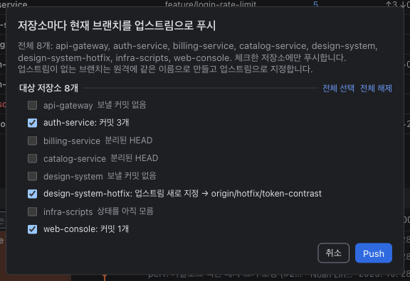

- 보낼 수 없는 저장소는 꺼진 칸으로 보이고 옆에 사유가 붙습니다: **보낼 커밋 없음**, **분리된 HEAD**, **원격 없음**, **업스트림 없음**(원격 목록을 읽지 못함), **제외됨 (폴더 설정)**, **상태를 아직 모름**.
- 보낼 저장소가 하나도 없으면 **보낼 커밋이 있는 저장소가 없습니다.** 가 보입니다. 체크를 모두 끄면 **체크한 저장소가 없습니다** 가 보이고 **Push** 가 꺼집니다.
- 업스트림이 있는 저장소는 현재 branch 를 그 업스트림으로 그냥 `git push` 합니다.
- 업스트림이 없는 branch(예: 폴더 탭에서 일괄로 만든 새 branch)는 같은 이름의 원격 branch 를 만들고 업스트림으로 지정합니다(`git push -u <원격> <branch>`). 보낼 commit 수는 세지 않습니다.
  - `origin` 이 있으면 묻지 않고 `origin` 으로 보냅니다.
  - `origin` 이 없으면 **보낼 원격** 칸에서 고른 원격으로 보냅니다. 원격이 하나뿐이면 그것이 미리 골라져 있고, 여럿이면 **고르지 않음 (건너뜀)** 으로 시작합니다. 고르지 않은 채 체크해 두면 그 저장소는 `origin 이 없어 보낼 원격을 골라야 합니다` 로 건너뜁니다.
  - 원격이 하나도 없으면 꺼진 칸(**원격 없음**)입니다.
- 보낼 commit 이 있는 저장소나 업스트림이 없는 저장소만 보려면 개요 탭의 **보낼 것 있음**·**업스트림 없음** 필터로 거릅니다([3.6](3-화면-둘러보기.md#36-개요-탭)).
- 폴더 탭에는 강제 push 가 없습니다. 원격에 새 commit 이 있어 거부되면 실패로만 나옵니다. 그런 저장소는 저장소 탭으로 열어 처리하세요([저장소 탭에서는](#저장소-탭에서는-1)).

#### 진행과 결과

- 도는 동안 툴바에 `<작업>: <단계> 실행 중…` 과 진행 막대가 보이고, 일괄 단추들이 꺼집니다.
- 멈추려면 진행 막대 옆 **×**(툴팁 `일괄 작업 취소 — …`)를 누릅니다. 개요 탭 일괄 줄의 **일괄 작업 취소** 도 같습니다. 누르면 `취소하는 중…` 이 붙고, 끝날 때까지 단추가 꺼집니다.
  - 아직 시작하지 않은 저장소는 **취소됨** 으로 남습니다.
  - 실행 중이던 fetch·push 는 멈추고 `실행 중에 취소했습니다 (반영 여부를 확인하세요)` 로 남습니다. 원격에 일부 반영됐을 수 있습니다.
  - 그 밖의 실행 중 작업(pull·checkout 등 작업 트리를 바꾸는 것)은 중간에 끊지 않고 끝까지 둡니다. 그 저장소는 원래 결과대로 남습니다.
  - 이미 끝난 저장소는 그 결과대로입니다.
- 끝나면 알림이 뜹니다. 개요 탭·툴바·브랜치 칸·Project 트리 메뉴 어디서 실행해도 같습니다. 제목은 `일괄 fetch`·`일괄 pull`·`일괄 push` 이고, 본문에 `성공 s · 건너뜀 k · 실패 f` 와 저장소별 사유가 보입니다. 하나라도 실패하면 빨간 알림입니다.
- pull 과 branch 업데이트는 성공을 둘로 나눕니다: `갱신 u · 이미 최신 d · 건너뜀 k · 실패 f`. 알림 본문에는 건너뛰거나 실패한 저장소의 사유 다음에 갱신한 저장소가 `<저장소>: <branch> ← commit N개` 로 보입니다. 줄이 많으면 다섯 줄 뒤는 `외 N개` 로 줄입니다.
- push 가 업스트림을 새로 지정한 저장소가 있으면 요약이 `성공 s (업스트림 새로 지정 n) · 건너뜀 k · 실패 f` 입니다. 알림 본문과 작업 기록의 저장소 줄에는 `업스트림 새로 지정: origin/<branch>` 가 보입니다.
- 취소한 저장소가 있으면 요약 끝에 `· 취소됨 c` 가 붙습니다. 취소된 저장소는 건너뜀·실패에 세지 않습니다.
- pull·checkout·branch 업데이트에서 **커밋하지 않은 변경이 있습니다** 로 건너뛴 저장소가 있으면 알림 끝에 `커밋하지 않은 변경으로 건너뛴 저장소 N개 — '스태시 저장…' 후 다시 실행하고, 끝나면 '스태시 꺼내기…'로 되돌리세요` 가 붙습니다([폴더 탭에서 한꺼번에 stash 하기](#폴더-탭에서-한꺼번에-stash-하기)).
- 개요 탭에는 결과가 남지 않습니다. 저장소별 결과는 Git 도구 창의 **작업 기록** 탭에서 끝난 시각과 함께 다시 봅니다([작업 기록](#작업-기록)).
- 실패한 명령은 Git 도구 창 **콘솔** 탭에도 쌓입니다. 콘솔을 보지 않는 동안 실패가 있으면 탭 옆에 숫자 배지가 붙습니다([6.5](6-실수했을-때.md#65-실행된-명령-보기)).

#### 작업 기록

지난 일괄 작업의 결과를 다시 보려면 Git 도구 창의 **작업 기록** 탭을 엽니다. 이 탭은 폴더 탭에만 있습니다.

- 끝난 일괄 작업(fetch·pull·push·branch 만들기·checkout·워크트리 만들기·branch 업데이트·이름 바꾸기·스태시 저장·스태시 꺼내기·git 명령 실행), 일괄 commit, 이 폴더로 받은 여러 저장소 clone([2.4](2-저장소와-폴더-열기.md#여러-저장소-한꺼번에-clone-하기)), 폴더 자동 fetch([자동 fetch와 배지](#자동-fetch와-배지))가 최신 순으로 쌓입니다.
- 한 줄에는 끝난 시각(`HH:mm:ss`), 작업 이름(`일괄 fetch`·`일괄 commit`·`자동 fetch` 등), 요약이 보입니다. 요약은 알림과 같은 `성공 s · 건너뜀 k · 실패 f`(pull·업데이트는 `갱신 u · 이미 최신 d · …`)이고, 실패가 있으면 빨간 글자입니다.
- 줄을 누르면 저장소별 결과가 펼쳐집니다. 저장소마다 `건너뜀: <사유>`·**실패**·**완료** 와 git 메시지가 보이고, pull·업데이트는 **완료** 대신 `<branch> ← commit N개` 나 **이미 최신** 이 보입니다. git 명령 실행 줄은 저장소마다 종료 코드와 출력이 보이고, 가장 최근 줄은 펼친 채로 시작합니다([5.10](5-가끔-하는-작업.md#결과-보기)).
- 실행조차 하지 못한 작업은 요약이 **실행하지 못함** 이고, 펼치면 사유가 보입니다.
- 실패하거나 취소된 저장소가 있는 일괄 작업 줄에는 `실패한 저장소만 다시 실행 (N개)` 단추가 붙습니다. 일괄 작업이 도는 동안은 꺼집니다.
  - fetch·pull·branch 업데이트는 그 저장소들에서 바로 다시 실행합니다.
  - 확인 창을 거치던 작업은 같은 확인 창을 그 저장소들로 좁혀 다시 엽니다. push 체크 목록(골랐던 **보낼 원격** 을 처음 값으로), branch 만들기·여기서 새 branch(이름·checkout), checkout(branch 전환 체크 목록), 워크트리 만들기(폴더·branch), 이름 바꾸기(새 이름), 로컬 branch 삭제, merge·rebase(사전 조회를 다시 하고 방식은 그대로), 스태시 저장(같은 묶음으로, 메시지·**미추적 파일 포함** 그대로), 스태시 꺼내기(그 묶음의 남은 저장소 체크 목록), git 명령 실행(같은 명령을 채운 입력 창, 위험한 명령은 확인도 다시), 여러 저장소 clone(실패·취소된 주소를 채운 **여러 저장소 복제** 대화상자, 같은 상위 폴더·옵션)입니다.
  - 원격 branch 삭제·로컬 강제 삭제와 일괄 commit 줄에는 이 단추가 없습니다.
- 저장에 성공한 저장소가 있는 스태시 저장 줄에는 **이 묶음 꺼내기** 단추가 붙습니다. 누르면 그 묶음의 꺼내기 체크 목록이 열립니다([폴더 탭에서 한꺼번에 stash 하기](#폴더-탭에서-한꺼번에-stash-하기)).
- 자동 fetch 줄은 `저장소 N개 갱신 · 실패 M` 으로 요약하고, 펼치면 저장소마다 새로 받은 원격 branch(`origin/main` 등)나 실패 사유가 보입니다. 바뀐 것 없이 같은 저장소들의 실패만 이어지면 새 줄을 만들지 않고 그 줄의 시각을 새로 고친 뒤 `×N`(이어진 횟수)을 붙입니다.
- 폴더 탭마다 최신 100줄까지 남습니다. 머리줄의 **기록 지우기** 로 비웁니다. 폴더 탭을 닫거나 앱을 끄면 사라집니다.

### 저장소 탭에서는

#### Fetch

다음 중 하나로 fetch 합니다. 확인창은 없습니다.

- 툴바의 **Fetch**, `⌘⇧F`(**원격 정보 가져오기 (모든 원격)**), 로그 탭 세로 툴바의 **Fetch**: `git fetch --all --prune`
- 브랜치 칸의 원격 이름(예: `origin`) 우클릭 → `<원격> 만 fetch`: 그 원격만

원격이 없거나, 다른 Git 작업이 도는 중이거나, merge·rebase 등이 멈춰 있으면 꺼집니다.

#### Pull

1. 툴바 **Pull** 옆의 선택 상자에서 방식을 고릅니다.
2. **Pull** 을 누르거나 `⌘T` 를 누릅니다. 확인창은 없습니다.

| 방식                 | 실행                   | 뜻                                                   |
| -------------------- | ---------------------- | ---------------------------------------------------- |
| **pull (설정 따름)** | `git pull`             | git 설정(`pull.rebase` 등)을 따릅니다. 처음 값입니다 |
| **pull --no-rebase** | `git pull --no-rebase` | merge 로 합칩니다                                    |
| **pull --rebase**    | `git pull --rebase`    | 내 commit 을 원격 위로 옮깁니다                      |
| **pull --ff-only**   | `git pull --ff-only`   | fast-forward 만. 갈라졌으면 실패합니다               |
- **Pull** 단추에 마우스를 올리면 지금 방식이 보입니다.
- Pull 은 현재 branch 만 갱신합니다. 다른 로컬 branch 는 [branch 업데이트](#branch-업데이트)로 받습니다.
- 고른 방식은 저장되지 않습니다. 탭을 다시 열거나 앱을 다시 켜면 **pull (설정 따름)** 으로 돌아갑니다.
- 업스트림이 없거나 업스트림이 원격에서 지워졌으면(**원격 삭제됨**) 꺼집니다.
- 충돌이 나면 [5.6 충돌 해결하기](5-가끔-하는-작업.md#56-충돌-해결하기)로 이어집니다.

#### Push

- 툴바의 **Push** 나 `⌘⇧K` 는 현재 branch 를 업스트림으로 보냅니다. 마우스를 올리면 `origin/main 로 push (업스트림)` 처럼 대상이 보입니다.
- 업스트림이 없으면 툴팁이 `업스트림 없음 — <원격> 로 push 하며 지정` 입니다. 같은 이름의 branch 로 보내면서 업스트림을 지정합니다(`git push -u`).
- 다른 원격으로 보내려면 **Push** 옆 ⌄(**푸시 대상 선택**)를 누르고 `<원격> 로 push` 를 고릅니다. 업스트림과 다른 원격이면 같은 이름의 branch 로 보내고, 업스트림은 바꾸지 않습니다.
- 브랜치 칸의 원격 이름 우클릭 메뉴에도 `<원격> 로 push` 와 `<원격> 로 push 하고 업스트림 지정` 이 있습니다.

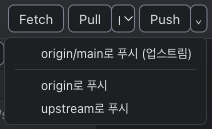

- 보낼 원격을 정하지 않았고 업스트림도 없으면, 원격이 하나뿐이면 그것, 여럿이면 `origin` 으로 보냅니다. 원격이 없거나 `origin` 없이 여럿이면 `원격이 없습니다. 먼저 원격을 추가하세요`·`원격이 여러 개라 보낼 곳을 정할 수 없습니다. 원격을 고르세요` 오류가 뜹니다.
- 분리된 HEAD 에서는 push 할 수 없습니다(`detached HEAD 에서는 push 할 수 없습니다`).
- tag 는 push 되지 않습니다. tag 는 따로 push 합니다. → [5.4 tag push 하기](5-가끔-하는-작업.md#tag-push-하기)

> [!WARNING]
> 저장소 탭의 **Push** 는 확인창 없이 바로 보냅니다. 업스트림이 없으면 같은 이름의 원격 branch 를 만들고 업스트림으로 지정합니다. 보내기 전에 툴바 배지(`↑2 ↓0`)와 **Push** 툴팁으로 대상을 확인하세요.

#### push 중에 뜨는 대화상자

| 상황                                           | 제목                                       | 고를 수 있는 것                                                                    |
| ---------------------------------------------- | ------------------------------------------ | ---------------------------------------------------------------------------------- |
| 업스트림 branch 이름이 로컬과 다름             | **업스트림 브랜치 이름이 로컬과 다릅니다** | **이 브랜치는 다시 묻지 않기** 체크 후 **푸시**                                    |
| 원격에 내가 받지 않은 새 commit 이 있어 거부됨 | **원격에 새 커밋이 있습니다**              | **원격 변경 반영 후 푸시**, 또는 원격을 덮어쓰는 **force-with-lease로 푸시**       |
| 강제 push 가 거부됨(그 사이 원격이 또 바뀜)    | **강제 푸시가 거부됐습니다**               | **원격 변경 가져오기** 로 받아 확인한 뒤 다시 push                                 |
| 서브모듈에 아직 push 안 한 commit 이 있음      | **푸시하지 않은 서브모듈 커밋**            | **서브모듈 먼저 푸시**(서브모듈부터 보낸 뒤 이 저장소) 또는 **상위 저장소만 푸시** |
| 업스트림이 없다고 git 이 거부함                | **업스트림이 없습니다**                    | **업스트림 지정 후 푸시**                                                          |

**force-with-lease로 푸시** 는 내가 마지막으로 받아 온 뒤 원격이 바뀌지 않았을 때만 덮어씁니다(`--force-with-lease --force-if-includes`). 다른 사람의 commit 이 원격에서 사라질 수 있으니 꼭 필요할 때만 쓰세요.

#### 자동 fetch와 배지

- 저장소 탭과 폴더 탭은 정해진 간격마다 자동으로 `git fetch --all --prune` 합니다. 처음 값은 5분이고, `⌘,` **설정** 의 **자동 원격 정보 가져오기 간격** 에서 **끔**·5·10·15·30·60분 중에 고릅니다. 바꾸면 열린 탭에 곧바로 적용되고, 다음 자동 fetch 까지의 시간도 처음부터 다시 셉니다([8.12](8-설정.md#812-자동-fetch)).
- 원격이 없거나 그 저장소의 git 설정에 `core.sshCommand` 가 있으면 하지 않습니다.
- 폴더 탭은 하위 저장소마다 fetch 합니다. 워크트리는 원래 저장소와 한 번만 받고, 폴더 설정에서 뺀 저장소([8.8](8-설정.md#88-폴더-설정))와 저장소 탭으로 열려 있는 저장소(그 탭이 따로 받습니다)는 건너뜁니다. 한꺼번에 받는 저장소 수는 폴더 설정의 **동시 실행 수 (1~16)** 를 따릅니다.
- 자동 fetch 는 자격 증명을 묻지 않습니다. OS 키체인에 저장된 자격 증명만 쓰고, 없으면 대화상자 없이 그 저장소의 자동 fetch 가 실패합니다. ssh 의 처음 보는 호스트 확인도 묻지 않고 실패합니다. 이런 저장소는 한 번 직접 **Fetch** 해서 자격 증명을 넣고 **OS 키체인에 저장** 을 켜 두세요.
- 자동 fetch 로 원격에 새 commit 이 오면 `원격에 새 commit (N개 branch)` 알림이 뜹니다. 폴더 탭은 본문에 `<저장소>: <원격 branch>` 가 다섯 개까지 보입니다. 실패는 알리지 않습니다. 폴더 탭은 새로 받은 것과 실패를 **작업 기록** 탭에 남깁니다([작업 기록](#작업-기록)).
- 툴바 배지는 현재 branch 와 업스트림의 차이입니다. `↑2 ↓0`(보낼 것·받을 것), **업스트림 없음**, **원격 삭제됨** 중 하나가 보입니다.

#### 진행·취소·결과

- 도는 동안 툴바에 `<작업> 실행 중…`, 진행 막대와 %, × 단추(툴팁 **취소**)가 보입니다. × 를 누르면 그 명령을 멈춥니다.
- 1.5초보다 오래 걸렸거나 실패하면 `<작업> 완료`·`<작업> 실패` 알림이 뜹니다. 그때 mGit 창이 뒤에 있으면 macOS 알림으로도 뜹니다.
- 실패 이유는 툴바 아래(작업 진행 띠가 있으면 그 아래)의 빨간 오류 줄과 Git 도구 창 **콘솔** 탭에 보입니다.

> [!WARNING]
> Fetch 는 두 탭 모두 늘 `--prune` 으로 실행합니다. 원격에서 지워진 branch 의 원격 추적 branch(`origin/x`)가 내 저장소에서도 사라집니다. 그 branch 를 추적하던 로컬 branch 는 남고 **원격 삭제됨** 으로 표시됩니다.

### branch 업데이트

Pull 은 checkout 된 branch 만 갱신하고, Fetch 는 원격 추적 branch(`origin/*`)만 움직입니다. checkout 하지 않은 로컬 branch(예: `development`)를 원격만큼 앞으로 옮기려면 **업데이트** 를 씁니다. IntelliJ 의 **Update** 와 같은 동작입니다.

#### 여는 곳

| 곳                                     | 항목                                                                                                                                          |
| -------------------------------------- | --------------------------------------------------------------------------------------------------------------------------------------------- |
| 폴더 탭 브랜치 칸 로컬 branch 우클릭   | **업데이트 (N개 저장소)**: 그 branch 가 있고 업스트림이 있는 저장소에서. 그런 저장소가 없으면 꺼진 **업데이트 (업스트림이 있는 저장소 없음)** |
| 저장소 탭 브랜치 칸 로컬 branch 우클릭 | **업데이트**(**브랜치 전환** 다음)                                                                                                            |
| 로그 탭 세로 툴바                      | **선택한 브랜치 업데이트**(**Fetch** 아래). 브랜치 칸에서 로컬 branch 하나를 골랐을 때만 켜지고, 툴팁에 대상이 보입니다                       |

#### 하는 일

확인창 없이 다음을 합니다. fast-forward 만 하므로 잃는 commit 이 없습니다.

1. 그 branch 의 업스트림 하나만 받아 옵니다(`git fetch <원격> +<원격 branch>:<원격 추적 branch>`). 다른 branch 는 받지 않습니다.
2. 로컬 branch 와 업스트림을 견줍니다.
3. 받을 commit 만 있으면 로컬 branch 를 업스트림으로 옮깁니다. checkout 하지 않은 branch 는 파일을 건드리지 않고 branch 만 옮깁니다(`git branch -f`). 지금 checkout 된 branch 는 작업 트리까지 갱신합니다(`git merge --ff-only`).

| 견준 결과             | 저장소 탭 알림                                | 폴더 탭 결과                             |
| --------------------- | --------------------------------------------- | ---------------------------------------- |
| 받을 commit 만 있음   | `development ← commit 39개`                   | `development ← commit 39개`(갱신)        |
| 받을 것이 없음        | `development: 이미 최신`                      | **이미 최신**                            |
| 내 commit 만 있음     | `development: 로컬이 앞섬 (⇡N), 받을 것 없음` | 건너뜀: `로컬이 앞섬 (⇡N), 받을 것 없음` |
| 양쪽에 commit 이 있음 | `development: 갈라져 갱신하지 않음 (⇡a ⇣b)`   | 건너뜀: `갈라져 갱신하지 않음 (⇡a ⇣b)`   |
- 갈라진 branch 는 그대로 둡니다. 저장소 탭에서 그 branch 를 checkout 한 뒤 **Pull** 옆에서 방식을 골라 합치세요.
- 다음 branch 는 업데이트하지 않습니다. 저장소 탭에서는 메뉴·단추가 꺼지고, 폴더 탭에서는 그 저장소를 건너뜁니다.
  - 업스트림이 없거나 원격에서 지워진 branch(폴더 탭: **업스트림 없음**, 원격 branch 가 지워졌으면 실패)
  - 다른 워크트리에서 checkout 된 branch(폴더 탭: `다른 워크트리에서 checkout 중 (<경로>)`). 그 워크트리의 파일은 건드리지 않습니다.
  - 그 저장소에 없는 branch(폴더 탭: **해당 브랜치가 없습니다**)
  - 지금 checkout 된 branch 인데 merge·rebase 등이 멈춰 있음(**진행 중인 작업이 있습니다**). 폴더 탭은 pull 처럼 커밋하지 않은 변경이 있어도 건너뜁니다(**커밋하지 않은 변경이 있습니다**).
- 저장소 탭의 업데이트는 ↶ **되돌리기**(Undo) 대상입니다. Undo 목록에는 `update <branch>` 로 보입니다. → [6.1 Undo·Redo 로 되돌리기](6-실수했을-때.md#61-undoredo-로-되돌리기)
- 폴더 탭의 업데이트는 일괄 작업이라 Undo 목록에 남지 않습니다. 결과 알림과 작업 기록은 pull 과 같은 모양입니다([진행과 결과](#진행과-결과)).

## 4.4 branch 만들고 바꾸기

branch 를 만들고 바꾸려면 Git 도구 창 로그 탭 왼쪽의 브랜치 칸을 주로 씁니다. 같은 조작이라도 폴더 탭과 저장소 탭에서 뜻이 다릅니다.

### 브랜치 칸

| 조작                           | 폴더 탭                                                                                       | 저장소 탭                                                                                                   |
| ------------------------------ | --------------------------------------------------------------------------------------------- | ----------------------------------------------------------------------------------------------------------- |
| branch 클릭, Space             | 로그를 그 branch 로 거름. `⌘` 클릭은 더하거나 빼기                                            | 로그에서 그 commit 으로 이동                                                                                |
| branch 더블클릭, Enter         | 로그를 그 branch 와 기본 branch 로, 그 branch 가 있는 저장소만 거름(아래). checkout 하지 않음 | 같음(로컬·원격 branch). 태그는 그 commit 으로 분리된 HEAD checkout, 워크트리는 그 워크트리 탭을 엶          |
| **HEAD (현재 브랜치)** 행 클릭 | 저장소마다 자기 HEAD 의 이력만 보이게 거름                                                    | 현재 commit 으로 이동                                                                                       |
| 묶음 행 클릭                   | 펼치기·접기                                                                                   | 같음                                                                                                        |
| 우클릭                         | 메뉴 7개(원격 branch 는 5개, 아래)                                                            | branch 종류별 메뉴(아래, merge·rebase 등은 [5.1](5-가끔-하는-작업.md#51-mergerebasecherry-pickrevertreset)) |

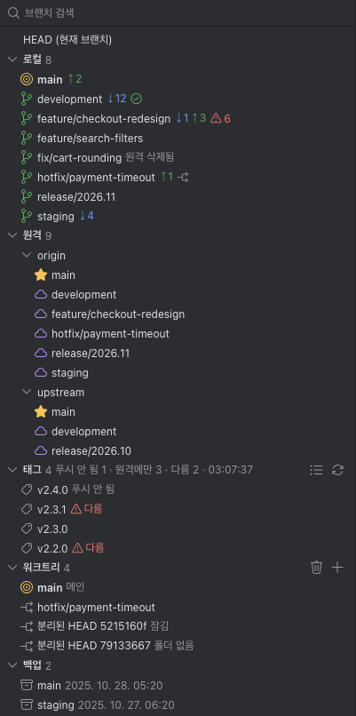

#### 더블클릭으로 기본 branch 와 견주어 보기

branch 를 더블클릭하거나 Enter 를 누르면 checkout 하지 않고, 로그를 그 branch 와 기본 branch(`master`·`origin/master`, 없으면 `main`·`origin/main`)로 거릅니다. 그 branch 가 기본 branch 에서 얼마나 갈라졌는지 바로 보입니다.

- `feature/x` 를 더블클릭하면 `feature/x`·`master`·`origin/master` 를 함께 봅니다. `master` 를 더블클릭하면 `master`·`origin/master` 만 봅니다. 원격 branch 행(예: `origin/feature/x`)도 같습니다.
- 원격 쪽은 기본 branch 의 업스트림입니다. 업스트림이 없으면 `origin/master`(또는 `origin/main`)가 있을 때 그것을 씁니다. 기본 branch 가 없는 저장소면 그 branch 만 봅니다.
- 폴더 탭은 그 branch 가 있는 저장소마다 그 저장소의 기본 branch 를 찾습니다(저장소마다 `master`·`main` 이 달라도 됩니다). 저장소에 없는 이름은 빼고 그립니다. 브랜치 칸에서는 거른 branch 행이 모두 선택으로 보입니다.
- 폴더 탭은 저장소 범위도 그 branch 가 있는 저장소로 좁힙니다. 필터 바의 **저장소** 조건(예: `저장소: api-gateway +1`)으로 보입니다. 모든 저장소에 있는 branch(예: `main`)면 좁히지 않습니다.
- 좁힌 저장소 범위는 branch 범위가 다른 것으로 바뀌면 더블클릭 전의 범위로 돌아갑니다. 다른 branch 클릭, **HEAD (현재 브랜치)** 행 클릭, 다른 branch 더블클릭, 필터 바 branch 조건의 × 가 모두 그렇습니다. 더블클릭을 이어서 해도 처음 더블클릭 전의 범위를 기억합니다. 그 사이 **저장소** 조건을 직접 바꿨으면 바꾼 값을 그대로 둡니다. 텍스트·작성자·날짜 조건을 바꾸는 것은 branch 범위를 바꾸지 않으므로 저장소 범위도 그대로입니다.
- 거른 범위는 필터 바의 **브랜치** 조건으로 보이고, 그 × 로 풉니다.
- checkout 은 우클릭 메뉴의 **브랜치 전환…**(폴더 탭)·**브랜치 전환**(저장소 탭)으로 합니다. 태그를 더블클릭하면 지금처럼 그 commit 으로 분리된 HEAD checkout, 워크트리는 그 워크트리 탭을 엽니다.

- 폴더 탭은 **로컬**·**원격** 묶음 안에 모든 저장소의 branch 를 한 목록으로 보입니다. 이름 뒤 회색 괄호는 그 branch 가 있는 저장소입니다.
- 저장소 탭은 **로컬**, **원격**(원격별 하위 묶음), **태그**, **워크트리**, **백업** 묶음입니다. **태그**·**백업** 은 처음에 접혀 있습니다.
- 저장소 탭에서 tag 를 우클릭하면 **이 커밋으로 전환 (분리된 HEAD)** · push · **삭제…** · **이름 복사** 가 나옵니다. push 는 원격이 하나면 `<원격> 로 push`, 여럿이면 **푸시** 아래에 원격 이름, 없으면 꺼진 **푸시 (원격 없음)** 입니다. **태그** 묶음 행의 우클릭 메뉴와 tag 에 붙는 상태 표시는 [3.8](3-화면-둘러보기.md#38-로그-탭의-틀), 자세한 쓰임은 [5.4 tag](5-가끔-하는-작업.md#54-tag)에 있습니다.
- 행 앞 아이콘: ◎ 는 **현재 브랜치**, 폴더 탭에서 색이 다른 ◎ 는 **일부 저장소에서만 현재 브랜치**, ★ 는 즐겨찾기입니다. 마우스를 올리면 뜻이 보입니다.
- 행 뒤: `⇣N`(받을 commit)·`⇡N`(보낼 commit), **원격 삭제됨**, 다른 워크트리에서 체크아웃된 branch 의 워크트리 표시(마우스를 올리면 `체크아웃됨: <경로>`).
- 저장소 탭에서는 branch 마다 지금 merge 하면 충돌이 나는지를 배지로 보입니다(충돌 레이더). ✓ 는 **지금 병합해도 충돌 없음**, ⚠ 와 숫자는 `지금 병합하면 충돌 N개` 입니다. → [5.2 미리보기와 격리 병합](5-가끔-하는-작업.md#52-미리보기와-격리-병합)
- 폴더 탭의 펼침 상태와 검색어는 기억하지 않습니다. 저장소 탭은 탭마다 기억하고, 탭을 닫으면 사라집니다.

#### 세로 툴바

브랜치 칸 왼쪽의 세로 툴바(**브랜치 도구**)에는 **브랜치 목록 보기/숨기기**·**새 브랜치…**·**Fetch**·**선택한 브랜치 업데이트**([4.3](#branch-업데이트))·**선택한 브랜치 즐겨찾기 추가/해제**·**모두 펼치기**·**모두 접기** 단추가 있습니다.

#### 검색

맨 위 **브랜치 검색** 칸에 이름 일부를 적으면 목록이 좁혀집니다. 검색 중에는 묶음이 모두 펼쳐집니다. ↓ 를 누르면 목록으로 들어갑니다. 맞는 것이 없으면 **일치하는 브랜치가 없습니다.** 가 보입니다.

#### 즐겨찾기

- 행 끝의 별(**즐겨찾기 추가**·**즐겨찾기 해제**)이나 세로 툴바의 **선택한 브랜치 즐겨찾기 추가/해제** 로 켜고 끕니다. 폴더 탭은 우클릭 메뉴에도 있습니다.
- 처음부터 `main`·`master` 와 그 원격 짝(`origin/main` 등)이 즐겨찾기입니다. 끌 수도 있습니다.
- 목록은 현재 branch, 즐겨찾기, 나머지 순이고 같은 무리 안은 이름순입니다.
- 즐겨찾기는 폴더·저장소마다 따로 저장돼 다음에 켜도 남아 있습니다.

### branch 만들기

branch 이름의 앞뒤 공백은 지우고, 가운데 공백은 하이픈(`-`) 하나로 바꿔 만듭니다. 예를 들어 `feature  login` 은 `feature-login`, `fix - typo` 는 `fix-typo` 가 됩니다. 이름이 바뀌면 칸 아래에 `만들 이름: feature-login` 처럼 실제로 만들 이름이 보입니다. 공백 없이 쓴 `--` 는 그대로 둡니다. 이 규칙은 branch 이름을 적는 모든 대화상자(이름 변경, 새 branch 워크트리, 백업·reflog 에서 복원 포함)에 같습니다.

#### 폴더 탭에서는

여러 저장소에 같은 이름의 branch 를 한꺼번에 만듭니다.

1. 개요 탭 일괄 줄의 **브랜치 만들기…**, Project 트리 저장소 행 우클릭의 `새 branch… (<이름>)`, 브랜치 칸 세로 툴바의 **새 브랜치…**, 또는 커맨드 팔레트의 **브랜치 만들기…** 를 누릅니다. 대상은 고른 저장소(없으면 전체)입니다.
2. **선택 저장소마다 브랜치 만들기** 대화상자에 **브랜치 이름** 을 적습니다.
3. 바로 바꾸지 않으려면 **생성 후 브랜치 전환** 을 끕니다(처음엔 켜짐).
4. **만들기** 를 누릅니다. 각 저장소의 현재 HEAD 에서 만듭니다.

특정 branch 에서 시작하려면 브랜치 칸에서 그 branch 를 우클릭하고 **여기서 새 브랜치…** 를 고릅니다.

1. `새 브랜치: <시작점>에서` 대화상자에 **브랜치 이름** 을 적습니다.
2. **생성 후 브랜치 전환** 은 처음에 꺼져 있습니다. 바로 바꾸려면 켭니다.
3. `대상 저장소 N개` 목록에서 만들 저장소만 체크합니다. 처음엔 시작점 branch 가 있는 저장소가 모두 체크돼 있습니다.
4. **만들기** 를 누릅니다.

- 원격 branch(예: `origin/release/2026.11`)에서 만들어도 새 branch 는 그것을 추적하지 않습니다(`--no-track`). 처음 push 할 때 업스트림을 정합니다. 폴더 탭 **Push** 는 업스트림이 없는 branch 를 `origin`(없으면 고른 원격)에 같은 이름으로 보내며 업스트림을 지정합니다([Push](#push)).
- 시작점이 없는 저장소는 `시작점이 없음: <이름>` 으로, **생성 후 브랜치 전환** 을 켰을 때 진행 중 작업이 있는 저장소는 **진행 중인 작업이 있습니다** 로 건너뜁니다.

#### 저장소 탭에서는

1. 커맨드 팔레트의 **브랜치 만들기…**(기본 키 없음, [9.2](9-단축키.md#92-단축키-바꾸기)에서 붙임)를 고르거나 브랜치 칸 세로 툴바의 **새 브랜치…** 를 누릅니다.
2. **새 브랜치** 대화상자에 **브랜치 이름** 을 적습니다.
3. 바로 바꾸지 않으려면 **생성 후 브랜치 전환** 을 끕니다(처음엔 켜짐).
4. **만들기** 를 누릅니다. 현재 HEAD 에서 만듭니다.

다른 commit 에서 만들려면 로그 행을 우클릭하고 **여기서 브랜치 만들기…** 를 고릅니다([5.1](5-가끔-하는-작업.md#51-mergerebasecherry-pickrevertreset)).

### branch 바꾸기(checkout)

#### 폴더 탭에서는

1. 브랜치 칸에서 branch 를 우클릭하고 **브랜치 전환…** 을 고릅니다. 더블클릭은 checkout 이 아니라 로그 거르기입니다([위](#더블클릭으로-기본-branch-와-견주어-보기)).
2. `브랜치 전환: <이름>` 대화상자에 그 branch 가 있는 저장소가 체크 목록으로 뜹니다. 이미 그 branch 인 저장소는 `<저장소> (현재 브랜치)` 로 보이고 체크가 빠져 있습니다.
3. 바꿀 저장소만 체크하고 **브랜치 전환** 을 누릅니다.

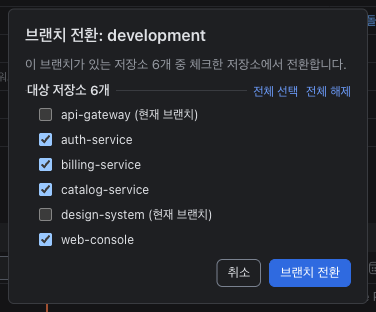

- 원격 branch(예: `origin/development`)를 고르면 저장소마다 그 원격을 추적하는 같은 이름의 로컬 branch 로 바꿉니다. 로컬 branch 가 없으면 만듭니다. 같은 이름의 로컬 branch 가 다른 곳을 추적하면 건너뜁니다. 대화상자에도 이 안내가 붙습니다.
- 모든 저장소에서 이미 현재 branch 이면 **브랜치 전환…** 이 꺼져 있습니다.
- 이름을 직접 적어 바꾸려면 개요 탭 일괄 줄의 **브랜치 전환…**, Project 트리 저장소 행 우클릭의 `checkout… (<이름>)`, 또는 `⌘B`(**브랜치 전환…**)를 씁니다. 대상은 고른 저장소(없으면 전체)입니다. **선택한 저장소의 브랜치 전환** 대화상자에 **브랜치 이름** 을 적고 **브랜치 전환** 을 누릅니다.

편집기에 저장하지 않은 편집이 있는 저장소는 체크 목록에서 꺼진 칸이고, 이름을 적는 창에서는 확인할 때 막습니다([편집기에 저장하지 않은 편집이 있을 때](#편집기에-저장하지-않은-편집이-있을-때)).

일괄 checkout 은 다음 저장소를 건너뜁니다. 결과 알림에서 사유를 확인하세요.

- **커밋하지 않은 변경이 있습니다**, **진행 중인 작업이 있습니다**, **이미 해당 브랜치입니다**
- 원격 branch 일 때: `원격 branch 가 없음: <원격>/<이름>`, `로컬 <이름> 이(가) <다른 곳> 을(를) 추적 중`

> [!NOTE]
> 변경이 있는 저장소는 건너뛰므로, 일괄 checkout 뒤에는 저장소마다 branch 가 다를 수 있습니다. 개요 표의 **브랜치** 열에서 확인하세요. 변경을 잠깐 치우고 함께 바꾸려면 먼저 [일괄 스태시 저장](#폴더-탭에서-한꺼번에-stash-하기)을 합니다.

#### 저장소 탭에서는

다음 중 하나로 checkout 합니다. 모두 확인창 없이 바로 바꿉니다.

- 브랜치 칸에서 branch 를 우클릭 → **브랜치 전환**. 더블클릭·Enter 는 checkout 이 아니라 로그 거르기입니다([위](#더블클릭으로-기본-branch-와-견주어-보기))
- `⌘B`(**브랜치 전환…**): 빠른 전환 창
- 로그 행 우클릭 → `checkout <이름>`·**이 커밋으로 전환 (분리된 HEAD)**([5.1](5-가끔-하는-작업.md#51-mergerebasecherry-pickrevertreset))

빠른 전환은 다음과 같이 합니다.

1. `⌘B` 를 누릅니다. **브랜치 전환** 창이 뜹니다.
2. **브랜치 이름 입력…** 칸에 이름 일부를 적습니다. 글자가 띄엄띄엄 맞아도 찾습니다.
3. ↑ ↓ 로 고르고 Enter 를 누릅니다. 목록을 눌러도 됩니다. Esc 는 닫기입니다.

빠른 전환 목록에는 현재 branch 와 태그가 없고, 원격 branch 는 오른쪽에 원격 이름이 붙습니다. 맞는 것이 없으면 **일치하는 브랜치가 없습니다.** 가 보입니다.

원격 branch 를 checkout 하면 그 원격 branch 를 추적하는 로컬 branch 로 바꿉니다. 없으면 같은 이름으로 만듭니다.

checkout 이 막히면 대화상자가 뜹니다.

| 제목                                  | 상황                                                            | 고를 수 있는 것                                                                                                        |
| ------------------------------------- | --------------------------------------------------------------- | ---------------------------------------------------------------------------------------------------------------------- |
| **로컬 변경이 있습니다**              | 바꾸면 덮어써질 파일이 있음                                     | **스태시 후 전환**: 변경을 stash 하고(untracked 포함) 바꾼 뒤 다시 꺼냅니다. 꺼낼 때 충돌하면 변경은 stash 에 남습니다 |
| `로컬 브랜치 <이름>가 이미 있습니다.` | 같은 이름의 로컬 branch 가 다른 곳을 추적하거나 업스트림이 없음 | **브랜치 이름** 을 정해 **추적 브랜치 만들기**, 또는 **커밋으로 전환 (분리된 HEAD)**                                   |
| **다른 워크트리에서 사용 중**         | 그 branch 가 다른 워크트리에 체크아웃돼 있음                    | **워크트리 열기**: 그 워크트리를 탭으로 엽니다                                                                         |

checkout 도 ↶ **되돌리기**(Undo) 대상입니다. 다만 HEAD 만 옛 branch 로 돌아가고 파일은 그대로라 차이가 변경으로 보입니다. → [6.1 Undo·Redo 로 되돌리기](6-실수했을-때.md#61-undoredo-로-되돌리기)

### 이름 바꾸기·지우기·업스트림

저장소 탭의 브랜치 칸에서 branch 를 우클릭해 다룹니다. 폴더 탭에는 이 가운데 **이름 변경…** 만 있습니다.

#### 이름 바꾸기

저장소 탭에서는 다음과 같이 합니다.

1. 로컬 branch 를 우클릭하고 **이름 변경…** 을 고릅니다.
2. **브랜치 이름 변경** 대화상자의 **새 이름** 칸(처음엔 지금 이름)을 고칩니다. 공백은 하이픈으로 바뀌고, 바뀌면 칸 아래에 `바꿀 이름: <이름>` 이 보입니다.
3. **변경** 을 누릅니다.

폴더 탭에서는 여러 저장소의 같은 이름 branch 를 한꺼번에 바꿉니다.

1. 브랜치 칸 **로컬** 묶음의 branch 를 우클릭하고 **이름 변경…** 을 고릅니다. 원격 branch 에는 없습니다.
2. `branch 이름 변경: <이름>` 대화상자의 **새 이름** 칸(처음엔 지금 이름)을 고칩니다. 정규화한 이름이 지금 이름과 같으면 **지금 이름과 같습니다** 가 보이고 **변경** 이 꺼집니다.
3. `대상 저장소 N개` 목록에서 바꿀 저장소만 체크합니다. 처음엔 그 branch 가 있는 저장소가 모두 체크돼 있습니다.
4. **변경** 을 누릅니다.

- 지금 checkout 된 branch 와 다른 워크트리에서 checkout 된 branch 도 바뀝니다. 그 워크트리는 새 이름의 branch 에 그대로 있습니다. 업스트림 설정도 새 이름으로 옮겨집니다.
- 새 이름의 branch 가 이미 있는 저장소는 `새 이름이 이미 있음: <이름>` 으로 건너뜁니다.
- 로그가 그 branch 로 걸려 있었으면 필터 바의 branch 조건도 새 이름으로 바뀝니다.
- 즐겨찾기는 옛 이름에 남습니다(저장소 탭도 같습니다). 새 이름을 즐겨찾기하려면 다시 켜세요.
- 일괄 작업이라 Undo 목록에 남지 않습니다. 되돌리려면 같은 메뉴로 다시 이름을 바꿉니다.

#### 지우기

1. 로컬 branch 를 우클릭하고 **삭제…** 를 고릅니다. 현재 branch 는 꺼져 있습니다.
2. `branch '<이름>' 을(를) 지울까요?` 확인창에서 **삭제** 를 누릅니다.
3. 아직 병합되지 않은 branch 이면 `'<이름>' 은(는) 아직 병합되지 않았습니다. 강제로 지울까요?` 가 한 번 더 뜹니다. 지우려면 **삭제** 를 누릅니다.

지우기 전에 앱이 그 branch 의 백업을 자동으로 만듭니다. 잘못 지웠으면 브랜치 칸의 **백업** 묶음에서 되살립니다. → [6.2 백업에서 되살리기](6-실수했을-때.md#62-백업에서-되살리기)

#### 원격에서 지우기

1. **원격** 묶음의 branch(예: `origin/feature/x`)를 우클릭하고 **원격에서 삭제…** 를 고릅니다.
2. `원격 <원격> 에서 branch '<이름>' 을(를) 지울까요?` 확인창에서 **삭제** 를 누릅니다.

> [!WARNING]
> **원격에서 삭제…** 는 원격 저장소의 branch 를 지웁니다. 같은 원격을 쓰는 다른 사람에게서도 사라지고, 앱의 백업이나 ↶ **되돌리기**(Undo)로 되살릴 수 없습니다. 지운 commit 이 내 로컬 branch 에 있으면 그 branch 를 다시 push 해 되살릴 수 있습니다.

#### 업스트림 지정·해제

- 업스트림이 없는 로컬 branch 를 우클릭하고 **업스트림 지정…** 을 고릅니다. **업스트림 (예: origin/main)** 칸(처음 값 `origin/<이름>`)을 확인하고 **적용** 을 누릅니다.
- 업스트림이 있는 branch 의 메뉴에는 **업스트림 해제** 가 있습니다. 확인창 없이 바로 풉니다.

## 4.5 기록 찾기

지난 commit 을 찾으려면 Git 도구 창의 **로그** 탭(`⌘9`)을 씁니다. 필터 바로 거르고, 저장소 탭에서는 찾기 줄로 하이라이트하며, 고른 commit 은 오른쪽 상세 칸에서 봅니다.

### 로그 읽기

열은 그래프, **메시지**, **작성자**, **날짜**, **해시** 입니다. 저장소 탭에서는 **그래프 열 설정…** 으로 작성자·날짜·해시 열을 숨기거나 **아바타** 를 켭니다([8.9](8-설정.md#89-그래프-열)).

메시지 앞의 ref 라벨은 다음과 같습니다.

- 같은 commit 에 있는 로컬 branch 와 원격 짝은 `origin & main` 처럼 한 라벨로 묶입니다.
- 라벨이 넘치면 `+N` 으로 줄어듭니다. 마우스를 올리면 전체 이름이 보입니다.
- 현재 branch 라벨에는 ◎ 아이콘이 붙습니다. branch 없이 HEAD 만 있는 commit(분리된 HEAD)에는 **HEAD** 라벨이 붙습니다.
- 원격 branch 는 구름 아이콘, 태그는 꼬리표 아이콘입니다.

#### 폴더 탭에서는

- 여러 저장소의 commit 을 시간순으로 합친 통합 로그입니다.
- 맨 앞 색 띠가 저장소를 나타냅니다. 저장소 이름은 같은 저장소가 이어지는 구간의 첫 행과 화면 맨 윗행에만 적힙니다.
- 각 저장소의 현재 branch 에 없는 commit 은 늘 흐리게 보입니다.
- 저장소마다 최근 10,000개까지만 읽습니다. 넘으면 상태 글자에 `저장소당 최근 10,000개만 표시` 가 보입니다.

#### 저장소 탭에서는

- 이 저장소의 commit 그래프입니다.
- 작업 트리에 변경이 있으면 맨 위에 **커밋 전 변경 내용 (WIP)** 행이 있습니다. 누르거나, 골라 두고 Enter 를 누르면 Commit 도구 창의 변경 탭이 열립니다.
- 다른 워크트리에 변경이 있으면 `WIP · <이름>` 행도 보입니다. 누르면 그 워크트리 탭이 열립니다.
- 현재 branch 밖 commit 은 처음에 흐리게 보입니다(**보기 옵션** 에서 끔).
- commit 을 하나 고른 뒤 다른 commit 을 `⇧` 클릭하면 그 사이가 범위로 골라집니다. 상세 칸에 `commit N개 범위` 와 범위 전체의 변경 파일이 보이고, **범위 해제** 로 풉니다.

#### 행 조작

| 입력                                 | 동작                                                         |
| ------------------------------------ | ------------------------------------------------------------ |
| 클릭                                 | 그 commit 을 고르고 상세 칸에 보이기                         |
| ↑ ↓ · PageUp · PageDown · Home · End | 행 옮기기                                                    |
| Enter                                | 상세 칸으로 포커스(저장소 탭의 WIP 행은 Commit 도구 창 열기) |
| `⇧F10`, 우클릭                       | 행 메뉴                                                      |
- 폴더 탭의 행 메뉴: **해시 복사** · **제목 복사** · **저장소 탭으로 열기** · **이 저장소만 보기**(이미 그 저장소만 보고 있으면 **모든 저장소 보기**). 이력을 바꾸는 항목은 없습니다.
- 저장소 탭의 행 메뉴는 merge·rebase·cherry-pick·reset 등 이력 작업입니다. → [5.1](5-가끔-하는-작업.md#51-mergerebasecherry-pickrevertreset)

### 필터 바

로그 칸 맨 위의 필터 바로 보일 commit 을 거릅니다.

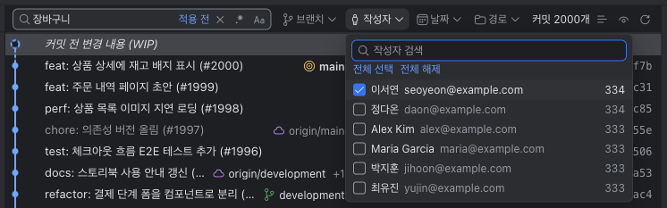

#### 텍스트·해시로 거르기

1. **텍스트 또는 해시 (Enter)** 칸에 commit 메시지의 일부를 적습니다. 폴더 탭은 `⌘F`, 저장소 탭은 `⌘⇧G` 로 이 칸에 갑니다.
2. Enter 를 누르면 적용됩니다. 누르기 전에는 칸에 **적용 전** 표시가 붙습니다.

- 7~64자의 16진수를 적으면 칸에 `#` 표시가 붙고, 메시지와 함께 해시가 그것으로 시작하는 commit 도 찾습니다.
- 칸 오른쪽 단추: × 는 **검색어 지우기**, `.*` 는 **정규식**(POSIX 확장 정규식), `Aa` 는 **대소문자 구분** 입니다. 정규식이 잘못되면 칸 아래에 오류가 보입니다.
- Esc 는 적용 전 글자가 있으면 적용된 값으로 되돌리고, 없으면 포커스를 로그로 옮깁니다.

> [!NOTE]
> 정규식에서 `.` 은 한 바이트에 맞습니다. 한글 한 글자는 여러 바이트라 `.` 하나로는 맞지 않습니다. 한글을 찾을 때는 글자를 그대로 적으세요.

#### 드롭다운

| 드롭다운   | 탭        | 고르는 것                                                                                                                                                                                                              |
| ---------- | --------- | ---------------------------------------------------------------------------------------------------------------------------------------------------------------------------------------------------------------------- |
| **저장소** | 폴더 탭   | 로그에 보일 저장소. 모두 풀면 전체(**모두 해제하면 모든 저장소를 봅니다**)                                                                                                                                             |
| **브랜치** | 두 탭     | **HEAD (현재 브랜치)** 또는 **로컬**·**원격** branch 여럿. 현재 branch 에 **현재** 표시. 저장소 탭은 태그·해시 같은 이름을 직접 적는 **참조 이름 입력…** 이 더 있고, 그렇게 고른 것은 **목록에 없는 참조** 묶음에 보임 |
| **작성자** | 두 탭     | 작성자 여럿. 위의 **작성자 검색** 칸으로 좁힘. commit 이 많은 순                                                                                                                                                       |
| **날짜**   | 두 탭     | **오늘**·**최근 7일**·**최근 30일**, 또는 **직접 고르기** 의 **시작**·**끝** 을 정하고 **적용**. commit 시각 기준, 양 끝 날짜 포함                                                                                     |
| **경로**   | 저장소 탭 | 그 경로를 바꾼 commit 만. 저장소 맨 위 기준 경로를 쉼표로 여럿 적고 Enter 또는 **적용**                                                                                                                                |
- **저장소** 체크는 팝오버를 닫지 않아도 즉시 적용됩니다. 새 범위를 읽는 동안은 이전 그래프 대신 읽는 중 표시가 보입니다. 전체 선택·해제도 즉시 적용되며, 아무 저장소도 체크하지 않으면 전체 저장소를 표시합니다.
- **브랜치**·**작성자** 체크 목록은 닫는 순간 적용됩니다. Esc 로 닫아도 적용됩니다.
- 조건이 걸리면 단추 글자가 `작성자: 서하린 +1` 처럼 바뀌고 옆에 × 가 생깁니다. × 로 그 조건만 풉니다.
- 조건이 하나라도 있으면 **모두 지우기** 단추가 생깁니다. 텍스트·드롭다운 조건을 한 번에 풉니다.
- 폴더 탭은 `⌘⇧G` 로 첫 드롭다운(**저장소**)에 갑니다.

#### 오른쪽 끝

- 상태 글자: `커밋 N개`, 걸렀으면 `N개 일치`. 폴더 탭은 잘림 안내도 여기 보입니다.
- **목록** 배지: 텍스트·작성자 조건이나 **병합 커밋 제외** 를 걸면 그래프 선 없이 맞는 commit 만 시간순으로 보입니다. 이때 붙습니다.
- **찾기**(저장소 탭): 찾기 줄을 엽니다(`⌘F`). → [찾기 줄](#찾기-줄-저장소-탭)
- **보기 옵션**: 아래 표. 기본값이 아닌 옵션이 있으면 단추에 점이 찍힙니다.
- **다시 읽기**: 로그를 다시 읽습니다.

저장소 탭에서 Git 작업이 도는 동안에는 필터를 바꿀 수 없습니다. 단추에 마우스를 올리면 **작업이 끝나면 바꿀 수 있습니다** 가 보입니다.

조건에 맞는 commit 이 없으면 로그 자리에 **필터와 일치하는 커밋이 없습니다**, 건 조건, **필터 지우기** 단추가 보입니다.

#### 보기 옵션

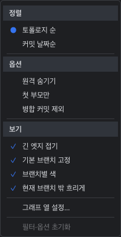

| 항목                            | 폴더 탭 | 저장소 탭 | 뜻                                                                      |
| ------------------------------- | ------- | --------- | ----------------------------------------------------------------------- |
| **토폴로지 순**·**커밋 날짜순** | ×       | ○         | 정렬(**정렬** 묶음). 처음은 토폴로지 순                                 |
| **원격 숨기기**                 | ○       | ○         | 원격 branch 를 로그 대상에서 뺍니다. 원격에만 있는 commit 이 사라집니다 |
| **첫 부모만**                   | ○       | ○         | merge 의 첫 부모만 따라갑니다                                           |
| **병합 커밋 제외**              | ○       | ○         | merge commit 을 뺍니다                                                  |
| **긴 엣지 접기**                | ○       | ○         | 화면을 길게 가로지르는 선을 접습니다                                    |
| **기본 브랜치 고정**            | ×       | ○         | 현재 branch 의 선을 맨 왼쪽 줄에 고정합니다                             |
| **브랜치별 색**                 | ×       | ○         | branch 마다 선 색을 나눕니다                                            |
| **현재 브랜치 밖 흐리게**       | ×       | ○         | 현재 branch 에 없는 commit 을 흐리게(폴더 탭은 늘 흐리게)               |
| **그래프 열 설정…**             | ×       | ○         | 열 고르기([8.9](8-설정.md#89-그래프-열))                                |
| **필터·옵션 초기화**            | ×       | ○         | 필터와 정렬·옵션을 모두 처음 값으로                                     |

### 찾기 줄 (저장소 탭)

필터는 로그를 줄이고, 찾기 줄은 로그는 그대로 두고 맞는 commit 사이를 옮겨 다닙니다.

1. `⌘F` 를 누르거나 필터 바의 **찾기** 단추를 누릅니다. 필터 바 아래에 찾기 줄이 열립니다.
2. **메시지·작성자·해시 검색** 칸에 적습니다. 입력을 멈추면 바로 찾습니다.
3. 오른쪽에 `n / N`(지금 위치 / 맞는 수)이 보입니다. Enter 나 **다음** 으로 다음, `⇧Enter` 나 **이전** 으로 앞의 commit 으로 갑니다.
4. Esc 나 **닫기** 로 닫습니다.

**고급** 을 누르면 칸이 더 생깁니다. **작성자**·**경로**·**코드 변화 (-S)**(그 글자가 더해지거나 빠진 commit)·**정규식 (-G)**·**이후**·**이전** 을 채우고 **검색** 이나 Enter 를 누릅니다. 모든 조건을 함께 만족하는 commit 을 찾습니다. 맞는 것이 많으면 `(일부만 표시)` 가 붙습니다.

### 커밋 상세

로그에서 commit 을 고르면 오른쪽 상세 칸에 내용이 보입니다(`⌘3` 로 포커스).

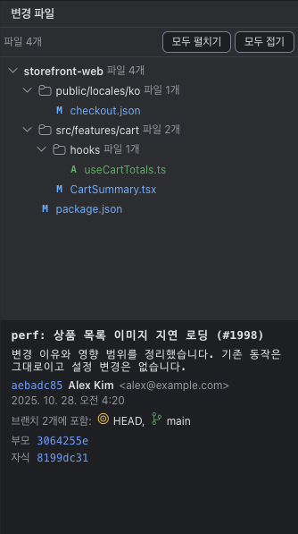

- 맨 위에 제목과 본문이 보입니다.
- 해시를 누르면 전체 해시가 복사되고 **복사됨** 이 잠깐 보입니다.
- 해시 옆에 작성자 이름·이메일·작성 시각이 있습니다. commit 한 사람이 작성자와 다르면 아래에 `<이름> 커밋 · <시각>` 이 붙습니다.
- 그 commit 의 ref 라벨이 보입니다.
- `브랜치 N개에 포함:` 줄에 이 commit 을 품은 branch 가 보입니다. 많으면 `외 N개` 를 눌러 펼치고 **접기** 로 접습니다.
- **부모**·**자식** 의 해시를 누르면 그 commit 으로 옮깁니다.
- 서명된 commit 은 **서명** 줄에 결과(**유효**·**잘못됨**·**만료** 등)가 보입니다.

#### 폴더 탭에서는

- 상세 칸 위쪽에 **변경 파일** 트리(저장소 색과 `파일 N개` › 폴더 › 파일), 아래쪽에 위의 commit 상세가 있습니다. 가운데 분할선으로 높이를 바꿉니다.
- 파일 클릭이나 Space 는 미리보기 diff 탭, 더블클릭이나 Enter 는 고정 diff 탭으로 엽니다.
- 파일 우클릭: **변경 내용 보기** · **줄별 수정 이력…** · **파일 이력…** · **외부 비교 도구로 열기** · **경로 복사**. 지운 파일은 **줄별 수정 이력…** 이 꺼져 있습니다.
- **부모** 등으로 옮긴 commit 이 지금 필터의 로그에 없으면 **선택한 커밋은 현재 필터가 적용된 로그에 없습니다.** 와 **필터 지우고 보기** 가 보입니다.

#### 저장소 탭에서는

- 폴더 탭처럼 상세 칸 위쪽에 **변경 파일** 트리(`파일 N개` › 폴더 › 파일), 아래쪽에 commit 상세가 있습니다. 파일 클릭은 미리보기 diff 탭, 더블클릭은 고정 diff 탭으로 엽니다.
- 파일 우클릭: **변경 내용 보기** · **줄별 수정 이력…** · **파일 이력…** · **외부 비교 도구로 열기**. 지운 파일은 **줄별 수정 이력…** 이 꺼져 있습니다.
- merge commit 의 파일 diff 는 첫 부모와 비교합니다(**병합 커밋의 첫 번째 부모와 비교한 변경 내용입니다.**).

## 4.6 파일·히스토리·Blame 보기

파일 하나가 어떻게 바뀌어 왔는지 보려면 파일 히스토리를, 줄마다 마지막으로 고친 commit 을 보려면 Blame 을 엽니다. 둘 다 편집기 탭이 아니라 대화상자로 열립니다.

### 여는 곳

| 곳                                                   | 파일 히스토리  | Blame                               |
| ---------------------------------------------------- | -------------- | ----------------------------------- |
| 파일 보기 탭 위 줄의 단추                            | **이력**       | **줄별 수정 이력**(작업 트리 기준)  |
| Project 트리 파일 우클릭                             | **파일 이력…** | **줄별 수정 이력…**(작업 트리 기준) |
| 저장소 탭 Commit 도구 창 파일 우클릭(충돌 영역 제외) | **파일 이력…** | **줄별 수정 이력…**(작업 트리 기준) |
| 상세 칸의 변경 파일 우클릭                           | **파일 이력…** | **줄별 수정 이력…**(그 commit 기준) |
| 파일 히스토리 대화상자의 각 줄                       | —              | **줄별 수정 이력**(그 commit 기준)  |
- 파일 보기 탭의 단추와 Project 트리의 메뉴는 저장소 안의 파일 하나일 때만 있습니다.
- 저장소 탭에서 서브모듈이나 하위 저장소 안의 파일에는 히스토리·Blame 이 없습니다.
- 폴더 탭에서는 그 파일이 든 저장소에 대고 엽니다. 폴더 탭에서 한 번에 열어 둘 수 있는 저장소 세션은 셋까지입니다([10.7](10-문제-해결.md#107-저장소-세션-3개-한도)).

### 파일 히스토리

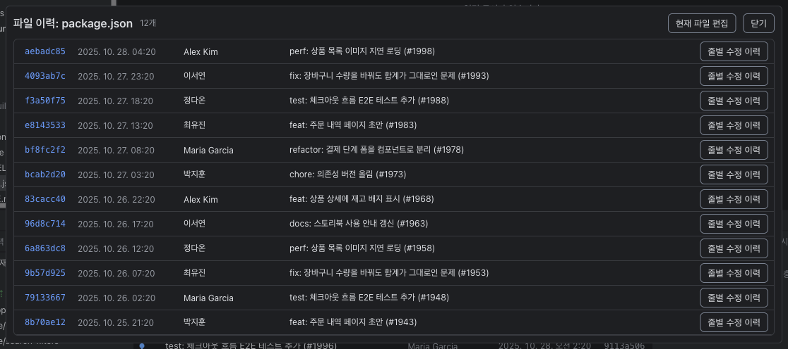

- 제목은 `파일 이력: <경로>` 이고, 폴더 탭에서는 `저장소 <이름>` 이 함께 보입니다. 옆의 `N개` 는 찾은 commit 수입니다. 최근 500개까지 읽습니다.
- 이름이 바뀐 이력도 따라갑니다. 그때의 경로가 지금과 다르면 제목 뒤에 `(당시 경로 <경로>)` 가 붙습니다.
- 해시를 누르면 대화상자가 닫히고, 로그에서 그 commit 을 고르고 그 파일의 commit diff 탭을 엽니다.
- 줄 끝의 **줄별 수정 이력** 은 그 commit 시점의 Blame 을 엽니다.
- **닫기** 나 Esc 로 닫습니다.

### Blame

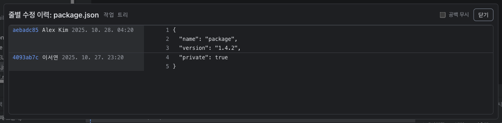

- 제목은 `줄별 수정 이력: <경로>` 이고, 옆에 기준이 보입니다. 작업 트리 기준이면 **작업 트리**, commit 기준이면 `@ <해시>` 입니다.
- 같은 commit 이 고친 줄이 이어지면 그 묶음의 첫 줄에만 해시·작성자·시각이 보입니다. 작성자에 마우스를 올리면 이메일이 보입니다.
- 해시를 누르면 대화상자가 닫히고 로그에서 그 commit 을 고릅니다.
- 해시 옆의 ← 는 그 commit 직전 시점의 Blame 으로 다시 엽니다(툴팁 `<해시> 직전 시점으로`). 그 줄을 누가 그 전에 고쳤는지 거슬러 올라갈 때 씁니다.
- 더 거슬러 갈 이력이 없는 commit(첫 commit, 얕은 복제의 끝)에는 **경계** 가 붙습니다.
- **공백 무시** 를 켜면 공백만 바꾼 commit 을 건너뜁니다. diff 탭의 **공백 무시** 와 같은 설정입니다.

### 외부 diff 도구로 열기

앱 밖의 diff 도구로 보려면 diff 탭의 **외부 비교 도구** 단추나 파일 우클릭의 **외부 비교 도구로 열기** 를 씁니다.

- git 의 `git difftool` 로 엽니다. 미리 `git config --global diff.tool <도구 이름>` 으로 도구를 정해 두어야 합니다.
- 정해 두지 않았으면 `diff.tool 이 설정돼 있지 않습니다. …` 오류가 뜹니다.

## 4.7 stash 하기

하던 변경을 잠깐 치워 두려면 stash 합니다. 목록·상세·apply·drop 은 저장소 탭에서만 됩니다. 폴더 탭에서는 여러 저장소에 한꺼번에 저장하고 꺼내는 것만 됩니다([폴더 탭에서 한꺼번에 stash 하기](#폴더-탭에서-한꺼번에-stash-하기)). 그 밖의 것은 그 저장소를 저장소 탭으로 여세요([2.2](2-저장소와-폴더-열기.md#폴더-탭에서-저장소-탭으로-열기)).

### stash 저장하기

1. Commit 도구 창(`⌘0`)의 **스태시** 탭을 엽니다. 탭 이름 옆 숫자는 stash 수입니다.
2. 머리 오른쪽의 + 단추(툴팁 **스태시 저장…**)를 누릅니다. stash 가 하나도 없으면 가운데의 **스태시 저장…** 단추를 누릅니다.
3. **스태시 저장** 대화상자에서 옵션을 고릅니다.

   | 옵션                             | 뜻                                                   |
   | -------------------------------- | ---------------------------------------------------- |
   | **메시지 (선택)**                | 나중에 알아볼 메모. 비우면 git 이 붙이는 기본 메시지 |
   | **미추적 파일 포함**             | 새 파일도 함께 치웁니다. 처음엔 켜짐                 |
   | **스테이징된 변경만 (--staged)** | stage 된 것만 치우고 나머지는 둡니다                 |

4. **만들기** 를 누릅니다.

`⌘⇧S`(**스태시 저장**)는 대화상자 없이 바로 저장합니다. 주의할 점은 [3.11 커맨드 팔레트](3-화면-둘러보기.md#311-커맨드-팔레트)의 경고에 있습니다.

merge·rebase 등이 멈춰 있거나 다른 Git 작업이 도는 동안에는 stash 를 저장할 수 없습니다.

### 목록과 상세

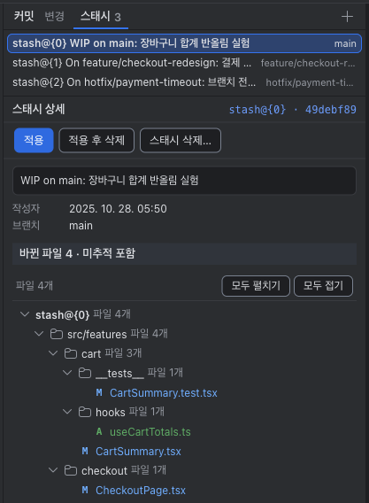

- 목록 한 줄은 `stash@{n} <메시지>` 와 오른쪽의 branch 이름입니다. `stash@{0}` 이 가장 최근 것입니다.
- 다른 워크트리에서 만든 stash 는 마우스를 올리면 `워크트리: <경로>` 가 보입니다.
- 줄을 누르거나 Enter·Space 를 누르면 아래에 **스태시 상세** 가 보입니다. 고르지 않았으면 **스태시를 선택하면 내용이 표시됩니다.** 가 보입니다.
- 상세에는 `stash@{n} · <해시>`, 단추 **적용**·**적용 후 삭제**·**스태시 삭제…**, 메시지, 만든 시각, **브랜치**, (다른 워크트리에서 만든 것이면) **경로**, `바뀐 파일 N`(untracked 가 들었으면 `· 미추적 포함`)과 파일 목록이 있습니다.
- 파일을 누르면 그 파일의 diff 탭이 열립니다.

### apply·pop·drop

| 동작             | 하는 일                                                     | 확인                        |
| ---------------- | ----------------------------------------------------------- | --------------------------- |
| **적용**         | stash 의 변경을 작업 트리에 꺼냅니다. stash 는 남습니다     | 없음                        |
| **적용 후 삭제** | 꺼내고 stash 를 지웁니다. 끝나면 **변경** 탭으로 넘어갑니다 | 없음                        |
| **스태시 삭제…** | 꺼내지 않고 stash 를 지웁니다                               | `stash@{n}을(를) 지울까요?` |
- 상세의 단추나 목록 줄의 우클릭 메뉴(**내용 보기** · **적용** · **적용 후 삭제** · **스태시 삭제…**)로 실행합니다.
- 다른 Git 작업이 도는 동안에는 세 동작 모두 꺼집니다. 우클릭 메뉴의 **적용**·**적용 후 삭제** 는 merge·rebase 등이 멈춰 있는 동안에도 꺼집니다.
- 꺼낼 때 지금 변경과 충돌하면 충돌 해결로 이어집니다. 충돌 편집기에서 stash 쪽은 `stash` 로 표시됩니다. → [5.6 충돌 해결하기](5-가끔-하는-작업.md#56-충돌-해결하기)

> [!WARNING]
> **스태시 삭제…** 로 지운 stash 는 앱에서 되살릴 수 없습니다. 확인창에도 **지운 스태시는 되돌릴 수 없습니다.** 가 보입니다. stash 는 ↶ **되돌리기**(Undo) 대상도 아닙니다. 지우기 전에 상세에서 내용을 확인하세요.

### 폴더 탭에서 한꺼번에 stash 하기

여러 저장소의 변경을 한꺼번에 치웠다가 되돌리려면 개요 탭 일괄 줄의 **스태시 저장…**·**스태시 꺼내기…** 를 씁니다. 한 번에 저장한 stash 들은 하나의 **묶음** 으로 다룹니다.

#### 저장

1. 대상 저장소를 고릅니다. 고르지 않으면 폴더의 모든 저장소가 대상입니다([대상 저장소](#대상-저장소)).
2. 개요 탭 일괄 줄의 **스태시 저장…** 을 누릅니다.
3. **저장소마다 변경을 스태시로 저장** 대화상자에서 옵션을 고릅니다.

   | 옵션                 | 뜻                                                 |
   | -------------------- | -------------------------------------------------- |
   | **메시지 (선택)**    | 나중에 알아볼 메모. 꺼낼 때 묶음 이름으로 보입니다 |
   | **미추적 파일 포함** | 새 파일도 함께 치웁니다. 처음엔 꺼짐               |

4. **저장** 을 누릅니다.

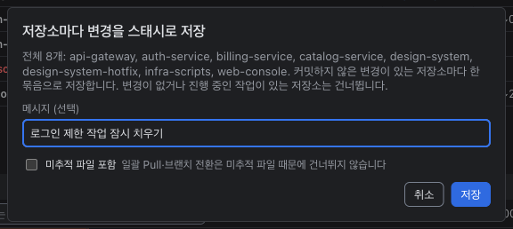

- 커밋하지 않은 변경(stage 한 것과 작업 트리에서 고친 것)이 있는 저장소마다 `git stash push` 합니다. 일괄 pull·checkout 이 **커밋하지 않은 변경이 있습니다** 로 건너뛰는 것과 같은 기준이라, 저장한 저장소는 그다음 일괄 pull·checkout 의 대상이 됩니다.
- 편집기에서 저장하지 않은 편집은 stash 에 들어가지 않고 저장한 뒤 다시 쓰입니다. 그래서 대상 저장소에 그런 편집이 있으면 저장하지 않습니다([편집기에 저장하지 않은 편집이 있을 때](#편집기에-저장하지-않은-편집이-있을-때)).
- **미추적 파일 포함** 이 처음에 꺼져 있는 것은 일괄 pull·checkout 이 미추적 파일 때문에 건너뛰지 않기 때문입니다. 켜면 새 파일도 넣습니다(`--include-untracked`). 저장소 탭의 stash 저장 대화상자와 처음 값이 다릅니다.
- 다음 저장소는 건너뜁니다: `스태시할 변경이 없습니다`, `미추적 파일만 있습니다 (미추적 파일 포함을 켜면 저장합니다)`, `진행 중인 작업이 있습니다`(merge·rebase 등이 멈췄거나 충돌이 남음), `아직 커밋이 없습니다`, **제외됨 (폴더 설정)**.
- stash 메시지 끝에는 묶음 표시 `[mgit-batch:<묶음 id>]` 가 붙습니다(예: `On main: 정리 [mgit-batch:mi8x2k3a7f0]`). 저장소 탭의 Stash 탭에도 이 메시지로 보입니다. 연결된 워크트리는 주 작업 트리와 stash 목록을 함께 쓰므로 표시 끝에 워크트리 이름이 붙습니다(`[mgit-batch:<id>@<워크트리 이름>]`). 서로의 것을 꺼내지 않게 하는 표시입니다.

#### 꺼내기

1. 개요 탭 일괄 줄의 **스태시 꺼내기…** 를 누릅니다. 대상 저장소(고르지 않으면 전체)의 stash 목록에서 묶음을 모읍니다.
2. 묶음이 여럿이면 **꺼낼 일괄 스태시 고르기** 대화상자의 **묶음** 에서 고르고 **다음** 을 누릅니다. 최근 묶음이 처음 값이고, 한 줄은 `<메시지> — 저장소 N개 · <시각>` 입니다. 메시지가 없으면 `메시지 없음 (<묶음 id>)` 입니다. 묶음이 하나면 이 단계는 없습니다.
3. `일괄 스태시 꺼내기: <묶음>` 체크 목록에서 꺼낼 저장소를 고릅니다. 한 줄은 `<저장소>: stash@{n} (<branch>)` 이고 처음엔 모두 체크돼 있습니다. 폴더 설정에서 뺀 저장소와 편집기에 저장하지 않은 편집이 있는 저장소([위](#편집기에-저장하지-않은-편집이-있을-때))는 꺼진 칸입니다.
4. **꺼내기** 를 누릅니다.

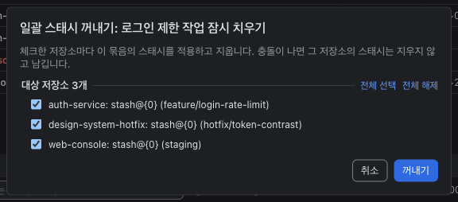

- 저장소마다 그 묶음의 stash 를 찾아 적용(`git stash apply`)하고, 성공하면 그 stash 를 지웁니다. 그사이 다른 stash 가 위에 쌓여 `stash@{0}` 이 아니어도 묶음 표시로 찾습니다.
- 진행 표시와 결과 알림의 작업 이름은 저장할 때 적은 메시지로 `스태시 일괄 꺼내기: <메시지>` 입니다. 메시지 없이 저장한 묶음은 `스태시 일괄 꺼내기 (<묶음 id>)` 입니다.
- 적용할 때 지금 내용과 충돌하면 그 저장소는 **실패** 이고 stash 는 지우지 않고 남깁니다(git 의 pop 과 같습니다). 메시지는 `충돌이 났습니다: <파일>. 스태시 항목은 지우지 않고 남겼습니다 — …` 입니다. 그 저장소를 저장소 탭으로 열어 충돌을 해결한 뒤 스태시 탭에서 그 stash 를 **스태시 삭제…** 로 지웁니다.
- 그 묶음의 stash 가 없는 저장소는 `이 묶음의 스태시가 없습니다`, 진행 중인 작업이나 충돌이 남은 저장소는 `진행 중인 작업이 있습니다` 로 건너뜁니다.
- 꺼낼 묶음이 없으면 `꺼낼 일괄 스태시가 없습니다.` 알림만 뜹니다.
- 묶음은 저장소의 stash 목록에서 다시 모으므로, 앱을 다시 켜 작업 기록이 사라져도 꺼낼 수 있습니다. 작업 기록의 스태시 저장 줄에서는 **이 묶음 꺼내기** 로 그 묶음의 체크 목록을 바로 엽니다([작업 기록](#작업-기록)).

> [!NOTE]
> 결과 알림, 작업 기록, 취소, 실패한 저장소만 다시 실행은 다른 일괄 작업과 같습니다([진행과 결과](#진행과-결과)). 취소해도 이미 시작한 저장소의 저장·꺼내기는 끝까지 둡니다.

---

[← 3. 화면 둘러보기](3-화면-둘러보기.md) · [목차](../사용법.md) · [5. 가끔 하는 작업 →](5-가끔-하는-작업.md)
