# 5. 가끔 하는 작업

자주 하지는 않지만 알아 두면 좋은 작업입니다. 이력을 다시 쓰는 작업, 충돌 해결, 워크트리·서브모듈, Pull Requests 를 다룹니다. 이 장의 작업은 대부분 저장소 탭에서 합니다.

기준: 브랜치 `feat/tag-management` · 커밋 `aedc0b6` · 2026-11-23

## 5.1 merge·rebase·cherry-pick·revert·reset

이력을 합치거나 옮기거나 되돌리려면 저장소 탭의 로그 행이나 브랜치 칸을 우클릭합니다. branch 라벨을 끌어다 놓아도 됩니다.

### 여는 곳

| 곳                               | 할 수 있는 것                                                                                |
| -------------------------------- | -------------------------------------------------------------------------------------------- |
| 로그 행 우클릭                   | 그 commit 을 기준으로 merge·rebase·cherry-pick·revert·reset 등([아래](#로그-행-우클릭-메뉴)) |
| 브랜치 칸 우클릭                 | 그 branch 를 기준으로 merge·rebase·비교·미리보기 등([아래](#브랜치-칸-우클릭-메뉴))          |
| 로그의 branch 라벨을 끌어다 놓기 | merge 세 가지와 rebase 중 하나를 골라 실행([아래](#끌어다-놓기))                             |
| 미리보기 대화상자                | 결과를 본 뒤 실행([5.2](#52-미리보기와-격리-병합))                                           |

폴더 탭의 로그에는 이력을 바꾸는 메뉴가 없습니다. 폴더 탭에서는 로그 행을 우클릭하고 **저장소 탭으로 열기** 를 고른 뒤 그 탭에서 합니다.

### 로그 행 우클릭 메뉴

로그에서 commit 행을 우클릭하면 아래 메뉴가 뜹니다(`⇧F10` 도 같습니다). 행에 현재 branch 가 아닌 로컬 branch 라벨이 있으면 그 branch 의 항목이, tag 라벨이 있으면 tag 마다 `tag <이름>` ▸ 하위 메뉴가 더 붙습니다.

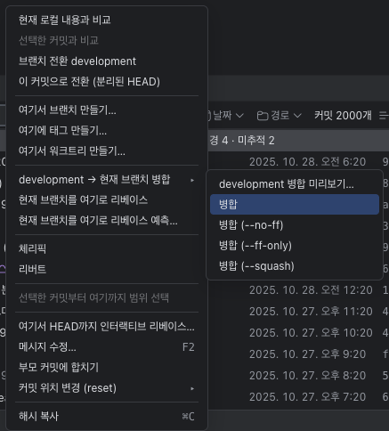

| 항목                                      | 하는 일                                                                                                  | 확인창   |
| ----------------------------------------- | -------------------------------------------------------------------------------------------------------- | -------- |
| `checkout <branch>`                       | 그 branch 로 바꿉니다. 행에 있는 로컬 branch 라벨마다 한 줄([4.4](4-일상-작업.md#branch-바꾸기checkout)) | 없음     |
| **이 commit 으로 checkout (detached)**    | 그 commit 을 분리된 HEAD 로 checkout 합니다                                                              | 없음     |
| **여기서 branch 만들기…**                 | 그 commit 에서 새 branch 를 만듭니다(**새 branch** 대화상자, [4.4](4-일상-작업.md#branch-만들기))        | 입력창   |
| **여기에 tag 만들기…**                    | [5.4 tag](#54-tag)                                                                                       | 입력창   |
| **여기서 워크트리 만들기…**               | 그 commit 에서 새 branch 와 워크트리를 만듭니다([5.7](#57-워크트리))                                     | 입력창   |
| `tag <이름>` ▸                            | 하위 메뉴: `<원격> 로 push`(원격이 둘 이상이면 **push** ▸) · **삭제…**([5.4](#tag-push-하기))            | 삭제만   |
| `<branch> 을(를) 현재 branch 에 merge` ▸  | 하위 메뉴: `<branch> merge 미리보기…`([5.2](#merge-미리보기)), merge 네 가지(아래 표)                    | 없음     |
| **현재 branch 를 여기로 rebase**          | 현재 branch 의 commit 을 이 commit 위로 옮깁니다                                                         | 없음     |
| **병합 해결 diff (remerge-diff)…**        | merge commit 행에만 있습니다([5.2](#병합-해결-diff))                                                     | —        |
| **현재 branch 를 여기로 rebase 예측…**    | rebase 결과를 미리 봅니다([5.2](#rebase-예측))                                                           | —        |
| **cherry-pick**                           | 이 commit 하나의 변경을 현재 branch 에 새 commit 으로 적용합니다                                         | 없음     |
| **revert**                                | 이 commit 의 변경을 되돌리는 새 commit 을 만듭니다(git 의 기본 메시지)                                   | 없음     |
| **선택한 commit 부터 여기까지 범위 선택** | 먼저 고른 commit 과 이 행 사이를 범위로 고릅니다([아래](#범위-선택))                                     | —        |
| **여기서 HEAD 까지 인터랙티브 rebase…**   | [5.3](#인터랙티브-rebase)                                                                                | 대화상자 |
| **메시지 수정…**                          | [5.3](#메시지-수정)                                                                                      | 입력창   |
| **부모 commit 에 합치기**                 | [5.3](#부모-commit-에-합치기)                                                                            | 확인창   |
| `선택한 commit <N>개를 하나로 합치기…`    | 범위를 고른 상태에서 범위 안의 행에만 있습니다([5.3](#범위를-하나로-합치기))                             | 입력창   |
| **reset** ▸                               | 현재 branch 를 이 commit 으로 옮깁니다([아래](#reset))                                                   | hard 만  |
| **해시 복사**                             | 전체 해시를 복사합니다                                                                                   | —        |
- 다른 Git 작업이 도는 동안이나 merge·rebase 등이 멈춰 있는 동안에는 이력을 바꾸는 항목이 꺼집니다. merge·rebase 등이 멈춰 있어도 branch·tag·워크트리 만들기와 **해시 복사** 는 쓸 수 있습니다.
- 분리된 HEAD 에서는 merge·rebase·인터랙티브 rebase·예측이 꺼집니다.
- **메시지 수정…**·**부모 commit 에 합치기**·`선택한 commit <N>개를 하나로 합치기…` 는 현재 branch 에서 닿는 commit 에만 켜집니다.

merge 하위 메뉴의 네 가지는 다음과 같습니다. 모두 merge commit 메시지를 묻지 않고 git 의 기본 메시지를 씁니다.

| 항목                  | 하는 일                                                                                             |
| --------------------- | --------------------------------------------------------------------------------------------------- |
| **merge**             | fast-forward 할 수 있으면 현재 branch 를 앞으로 옮기고, 아니면 merge commit 을 만듭니다             |
| **merge (--no-ff)**   | 늘 merge commit 을 만듭니다                                                                         |
| **merge (--ff-only)** | fast-forward 만 합니다. 갈라져 있으면 실패합니다                                                    |
| **merge (--squash)**  | 상대 branch 의 변경을 stage 에 모으기만 하고 commit 하지 않습니다. Commit 도구 창에서 commit 하세요 |

### 브랜치 칸 우클릭 메뉴

Git 도구 창 로그 탭 왼쪽의 브랜치 칸에서 행을 우클릭하면 행의 종류에 따라 메뉴가 다릅니다.

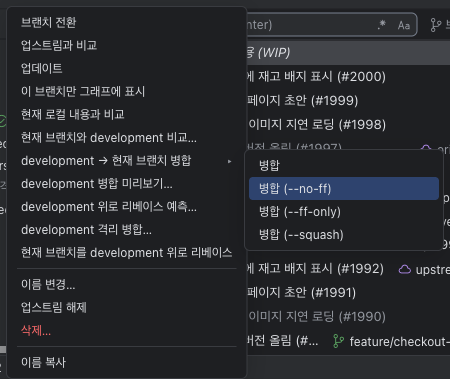

| 우클릭한 행            | 메뉴(순서대로)                                                                                                                                                                                                                                                                                                                                     |
| ---------------------- | -------------------------------------------------------------------------------------------------------------------------------------------------------------------------------------------------------------------------------------------------------------------------------------------------------------------------------------------------- |
| 로컬 branch            | **checkout** · **이 branch 만 그래프에 표시** · `현재 branch 와 <이름> 비교…` · `<이름> 을(를) 현재 branch 에 merge` ▸(merge 네 가지) · `<이름> merge 미리보기…` · `<이름> 위로 rebase 예측…` · `<이름> 격리 병합…` · `현재 branch 를 <이름> 위로 rebase` · **이름 변경…** · **업스트림 지정…** 또는 **업스트림 해제** · **삭제…** · **이름 복사** |
| 원격 이름(`origin` 등) | `<원격> 만 fetch` · `<원격> 로 push` · `<원격> 로 push 하고 업스트림 지정` · **이름 복사**                                                                                                                                                                                                                                                         |
| 원격 branch            | **checkout** · **이 branch 만 그래프에 표시** · `현재 branch 와 <이름> 비교…` · `<이름> 을(를) 현재 branch 에 merge`(하위 메뉴 없이 **merge** 와 같음) · `현재 branch 를 <이름> 위로 rebase` · **원격에서 삭제…** · **이름 복사**                                                                                                                  |
| **태그** 묶음          | **tag 관리 열기** · `<원격> 로 모든 tag push…`(원격이 둘 이상이면 **모든 tag push…** ▸) · `원격에만 있는 tag 보기 (<N>)`(있을 때만) · **원격 tag 확인**([5.4](#원격-tag-상태-확인))                                                                                                                                                                |
| 태그                   | **이 commit 으로 checkout (detached)** · `<원격> 로 push`(원격이 둘 이상이면 **push** ▸) · **삭제…** · **이름 복사**([5.4](#tag-push-하기))                                                                                                                                                                                                        |
| **워크트리** 묶음      | **워크트리 만들기…** · **사라진 워크트리 정리**([5.7](#57-워크트리))                                                                                                                                                                                                                                                                               |
| 워크트리               | **열기** · **삭제…** · **잠금…** 또는 **잠금 해제** · **사라진 워크트리 정리**([5.7](#57-워크트리))                                                                                                                                                                                                                                                |
| 백업                   | **새 branch 로 복원…** · `<branch> 를 이 시점으로 되돌리기` · **백업 삭제**([6.2](6-실수했을-때.md#62-백업에서-되살리기))                                                                                                                                                                                                                          |
| **HEAD (현재 브랜치)** | 메뉴 없음                                                                                                                                                                                                                                                                                                                                          |
- 확인창 없이 바로 실행되는 항목: **checkout**, merge, rebase, **업스트림 해제**, 원격 이름의 fetch·push 세 항목, tag 의 push, **원격 tag 확인**, **사라진 워크트리 정리**, **백업 삭제**.
- 현재 branch 자신의 행과 분리된 HEAD 에서는 비교·merge·미리보기·격리 병합·rebase 가 꺼집니다.
- **이 branch 만 그래프에 표시** 는 로그를 그 branch 의 이력만 보이게 거릅니다. 필터 바의 **branch** 조건으로 보이고, 그 × 로 풉니다([4.5](4-일상-작업.md#45-기록-찾기)).
- **이름 변경…**·**업스트림 지정…**·**삭제…**·**원격에서 삭제…** 는 [4.4](4-일상-작업.md#이름-바꾸기지우기업스트림), 원격 이름의 fetch·push 는 [4.3](4-일상-작업.md#43-fetchpullpush-하기)에 있습니다.

### 끌어다 놓기

로그에서 branch 라벨을 끌어 다른 행에 놓으면 merge·rebase 를 고르는 대화상자가 뜹니다.

1. 로그에서 로컬 branch 나 원격 branch 라벨을 끌어 아무 행에나 놓습니다. 태그와 **HEAD** 라벨은 끌리지 않습니다.
2. `<끈 branch> → <현재 branch>` 대화상자의 **동작** 에서 하나를 고릅니다.

   | 동작                              | 하는 일                              |
   | --------------------------------- | ------------------------------------ |
   | **merge**                         | 끈 branch 를 현재 branch 에 merge    |
   | **merge --no-ff**                 | 늘 merge commit 을 만들며 merge      |
   | **merge --ff-only**               | fast-forward 만                      |
   | `<현재 branch> 를 그 위로 rebase` | 현재 branch 를 끈 branch 위로 rebase |

3. **실행** 을 누릅니다.

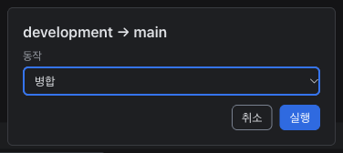

- 어느 행에 놓든 결과는 같습니다. 놓은 행이 아니라 끈 branch 와 현재 branch 가 대상입니다.
- 현재 branch 라벨을 끌거나 분리된 HEAD 이면 아무 일도 없습니다.
- 이 대화상자에서 동작을 고르는 것이 확인입니다. **실행** 을 누르면 바로 실행합니다.

### reset

현재 branch 를 다른 commit 으로 옮기려면 reset 합니다.

1. 로그에서 옮겨 갈 commit 행을 우클릭합니다.
2. **reset** ▸ 에서 방식을 고릅니다.

| 항목                                | 바뀌는 것                                                   | 확인창 | 백업 |
| ----------------------------------- | ----------------------------------------------------------- | ------ | ---- |
| **soft (변경을 stage 에 남김)**     | branch 만 옮깁니다. 사이 commit 의 변경은 stage 에 남습니다 | 없음   | ×    |
| **mixed (변경을 작업 트리에 남김)** | branch 와 stage 를 옮깁니다. 변경은 작업 트리에 남습니다    | 없음   | ○    |
| **hard (변경을 모두 버림)**         | branch·stage·작업 트리를 모두 그 commit 으로 맞춥니다       | 있음   | ○    |

hard 를 고르면 확인창 `<해시> 으로 hard reset 할까요?` 에 **stage 와 작업 트리의 변경이 모두 사라집니다. 커밋되지 않은 변경은 복구할 수 없습니다.** 가 보입니다. **reset** 을 눌러야 실행됩니다.

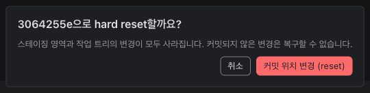

옮기기 전 branch 위치는 백업(soft 제외)과 ↶ **되돌리기**(Undo)로 되찾을 수 있습니다. hard reset 으로 버린 작업 트리 변경은 백업에도 Undo 에도 없어 되찾을 수 없습니다.

### 범위 선택

commit 여러 개의 변경을 한꺼번에 보려면 범위로 고릅니다.

1. 로그에서 commit 하나를 누릅니다.
2. 다른 commit 행을 우클릭하고 **선택한 commit 부터 여기까지 범위 선택** 을 고릅니다. `⇧` 클릭과 같습니다.
3. 상세 칸에 `commit N개 범위` 와 범위 전체의 변경 파일이 보입니다. **범위 해제** 로 풉니다.

범위로 하는 이력 작업은 하나로 합치기뿐입니다. 범위 안의 행을 우클릭해 `선택한 commit <N>개를 하나로 합치기…` 를 고릅니다. → [5.3 범위를 하나로 합치기](#범위를-하나로-합치기) cherry-pick·revert 는 한 commit 씩 합니다.

### 실행한 뒤

- 충돌 없이 끝나면 로그가 새 이력으로 바뀝니다.
- 충돌하면 툴바 아래에 작업 진행 띠가 생기고, Commit 도구 창이 저절로 열려 충돌 파일을 보입니다. → [5.6 충돌 해결하기](#56-충돌-해결하기)
- git 이 거부하면(예: 덮어써질 로컬 변경이 있음) 툴바 아래의 빨간 오류 줄에 이유가 보이고 아무것도 바뀌지 않습니다. 실행한 명령과 출력은 콘솔에 남습니다([6.5](6-실수했을-때.md#65-실행된-명령-보기)).
- 도는 동안 툴바에 `<작업> 실행 중…` 과 × 단추가 보입니다. × 로 멈출 수 있습니다.
- rebase(이 절의 메뉴·끌어다 놓기·[5.2](#rebase-예측)의 실행)는 작업 중인 변경을 잠깐 stash 했다가 끝나면 되돌려 놓습니다(`--autostash`).

### 백업이 만들어지는 작업

이력을 다시 쓰는 작업 일부는 실행 직전에 현재 branch 의 위치를 백업해 둡니다. 백업은 지울 때까지 브랜치 칸의 **백업** 묶음에 남습니다. → [6.2 백업에서 되살리기](6-실수했을-때.md#62-백업에서-되살리기)

| 작업                                                                                                                     | 백업 |
| ------------------------------------------------------------------------------------------------------------------------ | ---- |
| rebase(메뉴·끌어다 놓기·rebase 예측의 실행), 인터랙티브 rebase, 메시지 수정, 부모 commit 에 합치기, 범위를 하나로 합치기 | ○    |
| reset mixed·hard                                                                                                         | ○    |
| branch 삭제, amend([4장](4-일상-작업.md))                                                                                | ○    |
| merge, cherry-pick, revert, reset soft                                                                                   | ×    |

> [!WARNING]
> 다음 항목은 확인창 없이 바로 이력을 바꿉니다: merge 네 가지(로그 행·브랜치 칸), `현재 branch 를 … rebase`, **cherry-pick**, **revert**, reset **soft (변경을 stage 에 남김)**·**mixed (변경을 작업 트리에 남김)**, 미리보기의 **merge 실행**·**이 옵션으로 merge**·**rebase 실행**, 격리 병합의 **메인에 반영**, **업스트림 해제**, **백업 삭제**.
>
> 잘못 실행했으면 탭을 닫기 전에 툴바의 ↶ **되돌리기**(`⌘Z`)로 branch 위치를 되돌립니다. 작업 트리의 파일은 그대로 남습니다. → [6.1 Undo·Redo 로 되돌리기](6-실수했을-때.md#61-undoredo-로-되돌리기) 백업이 있는 작업은 [6.2](6-실수했을-때.md#62-백업에서-되살리기), 백업이 없는 merge·cherry-pick·revert 는 [6.4 reflog 로 찾기](6-실수했을-때.md#64-reflog-로-찾기)로도 되찾을 수 있습니다.

## 5.2 미리보기와 격리 병합

merge·rebase 를 실제로 하기 전에 충돌이 나는지 보려면 충돌 레이더·미리보기·비교를 씁니다. 지금 작업 트리를 건드리지 않고 merge 해 보려면 격리 병합을 씁니다. 모두 저장소 탭에만 있습니다.

### 충돌 레이더

브랜치 칸의 branch 행 끝에 지금 merge 하면 충돌이 나는지가 배지로 보입니다.

- ✓: **지금 merge 해도 충돌 없음**
- ⚠ 와 숫자: `지금 merge 하면 충돌 N개`. 마우스를 올리면 충돌 파일이 다섯 개까지 보입니다.

업스트림, 기본 branch, 다른 로컬 branch, 다른 워크트리의 branch 를 합쳐 12개까지 계산합니다. commit 끼리 계산하므로 커밋하지 않은 변경은 넣지 않습니다. branch 가 바뀌면 1.5초 뒤 다시 계산합니다.

### merge 미리보기

merge 결과를 미리 보려면 다음 중 하나로 엽니다.

- 로그 행 우클릭 → `<branch> 을(를) 현재 branch 에 merge` ▸ `<branch> merge 미리보기…`
- 브랜치 칸의 로컬 branch 우클릭 → `<branch> merge 미리보기…`

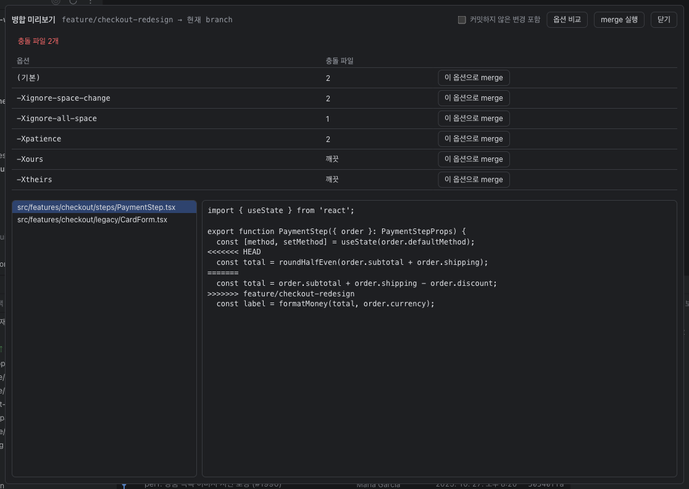

그림은 충돌이 있는 branch 의 예입니다.

- 제목 **병합 미리보기** 옆에 `<branch> → 현재 branch` 가 보입니다.
- 결과 줄은 **충돌 없음 — 바로 merge 할 수 있습니다** 또는 `충돌 파일 N개` 입니다.
- 왼쪽 목록에서 충돌 파일을 누르면 오른쪽에 충돌 마커가 든 merge 결과가 보입니다. 누르기 전에는 **충돌 파일을 고르면 병합 결과(마커 포함)를 보여 줍니다** 가 보입니다.
- **커밋하지 않은 변경 포함** 을 켜면 작업 트리의 변경까지 넣어 다시 계산합니다. 결과 줄 끝에 `· 작업 트리 변경 포함` 이 붙습니다.
- **옵션 비교** 를 누르면 git 의 `-X` 옵션 여섯 가지(기본, `ignore-space-change`, `ignore-all-space`, `patience`, `ours`, `theirs`)로 각각 merge 해 본 충돌 파일 수를 표로 보입니다. 충돌이 없으면 **깨끗** 입니다. 줄 끝의 **이 옵션으로 merge** 로 그 옵션을 붙여 merge 합니다.
- **merge 실행** 은 옵션 없이 merge 합니다. **닫기** 로 닫습니다.

미리보기 자체는 이력과 작업 트리를 바꾸지 않습니다. **merge 실행**·**이 옵션으로 merge** 는 확인창 없이 바로 merge 하고 대화상자를 닫습니다.

> [!NOTE]
> `-Xours`·`-Xtheirs` 는 충돌한 부분만 한쪽 내용으로 정하는 옵션입니다. 충돌하지 않은 상대 변경은 그대로 들어옵니다.

### rebase 예측

rebase 하면 commit 마다 충돌이 나는지 미리 보려면 다음 중 하나로 엽니다.

- 브랜치 칸의 로컬 branch 우클릭 → `<branch> 위로 rebase 예측…`
- 로그 행 우클릭 → **현재 branch 를 여기로 rebase 예측…**

대화상자 **rebase 예측** 에는 `현재 branch 의 commit 을 <대상> 위로` 와 다음이 보입니다.

- 요약: **모든 commit 이 충돌 없이 얹힙니다** 또는 `<전체>개 중 <n>개 commit 에서 충돌`. 옮길 commit 이 없으면 **옮길 commit 이 없습니다**.
- commit 마다 해시·제목과 **깨끗** 또는 `충돌: <파일>`. 처음 충돌한 단계 뒤의 결과는 어림값이라 `(앞 단계 충돌 뒤라 근사치)` 가 붙습니다.
- **rebase 실행**: 확인창 없이 rebase 합니다. **닫기** 로 닫습니다.

### 두 ref 비교

두 branch·tag 사이의 차이를 파일 단위로 보려면 다음 중 하나로 엽니다.

- 커맨드 팔레트(`⌘⇧P`)의 **두 ref 비교…**: 입력창 **두 ref 비교** 에서 **기준 (A)**·**대상 (B)** 를 고르고 **비교** 를 누릅니다. 목록에는 HEAD 와 모든 branch·tag 가 있습니다.
- 브랜치 칸의 branch 우클릭 → `현재 branch 와 <이름> 비교…`: 기준은 현재 branch, 대상은 그 branch 로 바로 엽니다.

결과 대화상자 **두 ref 비교** 의 왼쪽에 바뀐 파일, 오른쪽에 고른 파일의 diff 가 보입니다. 파일을 고르면 **외부 도구** 단추로 외부 diff 도구에서 엽니다([4.6](4-일상-작업.md#외부-diff-도구로-열기)). 차이가 없으면 **차이 없음** 입니다.

**공통 조상부터 비교 (A...B)** 는 처음에 켜져 있습니다. 켜면 B 쪽에서 갈라져 나온 뒤 바뀐 것만, 끄면 A 와 B 의 끝을 그대로 비교합니다. 제목 옆에 `A...B` 또는 `A..B` 로 보입니다.

### 병합 해결 diff

merge commit 에서 충돌을 어떻게 풀었는지 보려면 그 merge commit 행을 우클릭하고 **병합 해결 diff (remerge-diff)…** 를 고릅니다. 대화상자 **병합 해결 diff** 에 git 이 자동으로 merge 한 결과와 실제 merge commit 의 차이가 보입니다. 손댄 곳이 없으면 **이 commit 은 자동 병합 결과와 차이가 없습니다** 입니다.

### 격리 병합

지금 작업 트리를 그대로 두고 따로 merge 해 보려면 격리 병합을 씁니다. 임시 워크트리에서 merge 하고, 결과를 확인한 뒤 원래 branch 에 반영하거나 버립니다.

1. 브랜치 칸에서 합칠 로컬 branch 를 우클릭하고 `<이름> 격리 병합…` 을 고릅니다.
2. 확인창 **격리 병합** 에서 **격리 병합 시작** 을 누릅니다.
3. 앱이 임시 branch(`mgit/isolated-<숫자>`)와 임시 워크트리(저장소 옆 `<저장소 이름>.worktrees/_merge-<숫자>`)를 만들고 그 안에서 merge 합니다. 알림이 **충돌 없이 merge 됐습니다. 새 탭에서 확인한 뒤 반영하세요** 또는 **충돌이 있습니다. 새 탭에서 해결하고 commit 한 뒤 반영하세요** 입니다.
4. 임시 워크트리가 지금 탭의 하위 탭(`└`)으로 열립니다. 그 탭의 작업 진행 띠에 **격리** · `격리 병합 중 (<임시 branch>)` · **메인에 반영** · **버리기** 줄이 생깁니다.
5. 충돌이 있으면 그 탭에서 풀고 Continue 로 merge 를 끝냅니다([5.6](#56-충돌-해결하기)).
6. 결과가 괜찮으면 **메인에 반영** 을 누릅니다. 아니면 **버리기** 를 누릅니다.

| 단추            | 하는 일                                                                                                                | 확인창                                                                 |
| --------------- | ---------------------------------------------------------------------------------------------------------------------- | ---------------------------------------------------------------------- |
| **메인에 반영** | 메인 워크트리에서 원래 branch 를 임시 branch 로 fast-forward 합니다. 임시 워크트리·branch 를 지우고 하위 탭을 닫습니다 | 없음                                                                   |
| **버리기**      | 임시 워크트리·branch 를 지우고 하위 탭을 닫습니다                                                                      | **격리 워크트리와 임시 branch 를 지웁니다. 해결한 내용은 사라집니다.** |
- merge 가 끝나지 않았거나 임시 워크트리에 커밋하지 않은 변경이 있으면 **메인에 반영** 이 꺼집니다. 마우스를 올리면 **merge 를 끝내고 변경을 commit 한 뒤 반영할 수 있습니다** 가 보입니다.
- 메인 워크트리가 격리 병합을 시작한 branch 에 있어야 반영됩니다. 그사이 다른 branch 로 바꿨거나 원래 branch 가 앞으로 나가 fast-forward 할 수 없으면 오류로 멈춥니다.
- 끝나면 **격리 병합 결과를 메인 branch 에 반영했습니다** 또는 **격리 병합을 버렸습니다** 알림이 뜹니다.
- 격리 병합 하위 탭 안에서는 다시 격리 병합을 시작할 수 없습니다(메뉴가 꺼짐).

## 5.3 인터랙티브 rebase·메시지 수정·부모에 합치기

지난 commit 의 순서·메시지·묶음을 고치려면 저장소 탭 로그 행의 메뉴를 씁니다. 모두 현재 branch 의 commit 을 다시 씁니다.

### 인터랙티브 rebase

여러 commit 을 한 번에 고치려면 다음과 같이 합니다.

1. 로그에서 고칠 commit 들 바로 아래(더 오래된) commit 행을 우클릭하고 **여기서 HEAD 까지 인터랙티브 rebase…** 를 고릅니다. 고른 commit 은 목록에 들어가지 않습니다. 그 다음 commit 부터 HEAD 까지가 목록입니다.
2. `인터랙티브 rebase (<해시> 위로)` 대화상자가 뜹니다. 위가 먼저 적용되는 순서입니다.
3. 줄마다 왼쪽 선택 상자에서 동작을 고릅니다.
4. 순서를 바꾸려면 줄 앞의 ⋮⋮ 를 끌거나 줄 끝의 ↑ ↓ 단추(툴팁 **위로**·**아래로**)를 누릅니다.
5. 아래 옵션을 확인하고 **rebase 실행** 을 누릅니다. 그만두려면 **취소** 입니다.

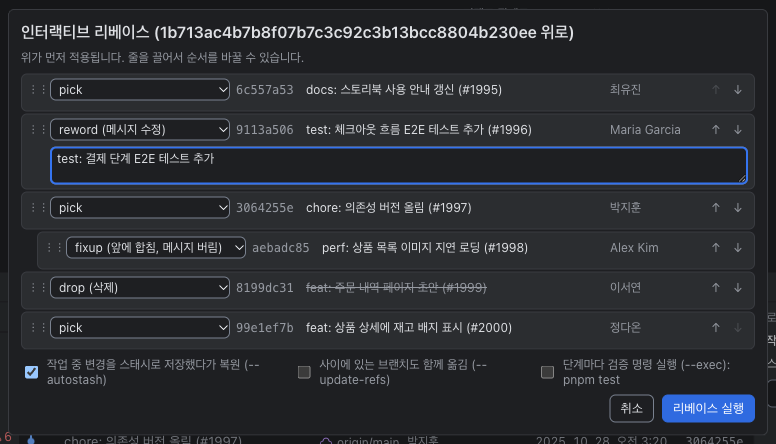

| 동작                                | 하는 일                                                                                                |
| ----------------------------------- | ------------------------------------------------------------------------------------------------------ |
| **pick**                            | 그대로 둡니다                                                                                          |
| **reword (메시지 수정)**            | 메시지를 바꿉니다. 줄 아래 칸에 지금 메시지 전체가 채워집니다(불러오는 동안 **메시지를 불러오는 중…**) |
| **edit (멈춰서 수정)**              | 그 commit 을 적용한 뒤 멈춥니다([아래](#멈췄을-때))                                                    |
| **squash (앞에 합침, 메시지 유지)** | 바로 위 줄의 commit 에 합칩니다. 두 메시지를 이어 붙입니다                                             |
| **fixup (앞에 합침, 메시지 버림)**  | 바로 위 줄의 commit 에 합칩니다. 이 commit 의 메시지는 버립니다                                        |
| **drop (삭제)**                     | 이 commit 을 뺍니다                                                                                    |

| 옵션                                                | 처음 값 | 뜻                                                                                                                                             |
| --------------------------------------------------- | ------- | ---------------------------------------------------------------------------------------------------------------------------------------------- |
| **작업 중 변경을 stash 했다가 복원 (--autostash)**  | 켜짐    | 커밋하지 않은 변경을 잠깐 치웠다가 끝나면 되돌립니다                                                                                           |
| **사이에 있는 branch 도 함께 옮김 (--update-refs)** | 꺼짐    | 고치는 구간 안에 있는 다른 로컬 branch 도 새 commit 으로 옮깁니다. 다른 워크트리에 체크아웃된 branch 는 빼고 옮깁니다                          |
| `단계마다 검증 명령 실행 (--exec): <명령>`          | 꺼짐    | commit 이 만들어질 때마다 검증 명령을 돌리고, 실패하면 멈춥니다. 저장소 설정에 검증 명령이 있을 때만 보입니다([8.7](8-설정.md#87-저장소-설정)) |
- 모든 줄을 drop 하면 **commit 을 전부 지울 수는 없습니다**, 남는 첫 줄이 squash·fixup 이면 **남는 commit 의 첫 줄은 앞에 합칠 수 없습니다** 가 보이고 실행되지 않습니다.
- 목록에는 merge commit 이 나오지 않습니다. 구간에 merge commit 이 있으면 맨 위에 **이 구간에 머지 commit 이 있습니다. 실행하면 머지가 사라지고 평탄해집니다.** 가 보입니다.
- 고칠 commit 이 없으면 **rebase 할 commit 이 없습니다** 가 보입니다.
- 분리된 HEAD, 다른 Git 작업이 도는 중, merge·rebase 등이 멈춰 있는 중에는 메뉴가 꺼집니다.

#### 멈췄을 때

충돌이 나거나 edit 줄에 닿으면 rebase 가 멈추고 작업 진행 띠에 `REBASING n/m` 이 보입니다.

- 충돌로 멈췄으면 [5.6](#56-충돌-해결하기)처럼 풀고 **Continue** 를 누릅니다.
- edit 로 멈췄으면 충돌이 없으므로 띠에 **충돌이 모두 해결됐습니다. Continue 로 이어 가세요** 가 보입니다. 파일을 고쳐 stage 한 뒤 **Continue** 를 누릅니다. stage 한 변경은 멈춘 commit 에 들어갑니다.
- 그만두려면 **Abort** 를 누릅니다. rebase 전 상태로 돌아갑니다.

### 메시지 수정

commit 하나의 메시지만 바꾸려면 다음과 같이 합니다.

1. 로그에서 그 commit 행을 우클릭하고 **메시지 수정…** 을 고릅니다.
2. 대화상자의 **새 메시지** 칸에 지금 메시지 전체(제목과 본문)가 채워져 있습니다. 고칩니다.
3. **적용** 을 누릅니다.

- HEAD commit 이면 amend 로, 아니면 그 위 commit 들을 다시 써서 바꿉니다.
- 현재 branch 에서 닿는 commit 에만 켜집니다. 다른 branch 의 commit 이면 그 branch 로 바꾼 뒤 합니다.
- 고칠 commit 과 HEAD 사이에 merge commit 이 있으면 `머지 커밋이 낀 구간은 이력을 펼치지 않고는 고칠 수 없습니다. …` 오류로 멈춥니다.

### 부모 commit 에 합치기

commit 하나를 바로 앞 commit 에 합치려면 다음과 같이 합니다.

1. 로그에서 그 commit 행을 우클릭하고 **부모 commit 에 합치기** 를 고릅니다.
2. 확인창 `<해시> 를 부모 commit 에 합칠까요?` 에 **이 commit 의 변경이 부모에 들어가고 메시지는 부모 것을 남깁니다. 그 뒤 commit 들은 다시 쓰입니다.** 가 보입니다. **적용** 을 누릅니다.

- 부모가 하나인 commit 에만 켜집니다. merge commit 과 첫 commit 은 합칠 수 없습니다.
- 메시지 수정과 같은 조건(현재 branch 에서 닿는 commit, 사이에 merge commit 없음)이 붙습니다.

### 범위를 하나로 합치기

이어진 commit 여러 개를 commit 하나로 합치려면 다음과 같이 합니다. 인터랙티브 rebase 에서 줄마다 fixup 을 고르지 않아도 됩니다.

1. 로그에서 합칠 commit 들을 범위로 고릅니다([범위 선택](#범위-선택)).
2. 범위 안의 행을 우클릭하고 `선택한 commit <N>개를 하나로 합치기…` 를 고릅니다. N 은 범위에 칠해진 줄 수입니다.
3. `commit <N>개를 하나로 합치기` 대화상자가 뜹니다. **새 메시지** 칸에 범위의 메시지가 오래된 것부터 빈 줄을 두고 이어져 있습니다. 하나의 메시지로 다듬습니다.
4. **합치기** 를 누릅니다. 그만두려면 **취소** 입니다.

- 결과는 적은 메시지의 commit 하나입니다. 내용은 범위의 변경을 모두 합친 것이고, 작성자는 가장 오래된 commit 의 것입니다. 범위 뒤에서 HEAD 까지의 commit 은 내용과 메시지를 그대로 둔 채 다시 쓰입니다.
- 끝나면 범위가 풀리고 로그가 새 commit 으로 옮겨 갑니다. 충돌로 멈추면 인터랙티브 rebase 처럼 작업 진행 띠에서 이어 갑니다([멈췄을 때](#멈췄을-때)).
- 메시지 수정과 같은 조건(분리된 HEAD 가 아님, 다른 Git 작업이 돌거나 멈춰 있지 않음, 현재 branch 에서 닿는 행)이 붙습니다. 범위의 변경 파일을 읽는 동안과 merge commit 행에서도 꺼집니다.
- 고르면 실행 전에 범위를 다시 확인합니다. 다음 경우에는 대화상자가 뜨지 않고 툴바 아래 오류 줄에 이유가 보입니다.
  - 범위 안이나 그 위(HEAD 까지)에 merge commit 이 있음: `범위나 그 위(HEAD 까지)에 merge commit 이 있어 하나로 합칠 수 없습니다. …`
  - 범위가 현재 branch 에 없음: `범위가 현재 branch 에 없습니다. …`
  - 칠한 줄이 현재 branch 의 이어진 commit 과 다름(다른 branch 의 commit 이 끼었거나 필터로 가린 commit 이 있음): `범위의 줄이 현재 branch 의 이어진 commit 과 맞지 않습니다…`
- 첫 commit 이 든 범위도 합칠 수 있습니다.
- 잘못 합쳤으면 ↶ **되돌리기**(`⌘Z`)로 합치기 전 branch 위치로 돌아갑니다.

인터랙티브 rebase·메시지 수정·부모 commit 에 합치기·범위를 하나로 합치기는 실행 전에 현재 branch 를 백업합니다. → [6.2 백업에서 되살리기](6-실수했을-때.md#62-백업에서-되살리기)

> [!WARNING]
> 이 절의 작업은 모두 commit 을 새로 만들어 이력을 바꿉니다. 이미 push 한 commit 을 고치면 원격과 갈라져 다음 push 가 거부됩니다. 같은 branch 를 쓰는 사람이 있으면 고치지 마세요. 꼭 고쳤다면 push 거부 대화상자의 **force-with-lease 로 push** 로만 보낼 수 있습니다([4.3](4-일상-작업.md#push-중에-뜨는-대화상자)).

## 5.4 tag

commit 에 이름표를 붙이려면 tag 를 만듭니다. 만든 tag 는 원격에 push 하고, 원격과 견주어 보고, 원격에만 있는 tag 를 가져오거나 다른 것을 맞출 수 있습니다. tag 는 저장소 탭에서만 다룹니다.

| 하려는 일                                   | 여는 곳                                                                                          |
| ------------------------------------------- | ------------------------------------------------------------------------------------------------ |
| tag 하나를 push 하거나 지우기               | 브랜치 칸 tag 우클릭, 로그 행 우클릭 → `tag <이름>` ▸([tag push 하기](#tag-push-하기))           |
| 원격에 있는지·같은지 보기                   | **태그** 묶음 행 끝 단추나 우클릭 → **원격 tag 확인**([원격 tag 상태 확인](#원격-tag-상태-확인)) |
| 여러 tag 를 한꺼번에 보내기·가져오기·지우기 | **태그** 문서([태그 문서](#태그-문서))                                                           |

### tag 만들기

1. 로그에서 tag 를 붙일 commit 행을 우클릭하고 **여기에 tag 만들기…** 를 고릅니다.
2. **새 tag** 대화상자에 **tag 이름** 을 적습니다.
3. 필요하면 **메시지 (입력하면 annotated tag)** 를 적고 **서명 태그 (-s)** 를 켭니다.
4. **만들기** 를 누릅니다.

| 고른 것            | 만들어지는 tag                                                   |
| ------------------ | ---------------------------------------------------------------- |
| 메시지 없음        | 경량 tag(이름만)                                                 |
| 메시지 있음        | annotated tag(작성자·시각·메시지)                                |
| **서명 태그 (-s)** | 서명한 annotated tag. 메시지를 비우면 tag 이름을 메시지로 씁니다 |

**서명 태그 (-s)** 의 처음 값은 git 설정 `tag.gpgSign` 입니다. 서명 키는 git 설정을 따릅니다([8.5](8-설정.md#85-작성자-프로필)).

만든 tag 는 내 저장소에만 있습니다. 원격에 올리려면 [tag push 하기](#tag-push-하기)를 봅니다.

### 보기와 checkout

- tag 는 로그에서 꼬리표 아이콘 라벨로, 브랜치 칸에서는 **태그** 묶음(처음 접힘)에 보입니다.
- 브랜치 칸의 tag 를 누르면 로그가 그 commit 으로 옮겨 갑니다.
- tag 를 더블클릭하거나 Enter, 또는 우클릭 → **이 commit 으로 checkout (detached)** 를 고르면 확인창 없이 그 commit 으로 분리된 HEAD checkout 합니다. 거기서 작업하려면 branch 를 만드세요(로그 행 우클릭 → **여기서 branch 만들기…**).
- 원격 상태를 확인했으면 tag 행에 **push 안 됨**·**다름** 표시가 붙습니다([원격 tag 상태 확인](#원격-tag-상태-확인)).

### tag push 하기

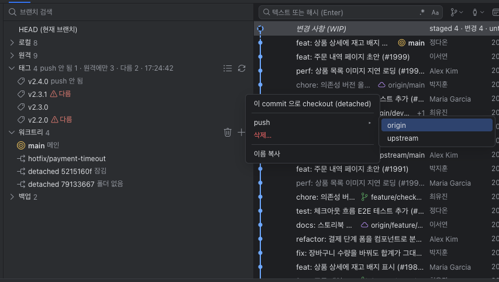

1. 브랜치 칸 **태그** 묶음에서 tag 를 우클릭합니다. 로그에서는 tag 라벨이 있는 행을 우클릭하고 `tag <이름>` ▸ 하위 메뉴를 엽니다.
2. `<원격> 로 push` 를 고릅니다. 원격이 둘 이상이면 **push** ▸ 에서 원격 이름을 고릅니다.

확인창 없이 바로 보냅니다.

- 고른 tag 하나만 보냅니다. 다른 tag 나 branch 는 보내지 않습니다(git 설정 `push.followTags` 와 상관없습니다).
- tag 가 가리키는 commit 이 아직 원격에 없으면 그 commit 과 그 앞의 올리지 않은 commit 도 함께 올라갑니다. 원격의 branch 는 움직이지 않습니다.
- 원격이 없으면 항목이 **push (원격 없음)** 으로 꺼져 있습니다. 다른 Git 작업이 도는 동안에도 꺼집니다.
- 도는 동안 툴바의 × 단추(툴팁 **취소**)로 멈출 수 있습니다.
- push 는 ↶ **되돌리기**(Undo) 대상이 아닙니다. 원격의 tag 를 없애려면 [tag 지우기](#tag-지우기)에서 그 원격을 고릅니다.
- 툴바 **Push** 는 지금처럼 branch 만 보냅니다. tag 는 이 메뉴나 [모든 tag push 하기](#모든-tag-push-하기)로 따로 보냅니다.

| 결과                                | 보이는 것                                                                                |
| ----------------------------------- | ---------------------------------------------------------------------------------------- |
| 보냄                                | 토스트 `tag <이름> 을(를) <원격> 로 push 했습니다`                                       |
| 원격에 같은 tag 가 이미 있음        | 토스트 `<원격> 에 같은 tag <이름> 이(가) 이미 있습니다`. 바뀐 것은 없습니다              |
| 원격에 이름이 같은 다른 tag 가 있음 | 안내 대화상자([아래](#원격에-이름이-같은-다른-tag-가-있을-때)). 아무것도 바뀌지 않습니다 |
| 서버가 거부함(hook·권한 등)         | 오류 줄 `<원격> 로 push 하지 못한 tag: <이름> (서버가 거부함: <사유>)`                   |

#### 원격에 이름이 같은 다른 tag 가 있을 때

원격에 같은 이름의 tag 가 다른 commit(또는 다른 tag 객체)을 가리키면 git 이 push 를 거부합니다. 앱은 덮어쓰지 않고 안내만 띄웁니다.

- 제목은 `<원격> 에 이름이 같은 다른 tag <이름> 이(가) 있습니다`, 설명은 **원격에 이름이 같은 다른 tag 가 있어 push 하지 않았습니다. 아무것도 바뀌지 않았습니다.** 입니다.
- 원격의 commit 을 알아내면 목록에 `<이름> — 원격 <commit> · 로컬 <commit>` 을 보입니다. 같은 commit 이면 `<이름> — 같은 commit <commit>, tag 객체만 다름` 입니다.
- **확인** 을 누르면 닫힙니다.
- 원격의 commit 을 알아낸 때만 **원격 tag 를 로컬 것으로 덮어쓰기…** 단추가 보입니다. 누르면 [로컬 것으로 맞추기](#원격과-다른-tag-맞추기)의 확인창으로 넘어갑니다.

### tag 지우기

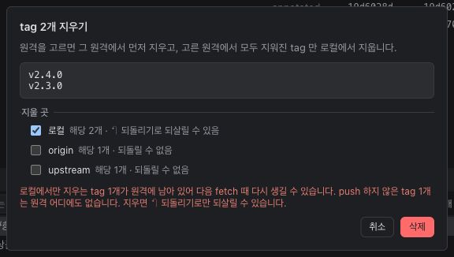

1. tag 를 우클릭하고 **삭제…** 를 고릅니다(브랜치 칸, 로그 행의 `tag <이름>` ▸, 태그 문서의 줄).
2. **지울 곳** 에서 지울 곳을 고릅니다. 처음에는 **로컬** 만 체크돼 있습니다.
3. **삭제** 를 누릅니다.

대화상자 제목은 `tag '<이름>' 지우기`, 여럿이면 `tag <N>개 지우기` 입니다. 여럿이면 tag 이름을 20개까지 보이고 나머지는 `… 외 <N>개` 로 줄입니다. 설명은 **원격을 고르면 그 원격에서 먼저 지우고, 고른 원격에서 모두 지워진 tag 만 로컬에서 지웁니다.** 입니다.

| 칸                | 보조 글자                                                                                  |
| ----------------- | ------------------------------------------------------------------------------------------ |
| **로컬**          | `해당 <N>개 · ↶ 되돌리기로 되살릴 수 있음`                                                 |
| 원격(`origin` 등) | 원격 상태를 확인했으면 `해당 <N>개 · 되돌릴 수 없음`, 아니면 `확인 안 함 · 되돌릴 수 없음` |
- 확인한 원격에 고른 tag 가 하나도 없으면 그 원격 칸은 꺼지고 **이 원격에 없음** 이 붙습니다. 고른 tag 가 모두 원격에만 있으면 **로컬** 칸이 꺼지고 **로컬에 없음** 이 붙습니다.
- 하나도 고르지 않으면 **삭제** 가 꺼지고 **지울 곳을 하나 이상 고르세요** 가 보입니다. 체크 칸에서 Enter 를 눌러도 실행되지 않습니다.
- 고른 지울 곳에 따라 아래에 경고가 붙습니다. 경고는 막지 않습니다.
  - `로컬에서만 지우는 tag <N>개가 원격에 남아 있어 다음 fetch 때 다시 생길 수 있습니다.`
  - `push 하지 않은 tag <N>개는 원격 어디에도 없습니다. 지우면 ↶ 되돌리기로만 되살릴 수 있습니다.` (모든 원격을 확인했을 때)
  - 원격을 골랐고 tag 가 500개 이상이면 **tag 가 많아 몇 분 걸릴 수 있습니다. 진행 중에 취소할 수 있습니다.**
- 원격 상태를 한 번도 확인하지 않았으면 설명 끝에 **로컬에서만 지우면 원격에 남아 있는 tag 는 다음 fetch 때 다시 생길 수 있습니다.** 가 붙습니다.
- 원격이 하나도 없으면 지울 곳 없이 확인창 `tag '<이름>' 을(를) 지울까요?` 와 **↶ 되돌리기로 되살릴 수 있습니다.** 가 뜹니다.

지우는 순서와 결과는 다음과 같습니다.

- 고른 원격에서 먼저 지우고 로컬은 마지막에 지웁니다. 고른 원격 모두에서 지워졌거나 원래 없던 tag 만 로컬에서 지웁니다. 나머지는 로컬에 남고 오류 줄에 `로컬에 남긴 tag: <이름>` 이 보입니다.
- 원격에서 지우기 바로 전에 그 원격의 tag 를 다시 조회합니다. 원격 tag 가 로컬과 다르면 지우지 않고 묻습니다([아래](#원격-tag-가-로컬과-다를-때)). 조회한 뒤 지우기 전에 원격이 바뀌면 지우지 않고 **원격이 그사이 바뀜** 으로 남깁니다.
- 모두 지우면 토스트 `tag <이름> 을(를) 지웠습니다 (<지운 곳>)` 가 뜹니다. 지운 곳은 `로컬 · origin` 처럼 보입니다.

되돌리기는 지운 곳에 따라 다릅니다.

- 로컬에서 지운 tag 는 ↶ **되돌리기** 한 번으로 모두 되살립니다(되돌릴 작업 `tag -d v1`, 여럿이면 `tag -d v1 v2 v3 (+N)`). annotated tag 는 메시지까지 돌아옵니다.
- 원격에서 지운 tag 는 되돌릴 수 없습니다. 로컬에 남아 있으면 다시 push 합니다.
- 로컬에서만 지운 tag 가 원격에 남아 있으면 다음 fetch 때 다시 생길 수 있습니다. 원격에서도 없애려면 그 원격을 함께 고릅니다.

#### 원격 tag 가 로컬과 다를 때

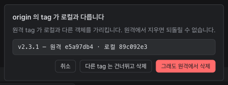

지우려는 원격 tag 가 로컬 tag 와 다른 객체를 가리키면, 그 원격에서는 아무것도 지우지 않고 위험 확인창을 띄웁니다. 제목은 `<원격> 의 tag 가 로컬과 다릅니다`(여럿이면 `<원격> 의 tag <N>개가 로컬과 다릅니다`)이고, 설명은 **원격 tag 가 로컬과 다른 객체를 가리킵니다. 원격에서 지우면 되돌릴 수 없습니다.** 입니다. 목록에는 tag 마다 원격·로컬 commit 이 보입니다.

| 단추                          | 하는 일                                                                                                                                                                       |
| ----------------------------- | ----------------------------------------------------------------------------------------------------------------------------------------------------------------------------- |
| **취소**                      | 그 자리에서 멈춥니다. 이 원격과 아직 처리하지 않은 원격·로컬은 그대로입니다(**확인창에서 취소해 나머지는 지우지 않았습니다**). 먼저 처리한 원격에서 지운 것은 지워진 채입니다 |
| **다른 tag 는 건너뛰고 삭제** | 다른 tag 는 남기고 나머지를 지웁니다. 같은 요청에 로컬과 같은 tag 가 섞여 있을 때만 보입니다. 남긴 tag 는 로컬에서도 지우지 않습니다                                          |
| **그래도 원격에서 삭제**      | 조회한 원격 tag 를 그대로 지웁니다. 그사이 원격이 또 바뀌었으면 지우지 않습니다                                                                                               |

### 원격 tag 상태 확인

원격에 tag 가 있는지, 로컬과 같은지는 확인을 눌러야 압니다. 앱은 원격 tag 를 저절로 조회하지 않습니다(자동 fetch 때도 하지 않습니다).

| 곳                                                         | 확인하는 원격      |
| ---------------------------------------------------------- | ------------------ |
| 브랜치 칸 **태그** 묶음 행 끝 단추(툴팁 **원격 tag 확인**) | 모든 원격          |
| **태그** 묶음 우클릭 → **원격 tag 확인**                   | 모든 원격          |
| 커맨드 팔레트 **원격 tag 확인**                            | 모든 원격          |
| 태그 문서의 **원격 확인**                                  | 문서에서 고른 원격 |
- 원격마다 네트워크로 tag 목록을 받아 로컬과 견줍니다. 받는 동안에도 다른 Git 작업을 할 수 있습니다. 다른 작업이 돌고 있어도 확인할 수 있습니다.
- 앱에서 tag 를 push·삭제·가져오기·맞추기 하면 네트워크 없이 표시를 바로 고칩니다.
- 같은 저장소의 다른 탭(워크트리)에서 확인한 결과도 함께 보입니다. 그 저장소의 마지막 탭을 닫으면 결과를 버립니다.

브랜치 칸에는 다음처럼 보입니다. 확인한 적이 없으면 아무것도 붙지 않습니다.

| 곳                 | 표시                                                                                                                                                        |
| ------------------ | ----------------------------------------------------------------------------------------------------------------------------------------------------------- |
| tag 행 뒤          | 확인한 모든 원격에 없으면 **push 안 됨**, 확인한 원격 하나라도 다르면 ⚠ **다름**                                                                            |
| tag 행 툴팁        | 원격마다 `<원격>: <상태>` 한 줄. 상태는 **push 안 됨**·**원격에만**·**같음**·**다름**·**다름 (같은 commit, tag 객체만 다름)**·**알 수 없음**·**확인 안 함** |
| **태그** 묶음 머리 | `push 안 됨 2 · 원격에만 3 · 다름 1 · 14:02:31` 처럼 개수와 확인 시각. 0 인 개수는 빼고, 모두 0 이면 **원격과 같음**                                        |
- 확인하는 동안 묶음 머리 앞에 **확인 중…** 이 붙습니다.
- 확인한 뒤 fetch·pull 로 로컬 tag 가 바뀌는 등 원격 상태가 달라졌을 수 있으면 끝에 **오래됨** 이 붙습니다. 다시 확인하면 사라집니다.
- 확인이 실패하면 이전 결과는 그대로 두고 끝에 **인증 실패**·**연결 실패**·**확인 실패** 중 하나가 붙습니다.
- 원격에만 있는 tag 는 브랜치 칸에 넣지 않습니다. 개수만 묶음 머리에 보이고, 목록은 **태그** 묶음 우클릭 → `원격에만 있는 tag 보기 (<N>)` 로 태그 문서에서 봅니다.

### 태그 문서

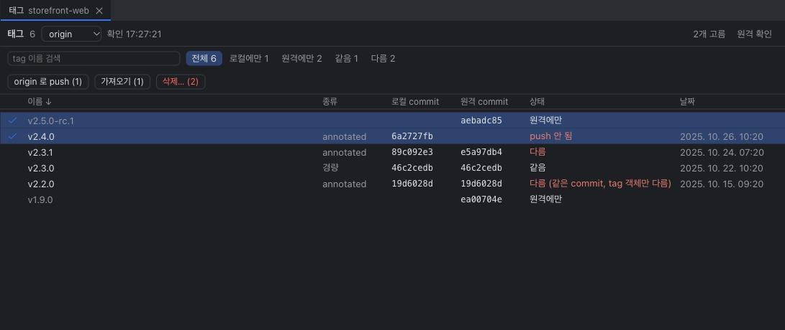

tag 를 한꺼번에 다루려면 편집기 영역에 **태그** 문서를 엽니다.

| 여는 곳                                                           |
| ----------------------------------------------------------------- |
| 브랜치 칸 **태그** 묶음 행 끝의 문서 단추(툴팁 **tag 관리 열기**) |
| **태그** 묶음 우클릭 → **tag 관리 열기**                          |
| 커맨드 팔레트 **tag 관리**                                        |
- 고정 탭으로 열립니다. 문서의 원격·필터·검색·정렬·선택은 탭마다 따로이고, 앱을 다시 켜면 처음으로 돌아갑니다.
- 머리: **태그** 와 전체 개수, 비교할 원격을 고르는 상자, 확인 상태, 고른 개수(`<N>개 고름`), **원격 확인** 단추가 있습니다.
  - 처음 원격은 현재 branch 업스트림의 원격, 없으면 `origin`, 없으면 첫 원격입니다. 원격이 없으면 **원격이 없어 비교할 수 없습니다** 가 보입니다.
  - 확인 상태는 확인 전이면 **확인 전 — 원격 확인을 누르면 원격과 견줍니다**, 확인했으면 `확인 14:02:31`(오래됐으면 `확인 14:02:31 · 오래됨`), 실패했으면 `연결 실패 · 확인 14:02:31` 처럼 보입니다.
- 찾기: **tag 이름 검색** 칸에 이름 일부를 적습니다. 대소문자는 가리지 않습니다.
- 필터: **전체**·**로컬에만**·**원격에만**·**같음**·**다름** 단추에 개수가 붙습니다(예: `로컬에만 3`). 원격을 확인하기 전에는 **전체** 말고는 꺼져 있습니다.
- 정렬: 열 머리 **이름**·**상태**·**날짜** 를 누릅니다. 다시 누르면 방향이 바뀌고, 정렬 중인 열에 ↓·↑ 가 붙습니다. 처음은 이름 역순(새 버전이 위)입니다.

| 열              | 보이는 것                                                                         |
| --------------- | --------------------------------------------------------------------------------- |
| **이름**        | tag 이름. 줄에 마우스를 올리면 tag 메시지(없으면 commit 제목)와 `만든 이: <이름>` |
| **종류**        | **annotated** 또는 **경량**                                                       |
| **로컬 commit** | 로컬 tag 가 가리키는 commit                                                       |
| **원격 commit** | 고른 원격의 tag 가 가리키는 commit                                                |
| **상태**        | 고른 원격과 견준 상태. 확인 전이면 **—**                                          |
| **날짜**        | annotated 면 tag 를 만든 때, 경량이면 commit 의 때                                |

고르기와 키보드는 다음과 같습니다.

| 조작                | 하는 일                                         |
| ------------------- | ----------------------------------------------- |
| 클릭                | 그 줄 하나만 고릅니다                           |
| `⌘` 클릭, Space     | 그 줄을 고르거나 뺍니다                         |
| `⇧` 클릭, `⇧↑`·`⇧↓` | 범위로 고릅니다                                 |
| `↑`·`↓`·Home·End    | 커서만 옮깁니다(고른 것은 그대로)               |
| `⌘A`                | 보이는 줄을 모두 고릅니다                       |
| Esc                 | 고른 것을 비웁니다                              |
| 더블클릭, Enter     | 로그에서 그 commit 을 보입니다(포커스는 목록에) |
| 우클릭, `⇧F10`      | 줄 메뉴                                         |
| `⌘2`                | 목록으로 포커스를 옮깁니다(**포커스: 에디터**)  |

줄 메뉴는 줄의 상태에 따라 다릅니다.

| 줄                | 메뉴(순서대로)                                                                                                                                                         |
| ----------------- | ---------------------------------------------------------------------------------------------------------------------------------------------------------------------- |
| 로컬에 있는 tag   | **로그에서 보기** · `<원격> 로 push` · **삭제…** · (다르면) **원격 것으로 맞추기…** · **로컬 것으로 맞추기…** · **이 commit 으로 checkout (detached)** · **이름 복사** |
| 원격에만 있는 tag | **가져오기** · **삭제…** · **이름 복사**                                                                                                                               |

일괄 단추는 고른 줄 가운데 해당하는 것의 개수를 보이고, 해당하는 것이 없으면 꺼집니다.

| 단추                   | 해당하는 줄                                | 하는 일                                               |
| ---------------------- | ------------------------------------------ | ----------------------------------------------------- |
| `<원격> 로 push (<N>)` | 로컬에 있고 원격에 없거나 상태를 모르는 것 | 확인창 없이 보냅니다([tag push 하기](#tag-push-하기)) |
| `가져오기 (<N>)`       | 원격에만 있는 것                           | [원격 tag 가져오기](#원격-tag-가져오기)               |
| `삭제… (<N>)`          | 모든 줄                                    | 지울 곳 대화상자를 엽니다([tag 지우기](#tag-지우기))  |

문서 안에서 한 작업은 토스트를 띄우지 않고 일괄 단추 아래 결과 칸에 보입니다.

- 첫 줄은 `<작업>: <N>개 완료` 이고, 남은 것이 있으면 `<작업>: <N>개 완료, <M>개 남음` 입니다. 작업은 `origin 로 push`·`origin 에서 가져오기`·**삭제** 처럼 보입니다.
- 남은 tag 는 이름과 사유를 한 줄씩 보입니다. 사유는 **원격 것이 로컬과 다름**·**원격에 이름이 같은 다른 tag 가 있음**·**원격이 그사이 바뀜**·**결과를 알 수 없음 — 원격을 다시 확인하세요**·**확인 대기**·서버가 준 사유 등입니다.
- 남은 tag 는 고른 채로 남습니다. 다시 하면 풀릴 수 있는 실패(결과를 모름·일시 실패·확인 대기)가 있을 때만 **실패한 것 다시 시도** 가 켜집니다.
- **결과 닫기** 로 결과 칸을 닫습니다.

tag 가 하나도 없으면 **tag 가 없습니다**, 찾기·필터에 맞는 것이 없으면 **조건에 맞는 tag 가 없습니다** 가 보입니다.

### 원격 tag 가져오기

다른 사람이 원격에 올린 tag 를 내 저장소로 받습니다. 고른 tag 만 받고 다른 tag 나 branch 는 받지 않습니다.

1. **태그** 묶음 우클릭 → `원격에만 있는 tag 보기 (<N>)` 를 고릅니다. 태그 문서가 **원격에만** 필터로 열립니다. 문서에서 직접 **원격에만** 필터를 눌러도 됩니다.
2. 하나면 줄을 우클릭하고 **가져오기** 를 고릅니다. 여럿이면 고른 뒤 `가져오기 (<N>)` 를 누릅니다.

- 확인창 없이 받습니다. 결과는 결과 칸에 `<원격> 에서 가져오기: <N>개 완료` 로 보이고, 받은 tag 는 브랜치 칸 **태그** 묶음에도 생깁니다.
- 고른 이름 가운데 하나라도 그사이 원격에서 사라졌으면 git 이 전체를 멈춥니다. 그러면 아무것도 받지 않고 `<원격> 에 없는 tag 가 섞여 아무것도 가져오지 않았습니다. 원격 확인 뒤 다시 시도하세요.` 가 보입니다. **원격 확인** 을 누른 뒤 다시 고릅니다.
- 받은 tag 는 ↶ **되돌리기** 한 번으로 모두 지웁니다(되돌릴 작업 `fetch tag v1`, 여럿이면 `fetch tags v1 v2 v3 (+N)`).

### 모든 tag push 하기

로컬에만 있는 tag 를 한꺼번에 보냅니다. 바로 보내지 않고, 보낼 것을 골라 둔 문서를 먼저 보여 줍니다.

1. **태그** 묶음 우클릭 → `<원격> 로 모든 tag push…` 를 고릅니다. 원격이 둘 이상이면 **모든 tag push…** ▸ 에서 원격을 고릅니다. 커맨드 팔레트 **모든 tag push…** 는 태그 문서의 처음 원격으로 합니다.
2. 태그 문서가 열리고 그 원격을 확인한 뒤, **로컬에만** 필터로 그 원격에 없는 tag 를 모두 골라 둡니다. 포커스는 `<원격> 로 push (<N>)` 단추에 있습니다.
3. 목록을 보고 보내지 않을 tag 는 `⌘` 클릭이나 Space 로 뺍니다.
4. `<원격> 로 push (<N>)` 를 누릅니다.

- 원격에 이미 있지만 다른 tag(**다름**)는 고르지 않습니다. 다른 것은 [원격과 다른 tag 맞추기](#원격과-다른-tag-맞추기)로 정리합니다.
- 보낼 tag 가 500개 이상이면 단추 옆에 **tag 가 많아 몇 분 걸릴 수 있습니다. 진행 중에 취소할 수 있습니다.** 가 보입니다. 막지는 않습니다. 원격의 tag 가 많을수록 오래 걸립니다.
- 도는 동안 툴바의 × 단추(툴팁 **취소**)로 멈출 수 있습니다. 멈춘 뒤 보내졌는지 모르는 tag 는 결과 칸에 **결과를 알 수 없음 — 원격을 다시 확인하세요** 로 남고, **실패한 것 다시 시도** 로 이어서 보냅니다.

> [!NOTE]
> 터미널의 `git push <원격> --tags` 와 달리, 원격에 없는 tag 만 골라 보내고 보내기 전에 목록을 보여 줍니다.

### tag 정리하기

push 하지 않은 채 쌓인 로컬 tag 를 한꺼번에 지웁니다.

1. 태그 문서에서 **원격 확인** 을 누른 뒤 **로컬에만** 필터를 누릅니다.
2. `⌘A` 로 모두 고르고, 남길 tag 는 `⌘` 클릭으로 뺍니다.
3. `삭제… (<N>)` 를 누릅니다. 지울 곳은 **로컬** 만 체크된 채로 열리고, 모든 원격을 확인했으면 `push 하지 않은 tag <N>개는 원격 어디에도 없습니다. 지우면 ↶ 되돌리기로만 되살릴 수 있습니다.` 가 보입니다.
4. **삭제** 를 누릅니다.

잘못 지웠으면 ↶ **되돌리기** 한 번으로 모두 되살립니다(되돌릴 작업 `tag -d v1 v2 v3 (+N)`). 원격에만 남은 tag 를 정리하려면 **원격에만** 필터에서 같은 순서로 하되 지울 곳에서 원격을 고릅니다(이때 **로컬** 칸은 **로컬에 없음** 으로 꺼져 있습니다).

### 원격과 다른 tag 맞추기

원격과 로컬에 같은 이름의 tag 가 있는데 가리키는 것이 다르면(상태 **다름**) 어느 한쪽에 맞춥니다. 태그 문서에서 **다름** 줄을 우클릭합니다.

| 항목                    | 하는 일                                                          | 확인창                                                                                         | 되돌리기                                    |
| ----------------------- | ---------------------------------------------------------------- | ---------------------------------------------------------------------------------------------- | ------------------------------------------- |
| **원격 것으로 맞추기…** | 로컬 tag 를 원격 tag 로 바꿉니다(원격에서 그 tag 를 덮어써 받음) | `로컬 tag <이름> 을(를) <원격> 것으로 바꿀까요?` · **원격 것으로 바꾸기**                      | ↶ **되돌리기**(되돌릴 작업 `fetch +tag v1`) |
| **로컬 것으로 맞추기…** | 원격 tag 를 지우고 로컬 tag 를 다시 push 합니다                  | `<원격> 의 tag 를 로컬 것으로 덮어쓸까요?` · **로컬 것으로 덮어쓰기**(위험, 포커스는 **취소**) | 되돌릴 수 없습니다                          |
- 두 확인창 모두 원격·로컬 commit 을 보입니다.
- **원격 것으로 맞추기…** 의 확인창 설명은 **로컬 tag 가 원격 tag 와 같은 객체를 가리키게 됩니다. ↶ 되돌리기로 되돌릴 수 있습니다.** 입니다.
- **로컬 것으로 맞추기…** 의 확인창 설명은 **이미 받아 간 저장소에는 옛 tag 가 남습니다. 되돌릴 수 없습니다.** 입니다. 다른 사람이 이미 받아 간 tag 는 그 사람 저장소에서 바뀌지 않습니다. 함께 쓰는 원격이면 먼저 알리세요.
- **로컬 것으로 맞추기…** 는 확인했을 때의 원격 tag 일 때만 지웁니다. 그사이 원격이 바뀌었으면 지우지 않고 **원격이 그사이 바뀜** 으로 남깁니다. 원격 tag 를 모르면 항목이 꺼져 있습니다.
- push 할 때 [이름이 같은 다른 tag](#원격에-이름이-같은-다른-tag-가-있을-때) 안내의 **원격 tag 를 로컬 것으로 덮어쓰기…** 도 같은 일을 합니다. 이때 결과는 토스트 `<원격> 의 tag <이름> 을(를) 로컬 것으로 덮어썼습니다` 로 보입니다.
- 앱에는 확인 없이 원격 tag 를 덮어쓰는(`--force`) 메뉴가 없습니다.

> [!NOTE]
> 터미널에서는 `git push <원격> <tag>`, `git push <원격> --delete <tag>` 로도 같은 일을 할 수 있습니다. 통합 터미널은 `⌘⇧J` 입니다.

## 5.5 원격 관리하기

원격을 더하거나 이름·주소를 바꾸려면 저장소 탭 툴바의 **원격…** 을 누릅니다. 폴더 탭에는 이 단추가 없습니다.

### 원격 대화상자

**원격** 대화상자에는 원격마다 이름, fetch 주소, 따로 정한 push 주소(`push: <주소>`)와 단추 셋이 보입니다. 원격이 없으면 **원격이 없습니다** 입니다.

| 단추           | 여는 것과 하는 일                                                                                                             |
| -------------- | ----------------------------------------------------------------------------------------------------------------------------- |
| **추가…**      | **원격 추가** 대화상자. **이름**(원격이 하나도 없으면 처음 값 `origin`)과 **URL** 을 적고 **만들기**                          |
| **이름 변경…** | 같은 제목의 대화상자. **이름** 을 고치고 **변경**. 원격 추적 branch 와 업스트림 설정도 새 이름을 따라갑니다(git 동작)         |
| **URL 변경…**  | 같은 제목의 대화상자. **URL** 을 고치고 **적용**. fetch 주소를 바꿉니다. push 주소를 따로 정해 둔 원격은 그것이 그대로입니다  |
| **제거…**      | `원격 '<이름>' 을(를) 제거할까요?` 확인창에 **원격 추적 branch 도 함께 지워집니다.** 가 보입니다. **삭제** 를 눌러야 지웁니다 |
- **닫기** 로 닫습니다.
- 원격을 더한 뒤에는 **Fetch** 를 해야 그 원격의 branch 가 브랜치 칸과 로그에 보입니다.
- 원격 설정 변경은 ↶ **되돌리기**(Undo) 대상이 아닙니다.
- 원격을 바꿔도 Pull Requests 도구 창은 탭을 다시 열 때 반영됩니다([5.9](#59-pull-requests)).

### 원격 이름 메뉴

브랜치 칸 **원격** 묶음 안의 원격 이름(`origin` 등)을 우클릭하면 그 원격에만 하는 작업이 있습니다. 모두 확인창 없이 바로 실행합니다.

| 항목                                | 하는 일                                                      |
| ----------------------------------- | ------------------------------------------------------------ |
| `<원격> 만 fetch`                   | 그 원격만 fetch 합니다(`--prune`)                            |
| `<원격> 로 push`                    | 현재 branch 를 그 원격의 같은 이름 branch 로 보냅니다        |
| `<원격> 로 push 하고 업스트림 지정` | 위와 같이 보내고 그것을 현재 branch 의 업스트림으로 정합니다 |
| **이름 복사**                       | 원격 이름을 복사합니다                                       |

push 에 대한 자세한 내용과 거부됐을 때의 대화상자는 [4.3](4-일상-작업.md#43-fetchpullpush-하기)에 있습니다.

## 5.6 충돌 해결하기

merge·rebase·cherry-pick·revert 중에 충돌이 나면 작업이 멈춥니다. 충돌 파일을 풀어 stage 한 뒤 Continue 로 작업을 이어 갑니다.

stash 를 꺼낼 때(apply·pop)나 pull 로 충돌하면 사정이 조금 다릅니다. stash 꺼내기는 멈춘 작업이 없어 작업 진행 띠가 생기지 않습니다. 저장소 탭의 Commit 도구 창에 충돌 파일이 보이면 아래 [충돌 편집기](#3-way-충돌-편집기)로 풀고 stage 하면 끝납니다. pop 이 충돌하면 git 은 그 stash 를 지우지 않고 남겨 둡니다. 다 풀었으면 Stash 탭에서 직접 **drop…** 합니다([4.7](4-일상-작업.md#47-stash-하기)). pull 은 방식에 따라 merge 나 rebase 로 멈추므로 아래 흐름과 같습니다.

### 흐름

1. 충돌이 나면 툴바 아래에 작업 진행 띠가 생깁니다.
2. 띠의 **충돌 해결** 을 누릅니다. 충돌 파일이 하나면 3-way 충돌 편집기 탭이, 여럿이면 Commit 도구 창의 충돌 목록이 열립니다.
3. 파일마다 충돌 편집기에서 결과를 정하고 **저장 후 stage**(`⌘S`)를 누릅니다.
4. 충돌 파일이 모두 사라지면 띠의 **Continue** 를 누릅니다. 다음 단계에서 또 충돌하면 2부터 되풀이합니다.
5. 그만두려면 띠의 **Abort** 를 누릅니다.

### 작업 진행 띠

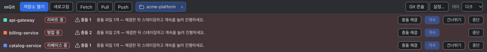

| 칸            | 내용                                                                                                                               |
| ------------- | ---------------------------------------------------------------------------------------------------------------------------------- |
| 저장소 이름   | 폴더 탭에만 있습니다. 진행 중인 저장소마다 한 줄입니다                                                                             |
| 작업 라벨     | **MERGING**·`REBASING 2/5`·**CHERRY-PICKING**·**REVERTING**·**BISECTING**·**APPLYING**                                             |
| `⚠ 충돌 N`    | 남은 충돌 파일 수. 누르면 **충돌 해결** 과 같습니다                                                                                |
| 안내          | `충돌 파일 N개 — 해결한 뒤 stage 하고 Continue 하세요` 또는 **충돌이 모두 해결됐습니다. Continue 로 이어 가세요**                  |
| **충돌 해결** | 충돌 파일이 하나면 충돌 편집기 탭, 여럿이면 Commit 도구 창의 충돌 목록을 엽니다. 충돌이 남아 있을 때만 보입니다                    |
| **Continue**  | 작업을 이어 갑니다. 충돌이 남아 있으면 꺼지고, 마우스를 올리면 `충돌 파일 N개를 먼저 해결해야 Continue 할 수 있습니다` 가 보입니다 |
| **Skip**      | 지금 commit 을 건너뜁니다. rebase·cherry-pick·revert 에만 있습니다                                                                 |
| **Abort**     | 작업을 중단하고 시작하기 전으로 돌아갑니다. 확인창을 거칩니다                                                                      |
- **Continue**·**Skip** 은 확인창이 없습니다. **Abort** 만 확인합니다.
  - 저장소 탭: **진행 중인 작업을 중단할까요?** — **지금까지 해결한 충돌 내용은 버려집니다.**
  - 폴더 탭: `<저장소> 의 <작업> 를 중단할까요?` — **지금까지 해결한 충돌 내용과 이 작업으로 바뀐 내용이 버려지고 작업을 시작하기 전 상태로 돌아갑니다.**
- stage 된 파일에 충돌 마커(`<<<<<<<` 등)가 남아 있으면 **Continue** 를 눌렀을 때 대화상자 **충돌 마커가 남아 있습니다** 가 뜹니다. 마커가 원래 내용이면 **그래도 계속** 을 누릅니다.
- **Skip**·**Abort** 로 충돌이 사라지면 그 파일의 저장하지 않은 편집(초안)도 버려지고 알림이 뜹니다.
- 폴더 탭에서 아직 연 적 없는 저장소의 줄은 단계 수 없이 **REBASING** 처럼 보입니다.

#### 폴더 탭과 저장소 탭의 차이

| 상황                                | 저장소 탭                                                                      | 폴더 탭                                                                                                           |
| ----------------------------------- | ------------------------------------------------------------------------------ | ----------------------------------------------------------------------------------------------------------------- |
| 충돌이 처음 생길 때                 | Commit 도구 창 **변경** 탭이 저절로 열려 맨 위에 `충돌 N` 영역을 보입니다      | 저절로 열리지 않습니다. 띠에 그 저장소 줄이 생깁니다                                                              |
| 충돌 파일이 여럿일 때 **충돌 해결** | Commit 도구 창의 **변경** 탭을 열고 포커스를 옮깁니다                          | Commit 도구 창을 열고 그 저장소를 펼칩니다                                                                        |
| 충돌 파일 열기                      | 충돌 영역에서 더블클릭·Enter                                                   | Commit 도구 창에서 클릭(우클릭 → **충돌 해결** 도 됨)                                                             |
| 결과                                | 띠가 사라지거나 다음 충돌로 바뀝니다                                           | 알림 `<저장소>: <작업> 를 마쳤습니다`·`… 를 중단했습니다`, 다시 충돌하면 줄에 `다시 충돌했습니다 — 충돌 파일 N개` |
| 충돌 도우미                         | 규칙·rerere·이름 변경 충돌·해결 내역 리뷰([아래](#commit-도구-창의-충돌-영역)) | 없습니다. 필요하면 그 저장소를 저장소 탭으로 엽니다                                                               |

폴더 탭은 한 번에 저장소 세션을 셋까지만 엽니다. 넘으면 띠의 단추가 꺼지고 사유가 보입니다. → [10.7 저장소 세션 3개 한도](10-문제-해결.md#107-저장소-세션-3개-한도)

### 3-way 충돌 편집기

충돌 파일을 열면 편집기 영역에 충돌 편집기 탭이 열립니다. 저장소마다 탭 하나이고, 다른 충돌 파일을 열면 같은 탭의 내용이 바뀝니다.

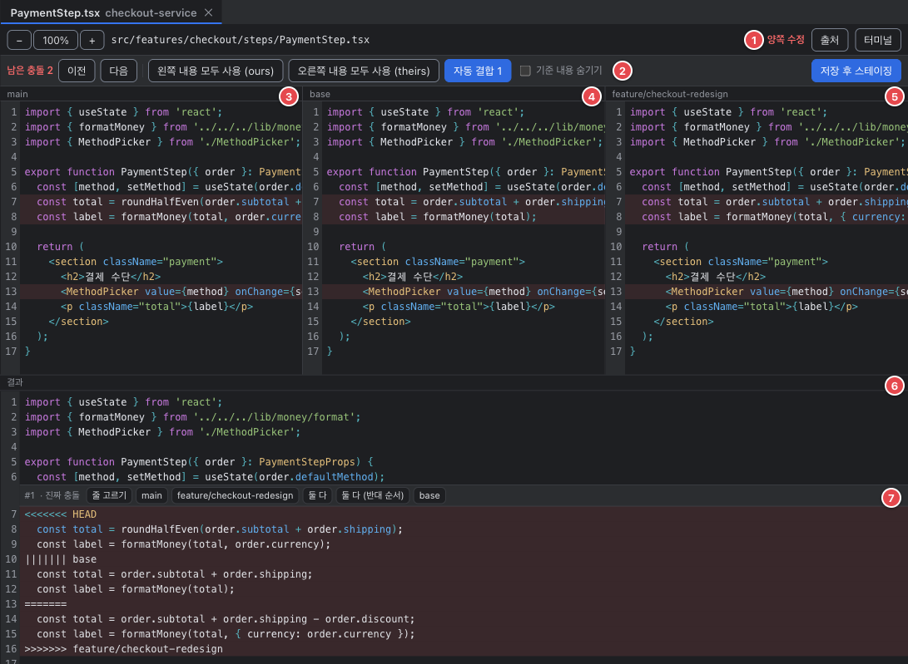

| 번호 | 이름         | 하는 일                                                                                                                                                                           |
| ---- | ------------ | --------------------------------------------------------------------------------------------------------------------------------------------------------------------------------- |
| ①    | 머리줄       | 경로, 충돌 종류(**양쪽 수정**·**양쪽 추가**·**우리가 삭제**·**상대가 삭제** 등), **출처**, **터미널**(검증 명령이 있으면 **검증 실행**·**터미널에서 검증**), 외부 merge 도구 단추 |
| ②    | 툴바         | `남은 충돌 N`(다 풀면 **남은 충돌 없음**), **이전**(`⇧F8`)·**다음**(`F8`), **모두 ours**·**모두 theirs**, `자동 결합 N`, **base 숨기기**, 오른쪽 끝 **저장 후 stage**(`⌘S`)       |
| ③    | ours 칸      | 내 쪽 내용(읽기 전용). 제목은 작업에 따라 다릅니다([아래](#ours와-theirs-라벨))                                                                                                   |
| ④    | base 칸      | 두 쪽이 갈라지기 전 공통 조상의 내용(읽기 전용). **base 숨기기** 로 숨깁니다                                                                                                      |
| ⑤    | theirs 칸    | 상대 쪽 내용(읽기 전용)                                                                                                                                                           |
| ⑥    | **결과** 칸  | 저장될 내용입니다. 직접 고쳐 써도 됩니다                                                                                                                                          |
| ⑦    | 블록 단추 줄 | 충돌 블록마다 하나. 그 블록을 어느 쪽으로 정할지 고릅니다                                                                                                                         |

네 칸은 충돌 블록을 맞춰 함께 스크롤됩니다. **이전**·**다음** 과 `F8`·`⇧F8` 은 결과 칸에서 미해결 블록 사이를 옮겨 다닙니다.

#### ours와 theirs 라벨

칸 제목과 블록 단추의 글자는 작업에 따라 다릅니다.

| 작업            | ours(③)                           | theirs(⑤)                                    |
| --------------- | --------------------------------- | -------------------------------------------- |
| merge           | 현재 branch 이름                  | 합치는 branch 이름                           |
| rebase          | `<대상> (rebase 대상, 현재 결과)` | `<내 branch> (적용 중인 내 commit — <제목>)` |
| cherry-pick     | 현재 branch 이름                  | `cherry-pick: <제목>`                        |
| revert          | 현재 branch 이름                  | `revert: <제목>`                             |
| stash 꺼내기 등 | 현재 branch 이름                  | `stash`                                      |

> [!NOTE]
> rebase 중에는 ours 가 옮겨 가는 대상 쪽(지금까지 쌓인 결과)이고, theirs 가 내 commit 입니다. merge 와 반대이니 라벨 글자를 보고 고르세요. **모두 ours**·**모두 theirs** 도 이 라벨의 쪽을 뜻합니다.

#### 블록 단추

블록 단추 줄의 왼쪽에는 `#번호`, 이미 고른 쪽, 앱이 본 블록 분류가 보입니다. 단추는 다음과 같습니다. 지금 고른 쪽의 단추는 꺼져 있습니다.

| 단추                  | 하는 일                                                        |
| --------------------- | -------------------------------------------------------------- |
| **줄 고르기**         | 양쪽 줄을 하나씩 골라 결과를 만듭니다(아래)                    |
| `<ours 라벨>`         | ours 쪽 내용으로 정합니다                                      |
| `<theirs 라벨>`       | theirs 쪽 내용으로 정합니다                                    |
| **둘 다**             | ours 다음에 theirs 를 이어 붙입니다                            |
| **둘 다 (반대 순서)** | theirs 다음에 ours 를 이어 붙입니다                            |
| `<base 라벨>`         | 공통 조상의 내용으로 정합니다(**base 숨기기** 를 켜면 없음)    |
| **되돌리기**          | 고른 것을 풀어 다시 미해결 블록으로 돌립니다(고른 뒤에만 보임) |

| 분류                 | 뜻                                         |
| -------------------- | ------------------------------------------ |
| **양쪽 동일**        | 두 쪽이 같은 내용으로 바꿨습니다           |
| **ours 만 변경**     | ours 쪽만 바꿨습니다                       |
| **theirs 만 변경**   | theirs 쪽만 바꿨습니다                     |
| **공백만 다름**      | 두 쪽이 공백만 다릅니다                    |
| **겹치지 않는 변경** | 두 쪽이 서로 다른 줄을 바꿨습니다          |
| **진짜 충돌**        | 같은 곳을 다르게 바꿨습니다. 직접 정하세요 |
- 툴바의 `자동 결합 N` 은 앱이 결합을 제안할 수 있는 블록 수입니다. 누르면 미해결 블록에 제안대로 적용합니다. 적용한 뒤에도 결과 칸에서 확인하세요.
- **모두 ours**·**모두 theirs** 는 남은 미해결 블록을 모두 한쪽으로 정합니다.
- **줄 고르기** 를 누르면 `블록 #n 줄 고르기` 대화상자가 뜹니다. 양쪽 줄 앞의 체크로 남길 줄을 고르고, **theirs 를 먼저** 로 순서를 바꿉니다. **결과 미리보기** 를 보고 **적용** 을 누릅니다.

#### 저장 후 stage

결과를 다 정했으면 **저장 후 stage** 를 누르거나 결과 칸에서 `⌘S` 를 누릅니다. 편집한 뒤에는 단추 글자 끝에 `*` 가 붙습니다(`저장 후 stage *`).

- 결과를 파일에 쓰고 stage 해 해결로 표시합니다. 그 파일은 충돌 목록에서 빠집니다.
- 결과에 충돌 마커가 남아 있으면 저장하지 않고 툴바에 `충돌 마커가 남아 있습니다 (<줄 번호>줄)` 과 **그래도 저장** 이 보입니다. 마커가 원래 내용일 때만 **그래도 저장** 을 누릅니다.
- 저장할 결과에 양쪽 원본에 없던 구문 오류가 새로 생기면 대화상자 **구문 오류가 새로 생겼습니다** 가 뜹니다. 괜찮으면 **그래도 저장** 을 누릅니다.

#### 저장하지 않은 편집(초안)

- 저장하지 않은 편집은 초안으로 남고, 탭 제목 끝에 `*` 가 붙습니다.
- 같은 파일을 다시 열면 툴바에 **편집하던 내용을 복원했습니다** 와 **처음부터** 가 보입니다. **처음부터** 는 초안을 버리고 git 의 충돌 상태부터 다시 엽니다.
- 작업 트리의 파일이 git 의 자동 병합 결과와 다르면(앱 밖에서 고쳤으면) 대화상자 **편집하던 내용이 있습니다** 가 뜹니다. **이어서** 는 그 파일 내용을 결과 칸에 이어서 편집하고, **처음부터** 는 git 의 충돌 상태부터 엽니다. **이어서** 를 고르면 블록 단추 없이 글자로만 편집합니다(**모두 ours** 등이 꺼짐).
- 초안이 있는 탭을 닫거나 다른 충돌 파일을 열면 `<경로> 에 저장하지 않은 편집이 있습니다` 가 뜹니다. **닫기**·**다른 파일 열기** 는 초안을 남기고, **초안 버리고 닫기**·**초안 버리고 열기** 는 버립니다.
- 초안은 그 폴더·저장소 탭을 닫으면 사라집니다. 앱을 끝낼 때는 묻지 않고 사라집니다.

### 텍스트가 아닌 충돌

내용을 줄 단위로 합칠 수 없는 충돌은 편집기 대신 고르기 화면이 열립니다. 고르면 바로 stage 됩니다.

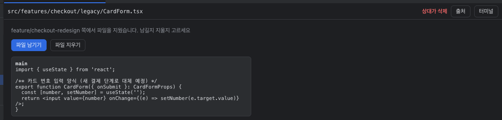

| 충돌                                    | 보이는 것                                                                                                | 고르는 단추                                     |
| --------------------------------------- | -------------------------------------------------------------------------------------------------------- | ----------------------------------------------- |
| 한쪽은 지우고 한쪽은 고침               | `<지운 쪽 라벨> 쪽에서 파일을 지웠습니다. 남길지 지울지 고르세요` 와 남은 쪽 내용                        | **파일 남기기** · **파일 지우기**               |
| 바이너리·UTF-8 이 아닌 파일·심볼릭 링크 | **텍스트로 편집할 수 없는 파일입니다 (바이너리·UTF-8 이 아닌 파일·심볼릭 링크). 한쪽을 통째로 고릅니다** | `<ours 라벨> 쪽 사용` · `<theirs 라벨> 쪽 사용` |
| 서브모듈                                | **서브모듈 충돌은 한쪽 commit 을 고릅니다** 와 양쪽·base 의 commit                                       | `<ours 라벨> 쪽 사용` · `<theirs 라벨> 쪽 사용` |

### Commit 도구 창의 충돌 영역

저장소 탭 Commit 도구 창의 `충돌 N` 영역 머리에는 충돌을 한꺼번에 다루는 단추가 있습니다. 폴더 탭에는 없습니다.

| 단추                              | 하는 일                                                                |
| --------------------------------- | ---------------------------------------------------------------------- |
| `이름 변경 충돌 N`                | 양쪽에서 다른 이름으로 바뀐 파일이 있을 때만 보입니다(아래)            |
| **규칙…**                         | 경로별 해결 규칙을 편집합니다(아래)                                    |
| **규칙 적용**                     | 저장해 둔 규칙을 지금 충돌 파일에 적용합니다                           |
| **rerere 켜짐** / **rerere 꺼짐** | git 의 rerere(해결 기록·재사용)를 켜고 끕니다(아래)                    |
| **stage**                         | 고른 충돌 파일을 지금 작업 트리 내용 그대로 stage 해 해결로 표시합니다 |

#### 이름 변경 충돌

base 의 파일이 양쪽에서 서로 다른 이름으로 바뀌면 `이름 변경 충돌 N` 이 생깁니다. 누르면 대화상자 **이름 변경 충돌** 에 파일마다 `<ours 라벨>: <경로>`·`<theirs 라벨>: <경로>` 단추가 있습니다. 남길 경로를 고르면 내용 충돌이 그 경로에 모이고 충돌 편집기로 이어집니다.

#### 경로별 해결 규칙

`package-lock.json` 처럼 늘 같은 방법으로 푸는 파일은 규칙으로 한꺼번에 풉니다.

1. **규칙…** 을 누릅니다. 대화상자 **경로별 해결 규칙** 이 뜹니다.
2. **규칙 추가** 로 줄을 더하고 **glob**(예: `*.lock`)과 **동작** 을 정합니다.

   | 동작              | 하는 일                                                                           |
   | ----------------- | --------------------------------------------------------------------------------- |
   | **ours 사용**     | ours 쪽 파일로                                                                    |
   | **theirs 사용**   | theirs 쪽 파일로                                                                  |
   | **둘 다 (union)** | 양쪽 줄을 모두 남깁니다                                                           |
   | **명령 실행**     | **명령** 칸의 셸 명령을 `sh -c` 로 실행합니다. `$MGIT_PATH` 에 파일 경로가 옵니다 |

3. **저장** 을 누릅니다. 바로 적용하려면 **규칙 적용** 을 누릅니다. 줄을 빼려면 줄 끝의 **삭제** 를 누릅니다.

적용 결과는 대화상자 아래에 파일마다 ✓·✗ 로, 알림으로 `규칙 적용: N개 중 M개 성공` 이 보입니다. 맞는 규칙이 없으면 **맞는 규칙이 없습니다** 입니다. 규칙이 성공한 파일은 stage 됩니다.

> [!WARNING]
> **규칙 적용** 은 확인창 없이 바로 실행됩니다. 맞는 파일을 규칙대로 덮어쓰고 stage 해 해결로 표시합니다. **명령 실행** 규칙은 셸 명령을 그대로 실행합니다. 적용 전에 **규칙…** 에서 glob 과 명령을 확인하세요.

#### rerere

**rerere 꺼짐** 을 눌러 켜면(**rerere 켜짐**) git 이 충돌 해결을 기록해 두었다가 같은 충돌이 다시 나면 자동으로 같은 해결을 적용합니다. 이 저장소의 git 설정 `rerere.enabled` 를 바꿉니다.

rerere 가 해결을 적용한 파일을 열면 머리줄에 `rerere` 꼬리표(툴팁 **rerere 가 이전 해결을 적용했습니다**)와 **이 기록 잊기** 가 보입니다. 기록이 틀렸으면 **이 기록 잊기** 로 지웁니다.

### 충돌 상태로 되돌리기와 해결 내역 리뷰

이미 해결로 표시한 파일을 다시 열어야 하면 Commit 도구 창 `Staged` 영역의 파일을 우클릭합니다. 진행 중인 작업이 있을 때만 메뉴에 있습니다.

| 항목                                      | 하는 일                                                                                | 탭        |
| ----------------------------------------- | -------------------------------------------------------------------------------------- | --------- |
| **충돌 상태로 되돌리기 (자동 병합 다시)** | 작업 트리 파일을 git 의 자동 병합 결과(충돌 마커 포함)로 다시 만들고 충돌로 되돌립니다 | 두 탭     |
| **충돌 상태로 되돌리기 (작업 트리 유지)** | 작업 트리 파일은 그대로 두고 충돌 표시만 되돌립니다                                    | 두 탭     |
| **해결 내역 리뷰…**                       | **해결 내역 리뷰** 대화상자에 `<경로>: git 자동 병합 → 저장한 결과` 의 차이를 보입니다 | 저장소 탭 |
- **충돌 상태로 되돌리기 (자동 병합 다시)** 는 저장해 둔 해결 내용을 지우고 마커가 든 파일로 바꿉니다. 해결 내용을 살려 고치려면 **충돌 상태로 되돌리기 (작업 트리 유지)** 를 쓰세요. 둘 다 그 파일의 rerere 기록도 지웁니다.
- 해결 내역 리뷰에서 자동 병합 결과에 마커가 있었으면 **자동 병합 결과에는 충돌 마커가 있었습니다 (- 줄)** 이, 차이가 없으면 **저장한 결과가 git 자동 병합 결과와 같습니다** 가 보입니다.

### 다시 시작할 때 해결 다시 쓰기

**Abort** 로 중단해도 앱은 저장해 둔 해결을 보관합니다. 중단 확인창에도 `해결한 파일 N개는 보관되어 같은 작업을 다시 시작하면 재적용을 제안합니다.` 가 붙습니다. 같은 작업을 다시 시작해 충돌이 나면 대화상자 **보관된 해결이 있습니다** 가 뜹니다. **재적용** 을 누르면 그 결과를 다시 적용하고 `보관된 해결 N개를 다시 적용했습니다` 알림이 뜹니다.

### 검증 명령

충돌을 푼 뒤 빌드·테스트가 되는지 확인하려면 저장소 설정에 검증 명령(예: `pnpm test`)을 정해 둡니다([8.7](8-설정.md#87-저장소-설정)). 그러면 충돌 편집기 머리줄에 단추 둘이 생깁니다.

- **검증 실행**: 작업 트리에서 명령을 돌립니다. 대화상자 **검증 명령** 에 출력과 결과(`성공 (Nms)`·`실패 (종료 코드 N)`·**시간 초과**)가 보이고 알림도 뜹니다.
- **터미널에서 검증**: 통합 터미널을 그 저장소에서 열고 명령을 입력해 실행합니다. 검증 명령이 없으면 이 자리는 **터미널**(그 저장소에서 통합 터미널 열기)입니다.

### 출처

머리줄의 **출처** 를 누르면 편집기 위에 이 파일을 건드린 양쪽 commit 목록이 펼쳐집니다. 지금 적용 중인 commit 에는 **지금 적용 중** 이 붙습니다. commit 을 누르면 로그에서 그 commit 을 고릅니다. 없으면 **이 파일을 건드린 commit 이 없습니다** 입니다.

### 외부 merge 도구

git 설정 `merge.tool` 에 도구를 정해 두면 머리줄에 `외부 도구로 열기 (<도구>)` 단추가 생깁니다. 누르면 `git mergetool` 로 그 파일을 엽니다. 도구에서 저장하고 닫아 성공하면 git 이 그 파일을 stage 합니다.

```sh
git config --global merge.tool meld
```

## 5.7 워크트리

한 저장소에서 branch 여럿을 동시에 열어 두려면 워크트리를 만듭니다. 워크트리는 같은 저장소를 공유하는 별도 작업 폴더입니다.

### 저장소 탭에서 만들기

1. 다음 중 하나를 누릅니다.
   - 브랜치 칸 **워크트리** 묶음 행 끝의 + 단추(툴팁 **워크트리 만들기…**)
   - **워크트리** 묶음 행 우클릭 → **워크트리 만들기…**
   - 로그 행 우클릭 → **여기서 워크트리 만들기…**(그 commit 에서 시작)
2. **새 워크트리** 대화상자에 **새 branch 이름** 을 적고 **만들기** 를 누릅니다.
3. **워크트리 경로** 대화상자에 `branch '<이름>' 를 체크아웃할 폴더입니다.` 와 **경로** 칸이 보입니다. 처음 값은 저장소 옆 `<저장소 이름>.worktrees/<branch 이름>` 입니다(branch 이름의 `/` 는 `-` 로). 고칠 수 있습니다.
4. **만들기** 를 누릅니다.

- 새 branch 를 만들며 워크트리를 만듭니다. 묶음 메뉴·+ 단추는 지금 HEAD 에서, 로그 행 메뉴는 그 commit 에서 시작합니다.
- 만든 워크트리는 **워크트리** 묶음에 보입니다. 탭은 저절로 열리지 않습니다.
- 저장소 설정에 워크트리 초기화 명령이 있으면 만든 직후 그 폴더에서 실행하고, 알림 **워크트리 초기화** 에 **초기화 명령이 끝났습니다** 또는 `초기화 명령이 실패했습니다: …` 가 뜹니다([8.7](8-설정.md#87-저장소-설정)).

예: 저장소가 `~/work/acme-platform/storefront-web` 이고 branch 가 `feature/order-history` 이면 처음 경로는 `~/work/acme-platform/storefront-web.worktrees/feature-order-history` 입니다.

### 워크트리 목록과 열기

브랜치 칸 **워크트리** 묶음에 이 저장소의 워크트리가 모두 보입니다.

- 행 이름은 체크아웃한 branch, 분리된 HEAD 면 `detached <해시>` 입니다. 뒤에 회색으로 **메인**(처음 저장소 폴더)·**잠김**·**폴더 없음** 이 붙습니다.
- 행을 더블클릭하거나 우클릭 → **열기** 를 고르면 그 워크트리를 새 저장소 탭으로 엽니다. 지금 탭의 워크트리는 꺼져 있습니다.
- 다른 워크트리에 커밋하지 않은 변경이 있으면 로그 맨 위에 `WIP · <이름>` 행이 생깁니다. 누르면 그 워크트리 탭이 열립니다.
- 다른 워크트리에 체크아웃된 branch 는 로컬 branch 행 끝에 워크트리 표시가 붙고, 마우스를 올리면 `체크아웃됨: <경로>` 가 보입니다. 그 branch 로 checkout 하면 **다른 워크트리에서 사용 중** 대화상자가 뜹니다([4.4](4-일상-작업.md#branch-바꾸기checkout)).

### 지우기

1. 워크트리 행을 우클릭하고 **삭제…** 를 고릅니다.
2. 확인창 `워크트리 <경로> 을(를) 지울까요?` 에 상태에 따라 아래 문구가 보입니다.

   | 문구                                                  | 뜻                                      |
   | ----------------------------------------------------- | --------------------------------------- |
   | **커밋되지 않은 변경이 있습니다. 지우면 사라집니다.** | 그 워크트리에 커밋하지 않은 변경이 있음 |
   | `push 되지 않은 commit N개가 있습니다.`               | 업스트림에 없는 commit 이 있음          |
   | **업스트림이 없어 push 여부를 알 수 없습니다.**       | 그 branch 에 업스트림이 없음            |
   | **폴더가 삭제됩니다. branch 는 남습니다.**            | 위의 어느 것도 아님                     |

3. branch 까지 지우려면 `branch '<이름>' 도 삭제` 를 켭니다.
4. **삭제** 를 누릅니다.

- 메인 워크트리와 지금 탭의 워크트리는 **삭제…** 가 꺼져 있습니다.
- 커밋하지 않은 변경이 있으면 강제로 지웁니다. 그 변경은 되찾을 수 없습니다.

### 잠금과 정리

- **잠금…**: 대화상자 **워크트리 잠금** 에 **이유 (선택)** 를 적고 **적용** 을 누릅니다. 잠긴 워크트리는 git 이 지우거나 정리하지 않습니다(이동식 디스크에 둔 워크트리 등). 행에 **잠김** 이 붙습니다. 메인 워크트리는 잠글 수 없습니다.
- **잠금 해제**: 잠긴 워크트리의 메뉴에 있습니다. 바로 풉니다.
- **사라진 워크트리 정리**: 폴더를 앱 밖에서 지워 **폴더 없음** 으로 보이는 워크트리의 기록을 지웁니다(`git worktree prune`). 그런 워크트리가 있으면 **워크트리** 묶음 행 끝에 정리 단추(툴팁 `폴더가 사라진 워크트리 N개 — 정리할까요?`)도 생깁니다. 툴팁 글자와 달리 누르면 확인 없이 바로 정리합니다.

### 폴더 탭에서 한꺼번에 만들기

폴더 탭에서는 여러 저장소에 같은 branch 의 워크트리를 한꺼번에 만듭니다.

1. 다음 중 하나를 누릅니다. 대상은 고른 저장소(없으면 전체)입니다.
   - 개요 탭 일괄 줄의 **워크트리 만들기…**
   - Project 트리 저장소 행 우클릭 → `워크트리 만들기… (<이름>)`
2. 폴더 설정에 **기본 워크트리 폴더** 가 없으면 워크트리를 모을 폴더를 고르는 창이 뜹니다([8.8](8-설정.md#88-폴더-설정)). 창 제목은 "저장소 열기" 로 보일 수 있습니다.
3. **저장소마다 워크트리 만들기** 대화상자에 대상 저장소와 `→ <폴더>` 가 보입니다. **branch** 를 적습니다.
4. 기존 branch 를 체크아웃하려면 **새 branch 로 만들기** 를 끕니다(처음엔 켜짐 — 저장소마다 지금 HEAD 에서 새 branch 를 만듭니다).
5. **만들기** 를 누릅니다.
6. 하나라도 만들어지면 **만든 워크트리 폴더를 열까요?** 가 뜹니다. **저장소 열기…** 를 누르면 그 폴더를 폴더 탭으로 엽니다.

- 저장소마다 `<고른 폴더>/<저장소 이름>` 에 만듭니다. 그 경로가 이미 있으면 `경로가 이미 있음` 으로 건너뜁니다.
- 결과는 다른 일괄 작업처럼 알림으로 `성공 s · 건너뜀 k · 실패 f` 가 보입니다([4.3](4-일상-작업.md#진행과-결과)).
- 폴더 탭에서 만든 워크트리에는 저장소 설정의 초기화 명령을 돌리지 않습니다.

PR 을 워크트리로 받는 방법은 [5.9](#59-pull-requests)에 있습니다.

## 5.8 서브모듈·모듈·하위 저장소

저장소 안에 든 다른 저장소나 빌드 모듈을 다루려면 저장소 탭 Project 도구 창 머리의 ⋮ 단추(툴팁 **모듈·서브모듈·하위 저장소**)와 트리 행의 메뉴를 씁니다. 폴더 탭에는 이 기능이 없습니다.

| 이름        | 무엇인가                                                                                                                                                                                            | 앱에서 하는 일                                             |
| ----------- | --------------------------------------------------------------------------------------------------------------------------------------------------------------------------------------------------- | ---------------------------------------------------------- |
| 서브모듈    | `.gitmodules` 에 등록된 다른 저장소. 상위 저장소는 그 저장소의 commit 하나만 가리킵니다                                                                                                             | 추가·동기화·일괄 fetch/pull/push·업데이트·제거·탭으로 열기 |
| 모듈        | 빌드 도구 설정이 정한 하위 프로젝트 폴더(Gradle `settings.gradle`, Maven `pom.xml`, `pnpm-workspace.yaml`, `package.json` 의 workspaces, `Cargo.toml` 의 workspace, `go.work`). 저장소는 하나입니다 | 로그를 그 폴더로 좁히기(범위), 변경 목록을 모듈별로 묶기   |
| 하위 저장소 | 서브모듈로 등록하지 않은 채 안에 `.git` 이 든 폴더                                                                                                                                                  | 탭으로 열기                                                |

### ⋮ 메뉴

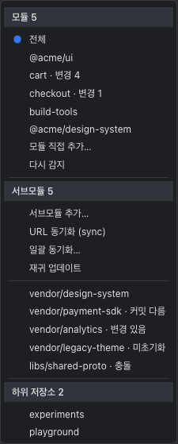

⋮ 단추는 모듈·서브모듈·하위 저장소 중 하나라도 있을 때만 보입니다. 마우스를 올리면 `모듈 5 · 서브모듈 5 · 하위 저장소 2` 처럼 개수가 보입니다. 메뉴의 묶음은 있는 것만 보입니다.

| 묶음            | 항목                                                                                                                      |
| --------------- | ------------------------------------------------------------------------------------------------------------------------- |
| `모듈 N`        | **전체** 와 모듈 목록(`<이름> · 변경 N`) 중 하나를 고르는 범위 선택, **모듈 직접 추가…**, **다시 감지**                   |
| `서브모듈 N`    | **서브모듈 추가…**, **URL 동기화 (sync)**, **일괄 fetch/pull/push…**, **재귀 업데이트**, 서브모듈 목록(`<경로> · <상태>`) |
| `하위 저장소 N` | 하위 저장소 목록                                                                                                          |
- 모듈을 고르면 그 모듈이 범위가 되고 트리에서 그 폴더가 펼쳐집니다. 지금 범위인 모듈을 다시 고르거나 **전체** 를 고르면 범위가 풀립니다([아래](#모듈-범위)).
- **모듈 직접 추가…**: 대화상자 **모듈 직접 추가** 에 **경로**(필수)와 **이름 (비우면 폴더 이름)** 을 적고 **만들기**. 감지되지 않는 폴더를 모듈로 더합니다.
- **다시 감지**: 빌드 설정을 다시 읽습니다.
- 서브모듈·하위 저장소 목록의 항목을 누르면 트리에서 그 폴더를 펼쳐 고릅니다.

| 서브모듈 항목             | 하는 일                                                                                                                                                             |
| ------------------------- | ------------------------------------------------------------------------------------------------------------------------------------------------------------------- |
| **서브모듈 추가…**        | **서브모듈 추가** 대화상자에 **URL**·**경로**(필수)와 **branch**(선택)를 적고 **만들기**. clone 해 등록하고 stage 합니다                                            |
| **URL 동기화 (sync)**     | `.gitmodules` 의 URL 을 각 서브모듈 설정에 다시 씁니다(`git submodule sync --recursive`)                                                                            |
| **일괄 fetch/pull/push…** | **서브모듈 일괄 작업** 대화상자에서 **작업**(fetch·pull·push)과 **fetch 때 --prune**(처음 켜짐)을 고르고 **실행**. 결과는 알림 `<작업>: 성공 s · 건너뜀 k · 실패 f` |
| **재귀 업데이트**         | 모든 서브모듈을 상위 저장소가 가리키는 commit 으로 맞춥니다(`git submodule update --init --recursive`)                                                              |

서브모듈 상태 글자: **미초기화**(아직 받지 않음), **commit 다름**(상위가 가리키는 것과 다른 commit), **변경 있음**(안에 커밋하지 않은 변경), **충돌**. 깨끗하면 경로만 보입니다. 다른 Git 작업이 돌거나 merge·rebase 등이 멈춰 있으면 서브모듈 항목 넷이 꺼집니다.

### 트리 행 메뉴

Project 트리에서 그 폴더 행을 우클릭하면 종류에 따라 항목이 앞에 붙습니다. 그 뒤에 **경로 복사**·**상대 경로 복사** 가 이어집니다.

| 행                              | 메뉴                                                                                      |
| ------------------------------- | ----------------------------------------------------------------------------------------- |
| 서브모듈 폴더                   | **열기** · **추적 branch 최신으로 (update --remote)** · **추적 branch 지정…** · **제거…** |
| 하위 저장소 폴더                | **저장소 탭으로 열기**                                                                    |
| 모듈 폴더                       | **이 모듈만 보기**(범위면 **범위 해제**) · **목록에서 숨기기**                            |
| 루트(이 저장소가 서브모듈일 때) | `↑ 상위 저장소 <이름>` · **새로고침** · **경로 복사**                                     |
- **열기**: 서브모듈을 새 저장소 탭으로 엽니다. 미초기화 서브모듈에서의 동작은 확인 전입니다.
- **추적 branch 최신으로 (update --remote)**: 서브모듈을 추적 branch 의 최신 commit 으로 받아 합칩니다(`--merge`). 상위 저장소에는 서브모듈 commit 변경으로 잡히니 commit 하세요. 미초기화면 꺼집니다.
- **추적 branch 지정…**: 대화상자 `<경로> 추적 branch` 의 **branch** 칸에 이름을 적고 **적용**. **비우면 추적 branch 를 해제합니다 (기본 HEAD)**.
- **제거…**: 확인창 `서브모듈 <경로> 를 제거할까요?` 에 **deinit → rm → .git/modules 삭제 순서로 지웁니다. 제거는 stage 되며 commit 은 직접 합니다.** 가 보입니다. **제거** 를 누른 뒤 Commit 도구 창에서 commit 합니다.
- **목록에서 숨기기**: 그 모듈을 목록에서 뺍니다. 다시 보이게 하려면 **모듈 직접 추가…** 로 같은 경로를 더합니다.

### 모듈 범위

모듈을 범위로 정하면 로그가 그 폴더를 바꾼 commit 만 보입니다.

- Project 트리 위에 `범위: <이름>` 띠와 경로가 생기고, 마우스를 올리면 `로그 그래프를 이 경로로 좁혔습니다: <경로>` 가 보입니다. 띠 끝의 ×(툴팁 **범위 해제**)로 풉니다.
- 범위인 모듈 폴더 행에는 **범위** 꼬리표가 붙습니다.
- 필터 바의 **경로** 조건을 바꾸거나 지워도 범위가 풀립니다.
- 범위는 저장소마다 기억돼 다음에 열 때도 걸립니다.

### 상위 저장소로 가기

서브모듈을 저장소 탭으로 열면 Project 트리 위에 `↑ 상위 저장소 <이름>` 링크가 생깁니다. 누르거나 루트 행 우클릭의 같은 항목을 고르면 상위 저장소를 탭으로 엽니다.

### 한계

- 서브모듈·모듈이 하나도 없으면 ⋮ 단추가 없어, 첫 서브모듈을 화면에서 추가할 길이 없습니다. 터미널에서 `git submodule add <URL> <경로>` 로 추가하세요. 예외로, 이미 clone 해 둔 하위 저장소 폴더를 stage 하면 뜨는 **미등록 하위 저장소** 대화상자의 **서브모듈로 등록** 으로 등록할 수 있습니다([4.2](4-일상-작업.md#commitstage-할-때-뜨는-경고)).
- 모듈이 하나도 감지되지 않으면 **모듈 직접 추가…** 에도 닿을 수 없습니다.
- 모듈 범위는 로그만 좁힙니다. Commit 도구 창의 변경 목록은 그대로입니다(모듈별로 보려면 **모듈** 보기, [4.1](4-일상-작업.md#저장소-탭에서는)).
- 서브모듈·하위 저장소 안의 파일에는 파일 히스토리·Blame 이 없습니다. 그 저장소를 탭으로 열어 보세요.

## 5.9 Pull Requests

GitHub 의 Pull Request(GitLab 은 Merge Request) 목록을 보고 만들려면 왼쪽 띠의 **Pull Requests** 도구 창을 엽니다.

### 보이는 조건

- 저장소 탭에서만, 원격(`origin`, 없으면 첫 원격)의 주소를 읽을 수 있을 때 왼쪽 띠에 단추가 생깁니다. 폴더 탭에는 없습니다.
- 연결한 호스팅 계정의 호스트와 같으면 그 계정의 종류를 따릅니다. 계정이 없으면 호스트 이름에 `gitlab` 이 들어 있을 때 GitLab, 아니면 GitHub 로 봅니다. 그래서 다른 호스트의 원격에도 **Pull Requests** 단추가 보일 수 있습니다.
- GitLab 이면 이름이 **Merge Requests** 입니다. 커맨드 팔레트의 `Pull Requests 도구 창`(GitLab 은 `Merge Requests 도구 창`)으로도 엽니다. 기본 단축키는 없습니다.
- 원격 정보는 탭을 열 때 읽습니다. 원격을 바꾼 뒤에는 탭을 다시 여세요.

### 계정이 없을 때

**계정을 연결하면 PR 을 볼 수 있습니다.** 와 **계정 연결…** 이 보입니다. **계정 연결…** 은 호스팅 계정 대화상자를 엽니다([8.4](8-설정.md#84-호스팅-계정)). 계정을 연결해도 목록이 바로 바뀌지 않으면 탭을 닫았다가 다시 여세요([10.8](10-문제-해결.md#108-pull-requests-에-계정이-없다고-나올-때)).

### 목록

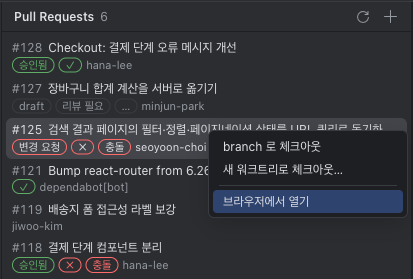

- 머리에 제목과 개수, 계정이 연결돼 있으면 **새로고침**·**만들기…** 단추가 있습니다.
- 열린 PR 만 50개까지 보입니다. 읽는 동안 **불러오는 중…**, 없으면 **열린 PR 없음** 입니다.
- 행마다 `#번호`, 제목, 배지, 작성자가 보입니다.

| 배지                                       | 뜻                                     |
| ------------------------------------------ | -------------------------------------- |
| **draft**                                  | 초안 PR                                |
| **승인됨** · **변경 요청** · **리뷰 필요** | 리뷰 상태                              |
| ✓ · ✗ · …                                  | CI 검사 성공·실패·진행 중              |
| **충돌**                                   | 대상 branch 와 충돌해 merge 할 수 없음 |

행을 누르면 고르기, 더블클릭이나 Enter 는 브라우저에서 엽니다.

### 우클릭 메뉴

| 항목                        | 하는 일                                                                                                                                |
| --------------------------- | -------------------------------------------------------------------------------------------------------------------------------------- |
| **branch 로 체크아웃**      | PR 의 commit 을 받아 로컬 branch `pr/<번호>`(GitLab 은 `mr/<번호>`)로 만들고 checkout 합니다. 알림 `pr/<번호> 로 체크아웃했습니다`     |
| **새 워크트리로 체크아웃…** | 대화상자의 **워크트리 경로**(처음 값 `<저장소 경로>-pr-<번호>`)를 확인하고 **만들기**. 그 branch 로 워크트리를 만들어 새 탭으로 엽니다 |
| **브라우저에서 열기**       | PR 페이지를 브라우저로 엽니다                                                                                                          |
- 이미 `pr/<번호>` branch 가 있으면 받은 commit 으로 앞으로만 옮깁니다. 받은 것에 없는 commit 이 그 branch 에 있으면 덮어쓰지 않고 오류로 멈춥니다.
- 다른 Git 작업이 도는 동안에는 체크아웃 두 항목이 꺼집니다.

### 만들기

1. 체크아웃한 branch 에서 머리의 **만들기…** 를 누릅니다. 분리된 HEAD 이거나 다른 작업이 도는 중이면 꺼집니다.
2. 저장소에 PR 본문 템플릿이 둘 이상이면 먼저 **본문 템플릿** 대화상자의 **템플릿** 에서 하나를 고르고 **선택** 을 누릅니다. 하나면 그것이 바로 쓰입니다.
3. **PR/MR 만들기** 대화상자를 채웁니다.

   | 칸                     | 처음 값                                                                      |
   | ---------------------- | ---------------------------------------------------------------------------- |
   | **head (내 branch)**   | 현재 branch 의 업스트림 이름(없으면 로컬 이름). 원격에 push 돼 있어야 합니다 |
   | **base (대상 branch)** | 그 원격의 `main`·`master`·`develop` 중 있는 것. 원격 branch 중에서 고릅니다  |
   | **제목**               | 현재 branch 이름                                                             |
   | **본문**               | 템플릿 내용                                                                  |
   | **초안 (draft)**       | 꺼짐                                                                         |

4. **만들기** 를 누릅니다. 만들어지면 알림 `#N 을(를) 만들었습니다` 가 뜨고, 브라우저에서 그 PR 이 열리며, 목록을 다시 읽습니다.

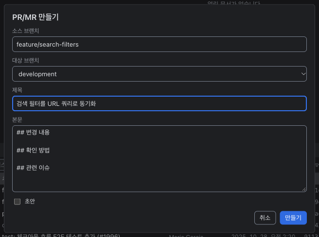

### 앱에 없는 것

PR 상세 화면, 리뷰·댓글 작성, PR merge·닫기는 앱에 없습니다. **브라우저에서 열기** 로 호스팅 사이트에서 합니다.

## 5.10 터미널과 외부 앱

명령을 직접 치거나 다른 앱으로 열려면 통합 터미널이나 외부 앱 명령을 씁니다.

### 통합 터미널

`⌘⇧J`(**통합 터미널 열기/닫기**)나 왼쪽 띠 아래의 **터미널** 단추로 아래 도구 창에 셸을 엽니다. 새 셸은 지금 탭의 폴더(폴더 탭은 그 폴더, 저장소 탭은 그 저장소)에서 시작합니다. 탭 관리와 수명은 [3.9 콘솔과 터미널](3-화면-둘러보기.md#39-콘솔과-터미널)에 있습니다.

충돌 편집기의 **터미널**·**터미널에서 검증** 단추도 그 저장소에서 통합 터미널을 엽니다([5.6](#검증-명령)).

### 외부 앱으로 열기

저장소 탭에서는 그 저장소 폴더를 다른 앱으로 엽니다. 커맨드 팔레트의 **외부 앱** 묶음에 있습니다.

| 명령                     | 키    | 하는 일                                                                       |
| ------------------------ | ----- | ----------------------------------------------------------------------------- |
| **에디터에서 열기**      | `⌘⇧E` | 저장소 폴더를 외부 에디터로 엽니다. 처음 설정은 PATH 의 `code`, 없으면 `idea` |
| **터미널에서 열기**      | `⌘⇧T` | 저장소 폴더에서 외부 터미널 앱을 엽니다. 처음 설정은 Terminal.app             |
| **파일 탐색기에서 보기** | —     | Finder 에서 저장소 폴더를 보여 줍니다                                         |
- 세 명령은 저장소 탭에서만 켜집니다. 폴더 탭에서는 저장소를 저장소 탭으로 연 뒤 씁니다.
- 파일 하나를 열려면 저장소 탭 Commit 도구 창에서 파일을 우클릭하고 **에디터에서 열기**·**파일 탐색기에서 보기** 를 고릅니다([4.2](4-일상-작업.md#파일-우클릭-메뉴)).
- 쓸 에디터와 터미널 앱은 **설정…**(`⌘,`)에서 바꿉니다. → [8.2 외부 앱](8-설정.md#82-외부-앱)

---

[← 4. 일상 작업](4-일상-작업.md) · [목차](../사용법.md) · [6. 실수했을 때 →](6-실수했을-때.md)
