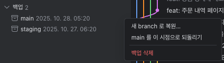
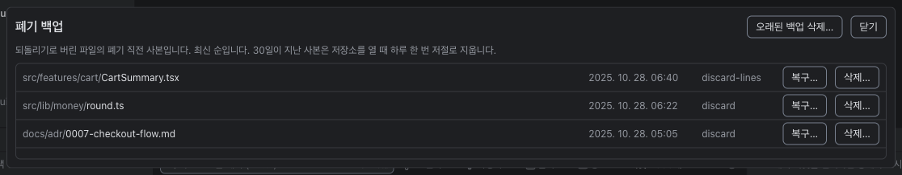
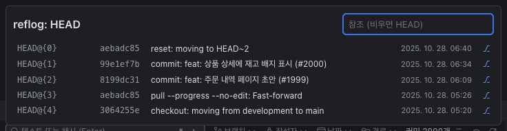
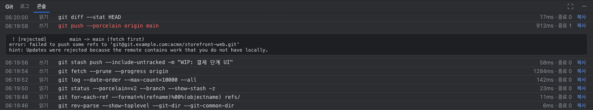

# 6. 실수했을 때

잘못 실행한 Git 작업을 되돌리거나, 버린 내용을 되살리는 방법입니다. 무엇을 잘못했는지 아래 표에서 찾아 해당 절로 가세요.

기준: 브랜치 `feat/tag-management` · 커밋 `aedc0b6` · 2026-11-23

| 잘못한 것                                                | 먼저 할 일                                                                                                      | 그래도 안 되면                                                                                                                                                  |
| -------------------------------------------------------- | --------------------------------------------------------------------------------------------------------------- | --------------------------------------------------------------------------------------------------------------------------------------------------------------- |
| commit 을 잘못함                                         | 탭을 닫기 전에 ↶ **되돌리기**([6.1](#61-undoredo-로-되돌리기)). 내용은 stage 된 채 남습니다                     | 메시지만 고치려면 [메시지 수정](5-가끔-하는-작업.md#메시지-수정), 직전 commit 에 더하려면 **amend**([4.2](4-일상-작업.md#저장소-탭에서-stage-하고-commit-하기)) |
| merge·pull·cherry-pick·revert 를 잘못함                  | ↶ **되돌리기**([6.1](#61-undoredo-로-되돌리기))                                                                 | 탭을 닫았으면 [6.4 reflog 로 찾기](#64-reflog-로-찾기). 이미 push 했으면 **revert** 로 되돌리는 commit 을 만듭니다                                              |
| rebase·reset·인터랙티브 rebase·메시지 수정·부모에 합치기 | ↶ **되돌리기**([6.1](#61-undoredo-로-되돌리기))                                                                 | 탭을 닫았으면 [6.2 백업에서 되살리기](#62-백업에서-되살리기)                                                                                                    |
| branch 를 지움                                           | ↶ **되돌리기**([6.1](#61-undoredo-로-되돌리기))                                                                 | [6.2 백업](#62-백업에서-되살리기). 워크트리와 함께 지운 branch 는 백업이 없어 Undo 로만 되살립니다                                                              |
| 로컬 tag 를 지움                                         | ↶ **되돌리기**([6.1](#61-undoredo-로-되돌리기)). 여러 개를 한 번에 지웠어도 Undo 한 번에 모두 되살아납니다      | 원격에 남아 있는 tag 는 다음 fetch 때 다시 생길 수 있습니다([아래](#원격에-남은-tag-를-로컬에서만-지웠을-때))                                                   |
| 원격 tag 를 지움(지울 곳에서 원격을 고름)                | Undo 대상이 아닙니다. 로컬에 같은 tag 가 남아 있으면 다시 push 합니다([5.4](5-가끔-하는-작업.md#tag-push-하기)) | 이미 받아 간 저장소에는 그 tag 가 남아 있습니다                                                                                                                 |
| tag 를 잘못 push 했거나 원격 tag 를 로컬 것으로 덮어씀   | Undo 대상이 아닙니다. 원격에서 지우거나 다시 맞춥니다([5.4](5-가끔-하는-작업.md#원격과-다른-tag-맞추기))        | 이미 받아 간 저장소에는 옛 tag 가 남습니다. 되돌릴 수 없습니다                                                                                                  |
| tag 를 가져왔거나 원격 것으로 맞춤                       | ↶ **되돌리기**([6.1](#61-undoredo-로-되돌리기))                                                                 | —                                                                                                                                                               |
| 파일의 변경을 버림(**되돌리기**·**hunk 되돌리기**)       | [6.3 버린 파일 되살리기](#63-버린-파일-되살리기)                                                                | Undo 로는 되찾을 수 없습니다                                                                                                                                    |
| reset hard 로 커밋하지 않은 변경이 사라짐                | 되찾을 수 없습니다                                                                                              | branch 위치만 Undo·백업으로 되돌릴 수 있습니다                                                                                                                  |
| stash 를 **drop…** 함                                    | 앱에서는 되살릴 수 없습니다                                                                                     | 아래 NOTE 의 터미널 방법                                                                                                                                        |
| 변경이 있는 워크트리를 지움                              | 되찾을 수 없습니다                                                                                              | —                                                                                                                                                               |
| 잘못 push 함                                             | Undo 는 원격을 되돌리지 않습니다. **revert** 로 되돌리는 commit 을 만들어 다시 push 합니다                      | 원격을 덮어써야 하면 **force-with-lease 로 push**([4.3](4-일상-작업.md#43-fetchpullpush-하기))                                                                  |
| 원격 branch 를 지움(**원격에서 삭제…**)                  | Undo 대상이 아닙니다. 로컬에 같은 branch 가 있으면 다시 push 합니다                                             | —                                                                                                                                                               |
| 무엇이 실행됐는지 모르겠음                               | [6.5 실행된 명령 보기](#65-실행된-명령-보기)                                                                    | —                                                                                                                                                               |

> [!NOTE]
> drop 한 stash 는 git 이 정리(gc)하기 전까지 연결이 끊긴 commit 으로 남아 있을 수 있습니다. 통합 터미널(`⌘⇧J`)에서 `git fsck --unreachable | grep commit` 으로 해시를 찾고, `git show <해시>` 로 내용을 확인한 뒤 `git stash apply <해시>` 로 꺼냅니다. 앱에는 이 기능이 없습니다.

## 6.1 Undo·Redo 로 되돌리기

방금 실행한 Git 작업을 취소하려면 저장소 탭에서 Undo(↶ **되돌리기**)를 씁니다. 되돌린 것을 다시 적용하려면 Redo(↷)를 씁니다.

### 여는 곳

| 곳            | Undo                                    | Redo                  |
| ------------- | --------------------------------------- | --------------------- |
| 툴바          | ↶ **되돌리기**                          | ↷(툴팁 **다시 실행**) |
| 단축키        | `⌘Z`                                    | `⌘⇧Z`                 |
| 커맨드 팔레트 | `되돌리기: <작업>`(없으면 **되돌리기**) | **다시 실행**         |
- 툴바 ↶ 에 마우스를 올리면 되돌릴 작업이 `되돌리기: <작업>` 으로 보입니다. 되돌릴 것이 없으면 **되돌릴 작업이 없습니다** 가 보이고 단추가 꺼집니다.
- 작업 이름은 실행한 git 명령의 앞부분입니다. 예: `commit -q`(commit·amend), `merge --no-edit`, `reset --hard <commit>`, `rebase onto <ref>`, `branch -d <이름>`. tag 는 `tag -d v1`·`tag -d v1 v2 v3 (+2)`(여러 개 지우기), `fetch tag v1`·`fetch tags v1 v2`(가져오기), `fetch +tag v1`(원격 것으로 맞추기)처럼 보입니다.
- commit 메시지 칸·검색 칸 같은 입력란에 글자 커서가 있으면 `⌘Z`·`⌘⇧Z` 는 그 칸의 글자를 되돌립니다. Git 작업을 되돌리려면 입력란 밖을 누른 뒤 누르거나 툴바 단추를 씁니다.
- 다른 Git 작업이 도는 동안에는 꺼집니다.
- 폴더 탭에는 Undo·Redo 가 없습니다. 폴더 탭에서 한 작업은 되돌릴 수 없습니다.

### 되돌릴 수 있는 작업

이 저장소 탭에서 실행해 로컬 branch·tag·HEAD 를 바꾼 작업이 대상입니다.

- 대상: commit·amend, checkout, merge, pull, rebase(인터랙티브 rebase 포함), reset, cherry-pick, revert, 메시지 수정, 부모 commit 에 합치기, 범위를 하나로 합치기, branch·tag 만들기·지우기·이름 바꾸기, 백업·reflog 에서 branch 되살리기
  - tag: 로컬 tag 지우기(여러 개를 한 번에 지운 것도 Undo 한 번에 되살아납니다), tag 가져오기, 원격 것으로 맞추기
- 대상이 아님: 폴더 탭의 모든 작업, fetch·push(원격 추적 branch 와 원격만 바뀜), **원격에서 삭제…**, stash 저장·apply·pop·drop, stage·unstage·파일 버리기, 원격 추가·변경, 저장소 설정, 5분마다 도는 자동 fetch, **백업 삭제**
  - tag: tag push, 원격 tag 지우기, 원격 tag 를 로컬 것으로 덮어쓰기. 모두 원격만 바꿉니다
- 실패한 작업은 쌓이지 않습니다. 충돌로 멈춘 merge·rebase 는 작업 진행 띠의 **Abort** 로 취소합니다([5.6](5-가끔-하는-작업.md#작업-진행-띠)).

### ref 만 되돌립니다

Undo 는 branch·tag·HEAD 가 가리키는 commit 만 작업 전으로 돌립니다. 작업 트리의 파일과 stage(index)는 그대로 둡니다. 그래서 되돌린 뒤 Commit 도구 창에 변경이 생길 수 있습니다.

| 되돌린 작업   | 되돌린 뒤 보이는 것                                                                                                                                |
| ------------- | -------------------------------------------------------------------------------------------------------------------------------------------------- |
| commit        | commit 이 없어지고 그 내용이 stage 된 변경으로 남습니다(`git reset --soft` 와 같음)                                                                |
| amend         | amend 전 commit 으로 돌아가고, amend 로 더한 내용이 stage 된 변경으로 남습니다                                                                     |
| checkout      | HEAD 가 옛 branch 로 돌아가지만 파일은 새 branch 의 내용 그대로입니다. 두 branch 의 차이가 모두 stage 된 변경으로 보입니다                         |
| merge·pull    | branch 가 합치기 전 commit 으로 돌아가고, 합쳐진 내용이 stage 된 변경으로 남습니다. pull 로 받은 `origin/main` 등은 그대로라 `↓N` 이 다시 보입니다 |
| reset --hard  | branch 는 원래 commit 으로 돌아가지만 파일은 reset 한 commit 의 내용입니다. 차이가 stage 된 변경으로 보입니다                                      |
| branch 지우기 | branch 가 같은 commit 에 다시 생깁니다. 업스트림 설정은 돌아오지 않습니다                                                                          |
| tag 지우기    | tag 가 지우기 전과 같은 객체로 다시 생깁니다. annotated tag 의 메시지·작성자도 그대로입니다                                                        |
| tag 가져오기  | 받기 전으로 돌아갑니다. 새로 받은 tag 는 사라지고, 원격 것으로 바꾼 tag 는 바꾸기 전 tag 로 돌아옵니다                                             |
- 파일까지 작업 전 commit 에 맞추려면, 되돌린 뒤 로그 맨 위(HEAD) commit 을 우클릭해 **reset** ▸ **hard (변경을 모두 버림)** 를 실행합니다. 커밋하지 않은 다른 변경도 함께 사라지니 먼저 확인하세요.
- 되돌려도 따로 알림은 뜨지 않습니다. 로그에서 branch 위치가 바뀐 것으로 확인합니다.

> [!WARNING]
> Undo 는 branch 위치만 되돌리고 파일은 되돌리지 않습니다. checkout·merge·pull 을 되돌린 직후 Commit 도구 창에 보이는 변경은 새로 생긴 것이 아니라 작업 결과가 남은 것입니다. 이것을 그대로 commit 하면 되돌린 작업의 내용이 새 commit 으로 다시 들어갑니다. reset hard 로 사라진 커밋하지 않은 변경은 Undo 로도 돌아오지 않습니다.

### 그 사이에 바뀐 ref

- 작업 뒤에 터미널·다른 탭 등에서 같은 ref 가 또 바뀌었으면 그 ref 는 건드리지 않습니다. 알림 **작업 뒤에 바뀐 ref 는 건드리지 않았습니다** 에 그 ref 의 전체 이름(`refs/heads/main` 등)이 보입니다.
- 되돌릴 ref 가 하나도 없으면 그 작업은 스택에서 빠지고 다시 실행할 수도 없습니다.

### 원격에 남은 tag 를 로컬에서만 지웠을 때

원격에 남아 있는 tag 를 로컬에서만 지우면 다음 fetch 때 다시 생길 수 있습니다. git 은 받아 오는 branch 이력을 가리키는 tag 를 함께 받기 때문입니다. 5분마다 도는 자동 fetch 로도 생깁니다. 그 뒤 그 지우기를 Undo 하면 tag 마다 이렇게 됩니다.

| 다시 생긴 tag                   | Undo 하면                                                                                                   |
| ------------------------------- | ----------------------------------------------------------------------------------------------------------- |
| 지우기 전과 같은 tag 로 생김    | 할 일이 없습니다. 이미 지우기 전 상태라 그대로 둡니다                                                       |
| 원격 것이 달라 다른 tag 로 생김 | 건드리지 않고 건너뜀으로 보고합니다(알림 **작업 뒤에 바뀐 ref 는 건드리지 않았습니다**, `refs/tags/<이름>`) |

원격에서도 없애려면 지울 곳 대화상자에서 그 원격 칸도 고릅니다. → [5.4 tag 지우기](5-가끔-하는-작업.md#tag-지우기)

### 스택의 수명

- 탭마다 최근 20개까지 쌓입니다. 넘으면 가장 오래된 것부터 빠집니다.
- 메모리에만 있습니다. 탭을 닫거나 앱을 끄면 사라집니다. 같은 저장소를 다시 열어도 돌아오지 않습니다.
- 되돌린 뒤 새 Git 작업을 하면 다시 실행할 목록이 비워집니다.
- 탭을 닫은 뒤에는 [6.2 백업](#62-백업에서-되살리기)이나 [6.4 reflog](#64-reflog-로-찾기)로 되찾습니다.

## 6.2 백업에서 되살리기

이력을 다시 쓰는 작업 일부는 실행 직전에 branch 위치를 백업 ref 로 남깁니다. 탭을 닫아 Undo 가 사라진 뒤에도 백업에서 되살릴 수 있습니다. 백업은 저장소 탭에서만 봅니다.

### 백업이 만들어지는 때

- 이력을 다시 쓰는 작업: rebase, 인터랙티브 rebase, 메시지 수정, 부모 commit 에 합치기, 범위를 하나로 합치기, reset mixed·hard. 표는 [5.1 백업이 만들어지는 작업](5-가끔-하는-작업.md#백업이-만들어지는-작업)에 있습니다.
- amend([4.2](4-일상-작업.md#저장소-탭에서-stage-하고-commit-하기))와 branch 지우기(**삭제…**, [4.4](4-일상-작업.md#이름-바꾸기지우기업스트림)).
- 아래 `<branch> 를 이 시점으로 되돌리기` 로 지금 checkout 된 branch 를 되돌릴 때. 되돌리기 직전 위치가 새 백업으로 남습니다.
- 만들지 않는 때: merge, cherry-pick, revert, reset soft, pull, 워크트리와 함께 지운 branch, 폴더 탭의 일괄 작업, 분리된 HEAD 에서 한 작업.

### 이름과 보관

- 백업은 저장소 안의 ref `refs/mgit/backup/<branch>/<만든 시각(초)>-<일련번호>` 입니다. 그 ref 의 reflog 에 `mgit backup: <이유>`(예: `rebase`, `reset`, `branch delete`)가 남습니다.
- 로그(그래프)에는 보이지 않고 브랜치 칸의 **백업** 묶음에만 보입니다.
- push 되지 않습니다. 이 Mac 의 이 저장소에만 있습니다.
- 백업은 지울 때까지 남습니다. 앱에 30일 보관 값이 있지만, 지금은 지난 백업을 지우는 동작이 실행되지 않습니다. 쌓인 백업은 직접 지웁니다.

### 백업 묶음 쓰기

1. 저장소 탭 Git 도구 창의 **로그** 탭에서 브랜치 칸 맨 아래 **백업** 묶음을 펼칩니다(처음엔 접혀 있음).
2. 항목은 `<branch> <백업한 시각>` 이고 최근 것이 위입니다.
3. 항목을 누르면 로그에서 그 commit 으로 이동합니다. 지운 branch 에만 있던 commit 처럼 로그에 없는 commit 이면 움직이지 않습니다.
4. 항목을 우클릭하고 아래 메뉴에서 고릅니다.



| 항목                               | 하는 일                                                                                                                         | 확인   |
| ---------------------------------- | ------------------------------------------------------------------------------------------------------------------------------- | ------ |
| **새 branch 로 복원…**             | 백업 시점에 새 branch 를 만듭니다. **백업 복원** 대화상자에서 **새 branch 이름**(처음 값 `<branch>-backup`)을 정하고 **만들기** | 입력창 |
| `<branch> 를 이 시점으로 되돌리기` | 원래 branch 를 백업 시점으로 옮깁니다. 지운 branch 면 다시 만듭니다                                                             | 확인창 |
| **백업 삭제**                      | 백업 ref 를 지웁니다                                                                                                            | 없음   |
- `<branch> 를 이 시점으로 되돌리기` 의 확인창은 그 branch 가 지금 checkout 돼 있는지에 따라 다릅니다. 둘 다 **적용** 을 눌러야 실행됩니다.
  - checkout 돼 있으면 hard reset 입니다. **stage 와 작업 트리의 변경이 모두 사라집니다. 커밋되지 않은 변경은 복구할 수 없습니다.** 가 보입니다.
  - checkout 돼 있지 않으면 branch 만 옮깁니다. **이 브랜치를 백업 시점으로 옮깁니다. 체크아웃돼 있지 않아 작업 트리는 바뀌지 않습니다.** 가 보입니다.
  - 다른 워크트리에 checkout 된 branch 는 되돌릴 수 없습니다. `다른 워크트리에 체크아웃된 브랜치는 되돌릴 수 없습니다: <branch> (<경로>)` 가 뜹니다. 그 워크트리 탭에서 하세요.
- **새 branch 로 복원…** 과 되돌리기는 ↶ **되돌리기**(Undo) 대상입니다. **백업 삭제** 는 확인 없이 바로 지우고 Undo 로도 되살릴 수 없습니다.

### 터미널에서 보기

백업은 보통의 ref 라 다른 git 도구에서도 보입니다.

```sh
git for-each-ref refs/mgit/backup                 # 백업 목록
git log -1 refs/mgit/backup/main/1761596400-000001  # 백업 하나의 commit
git for-each-ref --format='delete %(refname)' refs/mgit/backup | git update-ref --stdin  # 백업 모두 지우기
```

## 6.3 버린 파일 되살리기

commit 하지 않은 변경을 버렸다면 폐기 백업에서 되살립니다. 앱은 변경을 버리기 직전에 그 파일 전체를 앱 데이터 폴더에 복사해 둡니다.

### 폐기 백업이 만들어지는 때

- 저장소 탭 Commit 도구 창의 **되돌리기**(변경 버리기, [4.2](4-일상-작업.md#변경-버리기))
- 작업 트리 diff 탭의 **hunk 되돌리기**·`선택 N줄 되돌리기`([4.2](4-일상-작업.md#hunk줄-단위로-stage-하기)). 폴더 탭에서 한 것도 사본이 남습니다. 목록은 그 저장소를 저장소 탭으로 열어 봅니다.
- 버린 직후 알림 **폐기 백업에서 복구할 수 있습니다** 가 뜹니다.
- 만들지 않는 때: reset hard, checkout·stash 로 덮어쓴 파일, 충돌의 **Abort**, 워크트리 삭제. 이미 지워진 파일을 버릴 때(되살리기)는 잃을 내용이 없어 사본을 만들지 않습니다.

### 목록 열기

1. 저장소 탭에서 Commit 도구 창(`⌘0`) **변경** 탭 머리줄의 **폐기 백업…** 을 누릅니다. 커맨드 팔레트의 **폐기 백업…** 도 같습니다.
2. **폐기 백업** 대화상자에 이 저장소의 사본이 최신 순으로 최대 200개 보입니다.



- 줄마다 경로, 버린 시각, 이유(`discard` 는 파일 버리기, `discard-lines` 는 hunk·줄 되돌리기), **복구…** 단추가 있습니다.
- 경로가 길면 잘립니다. 마우스를 올리면 전체 경로가 보입니다.
- 사본이 없으면 **폐기 백업이 없습니다** 가 보입니다.

### 복구하기

1. 되살릴 줄의 **복구…** 를 누릅니다.
2. 확인창 `<경로> 을(를) 복구할까요?` 에 **작업 트리의 현재 파일을 이 사본으로 덮어씁니다.** 가 보입니다.
3. **복구…** 를 누릅니다. 알림 `복구했습니다: <경로>` 가 뜹니다.

- 파일 전체를 버린 시점의 사본으로 덮어씁니다. hunk 하나만 버렸어도 그 뒤에 고친 내용까지 버린 시점으로 돌아갑니다. 지금 파일을 남기려면 먼저 commit 하거나 stash 하세요.
- 그 사이 폴더가 지워졌으면 다시 만들어 넣습니다.
- 복구는 ↶ **되돌리기**(Undo) 대상이 아닙니다.

### 사본이 있는 곳

- 사본은 앱 데이터 폴더 `~/Library/Application Support/io.github.motolies.mgit/backups/` 아래에 저장소마다 나뉘어 있습니다. 목록 정보는 같은 폴더의 `mgit.db` 에 있습니다.
- 저절로 지워지지 않고, 앱에서 지우는 기능도 없습니다. 목록에는 최신 200개만 보입니다.
- 목록은 저장소 폴더의 경로로 찾습니다. 저장소 폴더를 옮기거나 이름을 바꾸면 그 전의 사본은 목록에 나오지 않습니다.

## 6.4 reflog 로 찾기

백업이 없는 작업(merge·cherry-pick·revert·pull)을 되돌리거나 Undo 가 사라진 뒤 옛 commit 을 찾으려면 reflog 를 봅니다. reflog 는 HEAD·branch 가 움직일 때마다 git 이 남기는 기록입니다. 저장소 탭에서만 엽니다.

1. 커맨드 팔레트(`⌘⇧P`)에서 **Reflog…** 를 실행합니다.
2. `reflog: HEAD` 대화상자에 HEAD 의 기록이 최근 순으로 최대 500개 보입니다.
3. 다른 ref 를 보려면 오른쪽 위 **ref (비우면 HEAD)** 칸에 `main` 처럼 적고 `Enter` 를 누릅니다. 제목이 `reflog: main` 으로 바뀝니다.
4. 줄을 누르면 로그에서 그 commit 으로 이동합니다(로그에 보이는 commit 일 때).
5. 되살릴 줄 끝의 ⎇ 단추(툴팁 **이 시점을 branch 로…**)를 누릅니다.
6. **백업 복원** 대화상자에 `HEAD@{n} · <해시>` 가 보입니다. **새 branch 이름** 을 적고 **만들기** 를 누릅니다.



- 줄에는 `HEAD@{n}`, 짧은 해시, git 이 남긴 내용(`commit: …`, `checkout: moving from … to …`, `reset: moving to …`, `merge …` 등), 시각이 보입니다.
- 기록이 없거나 ref 이름이 틀리면 **reflog 가 없습니다** 가 보입니다.
- 닫기 단추가 없습니다. `Esc` 로 닫습니다.
- 만든 branch 는 ↶ **되돌리기**(Undo) 대상입니다.
- reflog 는 이 저장소에만 있는 기록입니다. 오래된 항목은 git 설정(`gc.reflogExpire`)에 따라 git 이 지웁니다.

### 언제 쓰나

- 탭을 닫은 뒤 merge·pull·cherry-pick·revert 를 되돌리고 싶을 때: HEAD 의 reflog 에서 그 작업 바로 아래 줄(작업 전 위치)을 branch 로 만들어 확인합니다. 원래 branch 를 그 위치로 옮기려면 원래 branch 를 checkout 한 채 로그에서 그 commit 을 우클릭해 **reset** 합니다([5.1](5-가끔-하는-작업.md#reset)).
- reset·rebase 로 사라진 commit 을 찾을 때(백업보다 오래된 위치도 남아 있습니다).
- 분리된 HEAD 에서 만든 commit 을 branch 없이 떠나 놓쳤을 때.

## 6.5 실행된 명령 보기

앱이 실제로 어떤 git 명령을 돌렸는지, 왜 실패했는지 보려면 Git 콘솔을 엽니다. 화면 구성은 [3.9 콘솔과 터미널](3-화면-둘러보기.md#39-콘솔과-터미널)에 있고, 여기서는 쓰는 법을 다룹니다.

`⌘J`(**Git 콘솔 열기/닫기**)나 툴바의 **Git 콘솔** 을 누르면 아래 Git 도구 창의 **콘솔** 탭이 열립니다.



### 실패한 명령 찾기

- 맨 위가 최근 명령입니다. 탭마다 최근 500개가 남습니다.
- 실패한 명령(종료 코드가 0 이 아님)은 명령 글자가 빨갛고 끝에 `종료 1` 처럼 코드가 보입니다. 취소한 명령은 **취소됨** 입니다.
- 명령을 누르면 git 이 낸 오류 출력의 끝부분(최대 2 KiB)이 펼쳐집니다. 다시 누르면 접힙니다. 키보드로는 줄에서 `Enter`·`Space` 입니다.
- 툴바 아래의 빨간 오류 줄이나 알림보다 자세합니다. 예를 들어 push 거부는 `! [rejected] main -> main (fetch first)` 처럼 git 의 원래 문구가 보입니다.

### 명령 복사하기

- **복사** 단추(줄에서 `⌘C`)는 `git push --porcelain origin main` 처럼 명령줄 전체를 복사합니다. 누르면 잠깐 **복사됨** 으로 바뀝니다. 빈칸이 든 인자는 따옴표로 감쌉니다.
- 복사한 명령을 통합 터미널(`⌘⇧J`)에 붙여 같은 명령을 직접 돌려 볼 수 있습니다.
- 주소에 든 토큰·비밀번호와 `token=`·`password=` 뒤의 값은 `***` 로 가려 기록합니다.

> [!TIP]
> 문제를 물어볼 때는 콘솔에서 실패한 줄을 **복사** 해 붙이고, 펼친 오류 출력도 함께 적어 주세요. 화면의 오류 한 줄보다 원인을 찾기 쉽습니다.

### 폴더 탭과 저장소 탭

| 항목          | 저장소 탭                                                          | 폴더 탭                                                                                                 |
| ------------- | ------------------------------------------------------------------ | ------------------------------------------------------------------------------------------------------- |
| 쌓이는 명령   | 이 저장소에서 돈 명령 전부(상태·로그를 읽는 명령 포함)             | 폴더의 저장소에서 돈 쓰기·네트워크 명령(fetch·pull·push·commit·stage 등)                                |
| 줄 구성       | 시각 · **쓰기**/**읽기** · 명령 · 걸린 시간과 종료 코드 · **복사** | 시각 뒤에 저장소 칸(색 사각형과 이름)이 더 붙음                                                         |
| 저장소별 보기 | —                                                                  | 저장소 칸을 누르면 `<저장소> 저장소의 기록만 보는 중` 과 **전체 보기** 가 보임                          |
| 실패 배지     | —                                                                  | 콘솔을 보지 않는 동안 실패하면 **콘솔** 탭 옆에 숫자 배지(툴팁 `콘솔을 보지 않는 동안 실패한 명령 N개`) |
- 저장소 탭에서는 5분마다 도는 자동 fetch(`fetch --all --prune`)도 쌓입니다.
- 폴더 탭에서 워크트리에서 돈 명령이면 저장소 칸 툴팁에 `작업 디렉터리: <경로>` 가 더 보입니다.
- 기록은 메모리에만 있어 탭을 닫으면 사라집니다.

---

[← 5. 가끔 하는 작업](5-가끔-하는-작업.md) · [목차](../사용법.md) · [7. 알아 두면 좋은 동작 →](7-알아-두면-좋은-동작.md)
