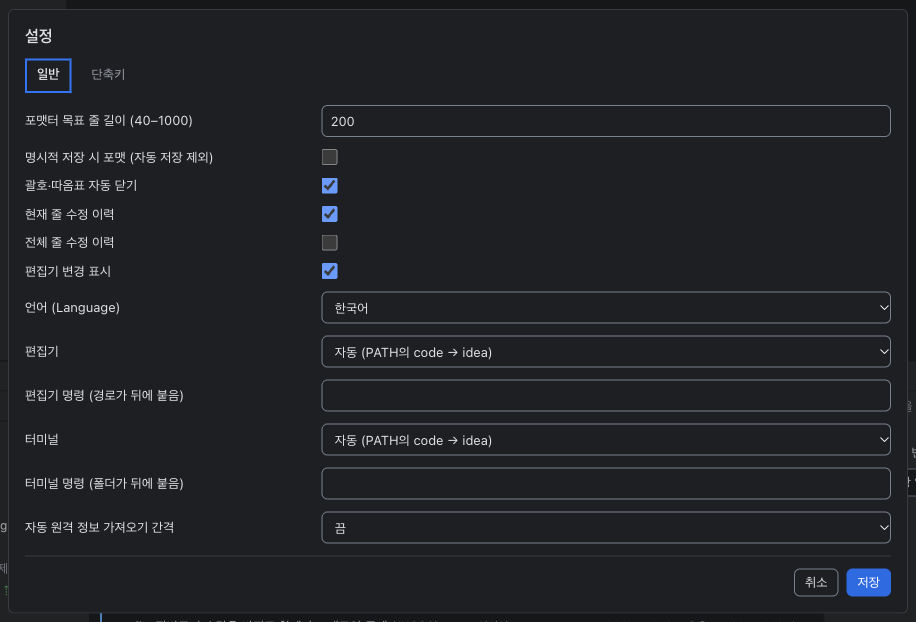
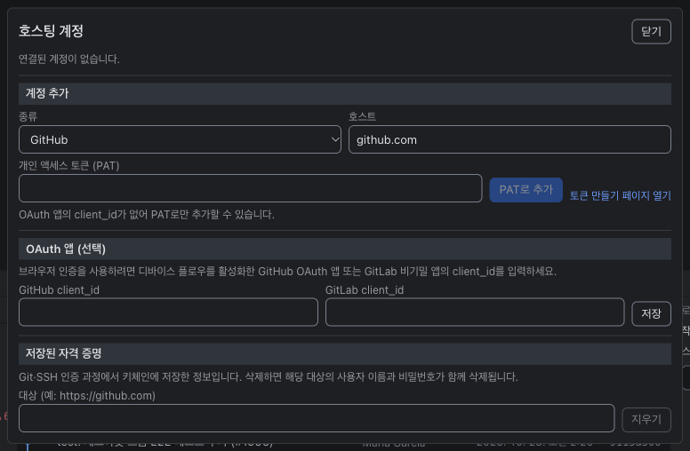
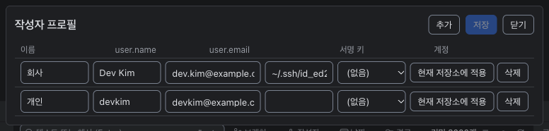
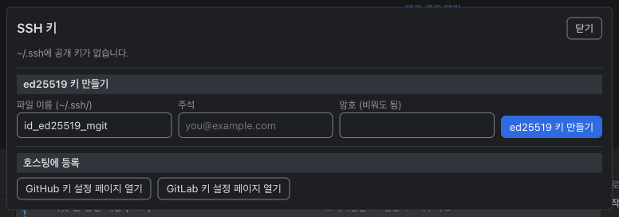
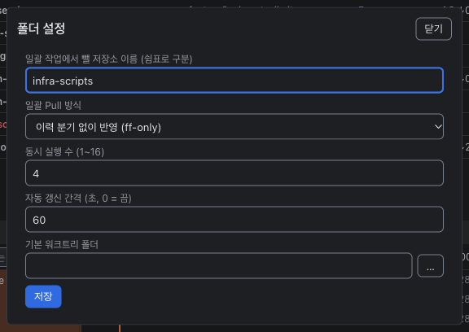

# 8. 설정

`⌘,` 로 여는 **설정** 대화상자는 **일반** 과 **단축키** 두 쪽입니다. **일반** 에는 편집기 설정(**포맷터 목표 줄 길이 (40–1000)**·**명시적 저장 시 포맷 (자동 저장 제외)**·**괄호·따옴표 자동 닫기**·**현재 줄 수정 이력**·**전체 줄 수정 이력**·**편집기 변경 표시**), **언어 (Language)**, 외부 앱(**편집기**·**터미널**), **자동 원격 정보 가져오기 간격** 이 있고, **단축키** 에서는 단축키를 바꿉니다([9.2](9-단축키.md#92-단축키-바꾸기)). 나머지 설정은 저마다 대화상자가 따로 있고, 대부분 커맨드 팔레트(`⌘⇧A`)에서 엽니다. 설정마다 저장되는 곳도 다르니, 다른 Mac 이나 다른 git 도구와 함께 쓰이는지는 아래 표로 확인하세요.

기준: 브랜치 `feat/multirepo-editor-batch1` · 커밋 `14bacde` · 2026-11-27

| 설정            | 여는 법                                     | 저장되는 곳                                  | 절                                          |
| --------------- | ------------------------------------------- | -------------------------------------------- | ------------------------------------------- |
| 테마            | 툴바 **테마**, 팔레트 **테마: 라이트** 등   | 앱 화면 설정                                 | [8.1](#81-테마)                             |
| 언어            | 팔레트 **설정…**(`⌘,`)                      | 앱 화면 설정                                 | [8.11](#811-언어)                           |
| 외부 앱         | 팔레트 **설정…**(`⌘,`)                      | 앱 데이터                                    | [8.2](#82-외부-앱)                          |
| 자동 fetch 간격 | 팔레트 **설정…**(`⌘,`)                      | 앱 데이터                                    | [8.12](#812-자동-fetch)                     |
| 편집기          | 팔레트 **설정…**(`⌘,`)                      | 앱 화면 설정                                 | [3.5](3-화면-둘러보기.md#편집-보조)         |
| 단축키          | 팔레트 **단축키 설정…**                     | 앱 화면 설정                                 | [8.3](#83-단축키)                           |
| 호스팅 계정     | 팔레트 **호스팅 계정…**                     | 앱 데이터, 토큰은 키체인                     | [8.4](#84-호스팅-계정)                      |
| 작성자 프로필   | 팔레트 **작성자 프로필…**                   | 앱 데이터, 적용하면 저장소 git 설정          | [8.5](#85-작성자-프로필)                    |
| SSH 키          | 팔레트 **SSH 키…**                          | `~/.ssh`                                     | [8.6](#86-ssh-키)                           |
| 저장소 설정     | 팔레트 **저장소 설정…**(저장소 탭)          | 저장소 git 설정·파일, 명령 두 개는 앱 데이터 | [8.7](#87-저장소-설정)                      |
| 폴더 설정       | Project 머리줄 ⚙ **폴더 설정…**(폴더 탭) 등 | 앱 데이터(폴더마다)                          | [8.8](#88-폴더-설정)                        |
| 그래프 열       | 팔레트 **그래프 열 설정…**(저장소 탭)       | 앱 화면 설정                                 | [8.9](#89-그래프-열)                        |
| 원격            | 툴바 **원격 저장소…**(저장소 탭)            | 저장소 git 설정                              | [5.5](5-가끔-하는-작업.md#55-원격-관리하기) |

저장되는 곳의 뜻은 다음과 같습니다.

| 저장되는 곳     | 실제 위치                                                       | 함께 쓰는 범위                                                                    |
| --------------- | --------------------------------------------------------------- | --------------------------------------------------------------------------------- |
| 앱 화면 설정    | 앱 화면 안의 저장 공간                                          | 이 Mac 의 mGit 만. 모든 탭이 함께 씁니다                                          |
| 앱 데이터       | `~/Library/Application Support/io.github.motolies.mgit/mgit.db` | 이 Mac 의 mGit 만                                                                 |
| 키체인          | macOS 로그인 키체인                                             | 이 Mac. 다른 git 도구가 저장한 자격 증명과는 따로입니다                           |
| 저장소 git 설정 | 그 저장소의 `.git/config`(`git config --local`)                 | 그 저장소를 쓰는 모든 git 도구(터미널 등). 다른 Mac 이나 다른 clone 에는 없습니다 |
| 저장소 파일     | `.gitignore`·`.gitattributes`                                   | commit 하고 push 하면 다른 사람과도 함께 씁니다                                   |
| `~/.ssh`        | 홈 폴더의 `.ssh`                                                | ssh 를 쓰는 모든 도구                                                             |

## 8.1 테마

화면 색을 바꾸려면 툴바 오른쪽 **테마** 선택 상자에서 **시스템**·**라이트**·**다크** 중 하나를 고릅니다.

- 커맨드 팔레트의 **테마: 라이트**·**테마: 다크**·**테마: 시스템** 도 같습니다. 지금 쓰는 테마는 팔레트에서 꺼져 보입니다.
- 처음 값은 **시스템** 입니다. macOS 의 밝은·어두운 모드를 따르고, macOS 설정을 바꾸면 바로 따라 바뀝니다.
- 고르는 즉시 적용되고 앱 화면 설정에 저장됩니다. 모든 탭에 같이 적용됩니다.

## 8.2 외부 앱

**편집기에서 열기**·**터미널에서 열기**([5.10](5-가끔-하는-작업.md#510-터미널과-외부-앱))가 쓸 앱을 바꾸려면 설정 대화상자를 엽니다.

1. `⌘,` 를 누르거나 커맨드 팔레트에서 **설정…** 을 실행합니다.
2. **설정** 대화상자의 **일반** 쪽에서 **언어 (Language)**([8.11](#811-언어)) 아래에 있는 **편집기** 와 **터미널** 을 고릅니다. 편집기 설정 여섯 칸이 그 위에, **자동 원격 정보 가져오기 간격** 이 그 아래에 있습니다.
3. **저장** 을 누릅니다.

| 칸                                 | 고를 수 있는 것                                                                      | 쓰이는 곳                                                                                                |
| ---------------------------------- | ------------------------------------------------------------------------------------ | -------------------------------------------------------------------------------------------------------- |
| **편집기**                         | **자동 (PATH의 code → idea)**·**Visual Studio Code**·**IntelliJ IDEA**·**직접 입력** | **편집기에서 열기**(`⌘⇧E`), Commit 도구 창 파일 메뉴의 **편집기에서 열기**, 저장소 설정 hook 의 **열기** |
| **편집기 명령 (경로가 뒤에 붙음)** | 명령                                                                                 | **편집기** 가 **직접 입력** 일 때. 명령 끝에 열 파일·폴더 경로가 붙습니다                                |
| **터미널**                         | 자동·**Terminal.app**·**iTerm**·**직접 입력**                                        | **터미널에서 열기**(`⌘⇧T`)                                                                               |
| **터미널 명령 (폴더가 뒤에 붙음)** | 명령                                                                                 | **터미널** 이 **직접 입력** 일 때. 명령 끝에 폴더 경로가 붙습니다                                        |
- 편집기의 자동은 PATH 의 `code`, 없으면 `idea`, 그것도 없으면 macOS 의 텍스트 편집기로 엽니다. **Visual Studio Code**·**IntelliJ IDEA** 를 고르면 그 앱을 직접 엽니다.
- 터미널의 자동은 Terminal.app 입니다. 터미널 칸의 자동 항목도 글자가 **자동 (PATH의 code → idea)** 로 보이지만 실제로는 Terminal.app 을 엽니다.
- 고른 앱이 열리지 않으면 자동 순서대로 다음 앱을 시도합니다.
- 직접 입력한 명령은 빈칸으로 나눠 셸 없이 실행합니다. 따옴표를 풀지 않으므로 빈칸이 든 경로나 앱 이름은 쓸 수 없습니다. 예: `zed`, `subl -n`, `open -a Warp`. 명령은 로그인 셸의 PATH 에서 찾습니다.
- **파일 탐색기에서 보기** 는 늘 Finder 를 씁니다. 바꾸는 설정이 없습니다.
- 앱 데이터에 저장됩니다.

## 8.3 단축키

단축키를 바꾸려면 커맨드 팔레트에서 **단축키 설정…** 을 실행합니다. **설정** 대화상자가 **단축키** 쪽으로 열립니다.

- 팔레트 명령이 묶음별로 모두 나옵니다. 줄의 **변경** 을 누르고 새 키 조합을 누르면 그 줄에 들어갑니다. **해제** 로 단축키를 뺍니다.
- 다른 명령과 겹치면 그 줄에 `충돌: <명령>` 이 보이고, 겹침을 풀기 전에는 저장할 수 없습니다.
- 줄의 **기본값** 으로 그 명령만, 머리줄의 **모두 초기화** 로 전부 처음 값으로 돌립니다.
- **저장** 을 눌러야 적용되고, 앱 화면 설정에 저장됩니다.

자세한 사용법은 [9.2 단축키 바꾸기](9-단축키.md#92-단축키-바꾸기), 기본 단축키 표는 [9.1 기본 단축키](9-단축키.md#91-기본-단축키)에 있습니다.

## 8.4 호스팅 계정

GitHub·GitLab 계정을 연결하면 Pull Requests 도구 창([5.9](5-가끔-하는-작업.md#59-pull-requests))과 계정의 저장소에서 clone 하기([2.6](2-저장소와-폴더-열기.md#26-호스팅-계정의-저장소에서-clone-하기))를 쓸 수 있습니다. 커맨드 팔레트에서 **호스팅 계정…** 을 실행합니다.

맨 위에 연결된 계정 목록이 있습니다. 줄마다 종류, `<사용자> (<이름>) · <호스트>`, 호스트 링크(누르면 브라우저에서 내 페이지), **제거** 단추가 있습니다. 계정이 없으면 **연결된 계정이 없습니다** 가 보입니다.

### 토큰(PAT)으로 연결하기

1. **계정 추가** 의 **종류** 에서 **GitHub** 이나 **GitLab** 을 고릅니다. **호스트** 가 `github.com`·`gitlab.com` 으로 바뀝니다. 회사 서버라면 호스트를 그 이름(`이름[:포트]`)으로 고칩니다.
2. **토큰 만들기 페이지 열기** 를 누릅니다. 브라우저에 토큰 만들기 페이지가 열리고 아래 권한이 미리 골라져 있습니다.

   | 종류   | 미리 고르는 권한                              |
   | ------ | --------------------------------------------- |
   | GitHub | `repo`, `read:org`, `read:user`, `user:email` |
   | GitLab | `api`                                         |

3. 만든 토큰을 **개인 액세스 토큰 (PAT)** 칸에 붙여 넣고 **PAT로 추가** 를 누릅니다.
4. 앱이 토큰으로 사용자 정보를 읽어 확인한 뒤 목록에 더합니다. 실패하면 대화상자 위에 이유가 보입니다.

### 브라우저로 로그인하기

토큰을 직접 만들지 않고 브라우저에서 승인하는 방법(디바이스 플로우)입니다. 그 호스팅에 등록한 OAuth App 의 client_id 가 필요합니다. 없으면 **OAuth 앱의 client_id가 없어 PAT로만 추가할 수 있습니다.** 가 보입니다.

1. **OAuth 앱 (선택)** 구역의 **GitHub client_id**·**GitLab client_id** 에 값을 넣고 **저장** 을 누릅니다. GitHub 은 OAuth App 에서 Device flow 를 켜고, GitLab 은 비기밀(non-confidential) 앱을 만듭니다.
2. **브라우저로 로그인 (디바이스 플로우)** 를 누릅니다.
3. 브라우저가 열리고, 대화상자에 코드와 **브라우저에서 이 코드를 입력하세요**, **브라우저 열기**, **승인을 기다리는 중…** 이 보입니다.
4. 브라우저에서 코드를 넣고 승인하면 계정이 목록에 더해집니다.

요청하는 권한은 토큰과 같습니다.

### 제거하기

- 계정 줄의 **제거** 를 누르면 확인 없이 목록과 키체인의 토큰을 지웁니다.
- 호스팅 쪽의 토큰은 그대로 살아 있습니다. 더 쓰지 않으려면 호스팅 사이트의 설정에서 토큰을 폐기하세요.

### 저장된 자격 증명 지우기

git·ssh 가 사용자 이름·비밀번호·SSH 키 암호를 물을 때 **OS 키체인에 저장** 을 켜 두면 키체인에 남습니다([10.6](10-문제-해결.md#106-인증을-묻거나-실패할-때)). 잘못 저장했으면 지웁니다.

1. **저장된 자격 증명** 구역의 **대상 (예: https://github.com)** 칸에 대상을 적습니다. 이번에 앱을 켠 뒤 물었던 대상은 칸에서 목록으로 고를 수 있습니다.
2. **지우기** 를 누릅니다. 알림 `저장된 자격 증명을 지웠습니다: <대상>` 이 뜹니다.

- 계정 목록과 client_id 는 앱 데이터에, 토큰과 자격 증명은 키체인에 저장됩니다. 터미널의 git 이나 다른 클라이언트와는 따로입니다.
- 계정을 연결해도 이미 열린 탭의 Pull Requests 도구 창은 바로 바뀌지 않을 수 있습니다. 탭을 닫았다가 다시 여세요([10.8](10-문제-해결.md#108-pull-requests-에-계정이-없다고-나올-때)).

## 8.5 작성자 프로필

저장소마다 다른 이름·이메일로 commit 하려면 작성자 프로필을 만들어 두고 저장소에 적용합니다.

1. 커맨드 팔레트에서 **작성자 프로필…** 을 실행합니다.
2. **추가** 를 누르면 빈 줄이 생깁니다.
3. 칸을 채웁니다.

   | 칸             | 뜻                                                                       |
   | -------------- | ------------------------------------------------------------------------ |
   | **이름**       | 프로필 이름(예: `회사`). 비우면 저장할 수 없습니다                       |
   | **user.name**  | commit 작성자 이름                                                       |
   | **user.email** | commit 작성자 이메일                                                     |
   | **서명 키**    | git 설정 `user.signingKey` 에 넣을 값(GPG 키 ID 나 SSH 공개 키 경로)     |
   | **계정**       | 연결된 호스팅 계정 하나. 지금은 적어 두기만 하고 적용할 때 쓰지 않습니다 |

4. **저장** 을 누릅니다.
5. 저장소 탭에서 열었다면 줄의 **현재 저장소에 적용** 을 누릅니다.

- 적용하면 지금 저장소의 git 설정(local)에 `user.name`·`user.email`·`user.signingKey` 를 씁니다. 비어 있는 칸은 그 저장소 설정을 지워 전역(global) 설정을 쓰게 합니다.
- **현재 저장소에 적용** 은 지금 탭이 저장소 탭이고 프로필을 저장한 뒤에만 켜집니다. 고친 뒤 저장하지 않았으면 툴팁에 **먼저 저장하세요** 가 보입니다.
- **삭제** 는 목록에서 빼기만 합니다. **저장** 을 눌러야 지워집니다.
- 저장소 설정의 **작성자 프로필** 칸에서 골라 **적용** 해도 같습니다([8.7](#87-저장소-설정)).
- 프로필 목록은 앱 데이터에 저장됩니다. 적용한 결과는 저장소 git 설정이라 터미널의 git 도 같은 이름으로 commit 합니다.
- SSH 키로 서명하려면 git 설정 `gpg.format` 을 `ssh` 로 따로 정해야 합니다. 앱에는 이 값을 바꾸는 칸이 없습니다.

## 8.6 SSH 키

`ssh` 주소로 clone·fetch·push 하려면 공개 키를 호스팅에 등록해야 합니다. 커맨드 팔레트에서 **SSH 키…** 를 실행합니다.

### 키 목록

- `~/.ssh` 의 공개 키(`*.pub`)마다 종류, 키 파일 경로, 주석이 보입니다. 없으면 **~/.ssh에 공개 키가 없습니다.** 가 보입니다.
- **공개 키 복사** 를 누르면 공개 키 한 줄을 클립보드에 복사하고 잠깐 **복사됨** 으로 바뀝니다.

### 새 키 만들기

1. **ed25519 키 만들기** 구역에서 **파일 이름 (~/.ssh/)** 을 정합니다. 처음 값은 `id_ed25519_mgit` 입니다.
2. **주석** 에 알아보기 쉬운 글(보통 이메일)을 적습니다.
3. 키에 암호를 걸려면 **암호 (비워도 됨)** 에 적습니다.
4. **ed25519 키 만들기** 를 누릅니다. `~/.ssh/<이름>`(비밀 키)과 `~/.ssh/<이름>.pub`(공개 키)가 생기고 목록에 나타납니다.

- 같은 이름의 파일이 있으면 `이미 있는 키입니다: <경로>` 가 뜨고 만들지 않습니다.
- `~/.ssh` 폴더가 없으면 만듭니다.

> [!NOTE]
> 앱은 만든 키를 ssh-agent 나 `~/.ssh/config` 에 등록하지 않습니다. ssh 는 `id_ed25519` 같은 정해진 이름의 키만 저절로 쓰므로, 처음 값 `id_ed25519_mgit` 으로 만들었다면 `~/.ssh/config` 에 `IdentityFile ~/.ssh/id_ed25519_mgit` 를 적어야 쓰입니다. `id_ed25519` 가 아직 없다면 파일 이름을 `id_ed25519` 로 만들어도 됩니다.

### 호스팅에 등록하기

1. 목록에서 등록할 키의 **공개 키 복사** 를 누릅니다.
2. **호스팅에 등록** 구역의 단추를 누릅니다. 연결된 계정이 있으면 계정마다 `<종류> · <호스트> 키 설정 페이지 열기`, 없으면 **GitHub 키 설정 페이지 열기**·**GitLab 키 설정 페이지 열기** 가 있습니다.
3. 브라우저에 열린 키 등록 페이지에 복사한 공개 키를 붙여 넣고 저장합니다.

키에 암호가 있으면 git 이 처음 쓸 때 **SSH 키 암호** 를 묻습니다([10.6](10-문제-해결.md#106-인증을-묻거나-실패할-때)).

## 8.7 저장소 설정

저장소 하나의 git 설정과 앱 동작을 바꾸려면 저장소 탭에서 커맨드 팔레트의 **저장소 설정…** 을 실행합니다. 다른 Git 작업이 도는 동안에는 꺼집니다. 폴더 탭에서는 저장소를 저장소 탭으로 연 뒤 엽니다.

**저장소 설정** 대화상자는 아래 구역으로 나뉩니다.

### 사용자

- **이름**·**이메일** 칸에 적고 **저장** 을 누르면 이 저장소의 git 설정(local) `user.name`·`user.email` 에 씁니다.
- 칸의 흐린 글씨는 지금 실제로 쓰이는 값입니다. 칸을 비우고 저장하면 이 저장소 설정을 지우고 전역(global) 설정을 씁니다(안내 **비워두면 전역 설정을 사용합니다. 흐리게 표시된 값은 현재 적용 중인 설정입니다.**).
- **작성자 프로필** 에서 프로필을 고르고 **적용** 을 누르면 그 프로필의 이름·이메일·서명 키를 씁니다. **프로필 관리…** 는 작성자 프로필 대화상자를 엽니다([8.5](#85-작성자-프로필)).

### 커밋 서명

`형식 <형식> · 키 <키> · commit.gpgSign <켜짐/꺼짐>` 으로 git 의 서명 설정을 보여 주기만 합니다. 바꾸는 칸은 없습니다. commit 할 때 서명은 commit 폼의 **서명 (-S)** 으로 켭니다([4.2](4-일상-작업.md#commit-폼)).

### hook

- 설치된 hook 이름이 나옵니다(`.sample` 은 빼고). 실행 권한이 없는 hook 에는 **(실행 권한 없음)** 이 붙습니다. 없으면 **설치된 훅 없음** 입니다.
- `core.hooksPath` 를 쓰는 저장소면 제목 옆에 그 경로가 보입니다.
- **열기** 는 hook 파일을 외부 에디터로 엽니다([8.2](#82-외부-앱)).

### .gitignore

- 저장소 맨 위의 `.gitignore` 내용을 고치고 **.gitignore 저장** 을 누릅니다. 바꾼 것이 있을 때만 켜집니다.
- 작업 트리의 파일을 고치는 것이라 commit 해야 다른 사람과 함께 쓰입니다.

### 상태 조회 최적화

- `추적 파일 N개 · fsmonitor 켜짐/꺼짐 · untrackedCache 켜짐/꺼짐` 이 보입니다.
- 둘 중 하나라도 꺼져 있으면 **fsmonitor 켜기** 단추가 있습니다. 누르면 이 저장소의 git 설정 `core.fsmonitor`·`core.untrackedCache` 를 켭니다. 파일이 많은 저장소에서 상태 조회가 빨라집니다.

### 검증·초기화 명령

| 칸                       | 쓰이는 곳                                                                                                                                                                                               |
| ------------------------ | ------------------------------------------------------------------------------------------------------------------------------------------------------------------------------------------------------- |
| **검증 명령**            | 충돌 해결 뒤의 검증([5.6](5-가끔-하는-작업.md#검증-명령))과 인터랙티브 rebase 의 `--exec`([5.3](5-가끔-하는-작업.md#인터랙티브-rebase)). 예: `pnpm test`                                                |
| **워크트리 초기화 명령** | 저장소 탭에서 새 워크트리를 만든 직후 그 폴더에서 실행([5.7](5-가끔-하는-작업.md#저장소-탭에서-만들기)). `$MGIT_WORKTREE`(새 워크트리)·`$MGIT_MAIN`(메인 워크트리)을 쓸 수 있습니다. 예: `pnpm install` |
- 칸마다 **저장** 을 누릅니다. 비우고 저장하면 해제됩니다.
- **검증 실행** 은 저장된 검증 명령을 지금 돌립니다. 결과는 **검증 명령** 창에 출력과 `성공 (Nms)`·`실패 (종료 코드 N)`·**시간 초과** 로 보입니다.
- 명령은 작업 트리에서 `sh -c` 로, 로그인 셸의 PATH 로 실행합니다. 10분을 넘기면 멈춥니다.
- 이 두 명령은 git 설정이 아니라 앱 데이터에 저장됩니다. 같은 저장소의 워크트리끼리는 함께 쓰고, 다른 Mac·다른 git 도구에는 없습니다.

### Git LFS

- git-lfs 가 없으면 **git-lfs 가 설치돼 있지 않습니다 (https://git-lfs.com)** 만 보입니다.
- 있으면 `git-lfs <버전>` 과 **이 저장소에 설치됨** 또는 **이 저장소에 아직 설치 안 됨** 이 보입니다. 아직이면 **이 저장소에 LFS 설치 (훅·필터)** 로 이 저장소에만 설치합니다(`git lfs install --local`).
- **추적 패턴** 에 `*.psd` 처럼 적고 **추적** 을 누르면 그 패턴을 LFS 로 관리합니다(`.gitattributes` 에 적힘). 목록의 패턴 옆 **해제** 로 뺍니다. `.gitattributes` 도 commit 해야 함께 쓰입니다.
- `LFS 파일 N개` 아래에 파일이 30개까지 보입니다. 내용을 받지 않은 파일에는 **(포인터만)** 이 붙습니다. 줄의 **잠금** 으로 그 파일을 잠급니다.
- **잠금** 아래에 잠긴 파일과 주인이 보이고, **해제**·**강제 해제**(남의 잠금) 단추가 있습니다. **잠글 파일** 에 경로를 적고 **잠금** 을 눌러도 됩니다. 잠금을 읽지 못하면 `잠금 조회 실패: <이유>` 가 보입니다.

### 얕은 복제

일부 이력만 받은 저장소(얕은 복제)일 때만 보입니다. **전체 이력 받기** 를 누르면 나머지 이력을 받습니다(`git fetch --unshallow`). blame·비교가 정확해집니다.

### 로그 위 배너

저장소 탭 로그 칸 위에 아래 배너가 뜨기도 합니다. 둘 다 **닫기** 로 감출 수 있습니다.

| 배너                                                                                | 뜨는 때                                            | 단추                                                                                         |
| ----------------------------------------------------------------------------------- | -------------------------------------------------- | -------------------------------------------------------------------------------------------- |
| **커밋이 많습니다. commit-graph를 생성하면 그래프를 더 빠르게 불러올 수 있습니다.** | commit 이 2만 개 이상이고 commit-graph 파일이 없음 | **commit-graph 생성**: `.git` 안에 commit-graph 파일을 만듭니다. 이력·설정은 바뀌지 않습니다 |
| `추적 파일 N개: fsmonitor 를 켜면 상태 조회가 빨라집니다`                           | 추적 파일이 2만 개 이상이고 fsmonitor 가 꺼져 있음 | **fsmonitor 켜기**: 위 상태 조회 최적화와 같습니다(저장소 git 설정을 바꿈)                   |

## 8.8 폴더 설정

폴더 탭의 일괄 작업과 갱신 방식을 바꾸려면 폴더 설정을 엽니다. 폴더 탭에서 다음 중 하나를 누릅니다.

- Project 도구 창 머리줄의 ⚙ **폴더 설정…**
- 개요 탭 머리줄의 **폴더 설정…**
- Project 트리 맨 위(폴더) 행 우클릭 → **폴더 설정…**

| 칸                                             | 처음 값                           | 뜻                                                                                                                                                               |
| ---------------------------------------------- | --------------------------------- | ---------------------------------------------------------------------------------------------------------------------------------------------------------------- |
| **일괄 작업에서 뺄 저장소 이름 (쉼표로 구분)** | 비어 있음                         | 저장소 폴더 이름(예: `infra-scripts, legacy-app`). 폴더 탭의 모든 일괄 작업과 자동 fetch 에서 **제외됨 (폴더 설정)** 으로 건너뜁니다. 대소문자까지 같아야 합니다 |
| **일괄 Pull 방식**                             | **이력 분기 없이 반영 (ff-only)** | **리베이스**·**병합** 으로 바꿀 수 있습니다([4.3](4-일상-작업.md#폴더-탭에서는-일괄-실행))                                                                       |
| **동시 실행 수 (1~16)**                        | 4                                 | 일괄 작업을 한꺼번에 돌리는 저장소 수                                                                                                                            |
| **자동 갱신 간격 (초, 0 = 끔)**                | 60                                | 저장소 상태(변경 수·ahead/behind 등)를 다시 읽는 간격. fetch 는 하지 않습니다. 0 이면 주기 갱신을 끄고, 앱 창으로 돌아올 때만 다시 읽습니다                      |
| **기본 워크트리 폴더**                         | 비어 있음                         | 일괄 워크트리 만들기([5.7](5-가끔-하는-작업.md#폴더-탭에서-한꺼번에-만들기))가 워크트리를 둘 상위 폴더. **…** 로 고릅니다. 비어 있으면 만들 때마다 묻습니다      |
- 모든 일괄 작업: fetch·pull·push·branch 만들기·checkout·branch 업데이트·이름 바꾸기·로컬 branch 삭제·원격 branch 삭제·merge·rebase·워크트리 만들기·스태시 저장·꺼내기.
- push·스태시 꺼내기·merge·rebase·로컬 branch 삭제의 체크 목록에서는 뺀 저장소가 사유와 함께 꺼진 칸으로 보입니다([4.7](4-일상-작업.md#폴더-탭에서-한꺼번에-stash-하기)).
- **저장** 을 누르면 잠깐 **저장됨** 이 보입니다. 저장하지 못하면 단추 위에 이유가 보입니다.
- 폴더마다 따로 앱 데이터에 저장됩니다. 폴더 경로가 열쇠라 폴더를 옮기면 처음 값으로 돌아갑니다.
- 그룹 탭([2.9](2-저장소와-폴더-열기.md#29-여러-곳의-저장소를-그룹으로-묶기))에도 같은 대화상자가 있고, 그룹마다 따로 저장됩니다. 그룹이 열쇠라 저장소 위치를 다시 지정해도 그대로입니다. 같은 저장소가 든 폴더 탭과 그룹 탭의 설정은 서로 따로입니다. 그룹을 고쳐도(이름·별칭·저장소) 그대로이고, 그룹을 지우면 그 설정도 지워집니다.
- 폴더 탭의 commit 과 stage 에는 제외 목록이 쓰이지 않습니다.

> [!WARNING]
> **일괄 Pull 방식** 을 **리베이스** 로 바꾸면 툴바의 **Pull** 이 고른 저장소들을 한꺼번에 rebase 합니다. 폴더 탭에는 Undo 가 없으니 처음 값 **이력 분기 없이 반영 (ff-only)** 으로 두는 것이 안전합니다.

## 8.9 그래프 열

저장소 탭 로그에 보일 열을 고르려면 커맨드 팔레트나 필터 바 보기 옵션 메뉴의 **그래프 열 설정…** 을 엽니다([4.5](4-일상-작업.md#로그-읽기)).

- **그래프 열** 대화상자에서 **작성자**·**날짜**·**해시**(처음엔 켜짐)와 **아바타**(처음엔 꺼짐)를 켜고 끈 뒤 **적용** 을 누릅니다.
- 그래프와 메시지 열은 늘 보입니다.
- 모든 저장소 탭에 같이 적용되고 앱 화면 설정에 저장됩니다. 폴더 탭에서는 열 수 없습니다.

> [!NOTE]
> **아바타** 를 켜면 작성자 이메일로 인터넷에서 그림을 받아 옵니다. GitHub 의 `users.noreply.github.com` 주소는 GitHub 에서, 나머지는 이메일의 SHA-256 해시로 Gravatar 에서 받습니다. 받은 그림은 앱 데이터 폴더의 `avatars` 에 둡니다. 이메일 해시를 밖으로 보내고 싶지 않으면 끄세요.

## 8.10 바꿀 수 없는 값

아래 값은 앱에 정해져 있어 화면에서 바꿀 수 없습니다.

| 항목                       | 값                       | 뜻                                                                                                                                                                                                               |
| -------------------------- | ------------------------ | ---------------------------------------------------------------------------------------------------------------------------------------------------------------------------------------------------------------- |
| git 경로                   | 앱이 켜질 때 받은 PATH   | PATH 에 없으면 `/opt/homebrew/bin/git`·`/usr/local/bin/git`·`/usr/bin/git` 순으로 찾습니다. 2.45.0 이상이어야 하고, 상태 바에 `git <버전>` 이 보입니다([10.1](10-문제-해결.md#101-git-이-없거나-버전이-낮을-때)) |
| 백업 ref 보관              | 30일(지나면 저절로 지움) | 저장소 탭을 열 때와 폴더 탭을 열고 첫 상태를 읽은 뒤 저장소마다 하루 한 번 지웁니다([6.2](6-실수했을-때.md#이름과-보관))                                                                                         |
| Undo 스택                  | 탭마다 20개              | [6.1](6-실수했을-때.md#61-undoredo-로-되돌리기)                                                                                                                                                                  |
| 폐기 백업 목록             | 최신 200개               | 30일이 지난 사본은 백업 ref 와 같은 때 저절로 지웁니다. 대화상자에서 직접 지울 수도 있습니다([6.3](6-실수했을-때.md#사본-지우기))                                                                                |
| reflog 목록                | 500개                    | [6.4](6-실수했을-때.md#64-reflog-로-찾기)                                                                                                                                                                        |
| 콘솔 기록                  | 탭마다 500줄             | 오류 출력은 끝 2 KiB 만 남습니다([6.5](6-실수했을-때.md#65-실행된-명령-보기))                                                                                                                                    |
| 폴더 탭의 저장소 세션      | 폴더마다 3개             | [10.7](10-문제-해결.md#107-저장소-세션-3개-한도)                                                                                                                                                                 |
| 파일 보기                  | 1 MiB 까지               | 넘으면 열지 않습니다([10.4](10-문제-해결.md#104-파일이-열리지-않을-때))                                                                                                                                          |
| diff                       | 10,000줄까지             | 넘으면 앞부분만 보입니다                                                                                                                                                                                         |
| index.lock 재시도          | 0.2초 간격 5번           | 그래도 잠겨 있으면 안내가 뜹니다([10.2](10-문제-해결.md#102-indexlock-이-남아-있을-때))                                                                                                                          |
| 자격 증명 입력             | 5분                      | 넘기면 `자격 증명 요청이 시간을 넘겨 취소됐습니다: <대상>` 으로 취소됩니다                                                                                                                                       |
| 검증·초기화·충돌 규칙 명령 | 10분                     | 넘기면 멈춥니다                                                                                                                                                                                                  |
| commit-graph 제안          | commit 2만 개            | [8.7 로그 위 배너](#로그-위-배너)                                                                                                                                                                                |
| fsmonitor 제안             | 추적 파일 2만 개         | [8.7 로그 위 배너](#로그-위-배너)                                                                                                                                                                                |
- 편집기는 2초마다 열린 파일의 크기·시각만 보고 바뀐 파일만 다시 읽습니다. Markdown 미리보기 안의 그림도 같은 방법으로 바뀐 그림만 다시 읽습니다. 앱 창으로 돌아오면 열린 파일과 미리보기 그림을 모두 다시 읽습니다. 수정 이력·변경 표시는 파일을 열 때, HEAD 가 바뀔 때, 파일을 다시 읽을 때만 git 에서 읽습니다([3.5 수정 이력과 변경 표시](3-화면-둘러보기.md#수정-이력과-변경-표시)).
- push 할 때 업스트림 이름이 로컬과 달라 묻는 확인에서 **이 브랜치는 다시 묻지 않기** 를 켜면 앱 데이터에 기억합니다. 이 기억을 지우는 화면은 없습니다.

## 8.11 언어

화면 글자를 한국어나 영어로 바꾸려면 설정 대화상자를 엽니다.

1. `⌘,` 를 누르거나 커맨드 팔레트에서 **설정…** 을 실행합니다.
2. **설정** 대화상자 맨 위 **언어 (Language)** 에서 **English**·**한국어**·**시스템 언어 따름** 중 하나를 고릅니다.
3. **저장** 을 누릅니다.

- 처음 값은 **English**입니다. 저장한 언어 선택은 유지합니다. **시스템 언어 따름**을 선택하면 macOS의 선호하는 언어 목록(시스템 설정 → 일반 → 언어 및 지역)에서 맨 위 언어가 한국어면 한국어로, 그 밖의 언어면 영어로 보입니다.
- **시스템 언어 따름**을 선택한 상태에서 앱이 켜질 때 시스템 언어를 읽지 못하면(1초 안에 읽지 못한 때도) 영어로 보입니다. 시스템 언어는 한 번 읽으면 앱을 끌 때까지 다시 읽지 않으므로, 앱을 켠 채 macOS 의 언어를 바꿨다면 앱을 다시 켜야 따라갑니다.
- 언어 이름 **한국어**·**English** 는 화면 언어와 상관없이 그 언어로 적혀 있습니다.
- 커맨드 팔레트에서 "언어" 로 찾으면 나오지 않습니다. "설정" 으로 찾습니다.
- 앱 화면 설정에 저장되어 앱을 다시 켜도 그대로입니다.

> [!TIP]
> 영어로 바꾼 화면에서 되돌리려면 `⌘,` 를 누르고 맨 위 **Language** 에서 **한국어** 나 **System default** 를 고른 뒤 **Save** 를 누릅니다. 영어 화면에서는 팔레트 명령 이름도 **Settings…** 입니다.

### 바꾸면 일어나는 일

- **저장** 을 누르면 바로 적용됩니다. 대화상자가 닫히고 화면 전체를 새 언어로 다시 그립니다.
- 열린 탭과 에디터 탭, 적어 두던 commit 메시지, 충돌 해결 중인 내용은 그대로입니다. 화면 안에서만 쓰던 일부 상태(입력하던 칸 등)는 처음으로 돌아갈 수 있습니다.
- 열린 통합 터미널은 새 셸로 다시 시작합니다. 실행 중이던 명령은 멈추고 터미널에 보이던 출력은 사라집니다. 터미널이 열려 있으면 대화상자에 **언어를 바꾸면 화면을 다시 그리면서 열린 터미널이 새로 시작됩니다** 가 보이니, 필요하면 터미널의 작업을 먼저 끝내세요.
- 이미 떠 있던 알림·오류와 이미 받은 일괄 작업 결과처럼 언어를 바꾸기 전에 만든 글자는 이전 언어로 남습니다. 새로 하는 작업부터 새 언어로 나옵니다.

### 번역하지 않는 것

- git 이 내는 메시지(오류 출력, Git 콘솔의 출력), hook 출력, 원격 서버가 보낸 메시지는 화면 언어와 상관없이 받은 그대로 보입니다. git 메시지는 늘 영어로 받습니다.
- commit·branch·rebase 같은 Git 용어는 한국어 화면에서도 영어로 씁니다.
- 화면 맨 위 macOS 메뉴 막대의 기본 메뉴는 늘 영어입니다.
- 이 사용법 문서는 한국어 화면을 기준으로 씁니다. 영어 화면에서는 단추·메뉴 이름이 문서의 굵은 글자와 다릅니다. 영어 사용법 문서는 없습니다.

## 8.12 자동 fetch

원격의 새 commit 을 저절로 받아 오는 간격을 바꾸려면 설정 대화상자를 엽니다.

1. `⌘,` 를 누르거나 커맨드 팔레트에서 **설정…** 을 실행합니다.
2. **설정** 대화상자 **일반** 쪽 맨 아래 **자동 원격 정보 가져오기 간격** 에서 **끔**·**5분**·**10분**·**15분**·**30분**·**60분** 중 하나를 고릅니다.
3. **저장** 을 누릅니다.

- 처음 값은 **5분** 입니다.
- 앱 전체에 값 하나입니다. 열린 저장소 탭과 폴더 탭 모두에 곧바로 적용되고, 다음 자동 fetch 까지의 시간도 처음부터 다시 셉니다.
- **끔** 을 고르면 자동 fetch 를 하지 않습니다. 툴바의 **Fetch** 는 그대로 쓸 수 있습니다.
- 같은 저장소를 여러 탭(저장소 탭·폴더 탭·그룹 탭, 워크트리 포함)에서 열어도 자동 fetch 는 간격마다 한 번입니다. 다른 탭이나 툴바의 **Fetch**(모든 원격)로 간격의 절반 안에 이미 받았으면 그 저장소를 건너뛰고, 받지 못했으면 다음 차례에 다시 시도합니다.
- 앱 데이터에 저장되어 앱을 다시 켜도 그대로입니다.
- 무엇을 받고 어떤 저장소를 건너뛰는지, 자격 증명을 묻지 않는 것은 [4.3 자동 fetch와 배지](4-일상-작업.md#자동-fetch와-배지)를 보세요.

---

[← 7. 알아 두면 좋은 동작](7-알아-두면-좋은-동작.md) · [목차](../사용법.md) · [9. 단축키 →](9-단축키.md)
