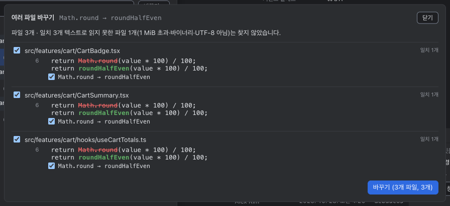

# 9. 단축키

기본 단축키 전체와 바꾸는 법, 마우스 없이 화면을 옮겨 다니는 법입니다. 명령마다 쓸 수 있는 조건은 [3.11 커맨드 팔레트](3-화면-둘러보기.md#311-커맨드-팔레트)의 표에도 있습니다.

기준: 브랜치 `feat/multirepo-editor-batch1` · 커밋 `14bacde` · 2026-11-27

## 9.1 기본 단축키

처음 설치했을 때의 단축키입니다. 커맨드 팔레트에 있는 명령의 키는 바꿀 수 있고([9.2](#92-단축키-바꾸기)), [팔레트 밖의 키](#팔레트-밖의-키)는 바꿀 수 없습니다.

단축키가 동작하지 않는 때가 있습니다.

- 대화상자·메뉴·팔레트가 떠 있는 동안에는 아래 단축키가 동작하지 않습니다. 그 창의 키(Enter·Esc 등)가 먼저입니다.
- 한글을 조합하는 중에 누른 키는 입력기 몫이라 단축키로 쓰이지 않습니다.
- 입력란(메시지 칸·검색 칸 등) 안에서는 `⌘` 가 붙지 않은 키와 `⌘Z`·`⌘⇧Z` 가 입력란 몫입니다. 입력란의 `⌘Z` 는 글자 되돌리기입니다.
- 지금 쓸 수 없는 명령의 키는 눌러도 아무 일도 없습니다.

### 앱 전체

| 동작                         | 키     | 쓸 수 있는 곳                                            |
| ---------------------------- | ------ | -------------------------------------------------------- |
| **커맨드 팔레트**            | `⌘⇧A`  | 늘                                                       |
| **저장소 열기…**             | `⌘O`   | 늘                                                       |
| **설정…**                    | `⌘,`   | 늘                                                       |
| **통합 터미널 열기/닫기**    | `⌥F12` | 늘                                                       |
| **Git 콘솔 열기/닫기**       | `⌘J`   | 늘                                                       |
| **아래 도구 창 최대화/복원** | `⌘⇧'`  | 아래 도구 창이 보일 때                                   |
| **아래 도구 창 숨기기**      | `⇧Esc` | 아래 도구 창이 보일 때. 팔레트에는 `⇧Escape` 로 보입니다 |
| **파일 빠른 열기**           | `⌘P`   | 폴더 탭·저장소 탭([9.3](#빠른-열기와-내용-검색))         |
| **최근 파일**                | `⌘E`   | 폴더 탭·저장소 탭. 편집기 글자 칸에서도 됩니다           |
| **워크스페이스 검색**        | `⌘⌥F`  | 폴더 탭·저장소 탭                                        |

### 탭

| 동작                    | 키          | 쓸 수 있는 곳                                                                                                        |
| ----------------------- | ----------- | -------------------------------------------------------------------------------------------------------------------- |
| **탭 닫기**             | `⌘W`        | 탭이 있을 때. 편집기에 포커스가 있으면 편집기 탭 하나만 닫습니다([2.7](2-저장소와-폴더-열기.md#27-탭-오가기와-닫기)) |
| **다음 탭**·**이전 탭** | `⌘⇧]`·`⌘⇧[` | 탭이 둘 이상일 때. 끝에서 누르면 처음으로 돕니다                                                                     |
| **새로고침**            | `⌘R`        | 탭이 있을 때                                                                                                         |

### 영역 옮기기

가는 곳은 [3.13 키보드로 영역 옮기기](3-화면-둘러보기.md#313-키보드로-영역-옮기기)에 있습니다. 모두 폴더 탭과 저장소 탭에서 씁니다.

| 동작                      | 키   |
| ------------------------- | ---- |
| **프로젝트 도구 창**      | `⌘1` |
| **커밋 도구 창**          | `⌘0` |
| **포커스: 편집기**        | `⌘2` |
| **포커스: Git 로그**      | `⌘9` |
| **포커스: Git 로그 상세** | `⌘3` |

지금 편집기 탭이 태그 문서이면 `⌘2` 는 문서 머리의 입력란이 아니라 tag 목록으로 갑니다.

편집기를 나눴으면 `⌘2` 는 지금 그룹으로 갑니다. 다른 쪽 그룹으로 가는 팔레트 명령 **편집기: 다른 쪽 그룹으로 이동** 과 분할 명령(**편집기: 오른쪽으로 분할**·**편집기: 다른 쪽 그룹으로 옮기기**·**편집기: 분할 해제**)은 기본 키가 없습니다([3.5 편집기 나누기](3-화면-둘러보기.md#편집기-나누기)).

Project 트리 위 이름 필터 칸으로 가는 팔레트 명령 **프로젝트 트리 이름 필터** 는 기본 키가 없습니다. IntelliJ 가 트리 찾기에 쓰는 `⌘F` 는 **커밋 검색** 이 쓰기 때문입니다. 트리에 포커스가 있으면 글자를 치기만 해도 그 칸에 적힙니다([3.4](3-화면-둘러보기.md#이름-필터변경된-파일만)).

### 로그에서 찾기·거르기

같은 키가 탭에 따라 가는 곳이 다릅니다. 두 키 모두 Git 도구 창의 로그 탭이 안 보이면 먼저 엽니다.

| 동작                  | 키    | 폴더 탭                                   | 저장소 탭           |
| --------------------- | ----- | ----------------------------------------- | ------------------- |
| **커밋 검색**         | `⌘F`  | 필터 바의 **텍스트 또는 해시 (Enter)** 칸 | 찾기 줄을 엽니다    |
| **포커스: 로그 필터** | `⌘⇧G` | 필터 바의 첫 드롭다운(**저장소**)         | 필터 바의 텍스트 칸 |

찾기 줄과 필터 바는 [4.5 기록 찾기](4-일상-작업.md#45-기록-찾기)에 있습니다.

### 동기화

같은 키가 탭에 따라 대상이 다릅니다. 폴더 탭에서는 툴바의 **Fetch**·**Pull**·**Push** 단추와 같습니다([4.3](4-일상-작업.md#폴더-탭에서는-일괄-실행)). 시작 화면에서는 꺼져 있습니다.

| 동작                               | 키    | 폴더 탭                                   | 저장소 탭                       |
| ---------------------------------- | ----- | ----------------------------------------- | ------------------------------- |
| **원격 정보 가져오기 (모든 원격)** | `⌘⇧F` | 고른 저장소(없으면 전체)에 일괄 fetch     | 원격이 있을 때                  |
| **Pull**                           | `⌘T`  | 고른 저장소에 일괄 pull(폴더 설정의 방식) | 업스트림이 있을 때              |
| **Push**                           | `⌘⇧K` | push 체크 목록을 엽니다                   | 원격이 있고 branch 위에 있을 때 |

폴더 탭에서는 일괄 작업이 도는 동안 세 키가 꺼집니다.

### branch·외부 앱

같은 키가 탭에 따라 대상이 다릅니다. 폴더 탭에서는 개요 탭 일괄 줄의 **브랜치 전환…**·**브랜치 만들기…** 와 같습니다([4.4](4-일상-작업.md#44-branch-만들고-바꾸기)). 시작 화면에서는 꺼져 있습니다.

| 동작                | 키    | 폴더 탭                                                       | 저장소 탭                      |
| ------------------- | ----- | ------------------------------------------------------------- | ------------------------------ |
| **브랜치 전환…**    | `⌘B`  | branch 이름을 적어 고른 저장소(없으면 전체)에서 일괄 checkout | 빠른 branch 전환 창            |
| **브랜치 만들기…**  | 없음  | 고른 저장소(없으면 전체)마다 일괄 branch 만들기               | 지금 commit 에서 branch 만들기 |
| **편집기에서 열기** | `⌘⇧E` | 폴더 탭의 루트 폴더                                           | 저장소 루트                    |
| **터미널에서 열기** | `⌘⇧T` | 폴더 탭의 루트 폴더                                           | 저장소 루트                    |
- 폴더 탭에서는 일괄 작업이 도는 동안 **브랜치 전환…**·**브랜치 만들기…** 가 꺼집니다. 저장소 탭에서는 다른 Git 작업이 도는 동안 꺼집니다. 외부 앱 열기는 늘 됩니다.
- **브랜치 만들기…** 는 기본 키가 없습니다. 팔레트에서 고르거나 [9.2](#92-단축키-바꾸기)에서 키를 붙입니다.
- 폴더 탭의 일괄 branch 전환은 편집기에 저장하지 않은 편집이 있는 저장소가 있으면 실행하지 않습니다([4.3](4-일상-작업.md#편집기에-저장하지-않은-편집이-있을-때)).
- 외부 앱 열기는 Project 트리에서 고른 것과 상관없이 탭의 루트를 엽니다. 고른 폴더에서 터미널을 열려면 Project 트리 우클릭의 **터미널에서 열기** 를 씁니다.

### 저장소 탭에서만

아래 키는 폴더 탭과 시작 화면에서 꺼져 있습니다. 폴더 안 저장소에 쓰려면 그 저장소를 저장소 탭으로 엽니다([2.2](2-저장소와-폴더-열기.md#폴더-탭에서-저장소-탭으로-열기)).

| 동작            | 키    | 쓸 수 있을 때                                                                               |
| --------------- | ----- | ------------------------------------------------------------------------------------------- |
| **스태시 저장** | `⌘⇧S` | 변경이 있을 때. 대화상자 없이 바로 저장합니다([3.11](3-화면-둘러보기.md#311-커맨드-팔레트)) |
| **되돌리기**    | `⌘Z`  | 되돌릴 작업이 있을 때                                                                       |
| **다시 실행**   | `⌘⇧Z` | 다시 할 작업이 있을 때                                                                      |
- 다른 Git 작업이 도는 동안이나 merge·rebase 등이 멈춰 있는 동안 꺼지는 명령도 있습니다. [3.11](3-화면-둘러보기.md#311-커맨드-팔레트)의 표 아래에 정리돼 있습니다.
- `Pull Requests 도구 창` 처럼 기본 키가 없는 명령에도 [9.2](#92-단축키-바꾸기)에서 키를 붙일 수 있습니다. tag 명령 **태그 관리**·**원격 태그 확인**·**모든 태그 푸시…** 도 기본 키가 없습니다(저장소 탭, 뒤의 둘은 원격이 있을 때, [5.4](5-가끔-하는-작업.md#54-tag)).

### 팔레트 밖의 키

아래 키는 단축키 설정에 없고 바꿀 수 없습니다. 화살표·Tab·Enter 처럼 옮겨 다니는 키는 [9.3](#93-키보드로-옮겨-다니기)에 있습니다.

| 영역           | 동작                          | 키               | 쓸 수 있는 곳                                                                          |
| -------------- | ----------------------------- | ---------------- | -------------------------------------------------------------------------------------- |
| 편집기         | 편집기 탭 닫기                | Delete·Backspace | 편집기 탭 막대에 포커스가 있을 때                                                      |
| 어디서나       | 찾기 줄·편집기 탭을 하나 닫기 | Esc              | [아래 순서](#esc-가-닫는-순서)대로                                                     |
| Commit         | commit                        | `⌘Enter`         | 폴더 탭의 메시지 칸, 저장소 탭의 **요약**·**본문 (선택)** 칸                           |
| 충돌 편집기    | **다음** 미해결 블록으로      | F8               | 결과 칸                                                                                |
| 충돌 편집기    | **이전** 미해결 블록으로      | ⇧F8              | 결과 칸                                                                                |
| 충돌 편집기    | **저장 후 스테이징**          | `⌘S`             | 결과 칸                                                                                |
| 찾기 줄        | 다음·이전 commit 으로         | Enter·⇧Enter     | 저장소 탭 찾기 줄의 **메시지·작성자·해시 검색** 칸                                     |
| 필터 바        | 텍스트 조건 적용              | Enter            | **텍스트 또는 해시 (Enter)** 칸. Esc 는 적용 전 글자를 되돌리거나 포커스를 로그로 옮김 |
| 콘솔           | 명령줄 복사                   | `⌘C`             | 콘솔 줄에 포커스가 있을 때(**복사** 단추와 같음)                                       |
| 트리·목록·로그 | 우클릭 메뉴 열기              | ⇧F10, 메뉴 키    | [9.3 우클릭 메뉴](#우클릭-메뉴를-키보드로)에 적은 곳                                   |
| Project 트리   | 이름 필터 칸으로 가서 적기    | 글자 키          | 트리에 포커스가 있을 때                                                                |
| Project 트리   | 이름 필터 지우기              | Esc              | 이름 필터 칸(지우고 트리로), 트리(적은 글자가 있을 때)                                 |
| Project 트리   | 트리로 들어가기               | ↓·Enter          | 이름 필터 칸. Enter 는 첫 맞은 파일을 고정 탭으로 엶                                   |

### 파일 편집기 안의 키

파일 편집기의 글자 칸에 포커스가 있을 때의 키입니다. 바꿀 수 없습니다. 무엇을 하는지는 [3.5 편집 보조](3-화면-둘러보기.md#편집-보조)에 있습니다.

| 동작                              | 키                 |
| --------------------------------- | ------------------ |
| 다음 같은 글자를 선택에 더하기    | `⌘D`               |
| 고른 글자와 같은 곳을 모두 고르기 | `⌘⇧L`              |
| 위·아래 줄에 커서 더하기          | `⌘⌥↑`·`⌘⌥↓`        |
| 커서 더하기                       | `⌘` 클릭           |
| 사각형으로 고르기                 | `⌥` 드래그         |
| 커서를 하나로 줄이기              | Esc                |
| 커서가 든 블록 접기·펴기          | `⌘⌥[`·`⌘⌥]`        |
| 모두 접기·모두 펴기               | `⌃⌥[`·`⌃⌥]`        |
| 자동으로 닫은 빈 괄호 쌍 지우기   | Backspace(쌍 사이) |
- `⌘D` 는 커서만 있으면 커서가 든 단어를 고르고, 고른 것이 있으면 다음 같은 글자를 더 고릅니다.
- 편집기 키가 할 일이 있으면 앱 단축키보다 먼저입니다. 예를 들어 편집기 안의 `⌘⇧K` 는 Push 가 아니라 줄 지우기입니다. Push 는 편집기 밖(Project 트리 등)에서 누릅니다.
- `⌘D` 는 할 일이 없어도 늘 편집기 몫입니다. [9.2](#92-단축키-바꾸기)에서 다른 명령에 `⌘D` 를 붙여도 편집기 안에서는 그 명령이 실행되지 않습니다.
- 접기 키는 접을 곳이 없으면 아무 일도 하지 않습니다.

### Esc 가 닫는 순서

맨 Esc(수정키 없이)는 화면을 한 번에 하나만 닫습니다. 대화상자·메뉴·팔레트가 떠 있으면 그것부터 닫습니다(취소). 그렇지 않으면 아래에서 처음 맞는 하나를 닫습니다.

1. 저장소 탭의 찾기 줄이 열려 있으면 찾기 줄을 닫습니다.
2. 지금 편집기 탭이 작업 트리 diff 탭이거나, 저장소 탭에서 **파일 이력…** 이나 스태시의 파일로 연 diff 탭이면 그 탭을 닫습니다. 로그 상세 칸에서 연 커밋 파일 diff 탭은 여기에 들지 않고, 미리보기 탭이면 4번으로 닫힙니다.
3. 지금 편집기 탭이 충돌 편집기 탭이면 그 탭을 닫습니다. 포커스가 편집기의 글자 칸(결과 칸 등) 안에 있으면 닫지 않습니다. 저장하지 않은 편집이 있으면 확인창이 먼저 뜹니다([5.6](5-가끔-하는-작업.md#저장하지-않은-편집초안)).
4. 지금 편집기 탭이 미리보기 탭이면 그 탭을 닫습니다. 포커스가 입력란 안에 있으면 닫지 않습니다.

- 고정 탭과 개요 탭은 Esc 로 닫히지 않습니다. `⌘W` 나 탭의 × 로 닫습니다.
- 포커스가 입력란(commit 메시지 칸·검색 칸·편집기 글자 칸 등) 안에 있으면 1~4번 모두 닫지 않습니다. 예를 들어 commit 메시지 칸에서 Esc 를 눌러도 열려 있던 작업 트리 diff 탭은 그대로입니다. 닫으려면 입력란 밖에서 누릅니다.
- Esc 를 스스로 쓰는 칸은 위 순서로 가지 않습니다. 필터 바 텍스트 칸(적용 전 글자를 되돌리거나 로그로), 찾기 줄 칸(찾기 줄 닫기), 충돌 편집기의 글자 칸, Project 트리의 이름 필터 칸(글자를 지우고 트리로)이 그렇습니다.
- Project 트리에 이름 필터가 걸려 있으면 트리의 Esc 는 필터를 지우기만 하고 4번(미리보기 탭 닫기)으로 가지 않습니다.
- 편집기를 나눴으면 2~4번의 "지금 편집기 탭" 은 지금 그룹의 탭입니다.
- `⇧Esc` 는 화면을 닫지 않고 **아래 도구 창 숨기기** 만 합니다.

## 9.2 단축키 바꾸기

팔레트 명령의 단축키를 바꾸거나 없애려면 **설정** 대화상자의 **단축키** 쪽을 씁니다.

1. `⌘⇧A` 로 팔레트를 열고 **단축키 설정…** 을 고릅니다. `⌘,` 로 **설정** 을 연 뒤 **단축키** 를 눌러도 됩니다.
2. 맨 위에 **변경을 누른 뒤 키를 입력하세요. Tab은 이동, Escape는 기록 취소입니다.** 가 보입니다. **동작명 또는 단축키 검색** 칸에 적으면 명령 이름·키·묶음으로 거릅니다.
3. 명령은 묶음별로 보입니다. 줄마다 명령 이름, 그 아래 `적용 영역 · IntelliJ 또는 mGit · 상태`(**기본값**·**사용자 지정**·**해제**), 지금 키(없으면 **(없음)**), **변경**·**해제**·**기본값** 단추가 있습니다.
4. 바꿀 줄의 **변경** 을 누릅니다. 단추 글자가 **키를 누르세요 · Esc 취소** 로 바뀝니다.
5. 새 키 조합을 누르면 그 줄에 들어갑니다. Esc 는 기록을 취소하고, Tab 은 기록을 멈추고 다음으로 옮겨 갑니다.
6. **저장** 을 누르면 적용됩니다. 저장하지 않고 닫으면 바꾼 것은 버려집니다.

### 없애기와 되돌리기

- 줄의 **해제** 는 그 명령의 키를 없앱니다. 키 칸이 **(없음)** 이 됩니다.
- 줄의 **기본값** 은 그 줄만 처음 키로 돌립니다. 바꾸지 않은 줄에서는 꺼져 있습니다.
- 머리의 **모두 초기화** 는 모든 줄을 처음 키로 돌립니다. 확인창은 없고, **저장** 해야 적용됩니다.
- 다른 명령과 키가 겹치면 그 줄에 `충돌: <명령>` 이 보입니다. 겹침을 풀기 전에는 저장할 수 없습니다(**단축키 충돌을 해결한 뒤 저장하세요.**).

### 붙일 수 있는 키

- 글자·숫자 키는 `⌘`·`⌃`·`⌥` 중 하나 이상과 함께 눌러야 합니다. 글자만 누르거나 `⇧` 만 더하면 바뀌지 않습니다. F 키처럼 글자가 아닌 키는 혼자서도 붙습니다.
- `⌃`(Control)도 키에 들어갑니다. `⌘` 와는 다른 키로 기록됩니다.
- Tab·Esc 는 붙일 수 없습니다. 기록 중 Esc 는 기록 취소, Tab 은 옮겨 가기입니다.
- 수정키 없는 Enter·Space·화살표·Home·End·F10 도 붙지 않습니다. 이런 키는 `⌘`·`⇧`·`⌥` 와 함께 눌러야 합니다.
- **커맨드 팔레트** 도 **앱** 묶음에 있어 다른 명령처럼 키를 바꿀 수 있습니다. 처음 키는 `⌘⇧A` 입니다.

> [!NOTE]
> F 키처럼 혼자서도 붙는 키를 명령에 붙여 두면, 화면에서 그 키의 원래 쓰임이 막힐 수 있습니다. 잘못 들어갔으면 그 줄의 **기본값** 을 누르고 **저장** 합니다.

### 키가 겹칠 때

다른 명령과 같은 키를 붙이면 겹친 줄들에 `충돌: <다른 명령 이름>` 이 보이고, 겹침을 풀기 전에는 **저장** 할 수 없습니다. 한쪽을 다른 키로 바꾸거나 **해제** 하세요.

처음 키끼리 겹치는 경우(영역이 다른 명령 등)에는 사용자 지정 키, 그 영역에서만 도는 명령, 팔레트 목록의 순서로 하나만 실행됩니다. 고른 명령이 지금 꺼져 있으면 아무 일도 없습니다.

### 저장과 반영

- **저장** 을 누르면 바꾼 키가 앱 전체에 한 벌로 저장되고 바로 적용됩니다. 앱을 다시 켜도 남습니다([2.8](2-저장소와-폴더-열기.md#28-다시-켰을-때-돌아오는-것)). 저장소·폴더마다 다르게 둘 수는 없습니다.
- 바꾼 키는 팔레트 오른쪽의 키 표시, 편집기 탭이 없을 때의 단축키 안내([3.5](3-화면-둘러보기.md#탭이-없을-때)), 저장소 탭 필터 바의 **찾기** 단추 툴팁에 그대로 보입니다.
- 툴바 **새로고침**·**Git 콘솔** 툴팁의 `⌘R`·`⌘J` 는 고정 글자라 바꿔도 그대로입니다([3.2](3-화면-둘러보기.md#툴바)).

## 9.3 키보드로 옮겨 다니기

마우스 없이 화면을 다루려면 영역 이동 키로 영역을 고르고, Tab 으로 묶음을 고르고, 화살표로 묶음 안을 옮깁니다.

### 영역 사이

- `⌘1`·`⌘0`·`⌘2`·`⌘9`·`⌘3` 으로 Project·Commit·편집기·로그·상세에 갑니다. 닫혀 있으면 열고 갑니다([3.13](3-화면-둘러보기.md#313-키보드로-영역-옮기기)).
- 로그에서 Enter 를 누르면 상세 칸으로 갑니다.
- 브랜치 칸으로 가는 전용 키는 없습니다. Tab·`⇧Tab` 으로 옮겨 갑니다.

### Tab 은 묶음 하나에 한 번

- 트리·목록·표·탭 막대·툴바 같은 묶음은 Tab 이 한 번만 멈춥니다. Tab 은 다음 묶음으로, `⇧Tab` 은 앞 묶음으로 갑니다.
- 묶음 안에서는 화살표·Home·End 로 옮깁니다.
- 묶음으로 돌아오면 마지막에 있던 항목(탭 막대는 지금 탭)에 다시 섭니다. 툴바와 작업 진행 띠에서는 꺼진 단추를 건너뜁니다.

### 묶음 안의 키

| 묶음                                                                                                  | 옮기는 키                                                            | Enter                                            | Space               | 끝에서                     |
| ----------------------------------------------------------------------------------------------------- | -------------------------------------------------------------------- | ------------------------------------------------ | ------------------- | -------------------------- |
| 왼쪽 띠, 브랜치 칸의 세로 툴바                                                                        | ↑ ↓ · Home · End                                                     | 단추 누르기                                      | 단추 누르기         | 처음으로 돎                |
| 편집기 탭 막대                                                                                        | ← → · Home · End(옆 탭을 엶)                                         | —                                                | —                   | 처음으로 돎                |
| Git 도구 창의 탭(**로그**·**작업 기록**·**콘솔**), 저장소 탭 Commit 도구 창의 탭(**변경**·**스태시**) | ← → · Home · End(고르면 바로 보임)                                   | —                                                | —                   | 처음으로 돎                |
| 트리(Project 트리, 브랜치 칸, 폴더 탭 Commit 도구 창, 상세의 변경 파일)                               | ↑ ↓ · Home · End, ← → 접기·펼치기와 부모·자식 행으로                 | 트리마다 다름(아래)                              | 트리마다 다름(아래) | 멈춤                       |
| 로그                                                                                                  | ↑ ↓ · PageUp · PageDown(한 화면) · Home / ⌘↑ · End / ⌘↓              | 상세 칸으로(저장소 탭의 WIP 행은 Commit 도구 창) | —                   | 멈춤                       |
| 저장소 탭 Commit 도구 창의 변경 목록                                                                  | ↑ ↓ · PageUp · PageDown(10줄) · Home · End                           | diff 탭(충돌 파일은 충돌 편집기)으로 열기        | 고르기              | 멈춤                       |
| 개요 표                                                                                               | ↑ ↓ · PageUp · PageDown(10줄) · Home · End                           | 저장소 탭으로 열기                               | 체크 켜고 끄기      | 멈춤                       |
| 콘솔                                                                                                  | ↑ ↓ · PageUp · PageDown(10줄) · Home · End, ← → 줄과 줄 안 단추 사이 | 오류 출력 펼치기                                 | 오류 출력 펼치기    | 멈춤                       |
| Stash 목록                                                                                            | ↑ ↓ · PageUp · PageDown(10줄) · Home · End                           | 상세 보기                                        | 상세 보기           | 멈춤                       |
| Pull Requests 목록                                                                                    | ↑ ↓ · PageUp · PageDown(10줄) · Home · End                           | 브라우저에서 열기                                | —                   | 멈춤                       |
| 태그 문서의 tag 목록                                                                                  | ↑ ↓ · Home · End(커서만 옮김)                                        | 로그에서 그 commit 보기(포커스는 목록에 남음)    | 커서 줄 고르기·풀기 | 멈춤                       |
| 작업 진행 띠                                                                                          | 줄 안 ← → · Home · End, 줄 사이 ↑ ↓                                  | 단추 누르기                                      | 단추 누르기         | 줄 안은 돎, 줄 사이는 멈춤 |

트리의 Enter·Space 는 트리마다 다릅니다. 폴더·묶음 행에서는 둘 다 펼치기·접기입니다.

| 트리                   | Enter                                                                                                                          | Space                                                                                                      |
| ---------------------- | ------------------------------------------------------------------------------------------------------------------------------ | ---------------------------------------------------------------------------------------------------------- |
| Project 트리           | 고정 탭으로 열기                                                                                                               | 미리보기 탭으로 열기                                                                                       |
| 브랜치 칸              | 더블클릭과 같음(branch 는 그 branch 와 기본 branch 로 로그 거르기, 저장소 탭의 태그는 분리된 HEAD checkout·워크트리는 탭 열기) | 클릭과 같음(폴더 탭은 로그 거르기, 저장소 탭은 그 commit 으로 이동). 폴더 탭의 `⌘Space` 는 `⌘` 클릭과 같음 |
| 폴더 탭 Commit 도구 창 | diff 탭(충돌 파일은 충돌 편집기)으로 열기                                                                                      | 체크 켜고 끄기. 누르는 즉시 stage·unstage 됩니다                                                           |
| 상세의 변경 파일       | 고정 diff 탭으로 열기                                                                                                          | 미리보기 diff 탭으로 열기                                                                                  |
- 터미널 탭도 Tab 진입점 하나를 사용합니다. ← →·Home·End로 탭을 전환하며, 열린 탭 목록 메뉴에서 긴 제목을 확인하고 선택합니다.
- 트리에서 `⇧↑`·`⇧↓` 는 범위로 고르기입니다(Project 트리).
- 브랜치 칸의 **브랜치 검색** 칸에서 ↓ 를 누르면 목록으로 들어갑니다.
- Project 트리의 **이름으로 거르기** 칸에서 ↓ 를 누르면 트리로 들어갑니다. 거르는 동안 트리의 ← 는 폴더를 접지 않고 부모 행으로만 갑니다([3.4](3-화면-둘러보기.md#이름-필터변경된-파일만)).
- 저장소 탭 브랜치 칸에서 Enter 는 확인 없이 checkout 합니다. 태그 행이면 분리된 HEAD 로 checkout 합니다([4.4](4-일상-작업.md#브랜치-칸)).
- 태그 문서의 tag 목록은 여러 줄을 고릅니다. `⇧↑`·`⇧↓` 는 기준 줄부터 커서까지 고르고, `⌘A` 는 보이는 줄 전부, Esc 는 고른 것을 비웁니다. 마우스로는 클릭(그 줄만), `⌘` 클릭(더하거나 빼기), `⇧` 클릭(범위)입니다. 고른 것은 필터로 숨어도 남습니다([5.4 태그 문서](5-가끔-하는-작업.md#태그-문서)).

### 우클릭 메뉴를 키보드로

고른 행에서 `⇧F10` 이나 메뉴 키를 누르면 그 행의 우클릭 메뉴가 열립니다. 되는 곳은 Project 트리, 브랜치 칸, 폴더 탭 Commit 도구 창, 상세의 변경 파일 트리, 로그, Stash 목록, Pull Requests 목록, 태그 문서의 tag 목록(커서 줄의 메뉴)입니다.

메뉴 안에서는 ↑ ↓ 로 옮기고 Enter 로 고릅니다. → 는 하위 메뉴(▸)를 열고, ← 는 하위 메뉴를 닫습니다. Esc 는 메뉴를 닫습니다.

### 대화상자·팔레트 안

- 대화상자 안에서는 Tab·`⇧Tab` 으로 칸과 단추 사이를 옮깁니다. Esc 는 취소하고 닫습니다.
- 이름 등을 적는 입력 대화상자에서는 입력 칸의 Enter 가 확인 단추와 같습니다.
- 확인창이 열리면 확인 단추에 포커스가 갑니다. 지우기처럼 위험한 확인창은 **취소** 에 포커스가 갑니다. Enter 한 번에 지우지 않게 하려는 것입니다.
- 커맨드 팔레트와 **브랜치 전환** 창에서는 ↑ ↓ 로 고르고 Enter 로 실행합니다. Esc 는 닫기입니다.
- 필터 바의 체크 목록 드롭다운(**저장소**·**브랜치**·**작성자**)에서는 ↑ ↓ · Home · End 로 옮기고, Enter 로 체크합니다. 검색 칸이 비어 있으면 Space 도 체크입니다. Esc 로 닫아도 고른 것이 적용됩니다.
- 한글을 조합하는 중의 Enter·Esc 는 입력기 몫이라 확인·실행·닫기로 쓰이지 않습니다. 조합이 끝난 뒤 한 번 더 누릅니다.

### 비교 파일을 연속으로 확인하기

- 변경 파일 트리의 ↑↓는 파일을 미리 보여주고 포커스를 트리에 유지합니다. ←→는 폴더를 접고 펼치며 Enter는 선택 파일의 diff 본문으로 이동합니다.
- **이전 변경** / **다음 변경**(기본 Shift+F7 / F7)은 현재 파일의 변경을 이동하고, 경계에서는 이전 파일의 마지막 변경 또는 다음 파일의 첫 변경으로 이동합니다.
- **이전 파일** / **다음 파일**은 파일 단위로 바로 이동합니다. 기본 단축키는 없으며 설정에서 지정할 수 있습니다.
- 같은 저장소·같은 `스테이징됨`·`변경` 영역 안에서 이동하며 전체 목록 끝에서는 멈춥니다. 접힌 폴더의 파일로 이동하면 해당 경로를 펼쳐 보여줍니다.
- 잘린 diff의 마지막 변경에서는 전체 보기 안내를 확인합니다. 다음 파일만 보려면 **다음 파일**을 사용합니다.
- 비교 파일 목록은 **모두 펼치기** / **모두 접기**와 폭 조절을 지원합니다. 줄바꿈·가로 동기화·강조 설정은 **보기 옵션**에서 변경합니다.

### 빠른 열기와 내용 검색

`⌘P`는 파일 빠른 열기, `⌘⌥F`는 워크스페이스 내용 검색입니다. 입력칸에서 ↑↓·PageUp/PageDown으로 결과를 고르고 Enter로 엽니다. Home/End는 검색어의 커서 이동에 사용합니다. 한글 조합 확정 Enter는 파일을 열지 않습니다. Esc로 닫으면 출발한 영역으로 돌아갑니다.

`⌘P` 의 검색어는 글자를 띄엄띄엄 쳐도 됩니다.

- 검색어 글자가 경로에 차례대로 들어 있으면 결과에 나옵니다. 예를 들어 `fedit` 는 `FileEditor.tsx` 를 찾습니다. 대소문자는 가리지 않고 한글 경로도 찾습니다.
- 공백으로 나눈 낱말은 순서와 상관없이 모두 맞아야 합니다. `editor src` 와 `src editor` 는 같습니다.
- 맞은 글자는 결과 줄에서 색으로 보입니다.
- 앞에 오는 순서: 파일 이름 안에서 맞은 것, 글자가 이어져 맞은 것, 단어 첫 글자(`/`·`-`·`_`·`.` 뒤나 camelCase 대문자)에서 맞은 것, 경로가 짧은 것, 최근에 연 파일.
- 검색어가 비어 있으면 최근 파일(최근 50개, [3.5 최근 파일](3-화면-둘러보기.md#최근-파일))이 먼저, 그다음 나머지 파일이 경로 순서로 보입니다. 결과는 100줄까지 보이고, 위 줄의 결과 수는 맞은 파일 전체 수입니다.
- `⌘E`(**최근 파일**)는 같은 창을 최근 파일만 보이게 엽니다. 검색어 규칙과 키는 `⌘P` 와 같습니다.
- 파일 목록은 처음 열 때 한 번 읽어 두고 그다음부터는 그것을 씁니다. 그사이 파일 트리를 다시 읽었거나(창으로 돌아올 때·새로고침·Project 트리의 파일 작업·일괄 작업 뒤) 저장소의 변경 상태가 바뀌었으면 다음에 열 때 새로 읽습니다. 새로 읽는 동안에는 읽어 둔 목록을 먼저 보입니다.
- 그사이 지워진 파일을 고르면 그 탭에 **파일이 없습니다** 가 보이고, 다음에 열 때 목록을 새로 읽습니다.
- 내용 검색처럼 `.gitignore` 로 무시한 파일은 빠지지만 Git 이 추적하는 파일은 들어갑니다. 파일이 10만 개를 넘으면 앞의 10만 개만 찾습니다.
- 그룹 탭([2.9](2-저장소와-폴더-열기.md#29-여러-곳의-저장소를-그룹으로-묶기))에서는 그룹의 저장소들을 모두 찾고, 경로가 `api/src/main.rs` 처럼 별칭으로 시작합니다. 내용 검색의 저장소 범위에서 별칭 하나를 고르면 그 저장소만 찾습니다. 찾을 수 없는 저장소는 빠지고, 10만 개·결과 2,000줄 한도는 그룹 전체에 걸립니다.

`⌘⌥F` 창에서 찾은 내용을 여러 파일에서 한꺼번에 바꿀 수 있습니다. 저장소 탭·폴더 탭·그룹 탭 모두 같습니다. 그룹 탭에서는 내용 검색처럼 그룹의 저장소들을 모두 찾고(저장소 범위에서 별칭을 고르면 그 저장소만), 파일 경로가 별칭으로 시작합니다.

1. 검색어 아래 **바꿀 내용** 칸에 넣을 글자를 적고 **바꾸기…** 를 누릅니다. 칸에서 Enter 도 같습니다. 검색어·**정규식**·**대소문자 구분**·범위·경로 필터는 검색 창의 것을 그대로 씁니다.
2. **여러 파일 바꾸기** 창에 바뀌는 파일과 줄이 보입니다. 줄마다 위는 바꾸기 전(지워지는 글자에 줄), 아래는 바꾼 뒤입니다.
   - 파일 경로 앞 체크를 끄면 그 파일을 바꾸지 않습니다. 줄 아래 `찾은 글자 → 넣을 글자` 체크를 끄면 그 자리만 그대로 둡니다.
   - 파일마다 바뀌는 줄은 10줄까지 보입니다. 나머지 줄과, 줄이 길어 잘려 보이지 않는 자리는 파일 체크를 따릅니다.

   

3. 아래 `바꾸기 (N개 파일, M개)` 를 누릅니다. 결과에 `N개 파일에서 M개를 바꿨습니다.` 가 보이고, 건너뛰거나 실패한 파일은 **건너뛴 파일**·**실패한 파일** 아래에 사유와 함께 보입니다.
4. 결과에서 **되돌리기** 를 누르면 바꾼 파일을 원래대로 되돌립니다.

- 정규식이면 바꿀 내용의 `$1`·`${이름}` 자리에 묶음이 들어갑니다. `$0` 은 찾은 글자 전체이고, 글자 `$` 는 `$$` 로 적습니다. 바로 뒤에 영문·숫자가 오면 `${1}a` 처럼 중괄호로 감쌉니다(`$1a` 는 `1a` 라는 이름의 묶음입니다). 찾기와 바꾸기는 줄마다 하므로 여러 줄에 걸쳐 바꾸지는 못합니다.
- 창 아래 **바꾸지 않는 파일** 에 편집기에 저장하지 않은 변경이 있는 파일, 줄 끝(LF·CRLF)이 섞인 파일, Git 저장소 밖 파일이 사유와 함께 보입니다. 1 MiB 를 넘거나 바이너리·UTF-8 이 아닌 파일은 찾지 않고 그 수만 보입니다.
- 미리본 뒤 다른 곳에서 바뀐 파일은 덮어쓰지 않고 **미리본 뒤 파일이 바뀌었습니다** 로 건너뜁니다. 미리본 뒤 편집기에서 고치기 시작한 파일도 건너뜁니다.
- 줄 끝(LF·CRLF), 첫머리 BOM, 마지막 줄 끝의 유무는 그대로 둡니다.
- 바꾸기 직전 원본은 그 저장소의 폐기 백업(이유 `replace`, [6.3](6-실수했을-때.md#63-버린-파일-되살리기))에 남습니다. 창을 닫은 뒤에는 거기서 하나씩 복구합니다.
- **되돌리기** 는 바꾼 뒤 그대로인 파일만 되돌립니다. 그사이 또 고친 파일은 건너뛰고 `바꾼 뒤 또 바뀐 파일은 되돌리지 않았습니다. …` 가 보입니다.
- 열린 편집기 탭은 바꾼 직후 새 내용으로 다시 읽고, 검색 결과도 다시 찾습니다.
- 바꿀 파일이 500개를 넘으면 처음 500개만 보이고 그것만 바꿉니다.

편집기 본문에서는 Tab 들여쓰기를 유지합니다. 편집기 밖으로 이동하려면 Esc를 누른 다음 Tab을 누릅니다.

### 긴 이름과 가로 스크롤

Project·변경 파일·브랜치 트리는 가로 스크롤로 긴 이름을 확인합니다. 방향키로 행을 이동해도 가로 위치를 유지합니다. 비교 파일 목록의 경계를 드래그하거나 키보드로 조절해 폭을 변경할 수 있습니다. 통합 로그의 저장소 열도 경계 드래그 또는 ←→로 조절하며 폴더별 선호 폭을 기억합니다.

F7을 계속 누르면 파일 전환과 자동 새로고침 뒤에도 비교 본문에 포커스가 이어집니다. 로딩 중에는 중복 이동을 실행하지 않으며, 준비된 뒤 다음 반복 입력으로 계속 이동합니다.

### 코드 본문의 가로 스크롤

비교 화면에서 줄바꿈을 끄면 본문 아래의 가로 스크롤바로 긴 줄 끝까지 확인할 수 있습니다. 트랙패드의 가로 이동 또는 Shift+휠도 사용할 수 있습니다. 좌우 보기의 가로 동기화는 **보기 옵션**에서 켜고 끄며, 끄면 각 패널을 따로 움직입니다. 줄바꿈을 켜면 가로 스크롤바 대신 줄을 접어 표시합니다. Blame 대화상자의 긴 코드도 가로 스크롤로 확인합니다.

---

[← 8. 설정](8-설정.md) · [목차](../사용법.md) · [10. 문제 해결 →](10-문제-해결.md)
